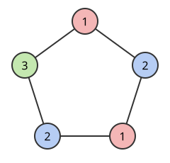

# 그래프 색칠

# 개요

**그래프 색칠(graph coloring)** 은 [그래프](graphs.md)의 정점마다 색을 하나씩 주되, 선으로 이어진 두 정점에는 다른 색을 주는 것이다. 시험 시간표를 짤 때 같은 학생이 듣는 두 과목은 같은 시간에 놓을 수 없다. 과목을 정점으로 놓고 함께 듣는 학생이 있는 두 과목을 선으로 이으면 시간대가 색이 되고, 필요한 시간대의 가장 적은 수는 필요한 색의 가장 적은 개수인 채색수(chromatic number)다.

# 직관

정점 다섯 개가 고리 모양으로 이어진 그래프의 정점에 색을 칠하되, 간선으로 이어진 두 정점은 다른 색을 받게 한다. 두 색을 번갈아 $1,2,1,2$ 로 칠하면 다섯째 정점이 색 $1$ 인 첫째 정점과 색 $2$ 인 넷째 정점에 모두 이웃하므로 셋째 색이 필요하다. 세 색이면 $1,2,1,2,3$ 으로 칠해진다.

같은 색을 받은 정점끼리는 서로 이어져 있지 않다. 그래서 색칠은 정점을 서로 인접하지 않은 정점들의 모임, 곧 [독립집합](independent-set.md)으로 나누는 일이다. 위 고리의 칠하기는 정점을 첫째와 셋째, 둘째와 넷째, 다섯째의 세 모임으로 나눈다.

# 정의

## 정점 색칠

그래프 $G=(V,E)$ 와 자연수 $k$ 에 대해, 사상

$$
c : V \to \lbrace 1, 2, \dots, k\rbrace
$$

가 모든 간선 $uv \in E$ 에 대해 $c(u) \neq c(v)$ 를 만족하면 $c$ 를 $G$ 의 **적절한 $k$ 색칠(proper k-coloring)** 이라 한다. 이런 $c$ 가 존재하면 $G$ 는 $k$ 색칠 가능하다고 한다.

**채색수(chromatic number)** 는

$$
\chi(G) = \min \lbrace\thinspace k \in \mathbb{N} : G \text{ 는 } k\text{-색칠 가능} \thinspace\rbrace
$$

이다. 색 클래스 $c^{-1}(i)$ 는 각각 독립집합이므로, 동치로

$$
\chi(G) = \min\lbrace\thinspace k : V \text{ 를 } k \text{ 개의 독립집합으로 분할할 수 있다} \thinspace\rbrace
$$

이다. 직관 절의 고리 $C\_5$ 에서 정점에 차례로 $1,2,1,2,3$ 을 주는 사상은 적절한 $3$ 색칠이고, 적절한 $2$ 색칠은 없으므로 $\chi(C\_5)=3$ 이다.

## 관련 불변량

- **클리크 수(clique number)** $\omega(G)$ 는 $G$ 가 포함하는 최대 완전부분그래프의 크기다.
- **독립수(independence number)** $\alpha(G)$ 는 최대 독립집합의 크기다.
- **최대차수(maximum degree)** $\Delta(G)$ 는 정점 차수의 최댓값이다.
- [퇴화도](graph-degeneracy.md)(degeneracy) $d(G)$ 는 모든 부분그래프가 차수 $d$ 이하인 정점을 하나 이상 가지게 되는 최소의 $d$ 다.

$C\_5$ 에서는 $\omega=2$, $\alpha=2$, $\Delta=2$, $d=2$ 다.

## 간선 색칠

간선 집합 위의 사상 $c : E \to \lbrace 1, \dots, k\rbrace$ 가 같은 정점을 공유하는 두 간선에 다른 색을 주면 적절한 간선 색칠이며, 최소 $k$ 를 **간선 채색수(chromatic index)** $\chi'(G)$ 라 한다. $C\_5$ 의 간선 다섯 개는 이웃한 간선끼리 다른 색이어야 하므로 정점의 경우와 같은 이유로 $\chi'(C\_5)=3$ 이다.

## 채색 다항식

$G$ 의 적절한 $k$ 색칠의 개수 $P(G, k)$ 를 **채색 다항식(chromatic polynomial)** 이라 한다. $C\_5$ 에서는 $P(C\_5,2)=0$ 이고 $P(C\_5,3)=30$ 이다.

# 성질

## 선 그래프와 채색 다항식

간선 색칠은 선 그래프(line graph) $L(G)$ 의 정점 색칠과 같다. $P(G,k)$ 는 아래 삭제-축약 점화식에서 보듯 $k$ 에 대한 다항식이고, $\chi(G)$ 는 $P(G, k) \gt 0$ 인 가장 작은 양의 정수다.

## 기본 경계

모든 그래프에 대해

$$
\omega(G) \le \chi(G) \le \Delta(G) + 1
$$

가 성립한다. 클리크의 정점은 서로 다른 색을 받으므로 왼쪽 부등식이 성립하고, 오른쪽은 아래 탐욕 색칠로 증명된다.

각 색 클래스는 독립집합이므로 크기가 $\alpha(G)$ 이하다. 따라서

$$
\chi(G) \ge \frac{|V|}{\alpha(G)}
$$

이다. [Ramsey 이론](ramsey-theory.md)과 [확률적 방법](probabilistic-method.md)에서 독립수의 상한을 채색수의 하한으로 바꿀 때 이 부등식을 쓴다.

## 탐욕 색칠과 퇴화도

정점을 임의의 순서 $v_1, \dots, v_n$ 으로 늘어놓고, 각 $v_i$ 에 이미 칠해진 이웃들이 쓰지 않은 가장 작은 색을 준다. $v_i$ 의 이웃은 많아야 $\Delta(G)$ 개이므로 $\Delta(G) + 1$ 개의 색이면 충분하다.

매번 남은 그래프에서 최소차수 정점을 떼어 내고, 뗀 순서의 역순으로 칠하면(smallest-last ordering)

$$
\chi(G) \le d(G) + 1
$$

이다. 여기서 $d(G)$ 는 퇴화도다. [평면 그래프](planar-graphs.md)는 항상 차수 5 이하인 정점을 가지므로 $d \le 5$ 이고, 6색으로 칠해진다.

탐욕 색칠이 쓰는 색의 수는 순서에 따라 달라진다. 완전 이분 그래프 $K_{n,n}$ 에서 완전 매칭을 뺀 그래프는 2색으로 칠해지지만, 순서 $a_1,b_1,a_2,b_2,\dots$ 로 탐욕 색칠하면 $a_i$ 와 $b_i$ 가 색 $i$ 를 받아 $n$ 색을 쓴다. 그래서 탐욕 색칠은 상한을 증명하는 데 쓰이고, [근사 알고리즘](approximation-algorithms.md)으로서의 근사 비율은 보장되지 않는다.

## Brooks 정리

Brooks 정리(Brooks' theorem, 1941)에 따르면 연결 그래프 $G$ 가 완전 그래프도 아니고 홀수 길이의 사이클도 아니면

$$
\chi(G) \le \Delta(G)
$$

이다. 연결 그래프에서 $\chi(G) = \Delta(G) + 1$ 인 것은 완전 그래프 $K_{\Delta+1}$ 과 홀수 사이클뿐이다.

증명의 요지. $\Delta \le 2$ 인 경우는 따로 확인한다. $\Delta \ge 3$ 이고 $G$ 가 2-연결이 아니면 절단점에서 쪼개어 귀납한다. 2-연결이면 어떤 정점 $v$ 와 그 이웃 $u, w$ 를 $u$ 와 $w$ 가 인접하지 않고 $G - u - w$ 가 연결되도록 고를 수 있다. $u, w$ 를 먼저 같은 색으로 칠하고 나머지를 $v$ 로부터 먼 순서대로 탐욕 색칠하면, 마지막의 $v$ 는 이웃 중 두 개가 색을 공유하므로 쓸 색이 남는다.

## 이분 그래프와 2-색칠

$\chi(G) \le 2$ 인 것, $G$ 가 이분 그래프인 것, $G$ 가 홀수 길이 사이클을 갖지 않는 것은 동치다.

증명의 요지. 2-색칠이 주어지면 두 색 클래스가 이분 분할이다. 이분 그래프의 사이클은 두 클래스를 번갈아 지나므로 길이가 짝수다. 역으로 홀수 사이클이 없으면, 각 연결 성분에서 정점 $r$ 을 하나 잡고 $r$ 로부터의 거리의 홀짝으로 색을 준다. 같은 색인 두 정점이 인접하면 홀수 사이클이 생기므로 모순이다.

이 판정은 너비 우선 탐색으로 선형 시간에 끝나고, [매칭](matchings.md)에서 이분 구조를 다시 쓴다. 3-색칠 가능성 판정은 [NP-완전](np-completeness.md)(NP: nondeterministic polynomial time)이다.

## 간선 색칠과 Vizing 정리

최대차수 정점에 붙은 $\Delta(G)$ 개의 간선은 서로 다른 색을 받으므로 $\chi'(G) \ge \Delta(G)$ 다. Vizing 정리(Vizing's theorem, 1964; Gupta, 1966)에 따르면 단순 그래프 $G$ 에 대해

$$
\Delta(G) \le \chi'(G) \le \Delta(G) + 1
$$

이다.

따라서 단순 그래프는 $\chi' = \Delta$ 인 class 1 과 $\chi' = \Delta + 1$ 인 class 2 로 나뉜다. 홀수 사이클과 Petersen 그래프는 class 2 이고, 이분 그래프는 König 의 간선 색칠 정리(König's line coloring theorem)에 따라 class 1 이다. 어느 class 인지 판정하는 문제는 $\Delta = 3$ 일 때도 NP-완전이다[^5].

## 4색 정리와 5색 정리

4색 정리(four color theorem)에 따르면 평면 그래프는 $\chi \le 4$ 다(Appel–Haken, 1976[^1]; Robertson–Sanders–Seymour–Thomas 의 재증명, 1997[^2]). 두 증명은 불가피 집합(unavoidable set)과 축약 가능 배치(reducible configuration)를 쓰고, 배치의 검사를 컴퓨터로 한다. Gonthier 는 이 증명을 Coq 로 형식 검증했다[^6].

5색 정리(five color theorem)는 차수 5 이하인 정점을 지우고 귀납하는 Heawood(1890)의 증명이 있고, 컴퓨터 검사를 쓰지 않는다. $K_4$ 는 평면 그래프이고 $\chi(K_4)=4$ 이므로 4 는 더 줄어들지 않는다.

## 삭제-축약 점화식

$P(G,k)$ 는 삭제-축약(deletion–contraction) 점화식

$$
P(G, k) = P(G - e, k) - P(G / e, k)
$$

를 만족한다. 우변 첫 항은 $e$ 의 양 끝 색이 같아도 되는 색칠 수, 둘째 항은 양 끝이 같은 색인 색칠 수이므로 차이가 $e$ 의 양 끝에 다른 색을 주는 색칠 수다. 간선 수에 대한 귀납으로 $P(G,k)$ 가 $k$ 에 대한 차수 $|V|$ 의 정수 계수 다항식이고, 최고차항 계수가 1, 그다음 계수가 $-|E|$ 임이 증명된다.

[포함배제 원리](inclusion-exclusion.md)를 간선 부분집합에 적용하면

$$
P(G, k) = \sum_{S \subseteq E} (-1)^{|S|} k^{\thinspace c(S)}
$$

를 얻는다. 여기서 $c(S)$ 는 간선 집합 $S$ 만 남긴 그래프의 연결 성분 수다. 이 식을 Whitney 정리(Whitney's theorem)라 한다. $|V| - c(S)$ 는 그래프의 [matroid](matroids.md)에서 $S$ 의 계수(rank)이므로, 이 식에서 채색 다항식은 [Tutte 다항식](tutte-polynomial.md)의 특수화로 나타난다.

완전 그래프는 $P(K_n,k)=k(k-1)\cdots(k-n+1)$ , 정점 $n$ 개의 트리는 $P(T,k)=k(k-1)^{n-1}$ , 길이 $n$ 의 사이클은

$$
P(C_n, k) = (k-1)^n + (-1)^n (k-1)
$$

이다. $n=5$, $k=3$ 이면 $2^5-2=30$ 으로 정의 절의 $P(C\_5,3)$ 과 같다.

## 계산 복잡도

$k \ge 3$ 을 고정하면 $k$ 색칠 가능성 판정은 NP-완전이다(Karp 의 21 개 문제 목록에 포함[^3]). 따라서 $\chi(G)$ 를 다항 시간에 계산하는 알고리즘이 있으면 [P 대 NP 문제](p-np.md)의 답은 P = NP 다. 임의의 $\varepsilon \gt 0$ 에 대해 $\chi(G)$ 를 $\lvert V \rvert^{1-\varepsilon}$ 배 이내로 근사하는 것도 NP-난해다.

3-색칠 가능한 그래프를 다항 시간에 칠하는 알고리즘이 쓰는 색 수는 $\lvert V \rvert$ 의 작은 거듭제곱 꼴이다. Kawarabayashi–Thorup(2017)의 $\tilde O(\lvert V\rvert^{0.19996})$ 색[^4]이 Kawarabayashi–Thorup–Yoneda(2024)에서 $\tilde O(\lvert V\rvert^{0.19747})$ 색으로 줄었다[^7].

실무에서는 DSATUR(degree of saturation) 같은 휴리스틱, [정수계획법](integer-programming.md), SAT(Boolean satisfiability) 솔버를 쓴다.

# 활용

## 자원 배정

충돌하는 두 대상을 간선으로 이은 충돌 그래프(conflict graph)를 칠하면 자원 배정이 된다. 시험 시간표에서 정점은 과목, 간선은 같이 수강하는 학생이 있는 두 과목이고, 색은 시험 시간대다. 컴파일러의 레지스터 할당에서 정점은 변수의 생존 구간, 간선은 생존 구간의 겹침, 색은 물리 레지스터다. 무선 주파수 배정에서 정점은 기지국, 간선은 간섭 가능성이다.

탐욕 색칠은 항상 $\Delta + 1$ 색 이하를 쓰므로 필요한 자원 수의 상한을 준다. 크기 $q$ 인 클리크가 있으면 자원이 $q$ 개 이상 필요하다는 하한이 나온다.

## 다른 조합론 문제

- 이분 그래프의 간선 색칠은 작업과 기계의 배정을 시간 단위로 나누는 스케줄링이다. König 의 간선 색칠 정리에 따라 $\Delta$ 개의 시간대로 충분하고, 이 정리는 완전 매칭을 하나씩 떼어 내는 매칭 분해로 증명된다.
- 위 Whitney 식에서 채색 다항식은 간선 부분집합을 연결 성분 수로 센 [생성함수](generating-functions.md)다.
- 클리크와 독립집합이 모두 작은 그래프는 확률적 방법으로 존재가 증명된다. 그런 그래프는 $\chi \ge |V|/\alpha$ 에 따라 채색수가 크고 클리크 수는 작다.

## 분수 채색수와 완벽 그래프

독립집합마다 0 이상의 가중치를 주어 각 정점을 덮는 가중치 합이 1 이상이 되게 할 때 가중치 합의 최솟값이 분수 채색수(fractional chromatic number) $\chi_f(G)$ 다. 이것은 채색수의 [선형계획법](linear-programming.md) 완화이고 $\omega(G) \le \chi_f(G) \le \chi(G)$ 를 만족한다. [반정부호 계획법](semidefinite-programming.md)으로 계산되는 [Lovász 세타 함수](lovasz-theta.md) $\vartheta(\bar G)$ 도 $\omega(G) \le \vartheta(\bar G) \le \chi(G)$ 를 만족한다.

[완벽 그래프](perfect-graphs.md)(perfect graph)는 모든 유도 부분그래프에서 $\omega = \chi$ 인 그래프다. 강한 완벽 그래프 정리(strong perfect graph theorem, Chudnovsky–Robertson–Seymour–Thomas, 2006)에 따르면 그래프가 완벽인 것은 길이 5 이상의 홀수 사이클과 그 여그래프를 유도 부분그래프로 갖지 않는 것과 동치다. 완벽 그래프에서는 $\chi = \vartheta(\bar G)$ 이므로 채색수가 다항 시간에 계산된다.

[^1]: K. Appel, W. Haken, "Every planar map is four colorable", Bulletin of the American Mathematical Society 82 (1976), https://www.ams.org/journals/bull/1976-82-05/S0002-9904-1976-14122-5/
[^2]: N. Robertson, D. Sanders, P. Seymour, R. Thomas, "The Four-Colour Theorem", Journal of Combinatorial Theory Series B 70 (1997), https://doi.org/10.1006/jctb.1997.1750
[^3]: R. M. Karp, "Reducibility Among Combinatorial Problems", Complexity of Computer Computations (1972), https://doi.org/10.1007/978-1-4684-2001-2_9
[^4]: K. Kawarabayashi, M. Thorup, "Coloring 3-colorable graphs with less than $n^{1/5}$ colors", Journal of the ACM 64 (2017), article 4.
[^5]: I. Holyer, "The NP-completeness of edge-coloring", SIAM Journal on Computing 10 (1981), 718–720.
[^6]: G. Gonthier, "Formal proof — the four-color theorem", Notices of the American Mathematical Society 55 (2008), 1382–1393.
[^7]: K. Kawarabayashi, M. Thorup, H. Yoneda, "Better coloring of 3-colorable graphs", STOC 2024, https://arxiv.org/abs/2406.00357

# 연관 문서

## 선수지식

- [그래프](graphs.md)
- [비둘기집 원리](pigeonhole-principle.md)

## 더 알아보기

### 상한과 불변량

- [그래프 퇴화도](graph-degeneracy.md)
- [Tutte 다항식](tutte-polynomial.md)
- [Lovász 세타 함수](lovasz-theta.md)

### 색칠의 변형

- [목록 색칠](list-coloring.md)
- [de Bruijn–Erdős 정리](de-bruijn-erdos-theorem.md)
- [평면의 채색수](chromatic-number-of-the-plane.md)

#graph_theory #combinatorics #algorithms
