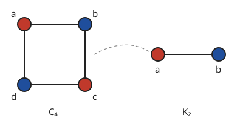

# 그래프의 핵

# 개요

**그래프의 핵(core of a graph)** 은 준동형으로 서로 오갈 수 있는 그래프들 가운데 가장 작은 것이다. 네 칸 고리 $C\_4$ 를 색칠하거나 다른 그래프로 보내는 문제를 풀 때, $C\_4$ 는 간선 하나 $K\_2$ 로 접히고 $K\_2$ 는 $C\_4$ 안에 들어가므로 두 그래프는 어느 목표 그래프로든 준동형이 있는지가 같다.

그러므로 준동형 문제에서는 그래프를 핵으로 줄여도 답이 바뀌지 않는다. 핵은 그래프마다 하나로 정해지고, 핵들 사이에 "준동형이 있다" 는 관계를 주면 그래프 전체가 하나의 순서로 늘어선다.

# 직관

$C\_4$ 의 정점을 차례로 $a,b,c,d$ 라 하고, $a$ 와 $c$ 를 한 정점으로, $b$ 와 $d$ 를 다른 정점으로 보낸다. 이웃한 두 정점은 언제나 서로 다른 쪽으로 가므로 이것은 $C\_4$ 에서 간선 $ab$ 로 가는 [그래프 준동형](graph-homomorphisms.md)이다.

그림에서 같은 색의 정점이 $K\_2$ 의 같은 정점으로 간다. 거꾸로 $K\_2$ 는 $C\_4$ 의 간선 $ab$ 로 그대로 들어간다. 어떤 그래프 $H$ 로 $C\_4\to H$ 가 있으면 $K\_2\to C\_4\to H$ 이고, $K\_2\to H$ 가 있으면 $C\_4\to K\_2\to H$ 다. 그래서 $C\_4$ 를 $K\_2$ 로 바꾸어도 어느 $H$ 에 대해서든 준동형의 존재가 같다.

$K\_2$ 는 더 줄일 수 없다. 정점 하나짜리 그래프로 보내면 간선의 두 끝이 같은 정점으로 가야 하고, 그 정점에는 고리가 없다.

# 정의

## 핵

그래프 $H$ 에서 자기 자신으로 가는 준동형이 모두 전단사이면 $H$ 를 **핵(core)** 이라 한다. $G$ 의 부분그래프 $K$ 가 핵이고 준동형 $G\to K$ 가 있으면 $K$ 를 $G$ 의 **핵(core of G)** 이라 한다.

직관 절에서 $K\_2$ 는 $C\_4$ 의 핵이다. 완전그래프 $K\_n$ 과 홀수 고리 $C\_{2k+1}$ 은 자기 자신이 핵이다.

## 준동형 동치와 준동형 순서

$G\to H$ 와 $H\to G$ 가 모두 있으면 $G$ 와 $H$ 가 **준동형 동치(homomorphically equivalent)** 라 한다. $G\to H$ 가 있으면 $G\le H$ 로 쓴다. 이 관계는 반사적이고 추이적이며, 준동형 동치인 것끼리 묶으면 [부분순서](partial-orders.md)가 된다. 이 부분순서를 **준동형 순서(homomorphism order)** 라 한다.

$C\_4$ 와 $K\_2$ 는 준동형 동치다. $K\_2\le C\_5\le K\_3$ 이고 거꾸로는 성립하지 않는다.

# 성질

## 핵의 존재와 유일성

모든 유한 그래프 $G$ 에는 핵이 있고, 동형을 빼고 하나뿐이다[^1]. 증명의 요지. $G$ 에서 자기 자신의 부분그래프로 가는 준동형 가운데 상의 정점 수가 가장 작은 것 $f$ 를 잡고 $K=f(G)$ 로 둔다. $K$ 에서 $K$ 의 진부분그래프로 가는 준동형이 있으면 $f$ 와 합성해 더 작은 상을 얻으므로 $K$ 는 핵이다. 두 핵 $K,K'$ 이 있으면 $K\to G\to K'$ 과 $K'\to G\to K$ 를 합성한 $K\to K$ 가 전단사이므로 두 사상이 단사이고, 정점 수와 간선 수를 견주면 $K\cong K'$ 이다.

두 그래프가 준동형 동치인 것과 두 핵이 동형인 것은 동치다. 그러므로 준동형 순서는 핵들 위의 부분순서로 볼 수 있다.

## 이분그래프와 홀수 고리

간선이 하나 이상인 이분그래프의 핵은 $K\_2$ 다. 두 쪽을 $K\_2$ 의 두 끝으로 보내면 된다. 홀수 고리는 짧은 홀수 고리로 접혀서

$$
K_2\lt\cdots\lt C_7\lt C_5\lt C_3=K_3
$$

이다. $C\_{2k+3}$ 의 정점 $0,\dots,2k$ 를 $C\_{2k+1}$ 의 같은 번호로, 남은 두 정점 $2k+1$, $2k+2$ 를 $2k-1$, $2k$ 로 보내면 준동형이다. 거꾸로 $C\_{2k+1}$ 을 한 바퀴 도는 길이 $2k+1$ 의 홀수 닫힌 걸음은 상에서도 홀수 닫힌 걸음이 되고, $C\_{2k+3}$ 의 홀수 닫힌 걸음은 길이가 $2k+3$ 이상이므로 $C\_{2k+1}\to C\_{2k+3}$ 은 없다.

## 순서의 구조

- 두 그래프의 서로소 합 $G+H$ 는 $G$ 와 $H$ 의 최소 상계다. $G\to K$ 와 $H\to K$ 를 합치면 $G+H\to K$ 다.
- 범주론적 곱 $G\times H$ 는 최대 하계다. 정점이 $V(G)\times V(H)$ 이고, 두 성분이 모두 이웃한 쌍끼리 잇는다. 두 사영이 준동형이다.
- Welzl 은 $G\lt H$ 이고 $G$ 가 간선을 가지면 $G\lt K\lt H$ 인 $K$ 가 있음을 증명했다[^2]. 정점 하나짜리 그래프와 $K\_2$ 사이에만 빈틈이 있다.

## 계산 복잡도

주어진 그래프가 핵인지 판정하는 문제는 coNP-완전이다[^3]. coNP 는 아니라는 답에 다항 길이의 증거가 있는 판정 문제의 부류(complement of NP, NP 는 nondeterministic polynomial time)다. $H$ 가 핵이 아니라는 증거는 진부분그래프로 가는 준동형 하나다.

# 활용

- 준동형 판정의 축소. $G\to H$ 의 존재는 두 그래프를 핵으로 바꾸어도 같으므로, [제약 만족 문제](constraint-satisfaction-problems.md)의 복잡도 분류는 목표를 핵으로 놓고 진행한다. Hell–Nešetřil 정리의 "이분그래프이면 다항시간" 은 이분그래프의 핵이 $K\_2$ 라는 데서 나온다.
- 곱의 채색수. 최대 하계 $G\times H$ 에 대해 $\chi(G\times H)\le\min(\chi(G),\chi(H))$ 이고, 등호가 늘 성립한다는 Hedetniemi 추측(Hedetniemi's conjecture)은 Shitov 의 반례로 부정되었다[^4].
- [그래프 색칠](graph-coloring.md)의 순서 해석. $\chi(G)\le n$ 은 준동형 순서에서 $G\le K\_n$ 이다.

[^1]: P. Hell, J. Nešetřil, *Graphs and Homomorphisms*, Oxford University Press (2004), 2 장.
[^2]: E. Welzl, "Color-families are dense", *Theoretical Computer Science* 17 (1982), 29–41.
[^3]: P. Hell, J. Nešetřil, "The core of a graph", *Discrete Mathematics* 109 (1992), 117–126.
[^4]: Y. Shitov, "Counterexamples to Hedetniemi's conjecture", *Annals of Mathematics* 190 (2019), 663–667.

# 연관 문서

## 선수지식

- [그래프 준동형](graph-homomorphisms.md)

## 더 알아보기

아직 연결한 문서가 없다.

#graph_theory #combinatorics #order_theory #complexity
