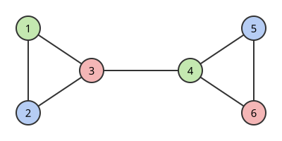

# 그래프 퇴화도

# 개요

그래프의 **퇴화도(degeneracy)** 는 모든 부분그래프가 차수 $d$ 이하의 정점을 하나 이상 갖게 하는 가장 작은 정수 $d$ 다. 이어진 정점끼리 색이 달라야 하는 [그래프 색칠](graph-coloring.md)에서 색을 몇 개 준비할지 정할 때, 가장 큰 차수보다 하나 많은 색이면 되지만 이 수는 대개 너무 크다. 차수가 가장 작은 정점부터 하나씩 지운 순서를 거꾸로 칠하면 퇴화도보다 하나 많은 색으로 충분하고, 이 순서는 간선 수에 비례하는 시간에 구한다.

# 직관

정점 $1,\dots,6$ 과 간선 $12,23,31,34,45,56,64$ 로 된 그래프를 적은 색으로 칠한다. 이 그래프는 삼각형 $123$ 과 삼각형 $456$ 을 간선 $34$ 로 이은 것이다. 정점 $3$ 과 $4$ 의 차수가 $3$ 이므로, 아무 순서로 칠해도 이미 칠한 이웃이 셋 이하여서 $4$ 색이면 충분하다.

순서를 고르면 색이 줄어든다. 차수가 가장 작은 정점을 하나 지우고, 남은 그래프에서 다시 차수가 가장 작은 정점을 지운다. 차수 $2$ 인 $1$ 을 지우면 $2$ 의 차수가 $1$ 이 되고, $2$, $3$, $4$, $5$, $6$ 을 차례로 지울 때 지우는 순간의 차수는 $1,1,2,1,0$ 이다. 지운 순서의 거꾸로 $6,5,4,3,2,1$ 로 칠하면 각 정점을 칠할 때 이미 칠한 이웃은 그 정점을 지울 때 남아 있던 이웃이므로 둘 이하다. 따라서 $3$ 색이면 충분하다.



그림의 색은 $6,5,4,3,2,1$ 순서로 이미 칠한 이웃과 다른 색 가운데 첫 색을 고른 결과다.

지우는 순간의 차수의 최댓값이 $2$ 였다. 삼각형 $123$ 만 남긴 부분그래프는 모든 정점의 차수가 $2$ 이므로 어떤 순서로 지워도 이 값은 $2$ 보다 작아지지 않는다. 이 값 $2$ 가 이 그래프의 퇴화도다.

# 정의

## 퇴화도

그래프 $G$ 의 정점 $v$ 의 차수를 $\deg_G(v)$, 최소 차수를 $\delta(G)$ 라 한다. $G$ 의 퇴화도는 다음 값이다.

$$
d(G)=\max_{H\subseteq G}\delta(H)
$$

$H$ 는 $G$ 의 공집합이 아닌 부분그래프 전체를 돈다. 모든 $H$ 가 $\delta(H)\le d$ 를 만족하는 가장 작은 $d$ 가 $d(G)$ 다. $d(G)\le k$ 인 그래프를 **$k$-퇴화(k-degenerate)** 라 한다.

## 최소 차수 제거 순서

**최소 차수 제거 순서(smallest-last ordering)** 는 남은 그래프에서 차수가 가장 작은 정점을 차례로 지운 순서 $v_1,\dots,v_n$ 이다. $v_i$ 의 뒤 이웃은 $v_{i+1},\dots,v_n$ 가운데 $v_i$ 의 이웃이다.

## 핵

**$k$-핵(k-core)** 은 최소 차수가 $k$ 이상인 부분그래프 가운데 가장 큰 것이다[^1]. 차수가 $k$ 보다 작은 정점을 지우는 일을 더 지울 정점이 없을 때까지 되풀이하면 남는 그래프이고, 지우는 순서와 관계없이 하나로 정해진다. 정점 $v$ 의 **핵수(core number)** 는 $v$ 를 포함하는 $k$-핵이 있는 가장 큰 $k$ 다.

# 성질

## 순서와 퇴화도

정리. 최소 차수 제거 순서에서 뒤 이웃 수의 최댓값은 $d(G)$ 와 같다. 정점의 어떤 순서에서도 뒤 이웃 수의 최댓값은 $d(G)$ 이상이다[^2].

증명의 요지. $v_i$ 를 지울 때 남은 그래프 $H_i$ 에서 $v_i$ 의 차수가 뒤 이웃 수이고, 이것은 $\delta(H_i)\le d(G)$ 다. 거꾸로 $\delta(H)=d(G)$ 인 부분그래프 $H$ 를 잡으면, 어떤 순서에서든 $H$ 의 정점 가운데 가장 앞에 오는 것은 $H$ 안의 이웃 $d(G)$ 개 이상을 모두 뒤 이웃으로 갖는다.

같은 논법으로 $d(G)$ 는 가장 큰 공집합이 아닌 핵의 $k$, 곧 핵수의 최댓값과 같다.

## 선형 시간 알고리즘

정리(Matula–Beck). 정점 $n$ 개, 간선 $m$ 개 그래프의 최소 차수 제거 순서와 퇴화도, 모든 정점의 핵수를 $O(n+m)$ 시간에 구한다[^2].

남은 정점을 현재 차수별 묶음에 넣어 두고, 비어 있지 않은 가장 낮은 묶음에서 정점을 꺼낸다. 정점 하나를 지우면 이웃의 차수가 $1$ 씩 줄어 바로 아래 묶음으로 옮겨지므로, 가장 낮은 묶음의 번호는 한 번에 $1$ 씩만 내려간다. 그 번호가 오르내린 횟수의 합이 $O(n+m)$ 이다.

```typescript
// adj[v] 는 v 의 이웃 목록이다. 지운 순서와 각 정점의 핵수를 돌려준다.
function smallestLast(adj: number[][]): { order: number[]; core: number[] } {
  const n = adj.length;
  const deg = adj.map((nb) => nb.length);
  const bucket = Array.from({ length: n }, () => new Set());
  deg.forEach((k, v) => bucket[k].add(v));
  const removed = new Array(n).fill(false);
  const core = new Array(n).fill(0);
  const order: number[] = [];
  let low = 0;
  let d = 0;
  for (let step = 0; step < n; step++) {
    while (bucket[low].size === 0) low++;
    const v = bucket[low].values().next().value as number;
    bucket[low].delete(v);
    removed[v] = true;
    d = Math.max(d, low);
    core[v] = d;
    order.push(v);
    for (const w of adj[v]) {
      if (removed[w]) continue;
      bucket[deg[w]].delete(w);
      deg[w]--;
      bucket[deg[w]].add(w);
    }
    low = Math.max(0, low - 1);
  }
  return { order, core };
}
```

## 채색수와 숲 분해

정리(Szekeres–Wilf). $\chi(G)\le d(G)+1$ 이다[^3].

최소 차수 제거 순서의 거꾸로 탐욕 색칠을 하면, 각 정점을 칠할 때 이미 칠한 이웃이 뒤 이웃이므로 $d(G)$ 개 이하다.

**수목도(arboricity)** $a(G)$ 는 $G$ 의 간선을 숲으로 나눌 때 필요한 숲의 최소 개수다. Nash-Williams 는 다음을 증명했다[^4].

$$
a(G)=\max_{H\subseteq G,\thinspace \lvert V(H)\rvert\ge 2}\left\lceil\frac{\lvert E(H)\rvert}{\lvert V(H)\rvert-1}\right\rceil
$$

정리. $a(G)\le d(G)\le 2a(G)-1$ 이다.

증명의 요지. 최소 차수 제거 순서에서 각 정점의 뒤 이웃으로 가는 간선에 $1,\dots,d$ 의 번호를 서로 다르게 붙이면, 같은 번호의 간선은 정점마다 뒤 이웃으로 하나 이하씩 나가므로 순환이 없어 숲이다. 따라서 $a(G)\le d(G)$ 다. 거꾸로 $\delta(H)=d(G)$ 인 $H$ 는 간선이 $d(G)\lvert V(H)\rvert/2$ 개 이상이고, 숲 $a(G)$ 개에 나뉘므로 $a(G)(\lvert V(H)\rvert-1)$ 개 이하다. 두 식에서 $d(G)\lt 2a(G)$ 가 나온다.

뒤 이웃이 정점마다 $d(G)$ 개 이하이므로 간선 수는 $d(G)\thinspace n$ 이하다.

## 평면 그래프

[평면 그래프](planar-graphs.md)는 차수 $5$ 이하의 정점을 갖고 그 부분그래프도 평면 그래프이므로 $5$-퇴화다. 정이십면체의 그래프는 모든 정점의 차수가 $5$ 이므로 이 값은 줄일 수 없다.

# 활용

- 색칠. 최소 차수 제거 순서의 탐욕 색칠은 평면 그래프를 $6$ 색으로 선형 시간에 칠한다. 그래프 색칠의 탐욕 상한이 이 순서를 쓴다.
- 극대 클릭 나열. [Bron–Kerbosch 알고리즘](bron-kerbosch-algorithm.md)의 바깥 고리를 최소 차수 제거 순서로 돌리면 시간이 $O(dn3^{d/3})$ 이다.
- 삼각형 나열. 각 간선을 순서의 뒤쪽으로 향하게 하면 정점마다 나가는 간선이 $d$ 개 이하이고, 간선 $u\to v$ 마다 $u$ 와 $v$ 의 나가는 이웃을 비교해 삼각형을 모두 $O(dm)$ 시간에 나열한다. Chiba 와 Nishizeki 는 같은 방식으로 $O(a(G)\thinspace m)$ 시간을 얻었다[^5].
- 망 분석. 사회망에서 핵수가 큰 정점들은 서로 촘촘히 연결된 중심부를 이룬다. 핵 분해는 Seidman 이 사회망의 응집도를 재는 데 처음 썼다[^1].

[^1]: S. B. Seidman, "Network structure and minimum degree", Social Networks 5 (1983), 269–287.
[^2]: D. W. Matula, L. L. Beck, "Smallest-last ordering and clustering and graph coloring algorithms", Journal of the ACM 30 (1983), 417–427.
[^3]: G. Szekeres, H. S. Wilf, "An inequality for the chromatic number of a graph", Journal of Combinatorial Theory 4 (1968), 1–3.
[^4]: C. St. J. A. Nash-Williams, "Decomposition of finite graphs into forests", Journal of the London Mathematical Society 39 (1964), 12.
[^5]: N. Chiba, T. Nishizeki, "Arboricity and subgraph listing algorithms", SIAM Journal on Computing 14 (1985), 210–223.

# 연관 문서

## 선수지식

- [그래프 색칠](graph-coloring.md)

## 더 알아보기

아직 연결한 문서가 없다.

#graph_theory #algorithms #combinatorics
