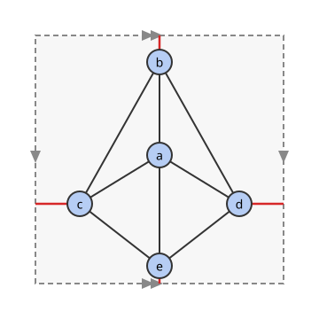

# 그래프의 종수

# 개요

**그래프의 종수(genus of a graph)** 는 그래프를 간선이 교차하지 않게 그릴 수 있는 곡면 가운데 손잡이가 가장 적은 것의 손잡이 수다. 정점 다섯 개를 모두 이은 그래프 $K_5$ 는 평면에 교차 없이 그릴 수 없지만, 도넛의 겉면에는 교차 없이 그릴 수 있다. 정점, 간선, 면의 수 사이의 식 하나로 손잡이가 몇 개 있어야 하는지의 하한을 세고, 그 하한에 맞는 그림을 찾아 종수를 정한다.

# 직관

[평면 그래프](planar-graphs.md)에서 $K_5$ 는 $V=5$, $E=10$ 이 $E\le 3V-6$ 을 어겨 평면에 교차 없이 그려지지 않았다. 도넛의 겉면은 정사각형의 마주 보는 두 변을 같은 방향으로 붙인 것이다([곡면의 분류](classification-of-surfaces.md)). 그러면 정사각형의 오른쪽 변으로 나간 곡선은 왼쪽 변의 같은 높이로 들어오고, 아래 변으로 나간 곡선은 위 변의 같은 자리로 들어온다.

아래 그림은 정사각형 안에 $K_5$ 를 그린 것이다. 화살표가 같은 변끼리 붙는다. 빨간 간선 $be$ 는 $e$ 에서 아래 변으로 나가 위 변으로 들어와 $b$ 에 닿고, 빨간 간선 $cd$ 는 $c$ 에서 왼쪽 변으로 나가 오른쪽 변으로 들어와 $d$ 에 닿는다. 나머지 여덟 간선은 정사각형 안에서 교차하지 않는다.



그림이 겉면을 나눈 조각을 세면 삼각형 $abc$, $abd$, $ace$, $ade$ 넷과, 간선 여덟 개로 둘러싸인 조각 하나로 모두 다섯이다. 평면에서는 $V-E+F=2$ 였는데 여기서는 $5-10+5=0$ 이다. 손잡이 하나가 이 값을 $2$ 만큼 줄인다.

정점 일곱 개를 모두 이은 $K_7$ 은 $V=7$, $E=21$ 이다. 조각마다 경계가 간선 셋 이상이고 간선 하나는 조각 두 개의 경계에 놓이므로 $3F\le 2E=42$, 곧 $F\le 14$ 다. 손잡이가 $g$ 개인 겉면에서 $7-21+F=2-2g$ 이면 $F=16-2g\le 14$ 이므로 $g\ge 1$ 이다.

정점 여덟 개의 $K_8$ 은 $E=28$ 이고 $F\le 18$, $F=22-2g$ 이므로 $g\ge 2$ 다. 손잡이 하나로는 $K_8$ 을 그릴 수 없다.

# 정의

## 곡면 위의 그리기

$S_g$ 는 구에 손잡이 $g$ 개를 단 가향(orientable) 닫힌 곡면이다. $S_0$ 은 구이고 $S_1$ 은 직관 절의 도넛 겉면인 [원환면](torus.md)이다. [그래프](graphs.md) $G$ 의 $S_g$ 위 **매장(embedding)** 은 각 정점을 $S_g$ 의 서로 다른 점에, 각 간선을 끝점을 잇는 단순 곡선에 대응시키되, 두 곡선이 공통 끝점 밖에서는 만나지 않게 하는 것이다. 직관 절의 그림은 $K_5$ 의 $S_1$ 위 매장이다.

매장이 주어지면 $S_g$ 에서 그림을 지우고 남은 연결 성분을 **면(face)** 이라 한다. 모든 면이 열린원판과 위상동형이면 그 매장을 **세포 매장(cellular embedding, 2-cell embedding)** 이라 한다. 직관 절의 다섯 조각은 모두 원판이므로 그 그림은 세포 매장이다. 원환면에 정점 하나와 고리(loop) 하나를 그리되 고리가 작은 원판을 둘러싸게 하면, 면 하나는 그 원판이고 다른 면은 구멍 뚫린 원환면이라 세포 매장이 아니다.

## 종수

그래프 $G$ 의 **종수** $\gamma(G)$ 는 $G$ 의 $S_g$ 위 매장이 존재하는 가장 작은 $g$ 다. $\gamma(G)=0$ 인 것은 $G$ 가 평면 그래프인 것과 같다. 직관 절에서 $K_5$ 는 평면 그래프가 아니고 $S_1$ 에 매장되므로 $\gamma(K_5)=1$ 이다.

## 회전 체계

정점마다 그 정점에 붙은 간선들의 순환 순서를 하나씩 정한 것을 **회전 체계(rotation system)** 라 한다. 가향 곡면의 세포 매장에서 각 정점 주위를 시계 반대 방향으로 돌며 만나는 간선의 순서를 읽으면 회전 체계가 나온다. 거꾸로 회전 체계가 주어지면 면을 다음 절차로 따라가 매장을 복원한다.

```javascript
// rot[v] 는 v 에 붙은 이웃의 순환 순서. 반쪽 간선 (u,v) 마다 한 번씩 지난다.
function traceFaces(rot) {
  const used = new Set();
  const faces = [];
  for (const u of Object.keys(rot)) {
    for (const v of rot[u]) {
      if (used.has(`${u},${v}`)) continue;
      const face = [];
      let [x, y] = [u, v];
      while (!used.has(`${x},${y}`)) {
        used.add(`${x},${y}`);
        face.push([x, y]);
        const r = rot[y];
        const next = r[(r.indexOf(x) + 1) % r.length]; // y 에서 x 다음 이웃
        [x, y] = [y, next];
      }
      faces.push(face);
    }
  }
  return faces;
}
```

연결 그래프의 회전 체계와 가향 곡면 위 세포 매장은 일대일로 대응한다(Heffter–Edmonds 원리, Heffter–Edmonds principle). 면의 수 $F$ 를 위 절차로 세면 곡면의 종수는 $V-E+F=2-2g$ 에서 정해진다.

# 성질

## Euler 공식

연결 그래프 $G$ 의 $S_g$ 위 세포 매장에서 다음이 성립한다.

$$
V-E+F=2-2g
$$

세포 매장은 $S_g$ 의 세포 분할이므로 좌변은 $S_g$ 의 [Euler 지표](euler-characteristic.md) $\chi(S_g)=2-2g$ 다. 연결 그래프의 최소 종수 매장은 세포 매장이다(Youngs, 1963)[^1]. 증명의 요지는 면이 원판이 아니면 그 면 안에서 원판을 둘러싸지 않는 고리를 따라 곡면을 자르고 구멍을 원판으로 메워 종수를 줄이는 것이다.

## Euler 하한

정점이 셋 이상인 연결 그래프 $G$ 에 대해 다음이 성립한다.

$$
\gamma(G)\ge\left\lceil\frac{E-3V+6}{6}\right\rceil
$$

증명의 요지. 최소 종수 매장은 세포 매장이고, 단순 그래프에서 면의 차수는 $3$ 이상이므로 $3F\le 2E$ 다. $F=2-2g-V+E$ 를 넣으면 $6-6g-3V+3E\le 2E$ 이고, 정리하면 $g\ge (E-3V+6)/6$ 이다. 삼각형이 없는 그래프에서는 $4F\le 2E$ 로 같은 계산을 하여 $\gamma(G)\ge\lceil (E-2V+4)/4\rceil$ 을 얻는다.

$K_n$ 에 넣으면 $E-3V+6=(n-3)(n-4)/2$ 이므로 $\gamma(K_n)\ge\lceil (n-3)(n-4)/12\rceil$ 이다. $K_{m,n}$ 은 삼각형이 없으므로 $\gamma(K_{m,n})\ge\lceil (m-2)(n-2)/4\rceil$ 이다.

## Ringel–Youngs 정리

**Ringel–Youngs 정리(Ringel–Youngs theorem)** 는 $n\ge 3$ 에 대해 다음이 성립한다는 정리다[^2].

$$
\gamma(K_n)=\left\lceil\frac{(n-3)(n-4)}{12}\right\rceil
$$

Euler 하한이 정확하다는 진술이다. 증명은 $n$ 을 $12$ 로 나눈 나머지 열두 경우로 나누어, 경우마다 면이 거의 모두 삼각형인 회전 체계를 전류 그래프(current graph)로 구성한다. $\gamma(K_5)=\gamma(K_6)=\gamma(K_7)=1$ 이고 $\gamma(K_8)=2$ 이므로 직관 절의 계산과 맞는다. 완전 이분 그래프에 대해서도 Euler 하한이 정확하다. $\gamma(K_{m,n})=\lceil (m-2)(n-2)/4\rceil$ 이다(Ringel, 1965)[^3].

## 종수의 덧셈성

그래프 $G$ 의 블록(block), 곧 극대 2-연결 부분그래프와 다리를 $B_1,\dots,B_k$ 라 하면 $\gamma(G)=\gamma(B_1)+\dots+\gamma(B_k)$ 다(Battle–Harary–Kodama–Youngs, 1962)[^4]. 정점 하나를 공유하는 $K_5$ 두 개의 종수는 $2$ 다.

## Heawood 공식

$g\ge 1$ 이면 $S_g$ 에 매장되는 모든 그래프의 채색수는 다음 값 이하다[^5].

$$
H(g)=\left\lfloor\frac{7+\sqrt{1+48g}}{2}\right\rfloor
$$

$H(1)=7$, $H(2)=8$, $H(3)=9$ 다.

증명의 요지. $S_g$ 에 매장된 단순 그래프는 Euler 하한의 계산에서 $E\le 3V-6+6g$ 를 만족한다. $c=H(g)$ 색으로 칠할 수 없는 그래프가 있으면 그 가운데 정점이 가장 적은 것은 최소차수가 $c$ 이상이고 정점이 $c+1$ 개 이상이다. 차수를 더하면 $cV\le 2E\le 6V-12+12g$ 이고 $V\ge c+1$ 이므로 $c\le 6+(12g-12)/(c+1)$ 이다. 이 부등식은 $c\le (5+\sqrt{1+48g})/2$ 를 함의하는데, $H(g)$ 는 이 값보다 크므로 모순이다.

[그래프 색칠](graph-coloring.md)의 탐욕 색칠로 마지막 단계를 채운다. 최소 반례에서 차수가 $c-1$ 이하인 정점을 지우고 나머지를 $c$ 색으로 칠하면 지운 정점에 쓸 색이 남는다.

## 지도 채색 정리

$K_{H(g)}$ 의 종수는 $g$ 이하다. $n=H(g)$ 에서 $(n-3)(n-4)\le 12g$ 가 성립하므로 Ringel–Youngs 정리에서 나온다. $K_{H(g)}$ 의 채색수는 $H(g)$ 이므로 $g\ge 1$ 인 모든 $S_g$ 에서 Heawood 공식의 상한이 정확하다. 이것을 **지도 채색 정리(map color theorem)** 라 한다.

$g=0$ 이면 같은 식이 $4$ 를 주고 이 값도 맞다. 위 증명은 $12g-12\ge 0$ 을 쓰므로 $g=0$ 에는 적용되지 않고, 평면의 경우는 [4색 정리](four-color-theorem.md)가 따로 증명한다.

가향이 아닌 곡면에도 같은 계산이 된다. 교차모(crosscap) $k$ 개를 단 곡면 $N_k$ 의 Euler 지표는 $2-k$ 이고, 상한 $\lfloor (7+\sqrt{1+24k})/2\rfloor$ 는 Klein 병 $N_2$ 를 뺀 모든 $k\ge 1$ 에서 정확하다. Klein 병에서 상한은 $7$ 이지만 실제로 필요한 색은 $6$ 이다(Franklin, 1934)[^6].

## 계산 복잡도

그래프 $G$ 와 정수 $k$ 가 주어질 때 $\gamma(G)\le k$ 인지 판정하는 문제는 [NP-완전](np-completeness.md)(nondeterministic polynomial time)이다(Thomassen, 1989)[^7]. $k$ 를 고정하면 $G$ 가 $S_k$ 에 매장되는지를 선형 시간에 판정하고 매장을 구하는 알고리즘이 있다(Mohar, 1999)[^8]. $S_k$ 에 매장되는 그래프의 집합은 마이너에 대해 닫혀 있으므로 [그래프 마이너](graph-minors.md)의 Robertson–Seymour 정리(Robertson–Seymour theorem)로 유한 개의 금지 마이너로 특징지어진다.

# 활용

- 지도 채색. $S_g$ 위의 지도에서 나라를 정점, 맞닿은 나라 쌍을 간선으로 둔 그래프는 $S_g$ 에 매장되므로, 지도 채색 정리가 그 곡면의 지도에 필요한 색의 수를 정한다. 원환면의 지도는 일곱 색이면 충분하고 일곱 색이 필요한 지도가 있다.
- 분리자. [평면 분리자 정리](planar-separator-theorem.md)는 종수 $g$ 인 그래프로 확장되어, 정점 $n$ 개의 그래프가 정점 $O(\sqrt{gn})$ 개를 지워 크기가 $2n/3$ 이하인 조각으로 나뉜다(Gilbert–Hutchinson–Tarjan, 1984)[^9]. 평면 그래프의 분할 정복 알고리즘이 종수가 작은 그래프로 옮겨 간다.
- 그래프 구조론. Robertson–Seymour 의 그래프 구조 정리(graph structure theorem)는 고정된 그래프를 마이너로 갖지 않는 그래프를 종수가 제한된 곡면에 거의 매장되는 조각들로 분해한다. 이 분해에서 종수가 조각의 복잡도를 재는 양으로 쓰인다.

[^1]: J. W. T. Youngs, "Minimal imbeddings and the genus of a graph", Journal of Mathematics and Mechanics 12 (1963), 303–315.
[^2]: G. Ringel, J. W. T. Youngs, "Solution of the Heawood map-coloring problem", Proceedings of the National Academy of Sciences of the USA 60 (1968), 438–445, https://doi.org/10.1073/pnas.60.2.438
[^3]: G. Ringel, "Das Geschlecht des vollständigen paaren Graphen", Abhandlungen aus dem Mathematischen Seminar der Universität Hamburg 28 (1965), 139–150.
[^4]: J. Battle, F. Harary, Y. Kodama, J. W. T. Youngs, "Additivity of the genus of a graph", Bulletin of the American Mathematical Society 68 (1962), 565–568.
[^5]: P. J. Heawood, "Map-colour theorem", Quarterly Journal of Pure and Applied Mathematics 24 (1890), 332–338.
[^6]: P. Franklin, "A six color problem", Journal of Mathematics and Physics 13 (1934), 363–369.
[^7]: C. Thomassen, "The graph genus problem is NP-complete", Journal of Algorithms 10 (1989), 568–576.
[^8]: B. Mohar, "A linear time algorithm for embedding graphs in an arbitrary surface", SIAM Journal on Discrete Mathematics 12 (1999), 6–26.
[^9]: J. R. Gilbert, J. P. Hutchinson, R. E. Tarjan, "A separator theorem for graphs of bounded genus", Journal of Algorithms 5 (1984), 391–407.

# 연관 문서

## 선수지식

- [평면 그래프](planar-graphs.md)
- [곡면의 분류](classification-of-surfaces.md)
- [그래프 색칠](graph-coloring.md)

## 더 알아보기

아직 연결한 문서가 없다.

#graph_theory #topology #combinatorics
