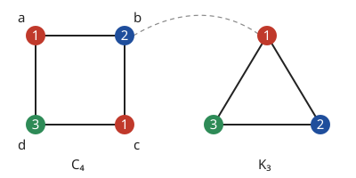

# 그래프 준동형

# 개요

**그래프 준동형(graph homomorphism)** 은 한 그래프의 정점을 다른 그래프의 정점으로 보내되, 이웃한 두 정점은 이웃한 두 정점으로 가게 하는 사상이다. 네 정점을 고리로 이은 그래프를 세 색으로 칠하는 방법이 몇 가지인지, 한 그래프에 독립집합이 몇 개인지는 서로 다른 물음처럼 보인다.

두 물음은 모두 정해진 작은 그래프로 가는 준동형의 수를 세는 일이다. 색칠은 색을 정점으로 하는 완전그래프로 가는 준동형이고, 독립집합은 고리가 달린 간선 하나로 가는 준동형이다. 그래서 색칠, 독립집합, 통계역학의 상태 수를 같은 틀에서 세고 비교한다.

# 직관

정점 $a,b,c,d$ 를 차례로 이은 네 칸 고리 $C\_4$ 를 색 $1,2,3$ 으로 칠한다. 이웃한 정점은 다른 색이어야 한다. $a=1$, $b=2$, $c=1$, $d=3$ 은 맞는 색칠이다.

색 $1,2,3$ 을 정점으로 하고 서로 다른 색끼리 모두 이은 삼각형 $K\_3$ 을 그린다. 색칠은 $C\_4$ 의 정점마다 $K\_3$ 의 정점 하나를 주는 사상이고, 이웃한 정점이 다른 색이라는 조건은 $C\_4$ 의 간선이 $K\_3$ 의 간선으로 간다는 조건과 같다.

그림에서 같은 색의 정점이 $K\_3$ 의 같은 정점으로 간다. $C\_4$ 의 세 색 색칠은 $a$ 와 $c$ 가 같은 색인지에 따라 세면 $3\cdot 2\cdot 2+3\cdot 2\cdot 1=18$ 가지이고, $C\_4$ 에서 $K\_3$ 으로 가는 준동형도 $18$ 개다.

# 정의

## 준동형

두 그래프 $G$, $H$ 에 대해, 사상 $f:V(G)\to V(H)$ 가 $G$ 의 모든 간선 $uv$ 에 대해 $f(u)f(v)$ 가 $H$ 의 간선이면 $f$ 를 $G$ 에서 $H$ 로 가는 **준동형(homomorphism)** 이라 하고 $f:G\to H$ 로 쓴다. $H$ 에는 한 정점을 자기 자신과 잇는 고리가 있어도 된다. $G$ 에서 $H$ 로 가는 준동형의 수를 $\hom(G,H)$ 로 쓴다.

직관 절에서 $\hom(C\_4,K\_3)=18$ 이다.

## H 색칠

$G$ 에서 $H$ 로 가는 준동형을 $G$ 의 **H 색칠(H-coloring)** 이라 한다. $H=K\_q$ 이면 $q$ 색 [그래프 색칠](graph-coloring.md)이다. $H$ 가 정점 $0,1$ 이고 $0$ 에 고리가 있으며 $0$ 과 $1$ 을 이은 그래프이면, $1$ 에는 고리가 없어 $1$ 로 가는 두 정점은 이웃할 수 없으므로, $H$ 색칠에서 $1$ 로 가는 정점들은 독립집합을 이룬다. 거꾸로 독립집합마다 그 정점들을 $1$ 로, 나머지를 $0$ 으로 보내는 $H$ 색칠이 하나씩 있다.

$C\_4$ 의 독립집합은 공집합, 한 점짜리 넷, 마주 보는 두 쌍으로 $7$ 개이고 이 $H$ 로 가는 준동형도 $7$ 개다.

# 성질

## 합성과 채색수

준동형 $G\to H$ 와 $H\to K$ 를 합성하면 $G\to K$ 다. 그러므로 $G\to H$ 가 있으면 $H$ 의 $q$ 색 색칠을 $G$ 로 끌어와 $\chi(G)\le\chi(H)$ 다. $\chi$ 는 채색수다. $G$ 가 이분그래프인 것과 $G\to K\_2$ 가 있는 것은 동치이고, 홀수 고리 $C\_5$ 에서 $K\_2$ 로 가는 준동형은 없다.

## 핵

$H$ 에서 자기 자신의 진부분그래프로 가는 준동형이 없으면 $H$ 를 **핵(core)** 이라 한다. 모든 유한 그래프 $G$ 에는 $G\to K$ 와 $K\to G$ 가 모두 있는 핵 $K\subseteq G$ 가 동형을 빼고 하나 있다.[^1] $C\_4$ 의 핵은 간선 하나 $K\_2$ 이고, 완전그래프와 홀수 고리는 자기 자신이 핵이다.

## 계산 복잡도

$H$ 를 고정하고 주어진 $G$ 에 $H$ 색칠이 있는지 판정하는 문제는, $H$ 에 고리가 있거나 $H$ 가 이분그래프이면 다항시간에 풀리고 그 밖에는 NP-완전(NP-complete, NP 는 nondeterministic polynomial time)이다(Hell, Nešetřil).[^2] $H=K\_3$ 이면 세 색 색칠 문제다. 이 판정 문제는 [제약 만족 문제](constraint-satisfaction-problems.md)의 특수한 경우다.

## 준동형 수로 정해지는 그래프

두 유한 그래프 $G$, $G'$ 이 동형인 것과 모든 유한 그래프 $F$ 에 대해 $\hom(F,G)=\hom(F,G')$ 인 것은 동치다(Lovász).[^3] [그래프 동형](graph-isomorphism.md)을 준동형 수의 목록으로 판정할 수 있다는 것이다. $F$ 를 트리로만 제한하면 같은 수를 갖는 두 그래프는 [Color refinement](color-refinement.md)로 구별되지 않는 두 그래프와 같다.

## 준동형 밀도

$t(F,G)=\hom(F,G)/\lvert V(G)\rvert^{\lvert V(F)\rvert}$ 를 **준동형 밀도(homomorphism density)** 라 한다. $G$ 의 정점을 $F$ 의 정점마다 고르게 뽑았을 때 그 사상이 준동형일 확률이다. [Sidorenko 추측](sidorenko-conjecture.md)은 이분그래프 $F$ 에 대해 $t(F,G)\ge t(K\_2,G)^{\lvert E(F)\rvert}$ 라는 추측이다.

# 활용

- 독립집합과 색칠의 상한. [Kahn–Zhao 정리](kahn-zhao-theorem.md)의 독립집합 상한을 [Galvin–Tetali 정리](galvin-tetali-theorem.md)가 모든 목표 그래프 $H$ 로 넓혔다. $d$ 정칙 이분그래프 $G$ 에서 $\hom(G,H)\le\hom(K\_{d,d},H)^{n/(2d)}$ 이고, $n$ 은 $G$ 의 정점 수다.[^4]
- 통계역학의 분배함수. 정점의 상태가 $H$ 의 정점이고 이웃한 정점의 상태가 $H$ 에서 이웃해야 하는 모형에서, 상태 배치의 수가 $\hom(G,H)$ 다. 독립집합의 경우가 [단단한 알갱이 모형](hard-core-model.md)이다.
- 그래프 극한(graph limit). 크기가 커지는 그래프 열의 수렴을 모든 $F$ 의 준동형 밀도가 수렴하는 것으로 정의하고, 극한은 [그래폰](graphons.md)이다.

[^1]: P. Hell, J. Nešetřil, *Graphs and Homomorphisms*, Oxford University Press (2004), 2 장.
[^2]: P. Hell, J. Nešetřil, "On the complexity of H-coloring", *Journal of Combinatorial Theory, Series B* **48** (1990), 92–110.
[^3]: L. Lovász, "Operations with structures", *Acta Mathematica Academiae Scientiarum Hungaricae* **18** (1967), 321–328.
[^4]: D. Galvin, P. Tetali, "On weighted graph homomorphisms", in *Graphs, Morphisms and Statistical Physics*, DIMACS Series in Discrete Mathematics and Theoretical Computer Science **63** (2004), 97–104.

# 연관 문서

## 선수지식

- [그래프 색칠](graph-coloring.md)

## 더 알아보기

- [그래폰](graphons.md)
- [Galvin–Tetali 정리](galvin-tetali-theorem.md)
- [단단한 알갱이 모형](hard-core-model.md)
- [제약 만족 문제](constraint-satisfaction-problems.md)

#graph_theory #combinatorics #algorithms
