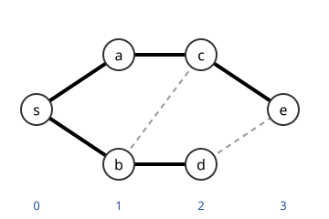

# 그래프 탐색

# 개요

**그래프 탐색(graph search)** 은 한 정점에서 시작해 간선을 따라 갈 수 있는 정점을 모두 방문하는 절차다. 미로의 입구에서 출구까지 갈 수 있는지, 갈 수 있다면 가장 적은 걸음이 몇인지 알려면 갈림길을 빠짐없이 한 번씩 확인해야 한다. 확인할 갈림길을 쌓아 두고 가장 최근 것부터 꺼내면 깊이 우선 탐색(depth-first search, DFS), 가장 먼저 쌓은 것부터 꺼내면 너비 우선 탐색(breadth-first search, BFS)이다.

# 직관

탐색은 정점을 세 상태로 나눈다. 아직 보지 못한 정점, 보았지만 이웃을 다 살피지 않은 정점, 다 살핀 정점이다. 두 번째 무리를 어떤 순서로 꺼내느냐가 탐색의 이름을 정한다. 가장 최근에 본 것을 먼저 꺼내면 한 방향으로 깊이 파고들고, 가장 먼저 본 것을 꺼내면 시작점에서 가까운 순으로 퍼진다.

아래 그림은 $s$ 에서 시작한 너비 우선 탐색이다. 같은 세로줄의 정점은 시작점에서 같은 걸음 수(아래 숫자)에 있고, 굵은 선은 각 정점을 처음 발견한 간선, 점선은 이미 발견한 정점으로 가는 간선이다.

# 정의

## 너비 우선 탐색

[그래프](graphs.md) $G=(V,E)$ 와 시작 정점 $s$ 에 대해 **너비 우선 탐색(breadth-first search, BFS)** 은 큐(queue) 하나와 방문 표시를 두고 다음을 반복하는 절차다. 처음에 $s$ 를 표시해 큐에 넣고 $\mathrm{dist}(s)=0$ 으로 둔다. 큐의 앞에서 정점 $v$ 를 꺼내고, $v$ 의 표시되지 않은 이웃 $w$ 마다 $w$ 를 표시하고 $\mathrm{dist}(w)=\mathrm{dist}(v)+1$ 로 두고 큐의 뒤에 넣는다. 큐가 비면 멈춘다.

직관 절의 그림에서 이웃을 알파벳 순으로 살피면 큐에서 꺼내는 순서는 $s,a,b,c,d,e$ 이고 $\mathrm{dist}$ 는 차례로 $0,1,1,2,2,3$ 이다. $b$ 를 꺼낼 때 $c$ 는 이미 $a$ 에서 표시되었으므로 간선 $bc$ 는 점선으로 남는다.

## 깊이 우선 탐색

**깊이 우선 탐색(depth-first search, DFS)** 은 정점 $v$ 에 들어갈 때 시각을 매겨 $v$ 의 **방문 시각(discovery time)** $d(v)$ 로 적고, $v$ 의 방문하지 않은 이웃마다 그 이웃에서 같은 절차를 끝까지 마친 뒤, 다시 시각을 매겨 **종료 시각(finishing time)** $f(v)$ 로 적는 재귀 절차다. 시각은 $1$ 에서 시작해 정점에 들어가거나 나올 때마다 $1$ 씩 늘린다. 재귀 대신 스택(stack)을 쓰면 가장 최근에 본 정점부터 꺼내는 절차가 된다.

같은 그림에서 $s$ 부터 이웃을 알파벳 순으로 살피면 $s\to a\to c\to b\to d\to e$ 로 들어간다. 방문 시각은 $s,a,c,b,d,e$ 순으로 $1$ 부터 $6$ 이고, 종료 시각은 $e,d,b,c,a,s$ 순으로 $7$ 부터 $12$ 다.

## 탐색 나무와 간선 분류

정점을 처음 방문할 때 쓴 간선이 **트리 간선(tree edge)** 이고, 트리 간선들은 $s$ 를 뿌리로 하는 나무를 이룬다. 그림의 BFS 나무는 굵은 선이고, 위 DFS 의 나무는 경로 $s,a,c,b,d,e$ 다.

방향그래프의 DFS 에서 간선 $(u,v)$ 는 네 종류다.

| 종류 | 조건 |
| --- | --- |
| 트리 간선 | $v$ 를 $u$ 에서 처음 방문 |
| 후향 간선(back edge) | $v$ 가 $u$ 의 조상, 곧 $v$ 가 아직 종료되지 않음 |
| 전향 간선(forward edge) | $v$ 가 $u$ 의 후손이고 이미 종료됨 |
| 교차 간선(cross edge) | 그 밖의 경우 |

그림의 간선을 모두 왼쪽에서 오른쪽으로 향하게 하면 간선은 $s\to a$, $s\to b$, $a\to c$, $b\to c$, $b\to d$, $c\to e$, $d\to e$ 다. $s$ 에서 DFS 하면 $s,a,c,e$ 를 방문하고 종료한 뒤 $b,d$ 를 방문한다. $b\to c$ 와 $d\to e$ 는 이미 종료되었고 후손이 아닌 정점으로 가므로 교차 간선이다. 여기에 간선 $e\to a$ 를 더하면 $e$ 를 방문할 때 $a$ 는 $e$ 의 조상이고 아직 종료되지 않았으므로 $e\to a$ 는 후향 간선이다.

# 성질

## 시간과 공간

인접 리스트 표현에서 두 탐색 모두 $O(\lvert V\rvert+\lvert E\rvert)$ 시간과 $O(\lvert V\rvert)$ 공간이 든다. 각 정점은 한 번 표시되고, 각 간선은 끝점을 꺼낼 때 한두 번 살펴진다.

## BFS 와 최단경로

가중치가 없는 그래프에서 BFS 가 계산한 $\mathrm{dist}(v)$ 는 $s$ 에서 $v$ 까지의 간선 수 최솟값이다. 큐에서 꺼내는 정점의 거리가 비감소한다는 불변량을 귀납법으로 보이면 된다. 거리 $d$ 인 정점이 모두 큐에 들어간 뒤에야 거리 $d+1$ 인 정점이 들어간다.

## 후향 간선과 순환

방향그래프에 순환이 있는 것과 DFS 에서 후향 간선이 나오는 것은 동치다. 후향 간선이 있으면 트리 경로와 합쳐 순환이 만들어지고, 순환이 있으면 그 순환에서 가장 먼저 방문된 정점이 나머지의 조상이 되어 순환을 닫는 간선이 후향 간선이 된다. 위의 $e\to a$ 는 순환 $a\to c\to e\to a$ 를 닫는다. [위상정렬](topological-sort.md)이 가능한지 판정하는 기준이 이것이다.

## 강연결성분

방향그래프의 **강연결성분(strongly connected component)** 은 서로 오갈 수 있는 정점들의 극대 집합이고, 두 번의 DFS 로 구한다. 첫 DFS 로 종료 시각을 구하고, 간선을 뒤집은 그래프에서 종료 시각의 역순으로 다시 DFS 하면 각 탐색 나무가 정확히 하나의 강연결성분이 된다(Kosaraju 알고리즘). 한 번의 DFS 로 같은 일을 하는 Tarjan 알고리즘(Tarjan's algorithm)은 각 정점에서 도달 가능한 최소 방문 시각을 갱신한다.

## 이분성 판정

BFS 로 거리의 홀짝에 따라 두 색을 칠하고, 같은 색 사이에 간선이 있는지 본다. 간선이 있으면 홀수 길이 순환이 존재하고, 없으면 이분그래프(bipartite graph)다. 그래프가 이분인 것과 홀수 길이 순환이 없는 것이 동치라는 정리의 구성적 증명이다. 그림의 그래프는 거리가 짝수인 $s,c,d$ 와 홀수인 $a,b,e$ 로 나뉘고, 점선 $bc$ 와 $de$ 도 두 무리를 이으므로 이분그래프다.

# 활용

## 다른 알고리즘의 내부 절차

[최소 신장트리](minimum-spanning-tree.md), [네트워크 흐름](network-flow.md)의 증가경로 찾기, [매칭](matchings.md)의 증대경로 찾기가 모두 탐색을 내부 절차로 쓴다. 흐름 알고리즘에서 증가경로를 BFS 로 고르면 Edmonds–Karp 알고리즘(Edmonds–Karp algorithm)이 되어 반복 횟수가 다항식으로 억제된다.

## 상태공간 탐색

퍼즐이나 게임의 국면을 정점, 한 수를 간선으로 보면 최소 수 풀이가 BFS 의 최단경로다. 상태 수가 많으면 양방향 탐색(bidirectional search)이나 휴리스틱(heuristic)을 더한 $A^\ast$ 탐색으로 넓히는 범위를 줄인다.

## 무작위 그래프의 성분

[무작위 걷기](random-walks.md)와 달리 탐색은 결정적이지만, 무작위 그래프에서 탐색이 훑는 정점 수를 분지과정(branching process)으로 근사하면 거대 연결성분(giant component)이 나타나는 문턱을 얻는다.

# 연관 문서

## 선수지식

- [그래프](graphs.md)

## 더 알아보기

- [위상정렬](topological-sort.md)

#graph_theory #algorithms
