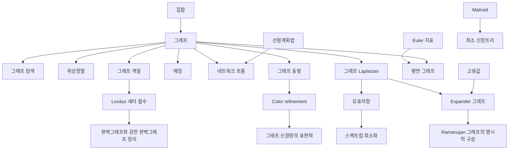

# 그래프 이론 개관

# 개요

그래프 이론(graph theory)은 정점과 간선만으로 이루어진 구조를 다룬다. 물음은 "연결 관계만 남겼을 때 무엇을 말할 수 있는가" 이고, 답은 세 방향에서 온다. 조합적 논증, 다항시간 알고리즘, 그리고 인접행렬의 스펙트럼이다.

그래프 이론의 갈래는 다섯 줄기다. 기본 구조, 색칠과 매칭, 알고리즘과 최적화, 동형과 구별, 그리고 스펙트럼 그래프 이론이다. 그래프 알고리즘의 계산복잡도 쪽은 [NP-완전성](np-completeness.md)(nondeterministic polynomial time)에, 조합적 세기 쪽은 [조합론 개관](combinatorics-overview.md)에 있다.

시작은 [그래프](graphs.md)다. 거기서 [그래프 색칠](graph-coloring.md)과 [매칭](matchings.md)이 조합적 갈래로, [네트워크 흐름](network-flow.md)이 알고리즘 갈래로, [그래프 Laplacian](graph-laplacian.md)이 스펙트럼 갈래로 갈라진다.

# 지도

# 갈래

처음 읽는 사람은 기본 구조를 순서대로 읽는다. 그 뒤는 네 방향으로 갈린다. 색칠과 매칭은 조합적 논증으로, 알고리즘과 최적화는 탐욕 규칙과 흐름으로, 동형과 구별은 라벨을 잊은 동일성의 판정으로, 스펙트럼 그래프 이론은 인접행렬의 고윳값으로 간다.

## 기본 구조

먼저 읽을 것: [집합](sets.md)(기초 개관), [동치관계](equivalence-relations.md)(기초 개관), [부분순서](partial-orders.md)(순서론 개관). 시작 문서: [그래프](graphs.md).

- [그래프](graphs.md): 정점과 간선, 차수, 경로와 연결성
- [그래프 탐색](graph-search.md): DFS(depth-first search)와 BFS(breadth-first search), 탐색 트리와 간선 분류, 강연결성분
- [위상정렬](topological-sort.md): 방향 비순환 그래프(directed acyclic graph, DAG)의 정점을 간선 방향과 맞는 한 줄로 놓는 순서
- [평면 그래프](planar-graphs.md): Euler 공식과 Kuratowski 정리
  - [교차수 부등식](crossing-number-inequality.md): 변이 많을 때 교차수의 세제곱 하한, 무작위 부분그래프 논증
  - [완전그래프의 교차수](complete-graph-crossing-number.md): $\mathrm{cr}(K_n)$ 의 확정값과 Guy 의 그림, 두 번 세기 하한
  - [Sylvester 네 점 문제](sylvester-four-point.md): 무작위 네 점이 볼록 위치일 확률, Blaschke 의 극값과 직선 교차수의 점근 상수
- [그래프 마이너](graph-minors.md): 정렬 유사 순서와 유한 금지 마이너
- [나무폭](treewidth.md): 주머니로 묶은 나무 분해, 마이너 단조성, 주머니 단위 동적 계획법
  - [경로폭](pathwidth.md): 주머니를 한 줄로 늘어놓은 분해의 폭, 구간 그래프와 정점 탐색 수와의 일치
  - [가지폭](branchwidth.md): 간선 집합의 가르기로 재는 폭, 나무폭과의 상수배 관계와 평면 그래프의 쌍대성
- [Hamilton 순환](hamiltonian-cycles.md): Dirac 과 Ore 의 차수 조건, 닫힘, 판정의 NP-완전성
  - [그래프 강인성](graph-toughness.md): 지운 정점 수와 남은 조각 수의 비의 최솟값, Hamilton 그래프의 1 강인성과 Chvátal 의 강인성 추측, 완전 매칭과 k 인자의 충분조건
- [Euler 회로](eulerian-circuits.md): 모든 변을 한 번씩 지나는 닫힌 걸음이 모든 차수가 짝수인 것과 동치라는 Euler 정리, Hierholzer 알고리즘과 유향 Euler 회로의 개수 공식
  - [de Bruijn 수열](de-bruijn-sequences.md): 길이 n 인 문자열을 모두 한 번씩 담는 길이 kⁿ 의 순환 수열, de Bruijn 그래프의 Euler 회로와 개수 공식, Lyndon 단어와 최대 길이 수열

## 색칠과 매칭

먼저 읽을 갈래: 기본 구조. 먼저 읽을 것: [셈의 기본 원리](counting-principles.md)(조합론 개관), [비둘기집 원리](pigeonhole-principle.md)(조합론 개관). 시작 문서: [그래프 색칠](graph-coloring.md).

- [그래프 색칠](graph-coloring.md): 채색수, 탐욕 상한, 4색 정리
  - [그래프 퇴화도](graph-degeneracy.md): 모든 부분그래프에 차수 d 이하의 정점이 있는 가장 작은 d, 최소 차수 제거 순서의 선형 시간 계산, k-핵, 수목도와의 부등식
  - [Tutte 다항식](tutte-polynomial.md): 채색 다항식과 신장트리 개수를 함께 거두는 두 변수 불변량
  - [목록 색칠](list-coloring.md): 정점마다 허용된 색의 목록 안에서 칠하는 색칠과 선택수, Alon–Tarsi 정리와 평면 그래프의 Thomassen 5 선택 가능성, 이분그래프 간선의 Galvin 정리
- [de Bruijn–Erdős 정리](de-bruijn-erdos-theorem.md): 모든 유한 부분그래프가 k 색으로 칠해지면 무한 그래프 전체가 k 색으로 칠해진다는 정리, Tychonoff 정리와 콤팩트성 증명, 선택 원리의 역할
  - [평면의 채색수](chromatic-number-of-the-plane.md): 거리 1 인 두 점이 다른 색을 받는 평면 색칠의 최소 색 수, Moser 방추의 하한 4 와 육각형 무늬의 상한 7, de Grey 의 하한 5
- [매칭](matchings.md): 이분그래프의 완전매칭 조건
  - [안정 매칭](stable-matching.md): 서로를 지금 짝보다 좋아하는 두 사람이 없는 짝짓기, Gale–Shapley 의 지연 수락 알고리즘과 청혼하는 쪽의 최적성, 안정 매칭의 격자
- [완벽그래프와 강한 완벽그래프 정리](perfect-graphs.md): 채색수와 클릭 수가 모든 유도부분그래프에서 같은 그래프

## 알고리즘과 최적화

먼저 읽을 갈래: 기본 구조. 먼저 읽을 것: [유한 확률 공간](probability.md)(확률 개관). 시작 문서: [최소 신장트리](minimum-spanning-tree.md).

- [최소 신장트리](minimum-spanning-tree.md): 탐욕 알고리즘이 최적해를 주는 독립성 구조
  - [유향 신장트리](arborescences.md): 뿌리에서 모든 정점으로 경로가 하나씩 있는 호의 집합, 순환을 줄이는 Chu–Liu/Edmonds 최소 비용 알고리즘과 Edmonds 가지 정리
- [Steiner 나무 문제](steiner-tree-problem.md): 단말 밖의 정점을 지나도 되는 최소 비용 연결 나무, 거리 폐포의 2-근사와 Dreyfus–Wagner 동적 계획법, Euclid 판본의 120° 조건
  - [Steiner 비](steiner-ratio.md): 최소 Steiner 나무와 최소 신장트리의 길이의 비의 하한, 일반 거리의 1/2 와 직교 거리의 2/3, 정삼각형의 √3/2 와 Gilbert–Pollak 추측
- [네트워크 흐름](network-flow.md): 흐름의 최댓값과 절단의 최솟값이 같다
- [Menger 정리](menger-theorem.md): 두 정점 사이의 내부 서로소 경로의 최대 개수와 분리 집합의 최소 크기가 같다는 정리, 흐름으로 하는 증명, Whitney 의 k 연결 판정과 부채 보조정리
  - [귀 분해](ear-decomposition.md): 순환에서 시작해 경로를 하나씩 붙이는 분해, 2 연결과 열린 귀 분해의 동치(Whitney), 간선 2 연결과 Robbins 의 강한 방향 정리, 깊이 우선 탐색의 사슬 분해
  - [Gomory–Hu 나무](gomory-hu-tree.md): 모든 정점 쌍의 최소 절단을 경로의 가장 가벼운 간선으로 담는 나무, 세 정점의 최소 절단 부등식, 최대 흐름 n − 1 번의 구성과 Gusfield 판본, 매칭 다면체의 분리 문제
  - [Karger 축약 알고리즘](karger-min-cut.md): 무작위 간선을 축약해 전역 최소 절단을 찾는 알고리즘, 성공 확률 1/C(n,2) 와 최소 절단 개수의 상한, Karger–Stein 재귀
  - [Stoer–Wagner 알고리즘](stoer-wagner-algorithm.md): 최대 인접 순서의 마지막 두 정점에서 최소 절단을 얻고 두 정점을 합치기를 n − 1 번 되풀이하는 결정적 전역 최소 절단 알고리즘
- [Chvátal–Erdős 정리](chvatal-erdos-theorem.md): 연결도가 독립수 이상이면 Hamilton 순환이 있다는 정리, 가장 긴 순환과 부채 보조정리

## 동형과 구별

먼저 읽을 갈래: 기본 구조. 시작 문서: [그래프 동형](graph-isomorphism.md).

- [그래프 동형](graph-isomorphism.md): 라벨을 잊은 동일성과 그 판정 문제
- [Color refinement](color-refinement.md): 1차원 Weisfeiler–Leman 알고리즘과 그 한계
- [그래프 신경망의 표현력](gnn-expressivity.md): 메시지 전달 신경망의 구별력이 색 세분과 같다

## 스펙트럼 그래프 이론

먼저 읽을 갈래: 기본 구조. 먼저 읽을 것: [고윳값](eigenvalues.md)(선형대수 개관), [유한 확률 공간](probability.md)(확률 개관). 시작 문서: [그래프 Laplacian](graph-laplacian.md).

- [그래프 Laplacian](graph-laplacian.md): 차수행렬과 인접행렬의 차, 고윳값과 연결성분
- [유효저항](effective-resistance.md): 간선을 저항으로 둔 회로의 두 정점 사이 저항, Laplacian 의 유사역행렬로 적은 값
  - [스펙트럼 희소화](spectral-sparsification.md): 유효저항에 비례한 표본추출로 이차형식을 보존하며 간선 수를 줄인다
- [Expander 그래프](expander-graphs.md): 성김과 강한 연결성의 공존
  - [Ramanujan 그래프의 명시적 구성](ramanujan-graphs.md): 스펙트럼 간극의 최적 경계를 달성하는 구성

# 연관 문서

## 선수지식

- [집합](sets.md)

## 더 알아보기

- [그래프](graphs.md)
- [최소 신장트리](minimum-spanning-tree.md)
- [완벽그래프와 강한 완벽그래프 정리](perfect-graphs.md)

#graph_theory #combinatorics #algorithms #overview
