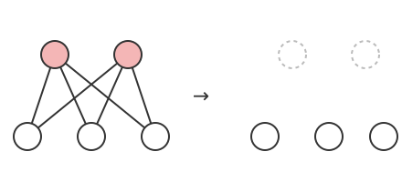

# 그래프 강인성

# 개요

**그래프 강인성(toughness)** 은 그래프에서 정점 몇 개를 지워 여러 조각으로 끊을 때, 지운 정점 수를 남은 조각 수로 나눈 값의 최솟값이다. 모든 정점을 한 번씩 도는 [Hamilton 순환](hamiltonian-cycles.md)이 있는지 판정하기 어려울 때, 정점 몇 개를 지워 그래프가 지운 수보다 많은 조각으로 갈리면 그런 순환이 없다고 바로 말할 수 있다. 강인성은 이 판정에 쓰는 수이고, V. Chvátal 이 1973 년에 정의했다[^1].

# 직관

크기가 $k$ 와 $k+1$ 인 두 쪽을 갖는 완전이분그래프 $K_{k,k+1}$ 에는 Hamilton 순환이 없다. 작은 쪽 정점 $k$ 개를 지우면 큰 쪽 정점 $k+1$ 개가 서로 떨어진 조각으로 남는다. 한편 순환에서 정점 $k$ 개를 지우면 순환은 많아야 $k$ 조각으로 끊긴다. 그래서 $K_{k,k+1}$ 의 정점을 지나는 순환은 모든 정점을 지날 수 없다.

아래 그림은 $k=2$ 인 경우다. 빨간 두 정점을 지우면 남은 세 정점이 서로 떨어진 조각이 된다.

이 논법은 지운 정점 수와 남은 조각 수만 쓴다. 그래서 그래프마다 "지운 정점 수 ÷ 남은 조각 수" 의 가장 작은 값을 잰다. $K_{k,k+1}$ 에서는 $k/(k+1)$ 이고 $1$ 보다 작아 Hamilton 순환이 없다. 이 값이 그래프의 강인성이다.

# 정의

그래프 $G$ 의 정점 집합 $S$ 에 대해 $c(G-S)$ 를 $S$ 를 지운 그래프의 연결 성분 수라 한다. $c(G-S)\ge 2$ 인 모든 $S$ 에서

$$
\lvert S\rvert\ge t\cdot c(G-S)
$$

이면 $G$ 를 **$t$ 강인(t-tough)** 이라 한다. $G$ 가 $t$ 강인인 가장 큰 $t$ 를 $G$ 의 강인성 $\tau(G)$ 라 한다. 완전그래프는 어떤 $S$ 를 지워도 끊기지 않으므로 $\tau(K_n)=\infty$ 로 둔다.

$$
\tau(G)=\min\left\lbrace \frac{\lvert S\rvert}{c(G-S)} : c(G-S)\ge 2\right\rbrace
$$

# 성질

## 연결도, 독립수, 최소 차수

$G$ 가 완전그래프가 아니면 다음이 성립한다. $\kappa(G)$ 는 연결도, $\alpha(G)$ 는 독립수, $\delta(G)$ 는 최소 차수다.

$$
\frac{\kappa(G)}{\alpha(G)}\le\tau(G)\le\frac{\kappa(G)}{2},\qquad 2\tau(G)\le\delta(G)
$$

증명의 요지. $c(G-S)\ge 2$ 이면 $S$ 는 $G$ 를 끊으므로 $\lvert S\rvert\ge\kappa(G)$ 이고, 각 성분에서 정점을 하나씩 고르면 독립집합이므로 $c(G-S)\le\alpha(G)$ 다. 이로부터 왼쪽 부등식이 나온다. 크기 $\kappa(G)$ 인 끊는 집합을 $S$ 로 잡으면 $c(G-S)\ge 2$ 이므로 가운데 부등식이 나온다. 정점 $v$ 의 이웃 전체를 $S$ 로 잡으면 $v$ 가 홀로 남는 성분이 생겨 마지막 부등식이 나온다.

[Chvátal–Erdős 정리](chvatal-erdos-theorem.md)의 조건 $\kappa\ge\alpha$ 를 만족하는 그래프는 왼쪽 부등식으로 $1$ 강인이다.

## Hamilton 순환과의 관계

정리. Hamilton 그래프는 $1$ 강인이다[^1].

증명의 요지. Hamilton 순환 $C$ 에서 정점 $\lvert S\rvert$ 개를 지우면 많아야 $\lvert S\rvert$ 개의 경로가 남는다. $G-S$ 는 이 경로들에 간선을 더한 것이므로 $c(G-S)\le c(C-S)\le\lvert S\rvert$ 다.

역은 성립하지 않는다. Petersen 그래프는 강인성이 $4/3$ 이고 Hamilton 순환이 없다.

**Chvátal 의 강인성 추측(Chvátal's toughness conjecture).** 상수 $t_0$ 가 존재해 모든 $t_0$ 강인 그래프는 Hamilton 그래프다[^1]. D. Bauer, H. J. Broersma, H. J. Veldman 이 모든 $\varepsilon\gt 0$ 에 대해 $(9/4-\varepsilon)$ 강인이면서 Hamilton 순환이 없는 그래프를 구성했으므로 $t_0$ 는 $9/4$ 이상이어야 한다[^2].

현선 그래프(chordal graph)에서는 추측이 증명되었다. A. Kabela 와 T. Kaiser 가 $10$ 강인 현선 그래프는 Hamilton 그래프임을 보였다[^3].

## 인자

$G$ 의 모든 정점에서 차수가 $k$ 인 생성 부분그래프를 **$k$ 인자(k-factor)** 라 한다. $1$ 인자는 완전 [매칭](matchings.md)이다.

정리. 정점 수가 짝수인 $1$ 강인 그래프에는 완전 매칭이 있다.

증명의 요지. Tutte 정리(Tutte's theorem)의 조건 "$G-S$ 의 홀수 성분 수가 $\lvert S\rvert$ 이하" 를 확인한다. $c(G-S)\ge 2$ 이면 $1$ 강인에서 $c(G-S)\le\lvert S\rvert$ 이다. $c(G-S)=1$ 이고 $S$ 가 비어 있지 않으면 홀수 성분이 많아야 하나다. $S$ 가 비어 있으면 $G$ 는 연결이고 정점 수가 짝수라 홀수 성분이 없다.

H. Enomoto, B. Jackson, P. Katerinis, A. Saito 는 이것을 일반화해, $k$ 강인 그래프는 정점 수가 $k+1$ 이상이고 $k$ 와 정점 수의 곱이 짝수이면 $k$ 인자를 가짐을 보였다[^4].

## 판정의 복잡도

D. Bauer, S. L. Hakimi, E. Schmeichel 은 그래프가 $1$ 강인인지 판정하는 문제가 coNP(complement of nondeterministic polynomial time)-완전임을 보였다[^5]. $1$ 강인이 아니라는 증거는 $c(G-S)\gt\lvert S\rvert$ 인 집합 $S$ 하나이므로 검증은 다항시간에 된다.

# 활용

- Hamilton 순환의 필요조건. 차수 조건(Dirac, Ore)과 달리 그래프 전체의 끊김을 보므로, 차수가 큰데도 Hamilton 순환이 없는 그래프를 가려낸다.
- 매칭과 인자의 존재 조건. Tutte 정리가 홀수 성분 수를 $\lvert S\rvert$ 로 묶는 데 비해 $1$ 강인은 성분 수 전체를 묶으므로, 위 정리로 완전 매칭과 $k$ 인자의 충분조건이 된다.

[^1]: V. Chvátal, "Tough graphs and Hamiltonian circuits", Discrete Mathematics 5 (1973), 215–228.
[^2]: D. Bauer, H. J. Broersma, H. J. Veldman, "Not every 2-tough graph is Hamiltonian", Discrete Applied Mathematics 99 (2000), 317–321.
[^3]: A. Kabela, T. Kaiser, "10-tough chordal graphs are Hamiltonian", Journal of Combinatorial Theory, Series B 122 (2017), 417–427.
[^4]: H. Enomoto, B. Jackson, P. Katerinis, A. Saito, "Toughness and the existence of k-factors", Journal of Graph Theory 9 (1985), 87–95.
[^5]: D. Bauer, S. L. Hakimi, E. Schmeichel, "Recognizing tough graphs is NP-hard", Discrete Applied Mathematics 28 (1990), 191–195.

# 연관 문서

## 선수지식

- [Hamilton 순환](hamiltonian-cycles.md)

## 더 알아보기

아직 연결한 문서가 없다.

#graph_theory #combinatorics #complexity
