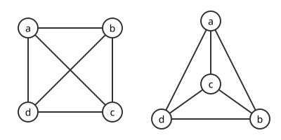
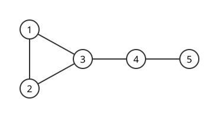

# 그래프

# 개요

**그래프(graph)** 는 점들과, 어느 두 점이 이어져 있는지만 기록한 구조다. 도시 다섯 개와 그 사이의 도로를 생각하면, 도로의 길이나 모양을 지우고 "어느 도시와 어느 도시가 직접 이어져 있는가" 만 남긴 것이 그래프다. 한 도시에서 다른 도시로 갈 수 있는지, 도로 몇 개를 거쳐야 하는지 같은 질문은 이 기록만으로 답이 나온다.

# 직관

## 그림이 아니라 데이터

그래프를 종이에 그리면 간선이 교차하지만, 교차점은 정점이 아니다. 같은 그래프를 다르게 그릴 수 있고 어떻게 그리든 그래프 자체는 같다. 그림은 이해를 돕는 보조물이고 데이터는 정점 집합과 간선 집합뿐이다. "교차 없이 그릴 수 있는가" 는 그림의 문제가 아니라 그래프의 성질이며, 그것을 따지는 것이 평면성이다.

아래 두 그림은 네 정점 $a,b,c,d$ 가 모두 서로 이어진 같은 그래프다. 왼쪽 그림에서는 간선 $ac$ 와 $bd$ 가 가운데서 교차하고, 오른쪽 그림에서는 $c$ 를 삼각형 안으로 옮겨 교차가 없다.

## 그래프 모형이 버리는 정보

그래프로 옮기면 거리, 방향, 순서, 세기가 사라진다. 필요하면 가중치를 붙이거나 방향을 주어 되살린다. 그래프 모형화가 실패하는 경우는 대개 "연결 여부만으로는 부족한 것" 을 연결 여부로만 적었을 때다.

# 정의

## 그래프

유한 단순 무향 그래프는 정점 집합 $V$ 와 간선 집합 $E$ 의 쌍이다.

$$
G=(V,E),\qquad E\subseteq\big\lbrace\lbrace u,v\rbrace:u,v\in V,\ u\ne v\big\rbrace
$$

$V=\lbrace 1,2,3,4,5\rbrace$ 이고 $E=\lbrace \lbrace 1,2\rbrace,\lbrace 1,3\rbrace,\lbrace 2,3\rbrace,\lbrace 3,4\rbrace,\lbrace 4,5\rbrace\rbrace$ 인 그래프는 다음 그림이다.

간선을 순서쌍으로 바꾸면 방향 그래프가 되고, 같은 간선을 여러 개 허용하면 다중 그래프, 자기 자신으로 가는 간선을 허용하면 루프가 있는 그래프다. 무엇을 허용하는지는 모형마다 명시해야 한다. 이 수학 지도 자체는 방향 그래프이며 순환을 금지한 [DAG](topological-sort.md)(directed acyclic graph)다.

## 걷기, 경로, 순환

인접한 정점을 따라가는 열을 걷기(walk)라 하고, 정점을 반복하지 않는 걷기를 경로, 시작점으로 돌아오되 나머지를 반복하지 않는 것을 순환이라 한다. 모든 두 정점 사이에 경로가 있으면 연결 그래프이고, 일반적으로는 연결 성분으로 쪼개진다. 위 그림에서 $1,3,4,5$ 는 경로이고 $1,2,3,1$ 은 순환이다.

## 인접행렬과 인접리스트

| 표현 | 공간 | 인접 질의 | 이웃 순회 |
|---|---|---|---|
| 인접행렬 | $O(n^2)$ | $O(1)$ | $O(n)$ |
| 인접리스트 | $O(n+m)$ | $O(\deg)$ | $O(\deg)$ |

간선이 적은 희소 그래프에서는 인접리스트가, 조밀하거나 [행렬](matrices.md) 연산을 쓸 때는 인접행렬이 유리하다. 인접행렬은 [그래프 Laplacian](graph-laplacian.md)처럼 선형대수로 넘어가는 자리이기도 하다.

# 성질

## 악수 정리

간선 하나가 두 끝점에서 한 번씩 세어지므로 다음이 성립한다.

$$
\sum_{v\in V}\deg(v)=2\lvert E\rvert
$$

따라서 홀수 차수를 가진 정점의 개수는 반드시 짝수다. 짝수 차수 항은 합의 홀짝에 영향을 주지 않으므로, 홀수 차수 정점이 홀수 개이면 좌변이 홀수가 되어 모순이다. 이중 계산이라는 기법의 가장 단순한 사례이며, 같은 논법이 조합론 전반에서 반복된다.

## 트리

연결되어 있고 순환이 없는 그래프가 트리다. 정점이 $n$ 개인 트리의 간선은 정확히 $n-1$ 개다. 잎 하나와 그 간선을 지우면 다시 트리가 되므로 귀납이 돌아간다. 다음 세 조건 중 둘이 성립하면 나머지 하나가 따라온다는 특징이 있다.

- 연결되어 있다
- 순환이 없다
- 간선이 $n-1$ 개다

## 이분 그래프와 홀수 순환

정점을 두 색으로 칠해 인접한 정점의 색이 다르게 만들 수 있으면 이분 그래프다. 이것은 홀수 길이의 순환이 없다는 것과 동치다. 한 정점에서 너비 우선 탐색으로 색을 번갈아 칠하다가 충돌이 나면 그 지점에서 홀수 순환이 만들어지기 때문이다. [그래프 색칠](graph-coloring.md)에서 색 수를 늘리면 판정이 갑자기 어려워지는데, 2 색은 선형 시간이고 3 색은 NP(nondeterministic polynomial time)-완전이다.

## 걷기의 개수와 행렬 거듭제곱

인접행렬 $A$ 에 대해 $(A^k)\_{uv}$ 는 $u$ 에서 $v$ 로 가는 길이 $k$ 인 걷기의 개수다. 행렬 곱의 정의가 "중간 정점을 하나 거치는 경우를 모두 더한다" 와 같기 때문이다. 특히 $A^3$ 의 대각합을 6 으로 나누면 삼각형의 개수가 된다. 방향과 시작점을 고려해 각 삼각형이 여섯 번 세어지기 때문이다.

# 활용

## 구조를 드러내는 모형

경로 탐색, 일정과 의존 관계, 통신망 설계, 추천, 지식 표현이 모두 그래프 위의 문제로 옮겨진다. 문제를 옮기고 나면 연결 성분, 최단 경로, 신장트리, 매칭, 흐름처럼 이미 잘 연구된 문제 중 하나로 환원되는 경우가 많다.

## 난이도의 경계

같은 그래프 문제라도 조금만 바꾸면 난이도가 크게 달라진다. 최단 경로는 다항시간이지만 최장 단순경로는 NP-난해이고, 2 색칠은 쉽지만 3 색칠은 어렵다. 오일러 회로(모든 간선을 한 번씩)는 차수의 홀짝만 보면 되지만 해밀턴 회로(모든 정점을 한 번씩)는 NP-완전이다. 그래프에서는 이런 경계가 선명하게 드러난다.

## 선형대수와의 연결

인접행렬과 Laplacian 의 [고윳값](eigenvalues.md)은 연결성, 확장성, [무작위 걷기](random-walks.md)의 혼합 속도 같은 조합적 성질을 통제한다. 스펙트럼 그래프 이론과 대규모 그래프 알고리즘이 그래프를 행렬로 보는 이 관점을 쓴다.[^1]

[^1]: MIT, *Mathematics for Computer Science*, Chapter 11.1–11.4. 그래프, 차수, 연결성의 기초. https://ocw.mit.edu/courses/6-042j-mathematics-for-computer-science-spring-2015/resources/mit6_042js15_session19/

# 연관 문서

## 선수지식

- [집합](sets.md)
- [그래프 이론 개관](graph-theory-overview.md)

## 더 알아보기

### 구조와 알고리즘

- [그래프 탐색](graph-search.md)
- [위상정렬](topological-sort.md)
- [서로소 집합 자료구조](union-find.md)
- [균형 이진 탐색 트리](balanced-binary-search-trees.md)
- [트라이](tries.md)
- [세그먼트 트리](segment-trees.md)
- [이진 힙](binary-heaps.md)
- [동적 연결성](dynamic-connectivity.md)
- [네트워크 흐름](network-flow.md)

### 색칠, 매칭, 극단

- [그래프 색칠](graph-coloring.md)
- [매칭](matchings.md)
- [Hamilton 순환](hamiltonian-cycles.md)
- [Euler 회로](eulerian-circuits.md)
- [Cayley 공식](cayley-formula.md)
- [Ramsey 이론](ramsey-theory.md)
- [Turán 정리](turan-theorem.md)
- [Matroid](matroids.md)

### 대수와 위상

- [그래프 동형](graph-isomorphism.md)
- [그래프 Laplacian](graph-laplacian.md)
- [Euler 지표](euler-characteristic.md)
- [평면 그래프](planar-graphs.md)
- [Aanderaa–Karp–Rosenberg 추측](evasiveness-conjecture.md)

#graph_theory #combinatorics #linear_algebra #complexity
