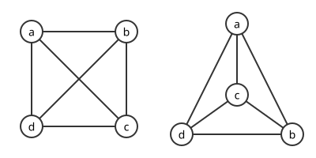
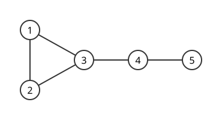

# 그래프

# 개요

**그래프(graph)** 는 점들과, 어느 두 점이 이어져 있는지만 기록한 구조다. 도시 다섯 개와 그 사이의 도로를 생각하면, 도로의 길이나 모양을 지우고 "어느 도시와 어느 도시가 직접 이어져 있는가" 만 남긴 것이 그래프다. 한 도시에서 다른 도시로 갈 수 있는지, 도로 몇 개를 거쳐야 하는지 같은 질문은 이 기록만으로 답이 나온다.

# 직관

## 그래프와 그림

그래프를 종이에 그리면 간선이 교차하지만, 교차점은 정점이 아니다. 같은 그래프를 다르게 그릴 수 있고 어떻게 그리든 그래프 자체는 같다. 기록되는 것은 정점 집합과 간선 집합뿐이다. 교차 없이 그릴 수 있는지는 그리는 방법이 아니라 그래프에 따라 정해지고, 그런 그래프가 [평면 그래프](planar-graphs.md)다.

아래 두 그림은 네 정점 $a,b,c,d$ 가 모두 서로 이어진 같은 그래프다. 왼쪽 그림에서는 간선 $ac$ 와 $bd$ 가 가운데서 교차하고, 오른쪽 그림에서는 $c$ 를 삼각형 안으로 옮겨 교차가 없다.

## 그래프로 옮길 때 사라지는 정보

도로망을 그래프로 옮기면 도로의 길이, 일방통행, 도로의 순서가 사라진다. 필요하면 간선에 수를 붙이거나 방향을 주어 다시 기록한다. 연결 여부만으로 부족한 문제를 연결 여부로만 적으면 그래프 위에서 얻은 답이 원래 문제의 답이 아니다.

# 정의

## 그래프

**유한 단순 무향 그래프(finite simple undirected graph)** 는 유한 집합 $V$ 와 $V$ 의 두 원소 부분집합들의 모임 $E$ 의 쌍이다.

$$
G=(V,E),\qquad E\subseteq\big\lbrace\lbrace u,v\rbrace:u,v\in V,\ u\ne v\big\rbrace
$$

$V$ 의 원소가 **정점(vertex)**, $E$ 의 원소가 **간선(edge)** 이다. $\lbrace u,v\rbrace\in E$ 이면 $u$ 와 $v$ 가 **인접한다(adjacent)** 고 하고, $v$ 에 인접한 정점의 수를 $v$ 의 **차수(degree)** $\deg(v)$ 라 한다.

$V=\lbrace 1,2,3,4,5\rbrace$ 이고 $E=\lbrace \lbrace 1,2\rbrace,\lbrace 1,3\rbrace,\lbrace 2,3\rbrace,\lbrace 3,4\rbrace,\lbrace 4,5\rbrace\rbrace$ 인 그래프는 다음 그림이다. 차수는 정점 $1$ 부터 차례로 $2,2,3,2,1$ 이다.

간선을 순서쌍 $(u,v)$ 로 바꾸면 **방향 그래프(directed graph)** 가 되고, 같은 두 정점 사이에 간선을 여러 개 허용하면 **다중 그래프(multigraph)** 다. 자기 자신으로 가는 간선은 **고리(loop)** 라 한다. 순환이 없는 방향 그래프를 DAG(directed acyclic graph)라 하고, [위상정렬](topological-sort.md)로 정점을 일렬로 늘어놓을 수 있다.

## 걷기, 경로, 순환

인접한 정점을 차례로 늘어놓은 열을 **걷기(walk)** 라 하고, 정점을 반복하지 않는 걷기를 **경로(path)**, 길이가 $3$ 이상이고 처음과 끝만 같은 걷기를 **순환(cycle)** 이라 한다. 걷기의 길이는 거친 간선 수다. 모든 두 정점 사이에 경로가 있으면 **연결 그래프(connected graph)** 이고, 서로 경로로 이어지는 정점들의 극대 집합을 **연결 성분(connected component)** 이라 한다.

위 그림에서 $1,3,4,5$ 는 길이 $3$ 인 경로이고 $1,2,3,1$ 은 길이 $3$ 인 순환이다. 그림의 그래프는 연결 그래프이고 연결 성분이 하나다.

## 트리와 이분 그래프

연결되어 있고 순환이 없는 그래프를 **트리(tree)** 라 한다. 위 그림에서 간선 $\lbrace 2,3\rbrace$ 를 지우면 남은 간선 $\lbrace 1,2\rbrace,\lbrace 1,3\rbrace,\lbrace 3,4\rbrace,\lbrace 4,5\rbrace$ 가 트리를 이룬다.

정점을 두 색으로 칠해 인접한 정점의 색이 늘 다르게 만들 수 있으면 **이분 그래프(bipartite graph)** 라 한다. 위 그림의 그래프는 정점 $1,2,3$ 이 서로 인접해 두 색으로 칠할 수 없으므로 이분 그래프가 아니다. 간선 $\lbrace 2,3\rbrace$ 를 지운 트리는 $1,4$ 를 한 색, $2,3,5$ 를 다른 색으로 칠할 수 있어 이분 그래프다.

## 인접행렬과 인접리스트

정점이 $1,\dots,n$ 인 그래프의 **인접행렬(adjacency matrix)** $A$ 는 $u$ 와 $v$ 가 인접하면 $A\_{uv}=1$, 아니면 $A\_{uv}=0$ 인 $n\times n$ [행렬](matrices.md)이다. **인접리스트(adjacency list)** 는 정점마다 이웃의 목록을 둔 표현이다. 위 그림의 그래프에서

$$
A=\begin{pmatrix}0&1&1&0&0\cr 1&0&1&0&0\cr 1&1&0&1&0\cr 0&0&1&0&1\cr 0&0&0&1&0\end{pmatrix}
$$

이고, 인접리스트는 $1:\lbrace 2,3\rbrace$, $2:\lbrace 1,3\rbrace$, $3:\lbrace 1,2,4\rbrace$, $4:\lbrace 3,5\rbrace$, $5:\lbrace 4\rbrace$ 다. $A$ 의 각 행의 합이 그 정점의 차수다.

# 성질

## 악수 정리

**악수 정리(handshaking lemma)** 는 다음 등식이다.

$$
\sum_{v\in V}\deg(v)=2\lvert E\rvert
$$

간선 하나가 두 끝점에서 한 번씩 세어지므로 성립한다. 위 그림의 그래프에서 $2+2+3+2+1=10=2\cdot 5$ 다. 홀수 차수를 가진 정점의 개수는 짝수다. 짝수 차수 항은 합의 홀짝에 영향을 주지 않으므로, 홀수 차수 정점이 홀수 개이면 좌변이 홀수가 되어 모순이다. 같은 대상을 두 방식으로 세는 이 논법을 이중 계산(double counting)이라 한다.

## 트리의 간선 수

정점이 $n$ 개인 트리의 간선은 정확히 $n-1$ 개다. 차수가 $1$ 인 정점(잎) 하나와 그 간선을 지우면 다시 트리가 되므로 귀납법으로 증명된다. 다음 세 조건 가운데 둘이 성립하면 나머지 하나가 성립한다.

- 연결되어 있다
- 순환이 없다
- 간선이 $n-1$ 개다

## 이분 그래프와 홀수 순환

이분 그래프인 것은 홀수 길이의 순환이 없는 것과 동치다. 한 정점에서 [그래프 탐색](graph-search.md)의 너비 우선 탐색으로 색을 번갈아 칠하다가 같은 색 두 정점이 인접하면 그 두 정점과 탐색 나무의 경로로 홀수 순환이 만들어진다. [그래프 색칠](graph-coloring.md)에서 2 색 판정은 선형 시간이지만 3 색 판정은 NP(nondeterministic polynomial time)-완전이다.

## 걷기의 개수와 행렬 거듭제곱

인접행렬 $A$ 에 대해 $(A^k)\_{uv}$ 는 $u$ 에서 $v$ 로 가는 길이 $k$ 인 걷기의 개수다. 행렬 곱 $(A^{k})\_{uv}=\sum\_w (A^{k-1})\_{uw}A\_{wv}$ 가 마지막 직전 정점 $w$ 에 따라 걷기를 나누어 더하기 때문이다. $A^3$ 의 대각합을 $6$ 으로 나누면 삼각형의 개수다. 각 삼각형은 시작점 셋과 방향 둘에 따라 여섯 번 세어진다. 위 그림의 그래프에서 대각합은 $6$ 이고 삼각형은 $1,2,3$ 하나다.

## 표현의 비용

정점 $n$ 개, 간선 $m$ 개인 그래프에서 두 표현의 비용은 다음과 같다.

| 표현 | 공간 | 인접 질의 | 이웃 순회 |
|---|---|---|---|
| 인접행렬 | $O(n^2)$ | $O(1)$ | $O(n)$ |
| 인접리스트 | $O(n+m)$ | $O(\deg)$ | $O(\deg)$ |

간선이 적은 그래프에서는 인접리스트가, 간선이 많거나 행렬 연산을 쓸 때는 인접행렬이 유리하다.

# 활용

## 모형화

경로 탐색, 일정과 의존 관계, 통신망 설계, 추천, 지식 표현을 그래프 위의 문제로 옮긴다. 옮긴 문제는 연결 성분, [최단경로](shortest-paths.md), 신장트리, [매칭](matchings.md), [네트워크 흐름](network-flow.md) 가운데 하나로 환원되는 경우가 많다.

## 난이도의 경계

최단경로는 다항시간이지만 최장 단순경로는 NP-난해이고, 2 색칠은 선형 시간이지만 3 색칠은 NP-완전이다. 모든 간선을 한 번씩 지나는 [Euler 회로](eulerian-circuits.md)는 차수의 홀짝으로 판정되지만 모든 정점을 한 번씩 지나는 [Hamilton 순환](hamiltonian-cycles.md)은 판정이 NP-완전이다.

## 행렬과 고윳값

인접행렬과 [그래프 Laplacian](graph-laplacian.md)의 [고윳값](eigenvalues.md)으로 연결성, 확장성, [무작위 걷기](random-walks.md)의 혼합 속도 같은 조합적 성질을 계산하고 어림한다. 스펙트럼 그래프 이론(spectral graph theory)이 이 방법을 쓴다.[^1]

[^1]: MIT, *Mathematics for Computer Science*, Chapter 11.1–11.4. 그래프, 차수, 연결성의 기초. https://ocw.mit.edu/courses/6-042j-mathematics-for-computer-science-spring-2015/resources/mit6_042js15_session19/

# 연관 문서

## 선수지식

- [집합](sets.md)
- [그래프 이론 개관](graph-theory-overview.md)

## 더 알아보기

### 구조와 알고리즘

- [그래프 탐색](graph-search.md)
- [위상정렬](topological-sort.md)
- [서로소 집합 자료구조](union-find.md)
- [균형 이진 탐색 트리](balanced-binary-search-trees.md)
- [트라이](tries.md)
- [세그먼트 트리](segment-trees.md)
- [이진 힙](binary-heaps.md)
- [동적 연결성](dynamic-connectivity.md)
- [네트워크 흐름](network-flow.md)

### 색칠, 매칭, 극단

- [그래프 색칠](graph-coloring.md)
- [매칭](matchings.md)
- [Hamilton 순환](hamiltonian-cycles.md)
- [Euler 회로](eulerian-circuits.md)
- [Cayley 공식](cayley-formula.md)
- [Ramsey 이론](ramsey-theory.md)
- [Turán 정리](turan-theorem.md)
- [Matroid](matroids.md)

### 대수와 위상

- [그래프 동형](graph-isomorphism.md)
- [그래프 Laplacian](graph-laplacian.md)
- [Euler 지표](euler-characteristic.md)
- [평면 그래프](planar-graphs.md)
- [Aanderaa–Karp–Rosenberg 추측](evasiveness-conjecture.md)

#graph_theory #combinatorics #linear_algebra #complexity
