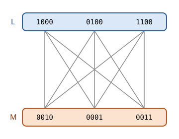

# Grassmann 그래프

# 개요

**Grassmann 그래프(Grassmann graph)** 는 유한체 위 벡터 공간의 $k$ 차원 부분공간을 정점으로 두고, 교집합의 차원이 하나만 작은 두 부분공간을 이은 그래프다. 네 자리 이진 문자열을 자리마다 더하는 공간에서 $\lbrace 0000,1000,0100,1100\rbrace$ 와 $\lbrace 0000,1000,0010,1010\rbrace$ 는 영 아닌 문자열 $1000$ 을 공유하므로 이어진다. 거리와 고윳값은 [Johnson 그래프](johnson-graphs.md)의 식에서 원소의 개수를 1 차원 부분공간의 개수로 바꾸면 모두 계산된다.

# 직관

Johnson 그래프 $J(4,2)$ 는 네 원소에서 두 원소를 고르고, 원소 하나를 바꾼 두 구성을 이었다. 원소 대신 [유한체](finite-fields.md) $\mathbb F\_2$ 위의 공간 $\mathbb F\_2^4$ 를 쓴다. 이 공간의 원소는 $1000$ 같은 네 자리 이진 문자열이고, 덧셈은 자리마다 $1+1=0$ 으로 더한다.

2 차원 부분공간은 영 아닌 두 문자열 $a,b$ 와 그 합 $a+b$, 그리고 $0000$ 으로 이루어진다. $L=\lbrace 0000,1000,0100,1100\rbrace$ 이 그런 예다. 두 2 차원 부분공간은 영 아닌 문자열을 하나 공유하거나 $0000$ 만 공유한다. 하나를 공유하는 것이 Johnson 그래프에서 원소 하나를 공유하는 것에 해당하고, 그런 두 부분공간을 잇는다.

$M=\lbrace 0000,0010,0001,0011\rbrace$ 은 $L$ 과 $0000$ 만 공유한다. $L$ 과 $M$ 에 모두 이웃인 부분공간은 $L$ 의 영 아닌 문자열 $a$ 하나와 $M$ 의 영 아닌 문자열 $b$ 하나를 담고, 그러면 $\lbrace 0000,a,b,a+b\rbrace$ 로 정해진다. 아래 그림의 선분 아홉 개가 그 아홉 부분공간이다.

$J(4,2)$ 에서 $12$ 와 $34$ 의 공통 이웃은 $2\times 2=4$ 개였다. 여기서는 $3\times 3=9$ 개다. 원소 하나가 1 차원 부분공간 하나로 바뀌었고, 2 차원 공간에는 1 차원 부분공간이 둘이 아니라 셋 있기 때문이다.

# 정의

$q$ 는 소수 거듭제곱이고 $\mathbb F\_q$ 는 원소가 $q$ 개인 유한체다.

## Gauss 이항계수

$\mathbb F\_q^n$ 의 $k$ 차원 부분공간의 개수를 **Gauss 이항계수(Gaussian binomial coefficient)** 라 하고 $\binom nk\_q$ 로 쓴다.

$$
\binom nk\_q=\frac{(q^n-1)(q^{n-1}-1)\cdots(q^{n-k+1}-1)}{(q^k-1)(q^{k-1}-1)\cdots(q-1)}
$$

일차독립인 벡터 $k$ 개를 순서대로 고르는 방법은 $(q^n-1)(q^n-q)\cdots(q^n-q^{k-1})$ 가지다. $k$ 차원 부분공간 하나에서 같은 방법으로 고르는 기저는 $(q^k-1)(q^k-q)\cdots(q^k-q^{k-1})$ 가지이므로, 나누면 위 식이 된다.

$q=2$, $n=4$, $k=2$ 이면 $\binom42\_2=\frac{15\cdot 7}{3\cdot 1}=35$ 다. 직관 절의 2 차원 부분공간은 35 개다.

1 차원 부분공간의 개수는 다음과 같다.

$$
\lbrack m\rbrack\_q=\binom m1\_q=\frac{q^m-1}{q-1}=1+q+\cdots+q^{m-1}
$$

$\lbrack 2\rbrack\_2=3$ 이 직관 절에서 공통 이웃을 셀 때 나온 $3$ 이다.

## Grassmann 그래프

$\mathbb F\_q^n$ 의 $k$ 차원 부분공간 전체를 정점으로 두고 $\dim(A\cap B)=k-1$ 인 두 부분공간 $A,B$ 를 이은 [그래프](graphs.md)를 Grassmann 그래프 $J\_q(n,k)$ 라 한다[^1]. 직관 절의 그래프는 $J\_2(4,2)$ 이고 정점이 35 개다.

$J\_q(n,1)$ 은 서로 다른 두 1 차원 부분공간의 교집합이 항상 $0$ 이므로 완전그래프다. $J\_2(3,1)$ 은 정점이 $\lbrack 3\rbrack\_2=7$ 개인 완전그래프다.

# 성질

## 거리

$J\_q(n,k)$ 에서 두 정점의 거리는 $k-\dim(A\cap B)$ 이다. 한 걸음에 교집합의 차원은 많아야 $1$ 늘어나고, $A$ 의 기저 벡터 하나를 $B$ 에만 있는 벡터로 바꾸면 $1$ 늘릴 수 있다. 지름은 $\min(k,n-k)$ 다.

$A$ 를 표준 내적에 대한 직교여공간 $A^\perp$ 로 보내면 $\dim(A^\perp\cap B^\perp)=n-\dim(A+B)$ 이므로 인접 관계가 보존된다. 그래서 $J\_q(n,k)$ 와 $J\_q(n,n-k)$ 는 같은 그래프이고, $n\ge 2k$ 인 경우만 보면 된다.

## 교차 배열

$J\_q(n,k)$ 는 [거리 정칙 그래프](distance-regular-graphs.md)이고 교차 배열은 다음과 같다[^1].

$$
b_i=q^{2i+1}\lbrack k-i\rbrack\_q\lbrack n-k-i\rbrack\_q,\qquad c_i=\lbrack i\rbrack\_q^2
$$

$c_i$ 는 Johnson 그래프의 $c_i=i^2$ 과 같은 방법으로 센다. 거리 $i$ 인 $A,B$ 의 공통 이웃 가운데 $A$ 쪽으로 한 걸음 가까운 것은 $B$ 에만 있는 방향 하나를 빼고 $A$ 에만 있는 방향 하나를 넣은 것이고, 두 방향의 선택이 각각 $\lbrack i\rbrack\_q$ 가지다.

$J\_2(4,2)$ 는 $b_0=2\cdot 3\cdot 3=18$, $b_1=8$, $c_1=1$, $c_2=9$ 이다. $c_2=9$ 가 직관 절 그림의 선분 아홉 개다.

## 고윳값

$n\ge 2k$ 일 때 $J\_q(n,k)$ 인접행렬의 고윳값은 $j=0,1,\dots,k$ 에 대해 다음과 같고, 중복도는 $\binom nj\_q-\binom n{j-1}\_q$ 다[^1].

$$
\theta_j=q^{j+1}\lbrack k-j\rbrack\_q\lbrack n-k-j\rbrack\_q-\lbrack j\rbrack\_q
$$

$J\_2(4,2)$ 의 고윳값은 $18$, $3$, $-3$ 이고 중복도는 $1$, $14$, $20$ 이다. 고윳값의 합 $18+3\cdot 14-3\cdot 20=0$ 이 대각합 $0$ 과 맞고, 제곱의 합 $324+126+180=630$ 이 차수의 합 $35\cdot 18$ 과 맞는다.

## Johnson 그래프와의 관계

$q\to 1$ 이면 $\lbrack m\rbrack\_q\to m$ 이고 $q$ 의 거듭제곱은 $1$ 로 간다. 그러면 교차 배열은 Johnson 그래프의 $b_i=(k-i)(n-k-i)$, $c_i=i^2$ 이 되고, 고윳값은 $(k-j)(n-k-j)-j$ 가 된다. 원소가 하나뿐인 체는 없으므로 이것은 식의 극한이고, $J(n,k)$ 를 $J\_q(n,k)$ 의 $q=1$ 인 경우로 부르는 근거다.

# 활용

- 부분공간 부호(subspace code). 무작위 선형 네트워크 부호화에서 송신자는 부분공간을 보내고 수신자는 그 안의 일차결합을 받는다. 두 부분공간의 거리 $\dim(A+B)-\dim(A\cap B)$ 는 $J\_q(n,k)$ 거리의 두 배이므로, 차원이 일정한 부분공간 부호는 Grassmann 그래프 위의 부호다[^2].
- [유일게임 추측과 2-to-2 정리](unique-games.md). 2-to-2 정리의 증명은 $J\_2(n,k)$ 의 작은 집합이 언제 확장성을 잃는지 분류한다[^3].
- [Erdős–Ko–Rado 정리](erdos-ko-rado.md)의 벡터 공간판. $n\ge 2k$ 에서 서로 $0$ 아닌 교집합을 갖는 $k$ 차원 부분공간의 모임은 크기가 $\binom{n-1}{k-1}\_q$ 이하다[^4].
- [연관 체계](association-schemes.md). $J\_q(n,k)$ 의 거리별 관계가 $q$-Johnson 체계를 이루고, 부분공간 부호의 선형계획 한계를 이 체계에서 계산한다.
- [Grassmann 다양체](grassmannian.md). 정점 집합은 Grassmann 다양체 $\mathrm{Gr}(k,n)$ 의 $\mathbb F\_q$ 점 전체이고, 그 개수가 Gauss 이항계수다.

[^1]: A. E. Brouwer, A. M. Cohen, A. Neumaier, *Distance-Regular Graphs*, Springer, 1989, §9.3.
[^2]: R. Koetter, F. R. Kschischang, "Coding for errors and erasures in random network coding", *IEEE Transactions on Information Theory* 54 (2008), 3579–3591.
[^3]: S. Khot, D. Minzer, M. Safra, "Pseudorandom sets in Grassmann graph have near-perfect expansion", *Annals of Mathematics* 198 (2023), 1–92.
[^4]: P. Frankl, R. M. Wilson, "The Erdős–Ko–Rado theorem for vector spaces", *Journal of Combinatorial Theory, Series A* 43 (1986), 228–236.

# 연관 문서

## 선수지식

- [Johnson 그래프](johnson-graphs.md)
- [유한체](finite-fields.md)

## 더 알아보기

아직 연결한 문서가 없다.

#graph_theory #combinatorics #linear_algebra #field_theory
