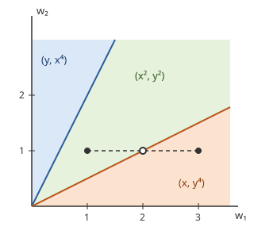

# Gröbner 부채

# 개요

**Gröbner 부채(Gröbner fan)** 는 한 아이디얼의 [Gröbner 기저](groebner-bases.md)가 단항식 순서에 따라 어떻게 달라지는지를, 변수마다 준 가중치의 공간을 뿔로 나눠 기록한 것이다. 방정식계 $x^2=y$, $y^2=x$ 는 $x$ 를 무겁게 보느냐 $y$ 를 무겁게 보느냐에 따라 Gröbner 기저가 세 가지로 나온다. 가중치 평면을 세 뿔로 나눈 그림 하나가 이 아이디얼의 Gröbner 기저를 모두 보이고, 한 기저에서 다른 기저로 옮겨 가는 계산의 경로도 이 그림 위에서 정해진다.

# 직관

$I=(x^2-y,\thinspace y^2-x)$ 의 선두항을 정할 때 $x$ 에 무게 $w\_1$, $y$ 에 무게 $w\_2$ 를 주고, 무게의 합이 큰 항을 선두항으로 고른다. $x^2-y$ 에서는 $2w\_1$ 과 $w\_2$ 를, $y^2-x$ 에서는 $2w\_2$ 와 $w\_1$ 을 비교한다.

$2w\_1\gt w\_2$ 이고 $2w\_2\gt w\_1$ 이면 선두항이 $x^2$ 와 $y^2$ 이다. 두 선두항이 공통 변수가 없으므로 $\lbrace x^2-y,\thinspace y^2-x\rbrace$ 가 Gröbner 기저이고, 선두항 아이디얼은 $(x^2,y^2)$ 다.

$w\_2\gt 2w\_1$ 이면 $x^2-y$ 의 선두항이 $y$ 로 바뀐다. $y=x^2$ 을 $y^2-x$ 에 넣으면 $x^4-x$ 가 나오고, 선두항이 $y$ 와 $x^4$ 인 $\lbrace y-x^2,\thinspace x^4-x\rbrace$ 가 Gröbner 기저다. $w\_1\gt 2w\_2$ 이면 같은 계산을 $x,y$ 를 바꿔 하여 $\lbrace x-y^2,\thinspace y^4-y\rbrace$ 를 얻는다. 이것이 [FGLM 알고리즘](fglm-algorithm.md)(Faugère–Gianni–Lazard–Mora)이 사전식 순서에서 얻은 기저다.

아래 그림은 양의 사분면을 두 반직선 $w\_2=2w\_1$ 과 $w\_1=2w\_2$ 로 나눈 것이다. 세 영역에 적은 것이 각 영역의 선두항 아이디얼이다. 점선과 점들은 성질 절의 Gröbner 걷기에서 쓴다.

# 정의

$S=k\lbrack x\_1,\dots,x\_n\rbrack$ 이고 $w\in\mathbb R^n$ 은 양의 성분을 갖는 가중치 벡터다.

## 초기형식

다항식 $f$ 의 항 $c\_\alpha x^\alpha$ 가운데 $w\cdot\alpha$ 가 가장 큰 항을 모두 더한 것을 $f$ 의 **초기형식(initial form)** $\mathrm{in}\_w(f)$ 라 한다. 아이디얼 $I$ 의 원소의 초기형식 전체가 생성하는 아이디얼을 $\mathrm{in}\_w(I)$ 로 쓴다.

$w=(1,1)$ 이면 $\mathrm{in}\_w(x^2-y)=x^2$ 이다. $w=(1,2)$ 이면 $x^2$ 과 $y$ 의 무게가 모두 $2$ 라 $\mathrm{in}\_w(x^2-y)=x^2-y$ 이다.

## Gröbner 뿔

$G$ 가 $I$ 의 축소 Gröbner 기저일 때, 모든 $g\in G$ 에 대해 $\mathrm{in}\_w(g)=\mathrm{LT}(g)$ 인 $w$ 의 집합의 폐포를 $G$ 의 **Gröbner 뿔(Gröbner cone)** 이라 한다. 이 집합은 $g$ 마다 선두항의 무게가 다른 항의 무게 이상이라는 일차부등식으로 정해지므로 다면 뿔이다.

직관 절의 가운데 영역은 $\lbrace x^2-y,\thinspace y^2-x\rbrace$ 의 Gröbner 뿔 $\lbrace 2w\_1\ge w\_2,\thinspace 2w\_2\ge w\_1\rbrace$ 이다.

## 부채

다면 뿔의 유한 모임이 각 뿔의 면을 모두 포함하고, 두 뿔의 교집합이 각각의 면이면 그 모임을 **부채(fan)** 라 한다. $I$ 의 Gröbner 뿔과 그 면 전체를 $I$ 의 Gröbner 부채라 한다[^1]. 직관 절의 Gröbner 부채는 뿔 셋과 반직선 둘, 원점으로 이루어진다.

# 성질

## 축소 Gröbner 기저의 유한성

**정리(Mora–Robbiano).** 아이디얼 $I$ 의 축소 Gröbner 기저는 단항식 순서를 모두 바꿔 보아도 유한 개뿐이고, Gröbner 뿔들은 부채를 이룬다[^1].

유한성의 요지는 서로 다른 선두항 아이디얼이 서로를 포함하지 않는다는 것이다. 두 선두항 아이디얼 밖의 단항식이 모두 $S/I$ 의 기저이므로, 한쪽이 다른 쪽을 포함하면 둘은 같다. 서로 포함하지 않는 단항식 아이디얼이 무한히 많으면 [Noether 환](noetherian-rings.md)의 Hilbert 기저 정리(Hilbert's basis theorem)와 모순되는 무한 증가열을 만들 수 있다.

## 주 아이디얼의 Gröbner 부채

$I=(f)$ 이면 축소 Gröbner 기저는 $f$ 하나이고 선두항만 바뀐다. 그래서 Gröbner 부채는 $f$ 의 지수 벡터들의 볼록 껍질, 곧 Newton 다면체의 법선 부채다. $f=x^2-y$ 의 Newton 다면체는 $(2,0)$ 과 $(0,1)$ 을 잇는 선분이고, 법선 부채는 $2w\_1=w\_2$ 에서 갈린다. 직관 절의 반직선 하나가 이것이다.

동차 아이디얼에서는 법선 부채가 Gröbner 부채와 같은 다면체가 있고, 이것을 상태 다면체(state polytope)라 한다[^2].

## Gröbner 걷기

한 Gröbner 뿔의 기저를 알 때 다른 뿔의 기저를 구하는 방법이 **Gröbner 걷기(Gröbner walk)** 다[^3]. 출발 가중치에서 목표 가중치로 선분을 따라가다 뿔의 벽을 지나는 점 $w^\ast$ 에서, $\mathrm{in}\_{w^\ast}(g)$ 들로 생성된 아이디얼의 새 기저를 구하고 그 원소를 $I$ 의 원소로 끌어올린다.

그림의 점선은 $(1,1)$ 에서 $(3,1)$ 로 가고 $w^\ast=(2,1)$ 에서 벽 $w\_1=2w\_2$ 를 지난다. 여기서 초기형식은 $x^2$ 과 $y^2-x$ 이다. 새 순서에서 $x$ 가 선두항이 되도록 $(x^2,\thinspace x-y^2)$ 의 기저를 구하면 $\lbrace x-y^2,\thinspace y^4\rbrace$ 이다. $y^4$ 을 끌어올리면 다음 등식에서 $y^4-y\in I$ 다.

$$
y^4-y=(y^2+x)(y^2-x)+(x^2-y)
$$

그래서 목표 뿔의 기저 $\lbrace x-y^2,\thinspace y^4-y\rbrace$ 가 나온다. 벽마다 계산하는 아이디얼은 초기형식으로 만든 것이라 항이 적고, 해가 무한히 많은 아이디얼에도 쓸 수 있다.

# 활용

- 순서 변환. 해를 구하려면 사전식 순서의 기저가 필요하지만 계산은 차수 순서에서 빠르다. 해가 유한 개이면 FGLM 알고리즘을, 일반 아이디얼이면 Gröbner 걷기를 쓴다.
- [토릭 아이디얼](toric-ideals.md). 정수계획 문제의 비용 벡터를 가중치로 두면 비용마다 다른 축소 Gröbner 기저가 쓰이고, 그 전체가 토릭 아이디얼의 Gröbner 부채다[^2].
- 열대 기하(tropical geometry). $\mathrm{in}\_w(I)$ 에 단항식이 들어가지 않는 $w$ 의 집합이 $I$ 의 열대 다양체이고, Gröbner 부채의 부분 부채로 계산된다.

[^1]: T. Mora, L. Robbiano, "The Gröbner fan of an ideal", *Journal of Symbolic Computation* 6 (1988), 183–208.
[^2]: B. Sturmfels, *Gröbner Bases and Convex Polytopes*, University Lecture Series 8, American Mathematical Society, 1996, 1장과 2장.
[^3]: S. Collart, M. Kalkbrener, D. Mall, "Converting bases with the Gröbner walk", *Journal of Symbolic Computation* 24 (1997), 465–469.

# 연관 문서

## 선수지식

- [Gröbner 기저](groebner-bases.md)
- [볼록 다면체](convex-polytopes.md)

## 더 알아보기

아직 연결한 문서가 없다.

#ring_theory #algebra #algorithms #combinatorics
