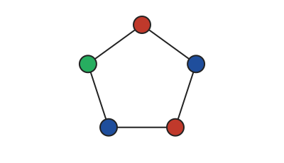

# Grötzsch 정리

# 개요

**Grötzsch 정리(Grötzsch's theorem)** 는 간선이 엇갈리지 않게 평면에 그릴 수 있고 삼각형이 없는 그래프는 세 색으로 칠해진다는 정리다. 평면 그래프 가운데에는 네 색이 드는 것이 있지만, 그런 그래프는 모두 삼각형을 가진다.

다섯 칸 고리는 삼각형이 없는 평면 그래프이고 세 색이 들므로, 세 색은 더 줄어들지 않는다.

# 직관

다음 그림은 다섯 칸 고리를 빨강, 파랑, 빨강, 파랑, 초록으로 칠한 것이다. 홀수 고리라 두 색으로는 칠할 수 없다.

[평면 그래프](planar-graphs.md)는 Euler 공식(Euler's formula)에서 간선 수가 $3V-6$ 이하다. 삼각형이 없으면 면마다 변이 넷 이상이므로 간선 수가 $2V-4$ 이하로 줄고, 차수의 합이 $4V-8$ 이하라 차수가 $3$ 이하인 정점이 있다. 그 정점을 지우고 나머지를 칠한 뒤 되돌리면 네 색으로 칠해진다.

이 논법은 [4색 정리](four-color-theorem.md)를 쓰지 않는다. 세 색으로 줄이려면 차수가 $3$ 인 정점의 세 이웃이 세 색을 다 쓰는 경우를 처리해야 하고, Grötzsch 정리가 그것을 한다.

# 정의

## 정리의 진술

삼각형이 없는 평면 그래프 $G$ 는 [그래프 색칠](graph-coloring.md)의 채색수가

$$
\chi(G)\le 3
$$

이다[^1]. 직관 절의 다섯 칸 고리에서 등호가 성립한다.

## 둘레

그래프에서 가장 짧은 고리의 길이를 **둘레(girth)** 라 한다. 삼각형이 없다는 것은 둘레가 $4$ 이상이라는 것이다. 다섯 칸 고리의 둘레는 $5$ 다.

# 성질

## 둘레가 6 이상인 경우

둘레가 $6$ 이상인 평면 그래프는 같은 셈으로 간선 수가 $\tfrac32(V-2)$ 이하이고, 차수가 $2$ 이하인 정점이 있다. 그 정점을 지우고 귀납하면 세 색으로 칠해진다. Grötzsch 정리는 둘레가 $4$ 와 $5$ 인 경우까지 같은 결론을 준다.

## 증명

Grötzsch 의 원래 증명은 경우가 많다[^1]. Thomassen 은 바깥 면의 짧은 고리에 미리 색을 준 채로 칠하기를 늘리는 더 강한 진술을 세워 짧은 귀납 증명을 주었고, 같은 방법으로 둘레가 $5$ 이상인 평면 그래프가 [목록 색칠](list-coloring.md)에서 $3$ 선택 가능임도 증명했다[^2].

## 삼각형이 몇 개 있는 경우

Grünbaum 은 삼각형이 $3$ 개 이하인 평면 그래프도 세 색으로 칠해짐을 증명했고, Aksenov 가 증명을 고쳤다[^3]. 삼각형이 $4$ 개인 평면 그래프 $K\_4$ 는 네 색이 들므로 $3$ 은 더 늘어나지 않는다.

## 평면성의 역할

평면성을 빼면 정리는 성립하지 않는다. [Mycielski 구성](mycielskian.md)의 Grötzsch 그래프는 삼각형이 없고 네 색이 든다. 그래서 이 그래프는 평면 그래프가 아니다.

## 알고리즘

Dvořák, Kawarabayashi, Thomas 는 삼각형이 없는 평면 그래프를 세 색으로 칠하는 선형 시간 알고리즘을 주었다[^4]. 일반 평면 그래프가 세 색으로 칠해지는지 판정하는 문제는 NP-완전(NP-complete, NP 는 nondeterministic polynomial time)이다.

# 활용

- 평면 그래프의 색칠 문제. [4색 정리](four-color-theorem.md)가 평면 그래프 전체에 네 색을 주고, Grötzsch 정리는 삼각형이 없는 경우에 세 색을 준다.
- 쌍대 그래프의 흐름. 평면 그래프의 정점 3 색칠은 쌍대 그래프에서 어느 간선에서도 $0$ 이 아닌 $\mathbb Z\_3$ 값 흐름(nowhere-zero 3-flow)과 대응한다. 간선 연결성이 $4$ 이상인 평면 그래프의 쌍대는 삼각형이 없으므로, Grötzsch 정리에서 그런 평면 그래프에 이 흐름이 있다는 것이 나온다.
- [임계 그래프](critical-graphs.md). 삼각형이 없는 $4$ 임계 그래프는 평면 그래프가 아니다.

[^1]: H. Grötzsch, "Zur Theorie der diskreten Gebilde, VII: Ein Dreifarbensatz für dreikreisfreie Netze auf der Kugel", *Wissenschaftliche Zeitschrift der Martin-Luther-Universität Halle-Wittenberg, Mathematisch-Naturwissenschaftliche Reihe* 8 (1959), 109–120.
[^2]: C. Thomassen, "A short list color proof of Grötzsch's theorem", *Journal of Combinatorial Theory, Series B* 88 (2003), 189–192.
[^3]: B. Grünbaum, "Grötzsch's theorem on 3-colorings", *Michigan Mathematical Journal* 10 (1963), 303–310.
[^4]: Z. Dvořák, K. Kawarabayashi, R. Thomas, "Three-coloring triangle-free planar graphs in linear time", *ACM Transactions on Algorithms* 7 (2011), article 41.

# 연관 문서

## 선수지식

- [평면 그래프](planar-graphs.md)
- [그래프 색칠](graph-coloring.md)

## 더 알아보기

아직 연결한 문서가 없다.

#graph_theory #combinatorics
