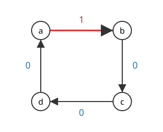

# 군 색칠

# 개요

**군 색칠(group coloring)** 은 간선마다 두 끝의 색의 차이로 쓰면 안 되는 값을 하나씩 아무렇게나 정해 주어도, 그 값을 모두 피해 정점에 색을 줄 수 있다는 성질이다. 보통의 [그래프 색칠](graph-coloring.md)은 모든 간선에서 차이 $0$ 을 금지한 경우다. 네 정점의 고리는 두 색으로 칠해지지만, 간선 하나에서만 금지하는 값을 $1$ 로 바꾸면 두 색으로는 칠할 수 없다. 군 색칠은 금지하는 값이 어떻게 정해져도 칠하려면 색이 몇 개 있어야 하는지를 묻고, 평면 그래프에서는 그 답이 쌍대 그래프의 [군 연결성](group-connectivity.md)으로 바뀐다.

# 직관

아래 그림의 고리 $a\to b\to c\to d\to a$ 의 정점에 색 $0$, $1$ 을 준다. 간선의 수는 그 간선에서 금지하는 차이이고, 차이는 화살표 끝 정점의 색에서 시작 정점의 색을 빼고 $2$ 로 나눈 나머지다.

수가 $0$ 인 간선은 차이 $0$ 을 금지하므로 두 끝의 색이 달라야 한다. 수가 $1$ 인 간선 $a\to b$ 는 차이 $1$ 을 금지하므로 $a$ 와 $b$ 의 색이 같아야 한다. $a$ 의 색을 정하면 $b$ 는 같은 색, $c$ 는 다른 색, $d$ 는 다시 다른 색이고, $d$ 와 $a$ 도 달라야 한다. 고리를 한 바퀴 도는 동안 색이 세 번 바뀌므로 $a$ 로 돌아오면 처음 색과 달라야 하고, 칠할 수 없다.

색을 $0,1,2$ 로 늘리고 $3$ 으로 나눈 나머지로 차이를 재면 금지하는 수가 어떻게 정해져도 칠할 수 있다. $a$ 의 색을 정하고 $b$, $c$ 의 색을 금지된 차이를 피해 차례로 정한다. 남은 $d$ 는 $c$ 와의 간선과 $a$ 와의 간선에서 하나씩, 많아야 두 색을 금지당하므로 세 색 가운데 하나가 남는다.

# 정의

## 군 색칠 가능

$G=(V,E)$ 를 그래프, $A$ 를 아벨 군(abelian group)이라 하고 간선마다 방향을 정한다. 간선 $e$ 가 $u$ 에서 $v$ 로 가면 $e=(u,v)$ 로 쓴다. 모든 함수 $f\colon E\to A$ 에 대해 다음을 만족하는 $c\colon V\to A$ 가 있으면 $G$ 가 **$A$ 색칠 가능($A$-colorable)** 하다고 한다.

$$
c(v)-c(u)\ne f(e)\qquad\text{for every } e=(u,v)\in E
$$

간선의 방향을 뒤집고 $f(e)$ 의 부호를 바꾸면 조건이 그대로이므로, 이 성질은 방향을 고르는 방법과 상관없다. 직관 절의 고리는 $f(a,b)=1$, 나머지 간선에서 $f=0$ 일 때 $c$ 가 없으므로 $\mathbb Z\_2$ 색칠 가능이 아니고, $\mathbb Z\_3$ 색칠 가능이다. F. Jaeger, N. Linial, C. Payan, M. Tarsi 가 이 개념을 정의했다[^1].

## 군 채색수

$\vert A\vert\ge m$ 인 모든 아벨 군 $A$ 에 대해 $G$ 가 $A$ 색칠 가능인 가장 작은 $m$ 을 **군 채색수(group chromatic number)** 라 하고 $\chi\_g(G)$ 로 쓴다. 직관 절의 고리 $C\_4$ 는 $\chi\_g(C\_4)=3$ 이다. 크기 $3$ 이상의 군에서는 직관 절의 마지막 문단의 논증이 그대로 통한다.

# 성질

## 채색수와 퇴화도 사이

모든 그래프에서 다음이 성립한다.

$$
\chi(G)\le\chi\_g(G)\le d+1
$$

$\chi(G)$ 는 채색수, $d$ 는 [그래프 퇴화도](graph-degeneracy.md)다. 왼쪽은 $f=0$ 으로 두면 나온다. 이때 $A$ 색칠은 원소 $\vert A\vert$ 개를 색으로 쓰는 보통의 색칠이다.

오른쪽은 정점을 먼저 칠한 이웃이 $d$ 개 이하가 되는 순서로 늘어놓고 차례로 칠해 얻는다. 먼저 칠한 이웃 $u$ 하나는 간선 하나의 조건으로 지금 정점의 색을 하나만 금지하므로, $\vert A\vert\ge d+1$ 이면 남는 색이 있다.

따라서 간선이 있는 나무는 $\chi\_g=2$, 완전그래프는 $\chi\_g(K\_n)=n$, 평면 그래프는 퇴화도가 $5$ 이하이므로 $\chi\_g\le 6$ 이다.

## 고리

$n\ge 3$ 인 고리는 $\chi\_g(C\_n)=3$ 이다. 고리를 한 방향으로 돌게 방향을 정하고 $s\_i$ 를 $i$ 번째 간선의 차이로 두면, 칠하는 것은 $s\_i\ne f\_i$ 이고 합이 $0$ 인 $s\_1,\dots,s\_n$ 을 고르는 것과 같다. $\vert A\vert\ge 3$ 이면 $s\_1,\dots,s\_{n-2}$ 를 아무렇게나 고른 뒤 $s\_{n-1}$ 은 많아야 두 값만 피하면 되고, $s\_n$ 은 합으로 정해진다.

$\mathbb Z\_2$ 에서는 $s\_i=f\_i+1$ 로 강제되므로, 다음이 되게 $f$ 를 고르면 칠할 수 없다.

$$
f\_1+f\_2+\dots+f\_n+n\ne 0
$$

짝수 고리는 채색수가 $2$ 이므로 $\chi\_g$ 와 $\chi$ 가 다르다.

## 평면 그래프의 쌍대

평면 그래프 $G$ 와 그 쌍대 그래프 $G^\ast$ 에 대해, $G$ 가 $A$ 색칠 가능인 것과 $G^\ast$ 가 $A$ 연결인 것이 동치다[^1].

증명의 요지. $G$ 의 정점 색 $c$ 에서 간선마다 차이 $c(v)-c(u)$ 를 $G^\ast$ 의 대응하는 간선에 옮기면, $G$ 의 면마다 둘레를 도는 차이의 합이 $0$ 이므로 $G^\ast$ 의 정점마다 경계가 $0$ 인 흐름이 된다. 거꾸로 $G^\ast$ 의 흐름은 $G$ 의 모든 순환에서 합이 $0$ 이므로 정점 색의 차이로 적힌다. 차이에서 금지하는 값 $f$ 를 뺀 함수 $h$ 는 $G^\ast$ 에서 경계가 $-\partial f$ 이고, 칠하는 조건은 $h$ 가 어느 간선에서도 $0$ 이 아니라는 것이다. $G^\ast$ 의 경계 조건은 모두 어떤 $f$ 의 $-\partial f$ 로 나타난다.

평면 그래프의 보통의 색칠이 쌍대의 [nowhere-zero 흐름](nowhere-zero-flows.md)과 대응하는 것을 경계 조건까지 넓힌 것이다.

# 활용

- 흐름 정리의 쌍대 진술. 평면 그래프에서 군 연결성에 관한 정리는 쌍대 그래프의 군 색칠에 관한 정리로 옮겨 진술한다.- 미리 칠한 정점의 확장. 그래프의 일부를 먼저 칠하면 남은 정점마다 이웃이 금지하는 색이 생긴다. 금지하는 차이를 간선마다 따로 두는 군 색칠은 이 확장을 모든 경우에 한꺼번에 다룬다.
- [목록 색칠](list-coloring.md)과의 비교. 목록 색칠은 정점마다 쓸 수 있는 색을 따로 정하고, 군 색칠은 간선마다 금지하는 관계를 따로 정한다. 두 수 모두 퇴화도에 $1$ 을 더한 값 이하이고 채색수 이상이다.

[^1]: F. Jaeger, N. Linial, C. Payan, M. Tarsi, "Group connectivity of graphs—a nonhomogeneous analogue of nowhere-zero flow properties", *Journal of Combinatorial Theory, Series B* 56 (1992), 165–182.

# 연관 문서

## 선수지식

- [그래프 색칠](graph-coloring.md)
- [군 연결성](group-connectivity.md)

## 더 알아보기

아직 연결한 문서가 없다.

#graph_theory #combinatorics #algebra
