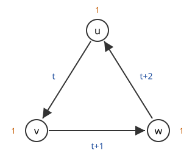

# 군 연결성

# 개요

**군 연결성(group connectivity)** 은 그래프의 정점마다 내보낼 양을 아무렇게나 정해 주어도, 모든 간선의 값이 $0$ 이 아니면서 그 양을 맞추는 흐름이 있다는 성질이다. 세 정점 $u,v,w$ 를 고리로 잇고 값을 $3$ 으로 나눈 나머지로 쓰면, 고리를 따라 $1$ 씩 보내는 흐름은 모든 값이 $0$ 이 아니다. 그런데 세 정점이 모두 $1$ 씩 내보내야 한다고 정하면, 세 간선의 값이 $t,t+1,t+2$ 가 되어 하나는 반드시 $0$ 이다.

그래프를 조각으로 나눠 흐름을 만들 때, 바깥에서 들어오는 양이 조각의 정점마다 아무렇게나 정해진다. 조각이 이 성질을 가지면 바깥 흐름이 어떻든 조각 안을 채울 수 있으므로, 조각을 한 점으로 줄이고 남은 그래프만 다루면 된다.

# 직관

[Nowhere-zero 흐름](nowhere-zero-flows.md)은 모든 정점에서 들어오는 양과 나가는 양이 같아야 한다. 아래 그림의 고리 $u\to v\to w\to u$ 에 값을 $3$ 으로 나눈 나머지로 주면, 세 간선에 모두 $1$ 을 주는 것이 nowhere-zero 흐름이다.

이제 정점마다 나가는 양에서 들어오는 양을 뺀 값을 $1$ 로 정한다. 세 값의 합은 $3$ 이고 $3$ 으로 나눈 나머지로는 $0$ 이라, 어디서 더 들어오지 않아도 앞뒤가 맞는다. 간선 $uv$ 의 값을 $t$ 로 두면, $v$ 에서 $1$ 을 더 내보내야 하므로 $vw$ 의 값은 $t+1$ 이고, 같은 이유로 $wu$ 의 값은 $t+2$ 다. 그림의 주황 수가 정점마다 정한 양이고 파란 글자가 간선의 값이다.

$t$ 를 $0,1,2$ 가운데 무엇으로 잡아도 $t,t+1,t+2$ 가 $0,1,2$ 를 모두 지나므로 값이 $0$ 인 간선이 생긴다. 값을 $4$ 로 나눈 나머지로 쓰면 세 값이 네 나머지 가운데 셋만 차지하므로 남은 자리에 $0$ 을 둘 수 있다. 고리에는 nowhere-zero 흐름이 있지만, 정점마다 정한 양을 맞추는 일은 값의 종류가 넉넉해야 된다.

# 정의

$G=(V,E)$ 를 그래프, $A$ 를 아벨 군(abelian group)이라 하고 간선마다 방향을 하나 정한다. 함수 $f\colon E\to A$ 의 **경계(boundary)** $\partial f\colon V\to A$ 는 다음이다.

$$
\partial f(v)=\sum_{e\in\delta^+(v)}f(e)-\sum_{e\in\delta^-(v)}f(e)
$$

$\delta^+(v)$ 는 $v$ 에서 나가는 간선, $\delta^-(v)$ 는 $v$ 로 들어오는 간선의 집합이다. 모든 간선이 두 끝에서 한 번씩 더하고 빼지므로 $\sum_{v}\partial f(v)=0$ 이다. $\partial f=0$ 인 것이 nowhere-zero 흐름의 보존 조건이다.

$\sum_v b(v)=0$ 인 함수 $b\colon V\to A$ 를 **$A$ 경계 조건($A$-boundary)** 이라 한다. 연결 그래프 $G$ 가 **$A$ 연결($A$-connected)** 이라는 것은, 모든 $A$ 경계 조건 $b$ 에 대해 $\partial f=b$ 이고 모든 간선에서 $f(e)\ne0$ 인 $f$ 가 있다는 것이다. 간선의 방향을 뒤집고 그 간선의 값의 부호를 바꾸면 조건이 그대로이므로 이 성질은 방향을 고르는 방법과 상관없다.

직관 절의 고리는 $b=(1,1,1)$ 에서 막히므로 $\mathbb Z_3$ 연결이 아니고, 아래 고리의 정리에 따라 $\mathbb Z_4$ 연결이다. F. Jaeger, N. Linial, C. Payan, M. Tarsi 가 이 개념을 정의했다[^1].

# 성질

## nowhere-zero 흐름과의 관계

$G$ 가 $A$ 연결이면 $b=0$ 으로 두어 nowhere-zero $A$ 흐름을 얻는다. 거꾸로는 성립하지 않는다. 직관 절의 고리가 nowhere-zero $\mathbb Z_3$ 흐름을 가지지만 $\mathbb Z_3$ 연결이 아니다.

## 고리

정점이 $n$ 개인 고리 $C_n$ 은 $\vert A\vert\ge n+1$ 인 것과 $A$ 연결인 것이 동치다. 고리를 한 방향으로 돌게 방향을 정하면, 경계 조건 $b$ 가 정해질 때 간선 값은 $t+c_1,\dots,t+c_n$ 꼴로 정해지고 $c_i$ 는 $b$ 의 부분합이다. 값이 모두 $0$ 이 아니려면 $t$ 가 $-c_1,\dots,-c_n$ 을 피해야 한다. $\vert A\vert\ge n+1$ 이면 피할 자리가 남고, $\vert A\vert\le n$ 이면 $c_i$ 들이 $A$ 의 서로 다른 원소 $n$ 개를 덮도록 $b$ 를 고를 수 있다.

## 축약

$H$ 가 $G$ 의 연결 부분그래프이고 $A$ 연결이면, $G$ 가 $A$ 연결인 것과 $H$ 를 한 정점으로 줄인 $G/H$ 가 $A$ 연결인 것이 동치다[^1]. $G/H$ 에서 경계 조건을 맞춘 뒤 $H$ 의 정점마다 남은 차이를 새 경계 조건으로 두고, $H$ 가 $A$ 연결이라 그것을 $H$ 안에서 맞춘다. 개요의 "조각을 한 점으로 줄인다" 가 이 성질이다. 그래프를 $A$ 연결인 조각으로 줄여 가며 흐름의 존재를 증명할 때 쓴다.

## 간선 연결도로 하는 충분조건

Jaeger, Linial, Payan, Tarsi 는 다음을 증명했다[^1].

- 3 간선 연결인 그래프는 $\vert A\vert\ge6$ 인 모든 아벨 군 $A$ 에 대해 $A$ 연결이다. [Seymour 6 흐름 정리](seymour-6-flow-theorem.md)를 경계 조건이 있는 꼴로 넓힌 것이다.
- 간선을 공유하지 않는 신장나무 두 개를 가진 그래프는 $\vert A\vert\ge4$ 인 모든 $A$ 에 대해 $A$ 연결이다. 4 간선 연결인 그래프는 이런 신장나무 두 개를 가진다.

**Jaeger–Linial–Payan–Tarsi 추측(Jaeger–Linial–Payan–Tarsi conjecture)** 은 5 간선 연결인 그래프가 모두 $\mathbb Z_3$ 연결이라는 진술이다. $\mathbb Z_3$ 연결이면 nowhere-zero $3$ 흐름이 있고, Kochol 의 환원으로 [Tutte 3 흐름 추측](tutte-3-flow-conjecture.md)은 5 간선 연결인 그래프에서만 보이면 되므로, 이 추측은 Tutte 3 흐름 추측을 함의한다. L. M. Lovász, C. Thomassen, Y. Wu, C.-Q. Zhang 은 6 간선 연결인 그래프가 $\mathbb Z_3$ 연결임을 증명했다[^2].

## 군의 구조에 따른 차이

nowhere-zero $A$ 흐름이 있는지는 $\vert A\vert$ 에만 달려 있다. 군 연결성은 그렇지 않다. R. Hušek, L. Mohelníková, R. Šámal 은 $\mathbb Z_4$ 연결이지만 $\mathbb Z_2\times\mathbb Z_2$ 연결이 아닌 그래프와 그 반대인 그래프를 찾았다[^3]. 경계 조건 $b$ 가 군의 원소를 정점마다 따로 고정하므로, 흐름의 개수를 $\vert A\vert$ 의 다항식으로 세는 Tutte 의 논증이 그대로 옮겨 가지 않는다.

# 활용

- 흐름 정리의 귀납 증명. 축약 성질로 $\mathbb Z_3$ 연결인 부분그래프를 한 점으로 줄여 최소 반례의 구조를 좁힌다.
- 모듈러 방향. $\mathbb Z_3$ 연결성은 정점마다 나가는 간선 수와 들어오는 간선 수의 차를 $3$ 으로 나눈 나머지를, 합이 간선 수와 맞기만 하면 어떻게 정해도 그대로 되는 방향이 있다는 진술과 동치다. Tutte 3 흐름 추측 문서의 모듈러 3 방향을 경계 조건이 있는 꼴로 넓힌 것이다.
- 그래프 색칠과의 쌍대. 평면 그래프에서 nowhere-zero 흐름이 면의 색칠과 대응하듯, 평면 그래프의 군 연결성은 쌍대 그래프의 [군 색칠](group-coloring.md)과 동치다.

[^1]: F. Jaeger, N. Linial, C. Payan, M. Tarsi, "Group connectivity of graphs—a nonhomogeneous analogue of nowhere-zero flow properties", *Journal of Combinatorial Theory, Series B* 56 (1992), 165–182.
[^2]: L. M. Lovász, C. Thomassen, Y. Wu, C.-Q. Zhang, "Nowhere-zero 3-flows and modulo k-orientations", *Journal of Combinatorial Theory, Series B* 103 (2013), 587–598.
[^3]: R. Hušek, L. Mohelníková, R. Šámal, "Group connectivity: Z4 vs Z2²", *Journal of Graph Theory* 93 (2020), 317–327.

# 연관 문서

## 선수지식

- [Tutte 3 흐름 추측](tutte-3-flow-conjecture.md)
- [Seymour 6 흐름 정리](seymour-6-flow-theorem.md)

## 더 알아보기

- [군 색칠](group-coloring.md)

#graph_theory #combinatorics #algebra
