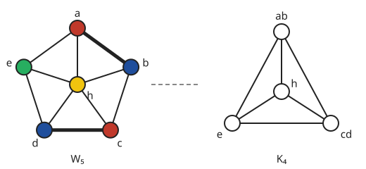

# Hadwiger 추측

# 개요

**Hadwiger 추측(Hadwiger's conjecture)** 은 칠하는 데 $t$ 색이 드는 그래프는 간선을 줄여 합치는 조작으로 $t$ 개의 정점이 모두 서로 이웃한 그래프를 만들 수 있다는 추측이다. 다섯 칸 고리는 삼각형이 없는데도 세 색이 들고, 이웃한 두 정점을 두 번 합치면 삼각형이 된다.

이 추측은 색이 많이 드는 이유를 축약으로 얻는 큰 완전그래프로 설명한다. 색의 수 $t$ 가 $6$ 이하이면 증명되어 있다.

# 직관

[그래프 색칠](graph-coloring.md)에서 $t$ 개의 정점이 모두 서로 이웃한 완전그래프 $K\_t$ 는 $t$ 색이 든다. 그래프가 $K\_t$ 를 부분그래프로 가지면 $t$ 색 이상이 든다. 거꾸로 $t$ 색이 드는 그래프가 언제나 $K\_t$ 를 가지는 것은 아니다. 다섯 칸 고리는 세 색이 들지만 삼각형이 없고, [Mycielski 구성](mycielskian.md)은 삼각형이 없으면서 색이 얼마든지 많이 드는 그래프를 만든다.

부분그래프 대신 간선을 줄여 두 끝을 한 정점으로 합치는 축약을 허용한다. 다음 그림의 왼쪽은 다섯 칸 고리 $a,b,c,d,e$ 에 모든 정점과 이웃한 가운데 정점 $h$ 를 더한 바퀴 그래프 $W\_5$ 다.

바깥 고리는 홀수 고리라 세 색이 들고, $h$ 는 고리의 모든 정점과 이웃하므로 넷째 색이 든다. 그림의 굵은 간선 $ab$ 와 $cd$ 를 축약하면 바깥 고리가 삼각형 $ab,cd,e$ 가 되고, $h$ 는 세 정점 모두와 이웃해 $K\_4$ 가 나온다. 네 색이 드는 $W\_5$ 에서 $K\_4$ 가 축약으로 나왔다.

# 정의

## 마이너와 Hadwiger 수

$H$ 가 $G$ 의 [그래프 마이너](graph-minors.md)라는 것은 정점 삭제, 간선 삭제, 간선 축약으로 $G$ 에서 $H$ 를 얻을 수 있다는 뜻이다. $K\_t$ 가 $G$ 의 마이너가 되는 가장 큰 $t$ 를 $G$ 의 **Hadwiger 수(Hadwiger number)** $h(G)$ 라 한다.

직관 절의 $W\_5$ 에서 $h(W\_5)=4$ 다. 정점이 $6$ 개인 $W\_5$ 에서 $K\_5$ 를 얻으려면 정점 하나를 지우거나 간선 하나를 축약해야 한다. 어느 쪽이든 손대지 않은 바깥 고리 정점이 남고, 그 정점의 차수는 $3$ 이하라 $K\_5$ 의 차수 $4$ 에 닿지 않는다.

## 추측

Hadwiger 추측은 모든 그래프 $G$ 에 대해

$$
\chi(G)\le h(G)
$$

라는 진술이다[^1]. $\chi$ 는 채색수다. 자연수 $t$ 를 고정해 " $K\_t$ 를 마이너로 갖지 않는 그래프는 $t-1$ 색으로 칠해진다" 는 진술을 **$t$ 에 대한 Hadwiger 추측** 이라 한다.

$W\_5$ 에서 $\chi(W\_5)=4=h(W\_5)$ 다.

# 성질

## t 가 3 이하인 경우

$K\_2$ 를 마이너로 갖지 않는 그래프는 간선이 없으므로 한 색으로 칠해진다. $K\_3$ 를 마이너로 갖지 않는 그래프는 고리가 없는 숲이다. 고리는 축약하면 $K\_3$ 이 되기 때문이다. 숲은 두 색으로 칠해진다.

## t 가 4 인 경우

$K\_4$ 를 마이너로 갖지 않는 그래프는 세 색으로 칠해진다. Hadwiger 가 추측과 함께 증명했고 Dirac 이 다시 증명했다[^1][^2].

증명의 요지. $K\_4$ 를 마이너로 갖지 않는 그래프에는 차수가 $2$ 이하인 정점 $v$ 가 있다[^2]. $v$ 를 지운 그래프도 $K\_4$ 를 마이너로 갖지 않으므로 귀납법으로 세 색으로 칠하고, $v$ 의 이웃 둘이 쓰지 않은 색을 $v$ 에 준다.

## t 가 5 인 경우와 4색 정리

$5$ 에 대한 Hadwiger 추측은 [4색 정리](four-color-theorem.md)와 동치다. [평면 그래프](planar-graphs.md)는 $K\_5$ 를 마이너로 갖지 않으므로 추측에서 4색 정리가 나온다.

거꾸로 Wagner 는 $K\_5$ 를 마이너로 갖지 않는 그래프가 평면 그래프와 정점 $8$ 개의 Wagner 그래프를 크기 $3$ 이하의 클릭에서 붙여 만들어짐을 증명했다[^3]. 클릭에서 붙여 만든 그래프의 채색수는 두 조각의 채색수 가운데 큰 값 이하이고 Wagner 그래프는 세 색으로 칠해지므로, 4색 정리에서 추측이 나온다.

## t 가 6 인 경우

Robertson, Seymour, Thomas 는 $K\_6$ 을 마이너로 갖지 않는 그래프가 다섯 색으로 칠해짐을 증명했다[^4]. 최소 반례는 정점 하나를 지우면 평면 그래프가 되는 그래프임을 보이고, 거기에 4색 정리를 쓴다. $t\ge 7$ 에서는 추측이 증명되지 않았다[^5].

## 일반적인 상한

Kostochka 와 Thomason 은 $K\_t$ 를 마이너로 갖지 않는 그래프의 평균 차수가

$$
O\bigl(t\sqrt{\log t}\bigr)
$$

이하임을 각각 증명했다[^6][^7]. 평균 차수가 $d$ 이하인 그래프에는 차수가 $d$ 이하인 정점이 있으므로, 탐욕 색칠로 이런 그래프는 $O(t\sqrt{\log t})$ 색으로 칠해진다.

## 세분 판본의 반례

마이너를 세분(subdivision)으로 바꾼 Hajós 추측(Hajós' conjecture)은 " $t$ 색이 드는 그래프는 $K\_t$ 의 세분을 부분그래프로 갖는다" 는 진술이다. Catlin 은 $t\ge 7$ 에서 반례를 찾았다[^8].

# 활용

- 4색 정리의 일반화. $t=5$ 의 경우가 4색 정리와 동치이므로, Hadwiger 추측은 평면 그래프의 4색 정리를 마이너 닫힌 그래프 모임 전체로 넓힌 진술로 다룬다.
- 마이너 닫힌 그래프 모임의 색칠. 평면 그래프, 원환면에 그릴 수 있는 그래프, 나무폭이 $k$ 이하인 그래프처럼 마이너에 대해 닫힌 모임은 어떤 $K\_t$ 를 금지 마이너로 가지므로, 일반적인 상한에 따라 채색수가 유계다.
- [Mycielski 구성](mycielskian.md)과의 대비. 삼각형이 없는 그래프의 채색수는 유계가 아니지만, $K\_t$ 마이너가 없는 그래프의 채색수는 유계다.

[^1]: H. Hadwiger, "Über eine Klassifikation der Streckenkomplexe", *Vierteljahrsschrift der Naturforschenden Gesellschaft in Zürich* 88 (1943), 133–142.
[^2]: G. A. Dirac, "A property of 4-chromatic graphs and some remarks on critical graphs", *Journal of the London Mathematical Society* 27 (1952), 85–92.
[^3]: K. Wagner, "Über eine Eigenschaft der ebenen Komplexe", *Mathematische Annalen* 114 (1937), 570–590.
[^4]: N. Robertson, P. Seymour, R. Thomas, "Hadwiger's conjecture for K6-free graphs", *Combinatorica* 13 (1993), 279–361.
[^5]: P. Seymour, "Hadwiger's conjecture", in J. F. Nash Jr., M. Th. Rassias (eds.), *Open Problems in Mathematics*, Springer (2016), 417–437.
[^6]: A. V. Kostochka, "Lower bound of the Hadwiger number of graphs by their average degree", *Combinatorica* 4 (1984), 307–316.
[^7]: A. Thomason, "An extremal function for contractions of graphs", *Mathematical Proceedings of the Cambridge Philosophical Society* 95 (1984), 261–265.
[^8]: P. A. Catlin, "Hajós' graph-coloring conjecture: variations and counterexamples", *Journal of Combinatorial Theory, Series B* 26 (1979), 268–274.

# 연관 문서

## 선수지식

- [그래프 마이너](graph-minors.md)
- [그래프 색칠](graph-coloring.md)

## 더 알아보기

아직 연결한 문서가 없다.

#graph_theory #combinatorics
