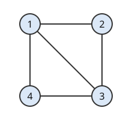

# Hafnian

# 개요

**Hafnian** 은 대칭행렬의 성분을 두 개씩 짝지어 곱한 값을, 첨자를 짝짓는 모든 방법에 대해 더한 값이다. 네 사람 가운데 서로 짝이 될 수 있는 쌍이 정해져 있을 때 네 사람을 두 쌍으로 나누는 방법의 수를 세려 하면, 사람들을 두 편으로 갈라 한쪽과 다른 쪽을 잇는 [영구식](permanent.md)의 방법은 짝이 될 수 있는 쌍이 삼각형을 이루는 순간 쓸 수 없다. Hafnian 은 편을 가르지 않고 모든 짝짓기를 더하므로, 일반 그래프의 완전 매칭의 수가 인접 행렬의 hafnian 으로 적힌다.

# 직관

아래 그림의 그래프에서 정점 $1,2,3,4$ 를 이웃끼리 두 쌍으로 짝짓는 방법을 센다. 간선은 $12,23,34,41$ 과 대각선 $13$ 이다. 정점 $1,2,3$ 이 삼각형을 이루어서 정점을 두 편으로 갈라 간선이 언제나 두 편 사이에만 놓이게 할 수 없다.

정점 넷을 두 쌍으로 나누는 방법은 $\lbrace 12,34\rbrace$, $\lbrace 13,24\rbrace$, $\lbrace 14,23\rbrace$ 셋뿐이다. 간선이 있으면 $1$, 없으면 $0$ 인 인접 행렬 $A$ 로 각 방법의 두 쌍이 모두 간선인지를 곱으로 적으면 다음과 같다.

$$
A\_{12}A\_{34}+A\_{13}A\_{24}+A\_{14}A\_{23}=1\cdot 1+1\cdot 0+1\cdot 1=2
$$

그래서 완전 [매칭](matchings.md)은 $\lbrace 12,34\rbrace$ 와 $\lbrace 14,23\rbrace$ 둘이다. 정점이 $2n$ 개이면 정점을 쌍으로 나누는 방법이 $(2n-1)(2n-3)\cdots 3\cdot 1$ 개이고, 그 모두에 대해 곱을 더한 값이 hafnian 이다.

# 정의

## Hafnian

$2n\times 2n$ 대칭행렬 $A$ 의 **hafnian** 은

$$
\mathrm{haf}\thinspace A=\sum\_{M}\prod\_{\lbrace i,j\rbrace\in M}A\_{ij}
$$

이다. $M$ 은 $\lbrace 1,\dots,2n\rbrace$ 을 원소 두 개짜리 부분집합 $n$ 개로 나누는 방법 전체를 돈다. 대각 성분은 쓰지 않는다. 직관 절의 식이 $n=2$ 인 경우이고, $2\times 2$ 행렬에서는 $\mathrm{haf}\thinspace A=A\_{12}$ 다.

같은 값을 순열로 쓰면 다음과 같다.

$$
\mathrm{haf}\thinspace A=\frac1{2^n\thinspace n!}\sum\_{\sigma\in S\_{2n}}\prod\_{i=1}^{n}A\_{\sigma(2i-1)\sigma(2i)}
$$

짝짓기 하나마다 쌍의 순서 $n!$ 가지와 쌍 안의 순서 $2^n$ 가지가 같은 항을 주므로 $2^n\thinspace n!$ 로 나눈다.

## 그래프의 완전 매칭

정점이 $2n$ 개인 그래프의 인접 행렬 $A$ 에서 $\mathrm{haf}\thinspace A$ 는 완전 매칭의 수다. 직관 절의 그래프에서 이 값이 $2$ 다. 완전 그래프 $K\_4$ 의 인접 행렬에서는 세 항이 모두 $1$ 이라 $3$ 이다.

# 성질

## 영구식과의 관계

$n\times n$ 행렬 $B$ 에 대해 다음이 성립한다.

$$
\mathrm{perm}\thinspace B=\mathrm{haf}\begin{pmatrix}0&B\cr B^{\mathsf T}&0\end{pmatrix}
$$

왼쪽 위와 오른쪽 아래 블록이 $0$ 이므로 $0$ 이 아닌 짝짓기는 첨자 $i\le n$ 을 첨자 $n+j$ 와 짝지어야 하고, 그런 짝짓기는 순열 $\sigma$ 와 일대일로 대응한다. 그래프로 쓰면 이분 그래프의 완전 매칭의 수가 일반 그래프의 완전 매칭의 수의 특수한 경우다.

## 계산의 어려움

영구식 계산이 #P-완전이라는 Valiant 정리(Valiant's theorem)와 위 관계로, 성분이 $0$ 과 $1$ 인 대칭행렬의 hafnian 계산도 #P-완전이다. 반대칭행렬에서 짝짓기마다 부호를 붙인 Pfaffian 은 제곱이 행렬식이라 다항시간에 계산되고, [Kasteleyn 정리](kasteleyn-theorem.md)는 평면 그래프에서 간선에 방향을 주어 완전 매칭의 수를 Pfaffian 으로 센다. Hafnian 과 Pfaffian 의 관계는 영구식과 행렬식의 관계와 같다.

A. Björklund, B. Gupt, N. Quesada 는 $2n\times 2n$ 복소 행렬의 hafnian 을 시간 $O(n^32^n)$ 에 계산하는 알고리즘을 주었다[^1]. 짝짓기를 하나씩 더하면 항이 $(2n-1)(2n-3)\cdots 1$ 개다.

## Isserlis 정리

평균이 $0$ 이고 공분산행렬이 $\Sigma$ 인 다변량 [정규분포](normal-distribution.md)를 따르는 $X\_1,\dots,X\_{2n}$ 에 대해

$$
\mathbb E\lbrack X\_1X\_2\cdots X\_{2n}\rbrack=\mathrm{haf}\thinspace\Sigma
$$

이고, 홀수 개의 곱의 평균은 $0$ 이다[^2]. 이것이 Isserlis 정리(Isserlis' theorem)이고, 물리에서는 Wick 정리(Wick's theorem)라 한다. 변수가 네 개이면 다음과 같다.

$$
\mathbb E\lbrack X\_1X\_2X\_3X\_4\rbrack=\Sigma\_{12}\Sigma\_{34}+\Sigma\_{13}\Sigma\_{24}+\Sigma\_{14}\Sigma\_{23}
$$

증명의 요지. 적률생성함수 $\mathbb E\lbrack e^{t^{\mathsf T}X}\rbrack=e^{t^{\mathsf T}\Sigma t/2}$ 를 $t\_1,\dots,t\_{2n}$ 으로 한 번씩 미분해 $t=0$ 에 넣는다. 지수의 이차식에서 미분 두 번이 $\Sigma\_{ij}$ 하나를 내므로, 남는 항은 첨자를 둘씩 짝지은 곱들의 합이다. 모든 $X\_i$ 를 한 표준정규변수 $Z$ 로 두면 $\Sigma$ 의 성분이 모두 $1$ 이라 $\mathbb E\lbrack Z^{2n}\rbrack=(2n-1)(2n-3)\cdots 1$ 이다.

# 활용

- [Gauss 보손 표본추출](gaussian-boson-sampling.md). [보손 표본추출](boson-sampling.md)에서 광자를 하나씩 넣는 대신 압착된 빛을 넣으면, 출력 배치의 확률이 영구식 대신 회로와 입력으로 정해지는 대칭행렬의 부분행렬의 hafnian 의 절댓값 제곱에 비례한다[^3]. 행렬을 그래프의 인접 행렬로 맞추면 완전 매칭이 많은 부분그래프가 자주 표본으로 나온다.
- 일반 그래프의 매칭 세기. 평면이 아닌 그래프의 완전 매칭의 수와 이합체 모형의 분배함수는 hafnian 이다. 평면 그래프에서만 Pfaffian 으로 바뀐다.
- 정규분포의 고차 적률. Isserlis 정리로 정규분포를 따르는 변수의 다항식의 평균을 공분산의 hafnian 으로 계산한다. 이 계산이 섭동 전개의 Feynman 도형에서 짝짓기의 합으로 나타난다.

[^1]: A. Björklund, B. Gupt, N. Quesada, A faster hafnian formula for complex matrices and its benchmarking on a supercomputer, *ACM Journal of Experimental Algorithmics* 24 (2019), 1.11.
[^2]: L. Isserlis, On a formula for the product-moment coefficient of any order of a normal frequency distribution in any number of variables, *Biometrika* 12 (1918), 134–139.
[^3]: C. S. Hamilton, R. Kruse, L. Sansoni, S. Barkhofen, C. Silberhorn, I. Jex, Gaussian boson sampling, *Physical Review Letters* 119 (2017), 170501.

# 연관 문서

## 선수지식

- [영구식](permanent.md)

## 더 알아보기

- [Gauss 보손 표본추출](gaussian-boson-sampling.md)

#combinatorics #complexity #probability #computation
