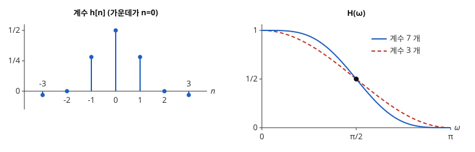

# 반대역 필터

# 개요

**반대역 필터(half-band filter)** 는 주파수 $0$ 부터 $\pi$ 까지의 범위를 가운데 $\pi/2$ 에서 반으로 나누어 아래쪽을 통과시키는 대칭 [FIR 필터](fir-filters.md)(finite impulse response filter)로, 가운데 계수를 빼고 짝수 번째 계수가 모두 $0$ 인 것이다. 녹음된 표본 사이사이에 새 표본을 하나씩 끼워 넣어 표본화율을 두 배로 올리면, 원래 표본은 그대로 두고 사이의 값만 이웃 표본들의 가중평균으로 채우고 싶다. 이 조건을 필터로 쓰면 반대역 필터가 되고, 계수의 절반이 $0$ 이라 곱셈이 절반으로 준다.

# 직관

수열 $x_0,x_1,x_2,\dots$ 의 표본 사이에 $0$ 을 하나씩 끼워 $x_0,0,x_1,0,x_2,\dots$ 를 만든다. [다중률 신호처리](multirate-signal-processing.md)의 업샘플링 $\uparrow 2$ 다. 이 수열에 대칭 필터 $h$ 를 걸어 $0$ 자리를 채운다. 원래 표본 자리의 출력이 $x_k$ 그대로이려면, 그 자리에서 $h$ 가 만나는 것은 가운데 계수와 짝수 칸 떨어진 계수뿐이므로 가운데 계수가 $1$ 이고 짝수 칸 떨어진 계수가 모두 $0$ 이어야 한다.

사이의 값을 두 이웃의 평균 $\frac12(x_k+x_{k+1})$ 로 채우면 필터는 $(\frac12,1,\frac12)$ 다. 이웃 네 개를 지나는 3 차 다항식의 가운데 값으로 채우면 가중치가 $(-\frac1{16},\frac9{16},\frac9{16},-\frac1{16})$ 이고 필터는

$$
\Bigl(-\tfrac1{16},\ 0,\ \tfrac9{16},\ 1,\ \tfrac9{16},\ 0,\ -\tfrac1{16}\Bigr)
$$

다. 두 필터 모두 가운데를 빼고 짝수 칸 떨어진 계수가 $0$ 이다.

이 필터들을 $2$ 로 나누면 가운데 계수가 $\frac12$ 가 되고, 주파수 응답은 계수 3 개짜리가 $\frac12+\frac12\cos\omega$, 계수 7 개짜리가 $\frac12+\frac9{16}\cos\omega-\frac1{16}\cos3\omega$ 다. 아래 그림의 왼쪽은 계수 7 개짜리를 $2$ 로 나눈 계수이고, 오른쪽은 두 응답이다. 두 곡선 모두 $\omega=0$ 에서 $1$, $\pi$ 에서 $0$ 이고 검은 점 $(\pi/2,\frac12)$ 을 지나며 그 점에 대해 점대칭이다.

# 정의

가운데를 $n=0$ 으로 두고 계수를 $h\lbrack n\rbrack=h\lbrack -n\rbrack$ 로 적는 실수 대칭 FIR 필터가

$$
h\lbrack 0\rbrack=\frac12,\qquad h\lbrack 2k\rbrack=0\quad(k\ne 0)
$$

을 만족하면 **반대역 필터** 라 한다. 가운데를 기준으로 쓴 주파수 응답은 다음과 같다.

$$
H(\omega)=\sum_nh\lbrack n\rbrack e^{-i\omega n}=\frac12+2\sum_{k\ge 1}h\lbrack 2k-1\rbrack\cos\bigl((2k-1)\omega\bigr)
$$

직관 절의 두 필터를 $2$ 로 나눈 다음 두 계수열이 반대역 필터다.

$$
\bigl(\tfrac14,\tfrac12,\tfrac14\bigr),\qquad \bigl(-\tfrac1{32},0,\tfrac9{32},\tfrac12,\tfrac9{32},0,-\tfrac1{32}\bigr)
$$

길이는 $4K-1$ 꼴이고, 계수 7 개짜리는 $K=2$ 다.

# 성질

## 상보성

$h$ 가 반대역 필터인 것은

$$
H(\omega)+H(\pi-\omega)=1\qquad(0\le\omega\le\pi)
$$

과 동치다. 다음 식에서 알 수 있다.

$$
H(\omega)+H(\omega+\pi)=\sum_nh\lbrack n\rbrack\bigl(1+(-1)^n\bigr)e^{-i\omega n}=2\sum_kh\lbrack 2k\rbrack e^{-2i\omega k}
$$

이것이 상수 $1$ 인 것은 $h\lbrack 0\rbrack=\frac12$ 이고 나머지 짝수 계수가 $0$ 인 것과 같다.

$H$ 가 짝함수이고 주기가 $2\pi$ 이므로 $H(\omega+\pi)=H(\pi-\omega)$ 다. 그래서 $H(\pi/2)=\frac12$ 이고, 통과대역 $\lbrack 0,\omega_p\rbrack$ 와 저지대역 $\lbrack\pi-\omega_p,\pi\rbrack$ 의 경계가 $\pi/2$ 에 대해 대칭이며 두 띠의 오차의 최댓값이 같다.

## 계산량

길이 $4K-1$ 의 반대역 필터는 $0$ 이 아닌 계수가 가운데 하나와 홀수 칸의 $2K$ 개다. 대칭이라 홀수 칸의 서로 다른 값은 $K$ 개다. 출력 하나에 드는 곱셈은 같은 길이의 일반 대칭 필터의 절반쯤이다. 계수 7 개짜리는 $\frac12$ 과 $\frac9{32}$, $-\frac1{32}$ 세 번이다.

## 다위상 성분

$D=2$ 의 다위상 분해 $H(z)=E_0(z^2)+z^{-1}E_1(z^2)$ 에서 짝수 계수로 된 $E_0$ 은 $\frac12$ 에 지연을 곱한 것뿐이다. 2 배 데시메이션의 다위상 구현에서 한 갈래는 곱셈 한 번이고, 나머지 계산은 $E_1$ 한 갈래에 몰린다. 2 배 보간에서는 원래 표본이 그대로 지나가고 사이의 값만 $E_1$ 로 계산한다. 직관 절의 구성과 같다.

## 최대로 평탄한 반대역 필터

$\omega=\pi$ 에서 $H$ 가 $2K$ 겹 영점을 갖는 길이 $4K-1$ 의 반대역 필터는 하나뿐이고, 그 홀수 계수는 이웃 $2K$ 개를 지나는 $2K-1$ 차 [다항식 보간](polynomial-interpolation.md)의 가운데 가중치의 절반이다[^1]. 상보성 때문에 $\omega=0$ 에서도 $H-1$ 이 $2K$ 겹 영점을 갖는다. 계수 7 개짜리는 $K=2$ 이고

$$
H(\omega)=\cos^4\frac\omega2\Bigl(1+2\sin^2\frac\omega2\Bigr)
$$

로 인수분해된다. 이 인수분해에서 $H(\omega)=\lvert M(\omega)\rvert^2$ 을 만족하는 길이 4 의 $M$ 을 고르면 Daubechies 웨이블릿(Daubechies wavelet)의 필터 $\frac1{4\sqrt2}(1+\sqrt3,\ 3+\sqrt3,\ 3-\sqrt3,\ 1-\sqrt3)$ 이 나온다. 이 필터의 자기상관을 $2$ 로 나누면 계수 7 개짜리 반대역 필터와 같다.

## 등리플 설계

[Parks–McClellan 알고리즘](parks-mcclellan-algorithm.md)에 통과대역 $\lbrack 0,\omega_p\rbrack$, 저지대역 $\lbrack\pi-\omega_p,\pi\rbrack$, 같은 가중치를 주면 해가 반대역 필터다. $A$ 가 해이면 $1-A(\pi-\omega)$ 도 같은 꼴의 코사인 합이고 최대 오차가 같으므로 해다. 교대 정리에서 해가 하나뿐이므로 $A(\omega)+A(\pi-\omega)=1$ 이고, 상보성에서 반대역 필터다[^2].

# 활용

- 다중률 신호처리의 2 배 데시메이션과 2 배 보간. 표본화율을 $2^m$ 배 바꿀 때 반대역 필터를 $m$ 단 이어 쓴다.
- [웨이블릿 변환](wavelet-transform.md)의 직교 필터 설계. 최대로 평탄한 반대역 필터를 $\lvert M\rvert^2$ 로 인수분해해 Daubechies 필터를 얻는다.
- [해석 신호](analytic-signal.md)를 만드는 Hilbert 변환기(Hilbert transformer). 반대역 필터의 계수에 $e^{i\pi n/2}$ 를 곱하면 통과대역이 $\lbrack 0,\pi\rbrack$ 로 옮겨지고, 음의 주파수를 지우는 FIR 필터가 된다.

[^1]: P. P. Vaidyanathan, *Multirate Systems and Filter Banks*, Prentice Hall, 1993, 4.6 절.
[^2]: P. P. Vaidyanathan, T. Q. Nguyen, "A trick for the design of FIR half-band filters", *IEEE Transactions on Circuits and Systems* 34 (1987), 297–300.

# 연관 문서

## 선수지식

- [다중률 신호처리](multirate-signal-processing.md)

## 더 알아보기

아직 연결한 문서가 없다.

#signal_processing #analysis #algorithms
