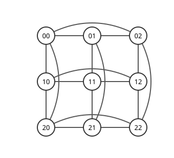

# Hamming 그래프

# 개요

**Hamming 그래프(Hamming graph)** 는 글자 $q$ 개로 쓴 길이 $d$ 인 낱말을 정점으로 두고, 한 자리만 다른 두 낱말을 이은 그래프다. 세 가지 글자 $0,1,2$ 로 쓴 두 자리 낱말 아홉 개를 $3\times 3$ 칸에 놓으면, 같은 행이나 같은 열에 있는 두 칸이 이어진다. 오류정정부호는 이 그래프에서 서로 멀리 떨어진 정점의 모임이고, 그래프의 거리와 고윳값이 모두 $d,q$ 의 식으로 나와 부호의 크기를 계산으로 제한할 수 있다.

# 직관

낱말 $ab$ 를 $a$ 행 $b$ 열의 칸에 놓는다. 한 자리만 바꾸면 같은 행 안에서 열이 바뀌거나 같은 열 안에서 행이 바뀐다. 아래 그림이 그 그래프이고, 행 하나와 열 하나가 각각 세 정점을 모두 이은 삼각형이다.

$00$ 에서 $11$ 로 가려면 두 자리를 모두 바꿔야 하므로 두 걸음이 걸리고, 중간 정점은 $01$ 과 $10$ 두 가지다. 두 정점의 거리는 두 낱말에서 다른 자리의 수다. 부호 이론에서 이 수를 Hamming 거리라 하고, 그래프의 이름이 여기서 나왔다.

# 정의

$Q$ 는 원소가 $q\ge 2$ 개인 집합이다. $Q^d$ 의 원소를 정점으로 두고 정확히 한 자리만 다른 두 낱말을 이은 [그래프](graphs.md)를 Hamming 그래프 $H(d,q)$ 라 한다[^1]. 직관 절의 그래프는 $H(2,3)$ 이다.

두 낱말 $x,y$ 에서 $x\_i\ne y\_i$ 인 자리 $i$ 의 수를 **Hamming 거리(Hamming distance)** $d\_H(x,y)$ 라 한다. $d\_H(00,11)=2$ 이다.

- $H(d,2)$ 는 [초입방체 그래프](hypercube-graphs.md)다.
- $H(1,q)$ 는 정점 $q$ 개의 완전그래프 $K\_q$ 다.
- $H(2,q)$ 는 $q\times q$ 칸에서 같은 행이나 같은 열의 칸을 이은 그래프다. [Paley 그래프](paley-graphs.md) $P\_9$ 는 $H(2,3)$ 과 같다.

# 성질

## 기본 수와 거리

$H(d,q)$ 는 정점이 $q^d$ 개이고, 각 정점은 자리 $d$ 개마다 다른 글자 $q-1$ 개로 바꾼 $d(q-1)$ 개와 이웃한다. 그래프의 거리는 Hamming 거리이고 지름은 $d$ 다. 한 걸음에 다른 자리의 수가 많아야 하나 줄고, 다른 자리를 하나씩 고치면 그만큼 걸린다.

$H(d,q)$ 는 완전그래프 $K\_q$ 를 $d$ 번 곱한 데카르트 곱(Cartesian product) $K\_q\mathbin{\square}\cdots\mathbin{\square}K\_q$ 이다. 한 자리를 바꾸는 것이 한 성분에서 $K\_q$ 의 간선을 따라가는 것이다.

## 교차 배열

$H(d,q)$ 는 [거리 정칙 그래프](distance-regular-graphs.md)이고 교차 배열은 다음과 같다[^1].

$$
b\_i=(d-i)(q-1),\qquad c\_i=i
$$

$x$ 에서 거리 $i$ 인 $y$ 에서 멀어지려면 $x,y$ 가 같은 $d-i$ 자리 가운데 하나를 다른 글자 $q-1$ 개 가운데 하나로 바꾼다. 가까워지려면 다른 $i$ 자리 가운데 하나를 $x$ 의 글자로 바꾼다. $H(2,3)$ 은 $b\_0=4$, $b\_1=2$, $c\_1=1$, $c\_2=2$ 이고, $c\_2=2$ 가 직관 절의 중간 정점 $01$ 과 $10$ 이다.

## 고윳값

$H(d,q)$ 인접행렬의 고윳값은 $j=0,1,\dots,d$ 에 대해 $d(q-1)-qj$ 이고, 중복도는 $\binom dj(q-1)^j$ 다[^1].

$Q=\mathbb Z\_q$ 로 두고 $\omega=e^{2\pi i/q}$ 라 한다. $a\in\mathbb Z\_q^d$ 마다 $x\mapsto\omega^{a\cdot x}$ 가 고유벡터다. 이웃마다 값을 더하면 $a\_i=0$ 인 자리는 $q-1$ 을, $a\_i\ne 0$ 인 자리는 $1$ 의 거듭제곱근의 합에서 $1$ 을 뺀 $-1$ 을 준다. 그래서 $a$ 의 $0$ 아닌 자리가 $j$ 개이면 고윳값은 $(d-j)(q-1)-j=d(q-1)-qj$ 다.

$H(2,3)$ 의 고윳값은 $4$, $1$, $-2$ 이고 중복도는 $1$, $4$, $4$ 다. 합 $4+4-8=0$ 이 대각합과 맞는다. 거리 $i$ 인 정점을 이은 행렬의 고윳값은 [Krawtchouk 다항식](krawtchouk-polynomials.md)의 $q$ 진 판으로 주어진다.

## 매개변수에 의한 특징

거리 정칙 그래프가 $H(d,q)$ 와 교차 배열이 같으면 그 그래프는 $H(d,q)$ 이거나, $q=4$ 일 때 Doob 그래프(Doob graph)다[^2]. $H(2,4)$ 와 교차 배열이 같은 Shrikhande 그래프(Shrikhande graph)가 Doob 그래프를 만드는 조각이다.

# 활용

- [오류정정부호](error-correcting-codes.md). 길이 $d$ 의 $q$ 진 부호는 $H(d,q)$ 의 정점 집합이고, 최소 거리가 $2e+1$ 이상이면 반지름 $e$ 인 공들이 겹치지 않는다. 공들이 정점을 빠짐없이 덮는 부호가 완전 부호이고, Hamming 부호가 $e=1$ 인 예다.
- [Delsarte 선형계획 상한](delsarte-lp-bound.md). $H(d,q)$ 의 거리별 관계가 Hamming 체계를 이루고, 부호의 거리 분포가 만족하는 부등식을 고윳값 표에서 얻는다.
- [MacWilliams 항등식](macwilliams-identity.md). 선형부호와 쌍대 부호의 무게 분포를 잇는 변환이 위 고유벡터 $\omega^{a\cdot x}$ 에 대한 전개다.

[^1]: A. E. Brouwer, A. M. Cohen, A. Neumaier, *Distance-Regular Graphs*, Springer, 1989, §9.2.
[^2]: Y. Egawa, "Characterization of H(n,q) by the parameters", *Journal of Combinatorial Theory, Series A* 31 (1981), 108–125.

# 연관 문서

## 선수지식

- [초입방체 그래프](hypercube-graphs.md)
- [거리 정칙 그래프](distance-regular-graphs.md)

## 더 알아보기

아직 연결한 문서가 없다.

#graph_theory #combinatorics #information_theory
