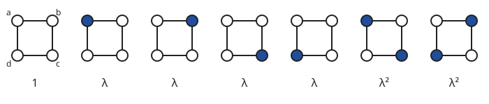

# 단단한 알갱이 모형

# 개요

**단단한 알갱이 모형(hard-core model)** 은 그래프의 [독립집합](independent-set.md)을 크기가 클수록 더 자주 뽑는 확률 모형이다. 무선 송신기 여러 대가 있고 가까운 두 대가 동시에 송신하면 신호가 섞이는 상황에서, 동시에 송신하는 송신기들의 집합은 "가까움" 을 간선으로 한 그래프의 독립집합이다.

이 모형은 독립집합 하나마다 정점 수만큼 같은 무게를 거듭 곱해 확률을 준다. 무게 하나를 바꾸어 가며 한 정점이 다른 정점의 상태에 얼마나 멀리까지 영향을 주는지 보고, 그 영향이 사라지는 범위에서 독립집합을 빠르게 뽑고 센다.

# 직관

정점 $a,b,c,d$ 를 차례로 이은 네 칸 고리 $C\_4$ 에서 독립집합을 고른다. 독립집합은 공집합, 한 점짜리 넷, 마주 보는 두 쌍 $\lbrace a,c\rbrace$ 와 $\lbrace b,d\rbrace$ 로 $7$ 개다. 일곱 개를 같은 확률로 뽑으면 $a$ 가 들어 있을 확률은 $\lbrace a\rbrace$ 와 $\lbrace a,c\rbrace$ 둘이므로 $2/7$ 이다.

송신기를 되도록 많이 켜고 싶으면 큰 집합에 확률을 더 준다. 독립집합에 든 정점 하나마다 무게 $\lambda$ 를 곱하면 일곱 집합의 무게는 다음 그림과 같다.

무게를 모두 더하면 $1+4\lambda+2\lambda^2$ 이고, 각 집합의 확률은 제 무게를 이 합으로 나눈 값이다. $\lambda=10$ 이면 두 쌍 가운데 하나가 뽑힐 확률이 $200/241\approx0.83$ 이다. $\lambda$ 가 크면 거의 언제나 $\lbrace a,c\rbrace$ 와 $\lbrace b,d\rbrace$ 둘 중 하나가 나온다.

그래프가 크면 독립집합의 수가 정점 수에 대해 지수적으로 늘어 모두 적을 수 없다. 대신 정점 하나만 보고 다시 뽑는다. $C\_4$ 에서 $b$ 와 $d$ 가 비어 있으면 $a$ 와 $c$ 는 서로 이웃이 아니므로 따로 정해지고, $a$ 가 들어 있을 확률은 $\lambda/(1+\lambda)$ 다. 이웃이 하나라도 들어 있으면 $a$ 는 비어 있다.

이 규칙을 정점마다 되풀이하는 것이 큰 그래프에서 표본을 얻는 방법이고, $\lambda$ 가 작을 때만 이 되풀이가 빨리 끝난다.

# 정의

## 분배함수와 분포

유한 그래프 $G=(V,E)$ 와 $\lambda\gt0$ 을 잡는다. $\mathcal I(G)$ 는 $G$ 의 독립집합 전체다. $G$ 위의 **단단한 알갱이 모형(hard-core model)** 은 $\mathcal I(G)$ 위의 확률분포

$$
\mu_{G,\lambda}(I)=\frac{\lambda^{\vert I\vert}}{Z_G(\lambda)},\qquad Z_G(\lambda)=\sum_{I\in\mathcal I(G)}\lambda^{\vert I\vert}
$$

다. $\lambda$ 를 **활동도(activity, fugacity)** 라 하고, $Z_G(\lambda)$ 를 **분배함수(partition function)** 또는 **독립집합 다항식(independence polynomial)** 이라 한다. $\lambda=1$ 이면 독립집합 전체 위의 균등분포다.

직관 절의 고리에서는 $Z\_{C\_4}(\lambda)=1+4\lambda+2\lambda^2$ 이고, $a$ 가 들어 있을 확률은 다음과 같다.

$$
\mu_{C_4,\lambda}(a\in I)=\frac{\lambda+\lambda^2}{1+4\lambda+2\lambda^2}
$$

이 값은 $\lambda=1$ 에서 $2/7$, $\lambda\to\infty$ 에서 $1/2$ 로 간다.

## 준동형 수로 적은 꼴

$H$ 를 정점 $0,1$ 로 두고, $0$ 에 고리를 달고 $0$ 과 $1$ 을 잇는다. [그래프 준동형](graph-homomorphisms.md) $f:G\to H$ 에서 $f^{-1}(1)$ 은 독립집합이고 이 대응은 전단사다. 그러므로

$$
Z_G(\lambda)=\sum_{f:G\to H}\lambda^{\vert f^{-1}(1)\vert}
$$

이고 $\lambda=1$ 이면 $Z_G(1)=\hom(G,H)$ 다. $\hom(C\_4,H)=7$ 이 직관 절의 일곱 집합이다.

## 국소 규칙과 Gibbs 측도

정점 $v$ 에 대해, $\mu\_{G,\lambda}$ 에서 $v$ 밖의 상태를 정했을 때 $v$ 가 들어 있을 조건부 확률은

$$
\frac{\lambda}{1+\lambda}\cdot\mathbf 1\lbrack v\text{ 의 이웃이 모두 비어 있다}\rbrack
$$

이다. 직관 절에서 $b$, $d$ 가 비어 있을 때 $a$ 가 들어 있을 확률 $\lambda/(1+\lambda)$ 가 이 식이다.

무한 그래프에서는 $Z_G$ 가 정의되지 않으므로 이 규칙으로 분포를 정한다. 정점이 셀 수 있게 많고 차수가 유한한 그래프 $G$ 에서, 독립집합 위의 확률측도 $\mu$ 가 모든 유한 정점 집합 $\Lambda$ 에 대해 " $\Lambda$ 밖을 정했을 때 $\Lambda$ 안의 조건부 분포가, 밖에서 들어 있는 정점의 이웃을 지운 $\Lambda$ 위의 단단한 알갱이 모형" 이면 $\mu$ 를 **Gibbs 측도(Gibbs measure)** 라 한다. 이 조건을 **DLR 조건**(Dobrushin–Lanford–Ruelle condition)이라 한다. Gibbs 측도가 하나뿐이면 **유일성(uniqueness)** 이 성립한다고 하고, 둘 이상이면 **상전이(phase transition)** 가 있다고 한다.

# 성질

## 나무 위의 재귀

나무 $T$ 의 뿌리 $v$ 에 대해 $R_v=\mu(v\in I)/\mu(v\notin I)$ 로 둔다. $v$ 의 자식을 $w_1,\dots,w_k$, 그 아래 부분나무를 $T_1,\dots,T_k$ 라 하면

$$
R_v=\lambda\prod_{j=1}^k\frac{1}{1+R_{w_j}}
$$

이다. 증명의 요지. $v$ 가 비어 있으면 부분나무들이 따로 정해져 무게의 합이 $\prod_j Z\_{T_j}$ 이고, $v$ 가 들어 있으면 자식이 모두 비어야 하므로 $\lambda\prod_j Z\_{T_j}^{\circ}$ 다. $Z\_{T_j}^{\circ}$ 는 $w_j$ 가 빈 독립집합의 무게 합이고 $Z\_{T_j}^{\circ}/Z\_{T_j}=1/(1+R\_{w_j})$ 이다.

세 정점의 경로 $a-b-c$ 를 $b$ 에서 보면 $R_a=R_c=\lambda$ 이고 $R_b=\lambda/(1+\lambda)^2$ 이다. $\lambda=1$ 에서 $R_b=1/4$ 이므로 $b$ 가 들어 있을 확률은 $1/5$ 이다. 독립집합 다섯 개 $\varnothing,\lbrace a\rbrace,\lbrace b\rbrace,\lbrace c\rbrace,\lbrace a,c\rbrace$ 가운데 $b$ 를 담은 것은 하나다.

## 정칙 나무의 유일성 문턱

모든 정점의 차수가 $\Delta\ge3$ 인 무한 나무 $\mathbb T\_\Delta$ 위의 단단한 알갱이 모형은

$$
\lambda\le\lambda_c(\Delta)=\frac{(\Delta-1)^{\Delta-1}}{(\Delta-2)^{\Delta}}
$$

일 때 유일성이 성립하고, $\lambda\gt\lambda_c(\Delta)$ 이면 Gibbs 측도가 여럿이다[^1]. $\lambda_c(3)=4$, $\lambda_c(4)=27/16$ 이고, $\Delta\to\infty$ 에서 $\lambda_c(\Delta)\sim e/\Delta$ 다.

증명의 요지. 뿌리 아래 깊이 $n$ 의 정점을 전부 채운 경계와 전부 비운 경계를 둔다. 뿌리가 아닌 정점은 자식이 $\Delta-1$ 개이므로, 위의 재귀가 $f(R)=\lambda/(1+R)^{\Delta-1}$ 의 반복이 된다. 두 경계에서 나온 뿌리의 $R$ 은 $f\circ f$ 의 가장 작은 고정점과 가장 큰 고정점으로 수렴한다. 두 고정점이 같은 것은 $f$ 의 고정점 $R^\ast$ 에서 $\vert f'(R^\ast)\vert\le1$ 인 것과 동치이고, 이 조건을 풀면 $\lambda\le\lambda_c(\Delta)$ 다.

## 격자의 상전이

정수 격자 $\mathbb Z^d$ 의 정점은 좌표의 합이 짝수인 것과 홀수인 것으로 나뉘고, 이웃한 두 정점은 서로 다른 쪽에 있다. $d\ge2$ 이면 $\lambda$ 가 충분히 클 때 짝수 정점에 몰린 Gibbs 측도와 홀수 정점에 몰린 Gibbs 측도가 따로 존재하고, $\lambda$ 가 충분히 작으면 유일성이 성립한다[^2]. 직관 절에서 $\lambda$ 가 크면 $\lbrace a,c\rbrace$ 와 $\lbrace b,d\rbrace$ 둘로 갈린 것이 유한 그래프에서 보이는 같은 현상이다. 삼각 격자에서는 정점이 세 부분격자로 나뉘고, 그 경우가 [단단한 육각형 모형](hard-hexagon-model.md)이다.

## Glauber 동역학

[Glauber 동역학](glauber-dynamics.md)은 독립집합 위의 [Markov 연쇄](markov-chains.md)다. 한 걸음에서 정점 $v$ 를 균등하게 고르고, 확률 $\lambda/(1+\lambda)$ 로 $v$ 를 넣으려 하고(이웃이 모두 비어 있을 때만 넣는다) 나머지 확률로 $v$ 를 뺀다. 이 연쇄의 정상분포는 $\mu\_{G,\lambda}$ 다.

최대 차수가 $\Delta$ 인 정점 $n$ 개의 그래프에서 $\lambda\lt 1/(\Delta-1)$ 이면 [혼합시간](mixing-time.md)이 $O(n\log n)$ 이다. [경로 결합](path-coupling.md)으로 증명한다.

$v$ 하나만 다른 두 상태 $X\ni v$, $Y=X\setminus\lbrace v\rbrace$ 에 같은 정점과 같은 동전을 쓴다. $v$ 를 고르면(확률 $1/n$) 두 상태가 같아진다. $v$ 의 이웃 $u$ 를 고르면 $X$ 에서는 $u$ 를 넣을 수 없고 $Y$ 에서는 넣을 수 있으므로, 확률 $\lambda/(1+\lambda)$ 이하로 차이가 하나 는다. 거리의 기댓값 변화는

$$
-\frac1n+\frac{\Delta}{n}\cdot\frac{\lambda}{1+\lambda}
$$

이하이고, $\lambda\lt1/(\Delta-1)$ 이면 음수다. Anari, Liu, Oveis Gharan 은 $\lambda\lt\lambda_c(\Delta)$ 전체에서 혼합시간이 다항식임을 증명했다[^3].

## 계산의 상전이

$Z_G(1)$ 은 $G$ 의 독립집합의 수이고, 이것을 정확히 세는 문제는 #P-완전이다([셈 복잡도](counting-complexity.md)). 근사는 유일성 문턱에서 갈린다.

- [Weitz 알고리즘](weitz-algorithm.md). Weitz 는 $\Delta$ 를 고정하고 최대 차수가 $\Delta$ 인 그래프에서 $\lambda\lt\lambda_c(\Delta)$ 이면 $Z_G(\lambda)$ 를 상대오차 $\varepsilon$ 안으로 근사하는 결정적 알고리즘이 $n$ 과 $1/\varepsilon$ 의 다항식 시간에 돈다는 것을 증명했다[^4]. 그래프 위의 확률을 자기 회피 걸음의 나무 위의 확률로 옮기고, 나무에서는 위의 재귀가 깊이에 따라 경계의 영향을 지수적으로 줄인다는 것을 쓴다. 이런 알고리즘을 **FPTAS**(fully polynomial-time approximation scheme)라 한다.
- Sly 와 Sun 은 $\lambda\gt\lambda_c(\Delta)$ 이면 $\Delta$ 정칙 그래프에서 $Z_G(\lambda)$ 를 근사하는 무작위 다항식 시간 알고리즘(fully polynomial randomized approximation scheme, FPRAS)이 NP(nondeterministic polynomial time) $=$ RP(randomized polynomial time) 가 아닌 한 없다는 것을 증명했다[^5].

[근사 세기](approximate-counting.md)에서 다항식 시간 근사가 되는 범위와 안 되는 범위의 경계가, 무한 나무에서 Gibbs 측도가 하나에서 여럿으로 바뀌는 $\lambda_c(\Delta)$ 와 같다.

## 정칙 그래프의 분배함수 상한

정점 $n$ 개의 $d$ 정칙 그래프 $G$ 에서

$$
Z_G(\lambda)^{1/n}\le Z\_{K\_{d,d}}(\lambda)^{1/(2d)}=\bigl(2(1+\lambda)^d-1\bigr)^{1/(2d)}
$$

이다. $\lambda=1$ 인 경우가 [Kahn–Zhao 정리](kahn-zhao-theorem.md)이고, 이분그래프에서는 Kahn 이 엔트로피로, 일반 정칙 그래프에서는 Zhao 가 이중 덮개로 증명했다.

# 활용

- 무선망의 무작위 접근. 이웃한 송신기가 동시에 송신하지 않는 규약(carrier sense multiple access, CSMA)을 이상화하면, 동시에 송신하는 송신기 집합의 정상분포가 충돌 그래프 위의 단단한 알갱이 모형이다[^6]. 활동도는 송신 시도율과 송신 길이의 비다.
- 격자 기체. 격자의 칸에 놓인 분자가 이웃 칸을 막는 흡착 모형이다. [Ising 모형](ising-model.md)과 같이 칸마다 두 상태를 두되, 이웃한 두 칸이 함께 차는 무게가 $0$ 이다.
- [Lovász 국소 보조정리](lovasz-local-lemma.md). 의존 그래프의 독립집합 다항식에 음의 활동도를 넣어 값이 양수로 남는 범위가 국소 보조정리의 가장 넓은 성립 범위인 Shearer 경계(Shearer's bound)다.
- 근사 세기 알고리즘의 시험대. [Markov 연쇄 Monte Carlo](markov-chain-monte-carlo.md)(Markov chain Monte Carlo)의 혼합 증명 기법(경로 결합, 상관 감쇠, 스펙트럼 독립성)이 이 모형에서 먼저 시험되었다.
- [Galvin–Tetali 정리](galvin-tetali-theorem.md). 준동형 수의 상한을 $H$ 에 정점 무게를 준 꼴로 넓히면 이 모형의 분배함수 상한이 그 특수한 경우다.

[^1]: F. P. Kelly, "Stochastic models of computer communication systems", *Journal of the Royal Statistical Society B* 47 (1985), 379–395.
[^2]: R. L. Dobrushin, "The problem of uniqueness of a Gibbsian random field and the problem of phase transitions", *Functional Analysis and Its Applications* 2 (1968), 302–312.
[^3]: N. Anari, K. Liu, S. Oveis Gharan, "Spectral independence in high-dimensional expanders and applications to the hardcore model", FOCS 2020.
[^4]: D. Weitz, "Counting independent sets up to the tree threshold", STOC 2006.
[^5]: A. Sly, N. Sun, "The computational hardness of counting in two-spin models on d-regular graphs", *Annals of Probability* 42 (2014), 2383–2416.
[^6]: R. R. Boorstyn, A. Kershenbaum, B. Maglaris, V. Sahin, "Throughput analysis in multihop CSMA packet radio networks", *IEEE Transactions on Communications* 35 (1987), 267–274.

# 연관 문서

## 선수지식

- [그래프 준동형](graph-homomorphisms.md)
- [독립집합 문제](independent-set.md)

## 더 알아보기

- [단단한 육각형 모형](hard-hexagon-model.md)
- [Weitz 알고리즘](weitz-algorithm.md)

#probability #graph_theory #combinatorics #complexity
