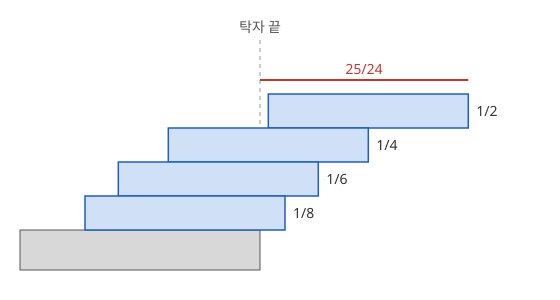

# 조화급수

# 개요

**조화급수(harmonic series)** 는 자연수의 역수 $1,\ 1/2,\ 1/3,\ \dots$ 을 모두 더한 급수다. 길이가 $1$ 인 책을 탁자 끝에 한 권씩 쌓아 밖으로 내밀면, 책 $n$ 권으로 내밀 수 있는 가장 긴 길이는 이 급수의 처음 $n$ 항의 합의 절반이다. 조화급수는 항이 $0$ 으로 가는데도 합이 한없이 커지므로, 책을 충분히 쌓으면 얼마든지 멀리 내밀 수 있다.

# 직관

책 한 권은 무게중심인 가운데가 탁자 끝 위에 올 때까지, 곧 $1/2$ 만큼 내밀 수 있다. 책 두 권이면 위 책을 아래 책 끝에서 $1/2$ 내밀고, 두 권을 합친 무게중심이 탁자 끝에 오도록 아래 책을 $1/4$ 내민다. 같은 방법으로 위에서 $k$ 번째 책은 그 아래 책보다 $1/(2k)$ 더 나간다.

아래 그림은 네 권을 쌓은 것이다. 각 책 옆의 수가 바로 아래 책보다 더 나간 길이이고, 맨 위 책의 끝은 탁자 끝에서 다음 거리에 있다.

$$
\frac12+\frac14+\frac16+\frac18=\frac12\Bigl(1+\frac12+\frac13+\frac14\Bigr)=\frac{25}{24}
$$

$25/24\gt 1$ 이므로 맨 위 책은 통째로 탁자 바깥에 있다. 책을 더 쌓을 때 더하는 길이 $1/(2n)$ 은 점점 작아지므로, 내민 길이에 한계가 있는지가 물음이다.

항을 $1/3+1/4$, $1/5+\cdots+1/8$, $1/9+\cdots+1/16$ 처럼 개수가 두 배씩 느는 묶음으로 나눈다. 묶음마다 마지막 항이 가장 작고, 그 항에 개수를 곱하면 $1/2$ 이므로 각 묶음의 합은 $1/2$ 이상이다. 묶음은 끝없이 있으므로 합은 한없이 커지고, 책을 충분히 쌓으면 얼마든지 멀리 내밀 수 있다.

# 정의

조화급수는 급수 $\sum_{n=1}^\infty 1/n$ 이고, 그 처음 $n$ 항의 부분합을 **조화수(harmonic number)** 라 한다.

$$
H_n=1+\frac12+\frac13+\cdots+\frac1n
$$

직관 절의 책 $n$ 권이 내밀 수 있는 가장 긴 길이는 $H_n/2$ 이고, 네 권이면 $H_4/2=25/24$ 다.

# 성질

## 발산

조화급수는 발산한다. 직관 절의 묶음 논법으로 다음이 성립하므로 부분합은 위로 유계가 아니다. 이 증명은 Oresme 가 14 세기에 쓴 것이다[^1].

$$
H_{2^k}\ge1+\frac k2
$$

항이 $0$ 으로 가는 것은 급수가 수렴할 필요조건일 뿐 충분조건이 아니다. 조화급수가 그 반례다.

## 로그 증가

함수 $1/x$ 는 감소하므로 구간 $\lbrack k,k+1\rbrack$ 에서 $1/(k+1)\le1/x\le1/k$ 이다. 이것을 더하면 [급수의 수렴판정](series-convergence.md)의 적분판정과 같은 비교로 다음이 나온다.

$$
\log(n+1)\le H_n\le1+\log n
$$

그래서 $H_n$ 은 $\log n$ 처럼 커진다. 차 $H_n-\log n$ 은 감소하며 $0$ 이상이고, 그 극한이 [Euler–Mascheroni 상수](euler-mascheroni-constant.md) $\gamma=0.5772\cdots$ 다. 책을 탁자 밖으로 $2$ 만큼 내밀려면 $H_n\ge4$ 여야 하고, $H_{30}=3.99\cdots$, $H_{31}=4.02\cdots$ 이므로 $31$ 권이 필요하다.

## 정수가 아닌 조화수

$n\ge2$ 이면 $H_n$ 은 정수가 아니다. $2^m$ 을 $n$ 이하의 가장 큰 $2$ 의 거듭제곱이라 하면, $1,\dots,n$ 가운데 $2^m$ 으로 나누어떨어지는 수는 $2^m$ 하나뿐이다. 분모들의 최소공배수 $L$ 을 곱한 $LH_n$ 에서 $L/2^m$ 만 홀수이고 나머지 항은 모두 짝수이므로 $LH_n$ 은 홀수다. $L$ 은 짝수이므로 $H_n=LH_n/L$ 은 정수가 아니다.

## 거듭제곱의 역수와 교대 조화급수

$\sum 1/n^p$ 는 $p\gt 1$ 이면 수렴하고 $p\le1$ 이면 발산한다. 적분 $\int_1^\infty x^{-p}dx$ 와 비교하면 나온다. $p\gt 1$ 일 때의 합이 [Riemann zeta 함수](riemann-zeta.md)의 값 $\zeta(p)$ 이고, $p=1$ 인 조화급수는 $\zeta$ 의 극 $s=1$ 에 해당한다.

부호를 번갈아 붙인 교대 조화급수는 수렴하고 합이 $\log 2$ 다.

$$
1-\frac12+\frac13-\frac14+\cdots=\log2
$$

이 급수는 절대수렴하지 않으므로 항의 순서를 바꾸면 합이 바뀐다. 양의 항 둘 뒤에 음의 항 하나를 놓는 순서로 더하면 합은 $\frac32\log2$ 다.

## 소수의 역수

소수의 역수만 더한 $\sum_p1/p$ 도 발산한다. Euler 는 $\prod_p(1-1/p)^{-1}=\sum_n1/n$ 에서 이를 증명했고, 부분합은 $\log\log x$ 처럼 커진다. 이 증가율과 오차가 [Mertens 정리](mertens-theorem.md)다.

# 활용

- [쿠폰 수집가 문제](coupon-collector.md): 쿠폰 $n$ 종류를 모두 모을 때까지 산 쿠폰 수의 기댓값이 $nH_n$ 이고, 로그 증가에 따라 $n\log n$ 쯤이다.
- [Euler–Mascheroni 상수](euler-mascheroni-constant.md): 조화수와 로그의 차의 극한으로 정의된다.
- [Mertens 정리](mertens-theorem.md): $\sum_{n\le x}1/n\approx\log x$ 를 소수의 역수 합과 비교하는 데서 시작한다.
- 알고리즘의 평균 비용: 무작위 순열에서 $k$ 번째 원소가 앞의 $k-1$ 개보다 클 확률은 $1/k$ 이므로, 지금까지의 최댓값이 바뀌는 횟수의 기댓값은 $H_n$ 이다.

[^1]: J. Havil, *Gamma: Exploring Euler's Constant*, Princeton University Press, 2003, 2 장.

# 연관 문서

## 선수지식

- [급수의 수렴판정](series-convergence.md)

## 더 알아보기

- [Euler–Mascheroni 상수](euler-mascheroni-constant.md)

#analysis #number_theory
