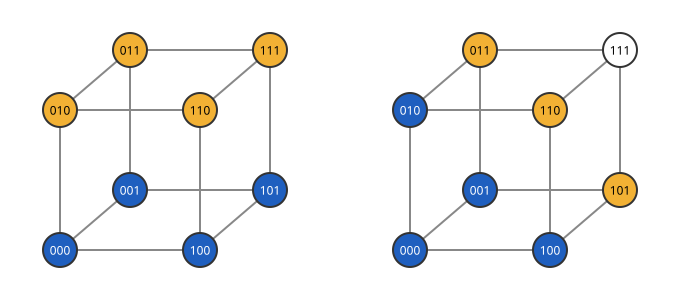

# Harper 정리

# 개요

**Harper 정리(Harper's theorem)** 는 길이 $n$ 인 이진 문자열 가운데 $m$ 개를 고를 때, 고른 것에서 한 비트만 바꿔 닿는 바깥 문자열이 가장 적은 선택이 무엇인지 정하는 정리다. 세 비트 문자열 여덟 개에서 네 개를 고르면, 정육면체의 한 면을 고를 때는 바깥 네 개 모두에 한 비트로 닿고, $000$ 과 그 이웃 셋을 고를 때는 바깥 세 개에만 닿는다.

이 정리는 한 문자열에서 가까운 것부터 차례로 채운 모양, 곧 Hamming 공 꼴의 집합이 어느 크기에서나 바깥 이웃을 가장 적게 둔다는 것을 보인다.

# 직관

[초입방체 그래프](hypercube-graphs.md) $Q_3$ 에서 정점 네 개를 고른다. 아래 그림의 왼쪽은 아랫면 $000,100,001,101$ 을 고른 것이고, 오른쪽은 $000$ 과 그 이웃 $100,010,001$ 을 고른 것이다. 고른 정점은 파랗게, 고른 정점과 간선으로 이어진 바깥 정점은 주황색으로 칠했다.

왼쪽에서는 윗면의 네 정점이 모두 아랫면의 정점 하나와 이어져 있어 바깥 이웃이 넷이다. 오른쪽에서는 $111$ 이 고른 네 정점과 두 비트 이상 달라 바깥 이웃이 $110,101,011$ 셋이다.

고른 정점 사이의 간선은 왼쪽이 $4$ 개, 오른쪽이 $3$ 개다. 고른 정점 사이의 간선이 많은 쪽은 면이고, 바깥으로 닿는 정점이 적은 쪽은 한 점 둘레를 채운 모양이다. 오른쪽 모양은 $000$ 에서 거리 $1$ 이하인 정점 전체다.

# 정의

## 정점 경계

그래프의 정점 집합 $S$ 에서, $S$ 밖에 있으면서 $S$ 의 정점과 간선으로 이어진 정점 전체를 $S$ 의 **정점 경계(vertex boundary)** $\partial\_V S$ 라 한다. 직관 절의 왼쪽 집합은 $\vert\partial\_V S\vert=4$, 오른쪽 집합은 $\vert\partial\_V S\vert=3$ 이다.

$S\cup\partial\_V S$ 를 $S$ 의 **닫힌 이웃(closed neighborhood)** $N\lbrack S\rbrack$ 이라 한다. 오른쪽 집합의 닫힌 이웃은 $111$ 을 뺀 일곱 정점이다.

## Hamming 공

$x\in\lbrace 0,1\rbrace^n$ 에서 Hamming 거리가 $r$ 이하인 문자열 전체를 반지름 $r$ 인 **Hamming 공(Hamming ball)** 이라 한다. 크기는 다음과 같다.

$$
\vert B(x,r)\vert=\sum_{i=0}^{r}\binom ni
$$

$B(x,r)$ 의 닫힌 이웃은 $B(x,r+1)$ 이다. 직관 절의 오른쪽 집합은 $B(000,1)$ 이고 크기는 $1+3=4$ 다.

## 단체 순서

$\lbrace 0,1\rbrace^n$ 의 문자열을 $1$ 의 개수가 적은 것부터 늘어놓고, $1$ 의 개수가 같으면 $1$ 인 자리의 집합을 사전식으로 비교해 앞선 것부터 늘어놓은 순서를 **단체 순서(simplicial order)** 라 한다. 자리를 왼쪽부터 $1,2,3$ 으로 번호 매기면 $n=3$ 에서 다음 순서다.

$$
000,\ 100,\ 010,\ 001,\ 110,\ 101,\ 011,\ 111
$$

처음 $\sum_{i\le r}\binom ni$ 개는 $B(0\cdots0,r)$ 이다. 그 사이의 개수에서는 공 하나에 다음 층의 앞부분을 붙인 모양이 된다.

# 성질

## 정리

정리. $S\subseteq\lbrace 0,1\rbrace^n$ 의 크기가 $m$ 이고 $C$ 가 단체 순서의 처음 $m$ 개이면 다음이 성립한다[^1].

$$
\vert N\lbrack S\rbrack\vert\ge\vert N\lbrack C\rbrack\vert
$$

특히 $\vert S\vert\ge\vert B(x,r)\vert$ 이면 $\vert N\lbrack S\rbrack\vert\ge\vert B(x,r+1)\vert$ 이다. 닫힌 이웃을 $t$ 번 되풀이해 얻는 거리 $t$ 이하의 정점 전체에도 같은 부등식이 성립한다.

증명의 요지. 자리 하나를 골라 그 자리를 기준으로 $Q_n$ 을 두 개의 $Q\_{n-1}$ 로 나누고, 각 반쪽 안의 정점들을 그 반쪽의 단체 순서 처음 부분으로 바꾸는 압축(compression)을 한다. 압축은 $\vert S\vert$ 를 그대로 두고 $\vert N\lbrack S\rbrack\vert$ 를 늘리지 않는다. 모든 자리에서 압축해도 바뀌지 않는 집합을 $n$ 에 대한 귀납법으로 다룬다. 층 사이의 셈에서는 [Kruskal–Katona 정리](kruskal-katona-theorem.md)의 그림자 대신 위쪽 그림자, 곧 원소를 하나 더한 집합들이 쓰인다[^2].

## 측도의 집중

$\vert S\vert\ge2^{n-1}$ 이고 $t\ge1$ 이면, $S$ 에서 Hamming 거리가 $t$ 보다 먼 문자열은 다음 개수 이하다.

$$
2^n e^{-2t^2/n}
$$

정리에서 거리 $t$ 이하의 정점 수는 반지름 $\lceil n/2\rceil-1+t$ 인 공의 크기 이상이다. 그 밖의 문자열은 $1$ 의 개수가 $n/2-t$ 이하인 문자열의 수 이하이고, 이 수는 Hoeffding 부등식(Hoeffding's inequality)으로 위 값 이하다. 절반 이상을 차지하는 집합에서 $\sqrt n$ 의 몇 배만 떨어지면 거의 모든 문자열에 닿는다.

# 활용

- [집중부등식](concentration-inequalities.md). 위 결론에서 $\lbrace 0,1\rbrace^n$ 위의 함수 가운데 한 비트를 바꿀 때 값이 $1$ 이하로 바뀌는 함수는 중앙값에서 $t$ 넘게 벗어날 확률이 $2e^{-2t^2/n}$ 이하다.
- [Lévy 등주부등식](levy-isoperimetric-inequality.md). 구면에서 구면 모자가 경계를 최소로 하듯, 초입방체에서는 Hamming 공이 경계를 최소로 한다.
- 오류정정부호. 부호어마다 한 비트 오류로 닿는 문자열의 수를 셀 때, 부호어 집합의 닫힌 이웃의 크기 하한이 이 정리에서 나온다.
- 간선 등주 부등식과의 대비. 초입방체 그래프의 간선 등주 부등식에서는 부분 초입방체가 안쪽 간선을 가장 많이 두고, 정점 경계에서는 Hamming 공이 최적이다. 직관 절의 두 집합이 두 최적을 나눠 갖는다.

[^1]: L. H. Harper, "Optimal numberings and isoperimetric problems on graphs", *Journal of Combinatorial Theory* 1 (1966), 385–393.
[^2]: B. Bollobás, *Combinatorics: Set Systems, Hypergraphs, Families of Vectors and Combinatorial Probability*, Cambridge University Press, 1986, §16.

# 연관 문서

## 선수지식

- [초입방체 그래프](hypercube-graphs.md)
- [Kruskal–Katona 정리](kruskal-katona-theorem.md)

## 더 알아보기

아직 연결한 문서가 없다.

#combinatorics #graph_theory #probability
