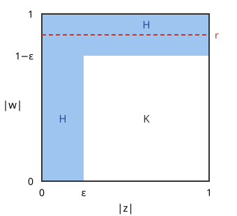

# Hartogs 확장 정리

# 개요

**Hartogs 확장 정리(Hartogs extension theorem)** 는 복소 변수가 둘 이상인 정칙함수가 가운데가 빈 영역에서 정의되어 있으면 빈 곳까지 정칙함수로 연장된다는 정리다. 한 변수에서는 $1/z$ 가 원점을 뺀 원판에서 정칙이지만 원점으로 연장되지 않는다. 두 변수에서는 단위 쌍원판의 가운데를 비운 영역에서 정칙인 함수가 모두 쌍원판 전체로 연장된다. 연장은 한 변수의 Cauchy 적분 공식을 한 변수씩 써서 만든다.

# 직관

두 복소 변수 $(z,w)$ 의 단위 쌍원판 $\Delta^2=\lbrace\lvert z\rvert\lt 1,\thinspace\lvert w\rvert\lt 1\rbrace$ 에서, 작은 $\varepsilon\gt 0$ 에 대해 $\lvert z\rvert\lt\varepsilon$ 이거나 $\lvert w\rvert\gt 1-\varepsilon$ 인 점만 모은 집합을 $H$ 로 둔다. 아래 그림은 가로축에 $\lvert z\rvert$, 세로축에 $\lvert w\rvert$ 를 두고 $H$ 를 파랗게 칠한 것이다. 칠하지 않은 $K$ 에서는 $f$ 가 정의되어 있지 않다.

$f$ 가 $H$ 에서 정칙이라 하자. 그림의 점선처럼 $1-\varepsilon\lt r\lt 1$ 인 $r$ 을 고르면 원 $\lvert w\rvert=r$ 은 모든 $z$ 에 대해 $H$ 안에 있다. 그래서 $w$ 에 대한 Cauchy 적분을 모든 $\lvert z\rvert\lt 1$ 에서 쓸 수 있다.

$$
F(z,w)=\frac{1}{2\pi i}\oint_{\lvert\eta\rvert=r}\frac{f(z,\eta)}{\eta-w}\thinspace d\eta
$$

$F$ 는 $\lvert z\rvert\lt 1$, $\lvert w\rvert\lt r$ 에서 정의되고 정칙이다. 왼쪽 띠 $\lvert z\rvert\lt\varepsilon$ 에서는 $f(z,\cdot)$ 이 원판 $\lvert w\rvert\lt 1$ 전체에서 정칙이므로 Cauchy 적분 공식으로 $F=f$ 다. 두 함수가 왼쪽 띠에서 같으므로 위쪽 띠에서도 같고, $F$ 가 $K$ 까지 $f$ 를 연장한다.

한 변수에서 같은 일을 하면 $f$ 는 원환 $1-\varepsilon\lt\lvert w\rvert\lt 1$ 에서만 주어지고, $F=f$ 를 확인할 왼쪽 띠가 없다. $f(w)=1/w$ 이면 $F=0$ 이 되어 $f$ 와 다르다.

# 정의

## 여러 변수의 정칙함수

$U$ 를 $\mathbb C^n$ 의 열린집합으로 둔다. 함수 $f:U\to\mathbb C$ 가 연속이고, 변수 하나만 움직이고 나머지를 고정할 때마다 그 변수의 [정칙함수](holomorphic-functions.md)이면 $f$ 를 **정칙(holomorphic)** 이라 한다. $zw$, $e^{z+w}$ 는 $\mathbb C^2$ 전체에서, $1/(1-zw)$ 는 $\Delta^2$ 에서 정칙이다.

정칙함수는 각 점의 근방에서 여러 변수의 [멱급수](power-series.md)로 전개된다. 이것이 Osgood 보조정리(Osgood's lemma)이고, 증명은 Cauchy 적분 공식을 변수마다 한 번씩 겹쳐 쓴다. 그래서 [해석적 연속](analytic-continuation.md)의 항등정리가 여러 변수에서도 성립한다. 연결된 열린집합에서 정칙인 두 함수가 공집합이 아닌 열린 부분집합에서 같으면 전체에서 같다.

## Hartogs 도형

$0\lt\varepsilon\lt 1$ 에 대해, $\Delta^2$ 의 점 가운데 $\lvert z\rvert\lt\varepsilon$ 이거나 $\lvert w\rvert\gt 1-\varepsilon$ 인 점의 집합 $H$ 를 **Hartogs 도형(Hartogs figure)** 이라 한다. $H$ 는 연결이고, $\Delta^2$ 에서 $H$ 를 뺀 $K$ 는 $\Delta^2$ 안의 닫힌 집합이다.

## Hartogs 확장 정리

Hartogs 도형에서 정칙인 함수는 $\Delta^2$ 에서 정칙인 함수로 하나뿐인 방법으로 연장된다. 일반 꼴은 다음과 같다[^1].

$n\ge 2$ 이고 $U\subseteq\mathbb C^n$ 이 열린집합, $K\subset U$ 가 [콤팩트](compactness.md) 집합이며 $U\setminus K$ 가 연결이라 하자. $U\setminus K$ 에서 정칙인 함수는 $U$ 에서 정칙인 함수로 하나뿐인 방법으로 연장된다.

$n=1$ 에서는 성립하지 않는다. $U$ 를 원판, $K=\lbrace 0\rbrace$ 로 두면 $1/z$ 가 반례다.

# 성질

## Hartogs 도형의 증명

직관 절의 $F$ 가 정칙이라는 것은 두 단계다. $w$ 에 대해서는 Cauchy 적분이므로 정칙이다. $z$ 에 대해서는 피적분함수가 $(z,\eta)$ 에 대해 연속이고 $\eta$ 마다 $z$ 의 정칙함수이므로, [Morera 정리](morera-theorem.md)의 매개변수 적분으로 정칙이다.

$F=f$ 가 성립하는 집합 $\lbrace\lvert z\rvert\lt\varepsilon,\thinspace\lvert w\rvert\lt r\rbrace$ 는 열려 있고, 두 함수가 함께 정의된 $H\cap\lbrace\lvert w\rvert\lt r\rbrace$ 는 연결이다. 항등정리로 이 연결집합 전체에서 $F=f$ 다. 그래서 $H$ 에서는 $f$, $\lvert w\rvert\lt r$ 에서는 $F$ 로 정한 함수가 $\Delta^2$ 에서 잘 정의되고 정칙이다.

## 일반 꼴의 증명

일반 꼴은 $\bar\partial$ 방정식으로 증명한다[^1]. $K$ 근방에서 $1$ 이고 $U$ 안에 콤팩트한 받침을 갖는 매끄러운 함수 $\chi$ 를 잡고, $f_0=(1-\chi)f$ 를 $K$ 위에서 $0$ 으로 두면 $f_0$ 은 $U$ 에서 매끄럽다. $\bar\partial f_0=-f\thinspace\bar\partial\chi$ 의 받침은 콤팩트하다.

$n\ge 2$ 이면 받침이 콤팩트한 자료의 $\bar\partial u=-f\thinspace\bar\partial\chi$ 에 받침이 콤팩트한 해 $u$ 가 있다. 해는 [Dolbeault–Grothendieck 보조정리](dolbeault-grothendieck-lemma.md)의 Cauchy 변환을 한 변수에 써서 얻고, 다른 변수가 크면 $0$ 이라는 것에서 받침의 콤팩트성이 나온다. $F=f_0-u$ 는 $\bar\partial F=0$ 이므로 정칙이고, $u$ 가 $U\setminus K$ 의 공집합이 아닌 열린 부분집합에서 $0$ 이므로 항등정리로 $U\setminus K$ 에서 $F=f$ 다. $n=1$ 에서는 이 해의 받침이 콤팩트하지 않을 수 있어 증명이 멈춘다.

## 영점과 특이점의 비고립성

$n\ge 2$ 이고 $f$ 가 점 $p$ 의 근방에서 정칙이며 $f(p)=0$ 이면, $p$ 는 $f$ 의 영점 집합의 고립점이 아니다. $p$ 가 고립된 영점이면 $p$ 를 중심으로 한 작은 공 $B$ 에서 $1/f$ 가 $B\setminus\lbrace p\rbrace$ 에서 정칙이다. $B\setminus\lbrace p\rbrace$ 는 연결이므로 Hartogs 확장 정리로 $1/f$ 가 $B$ 로 연장되고, $f\cdot(1/f)=1$ 이 $p$ 에서도 성립해 $f(p)=0$ 과 모순이다.

같은 이유로 $n\ge 2$ 에서 정칙함수는 고립 특이점을 갖지 않는다. $f(z,w)=z$ 의 영점 집합은 복소 직선 $\lbrace z=0\rbrace$ 이다.

# 활용

- 정칙 영역(domain of holomorphy). 열린집합 $U$ 의 경계의 어느 점 너머로도 연장되지 않는 정칙함수가 $U$ 위에 있으면 $U$ 를 정칙 영역이라 한다. 한 변수에서는 모든 열린집합이 정칙 영역이다. 두 변수의 Hartogs 도형은 모든 정칙함수가 $\Delta^2$ 로 연장되므로 정칙 영역이 아니다. 어떤 열린집합이 정칙 영역인지를 기하적 조건으로 판정하는 것이 Levi 문제(Levi problem)이고, 그 조건이 유사볼록성(pseudoconvexity)이다.
- [유수 정리](residue-theorem.md)의 고립 특이점 분류는 한 변수에서만 쓰인다. 두 변수 이상에서는 특이점이 고립되지 않으므로 유리형함수의 극이 복소 초곡면을 이룬다. $1/z$ 의 극은 $\mathbb C^2$ 에서 직선 $\lbrace z=0\rbrace$ 전체다.

[^1]: L. Hörmander, An Introduction to Complex Analysis in Several Variables, 3rd ed., North-Holland, 1990, 2장.

# 연관 문서

## 선수지식

- [Morera 정리](morera-theorem.md)
- [해석적 연속](analytic-continuation.md)

## 더 알아보기

아직 연결한 문서가 없다.

#complex_analysis #analysis #theorem
