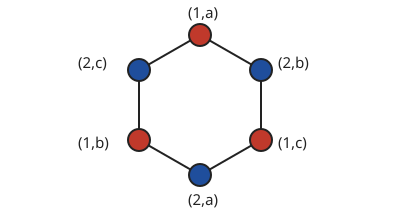

# Hedetniemi 추측

# 개요

**Hedetniemi 추측(Hedetniemi's conjecture)** 은 두 그래프를 곱한 그래프를 칠하는 데 드는 색의 수가 두 그래프 가운데 색이 적게 드는 쪽의 색 수와 같다는 추측이다. 간선 하나 $K\_2$ 와 삼각형 $K\_3$ 을 곱하면 정점 여섯 개의 육각형이 나오고, 이 육각형은 두 색으로 칠해진다. $K\_2$ 에 드는 색이 2, $K\_3$ 에 드는 색이 3 이므로 이 경우에는 적은 쪽과 같다.

곱을 칠하는 문제는 한 그래프에서 만든 지수 그래프 하나의 채색수를 묻는 문제로 바뀐다. Shitov 는 2019 년에 이 지수 그래프의 채색수가 큰 예를 만들어 추측을 부정했다.

# 직관

두 그래프 $G$, $H$ 의 곱은 $G$ 의 정점 하나와 $H$ 의 정점 하나를 짝지은 쌍을 정점으로 둔다. 두 쌍 $(u,x)$ 와 $(v,y)$ 는 $u$ 와 $v$ 가 $G$ 에서 이웃하고 $x$ 와 $y$ 가 $H$ 에서 이웃할 때 잇는다.

$K\_2$ 의 정점을 $1,2$, $K\_3$ 의 정점을 $a,b,c$ 라 하면 쌍은 여섯 개다. $(1,a)$ 는 첫 성분이 $2$ 이고 둘째 성분이 $a$ 가 아닌 $(2,b)$, $(2,c)$ 와 이웃한다. 여섯 쌍을 이렇게 이으면 다음 그림의 육각형이 된다.

그림에서 쌍의 첫 성분으로 색을 정했다. 이웃한 두 쌍은 첫 성분이 $K\_2$ 에서 이웃하므로 서로 다르고, 그래서 이 색칠은 적절하다. 같은 방법으로 $G$ 를 $k$ 색으로 칠한 것이 있으면 쌍 $(u,x)$ 에 $u$ 의 색을 주어 곱을 $k$ 색으로 칠할 수 있다. 둘째 성분으로도 같으므로 곱에 드는 색은 $G$ 와 $H$ 가운데 적게 드는 쪽의 색 수를 넘지 않는다.

거꾸로 더 적은 색으로 칠할 수 있는지가 남는다. $G$ 와 $G$ 자신을 곱하면 $(v,v)$ 꼴의 쌍들만 모은 부분이 $G$ 와 같은 모양이므로 $G$ 의 색 수보다 적게는 칠할 수 없다. Hedetniemi 는 1966 년에 어떤 두 그래프에서도 적은 쪽의 색 수보다 적게 칠할 수 없다고 추측했다[^1].

# 정의

## 텐서곱

그래프 $G$, $H$ 의 **텐서곱(tensor product)** $G\times H$ 는 정점 집합이 $V(G)\times V(H)$ 이고, $uv\in E(G)$ 이며 $xy\in E(H)$ 일 때 $(u,x)$ 와 $(v,y)$ 를 잇는 그래프다. 범주론적 곱(categorical product), 직접곱(direct product)이라고도 한다.

직관 절의 육각형이 $K\_2\times K\_3$ 이다. 두 사영 $(u,x)\mapsto u$ 와 $(u,x)\mapsto x$ 는 [그래프 준동형](graph-homomorphisms.md)이다.

## 추측

Hedetniemi 추측은 모든 유한 그래프 $G$, $H$ 에 대해

$$
\chi(G\times H)=\min\bigl(\chi(G),\chi(H)\bigr)
$$

이라는 진술이다. $\chi$ 는 [그래프 색칠](graph-coloring.md)의 채색수다. 자연수 $n$ 을 고정해 " $\chi(G)\gt n$ 이고 $\chi(H)\gt n$ 이면 $\chi(G\times H)\gt n$" 인 것을 **$n$ 에 대한 Hedetniemi 추측** 이라 한다.

$K\_2\times K\_3$ 에서 좌변과 우변은 모두 $2$ 다.

## 지수 그래프

그래프 $G$ 와 자연수 $n$ 에 대해 **지수 그래프(exponential graph)** $K\_n^G$ 는 사상 $f:V(G)\to\lbrace 1,\dots,n\rbrace$ 전부를 정점으로 두고, $G$ 의 모든 간선 $uv$ 에서 $f(u)\ne g(v)$ 이고 $f(v)\ne g(u)$ 일 때 $f$ 와 $g$ 를 잇는 그래프다. $f$ 는 자기 자신과 이웃할 수 있고, 그것은 $f$ 가 $G$ 의 적절한 $n$ 색칠일 때다.

$G=K\_2$, $n=2$ 이면 정점은 $(f(1),f(2))$ 꼴의 네 쌍 $11,12,21,22$ 다. $11$ 과 $22$ 는 이웃하고, $12$ 와 $21$ 은 각각 자기 자신과 이웃한다.

# 성질

## 쉬운 부등식

$\chi(G\times H)\le\min(\chi(G),\chi(H))$ 는 언제나 성립한다. 사영이 준동형이므로 $G$ 의 색칠을 사영과 합성하면 $G\times H$ 의 색칠이 된다.

$G$ 에서 $H$ 로 가는 준동형 $\varphi$ 가 있으면 등호가 성립한다. $v\mapsto(v,\varphi(v))$ 가 준동형 $G\to G\times H$ 이므로 $\chi(G)\le\chi(G\times H)$ 이고, 준동형이 있으면 $\chi(G)\le\chi(H)$ 이기 때문이다. 특히 $\chi(G\times G)=\chi(G)$ 이고, $m\ge\chi(G)$ 이면 $\chi(G\times K\_m)=\chi(G)$ 다.

## 작은 경우

$n=1$ 에 대한 추측은 두 그래프에 간선이 있으면 곱에도 간선이 있다는 것이므로 성립한다.

$n=2$ 에 대한 추측도 성립한다. $G$ 에 길이 $p$ 의 홀수 고리, $H$ 에 길이 $q$ 의 홀수 고리가 있으면 $G$ 의 고리를 $q$ 바퀴, $H$ 의 고리를 $p$ 바퀴 도는 두 걸음을 짝지어 $G\times H$ 에 길이 $pq$ 의 닫힌 걸음이 생긴다. $pq$ 는 홀수이므로 $G\times H$ 는 이분그래프(bipartite graph)가 아니다.

El-Zahar 와 Sauer 는 채색수가 4 인 두 그래프의 곱의 채색수가 4 임을 증명했다[^2]. 이로써 $n=3$ 에 대한 추측이 성립한다.

## 지수 그래프로의 환원

모든 그래프 $G$, $H$ 에 대해

$$
G\times H\to K_n \iff H\to K_n^G
$$

이다. 색칠 $c:G\times H\to K\_n$ 이 있으면 $x\in V(H)$ 를 사상 $u\mapsto c(u,x)$ 로 보낸다. $xy\in E(H)$ 이고 $uv\in E(G)$ 이면 $(u,x)$ 와 $(v,y)$ 가 이웃하므로 $c(u,x)\ne c(v,y)$ 이고, 그래서 이 대응이 준동형이다. 거꾸로 준동형 $\psi:H\to K\_n^G$ 가 있으면 $(u,x)\mapsto\psi(x)(u)$ 가 색칠이다.

$H=K\_n^G$ 로 두면 $G\times K\_n^G\to K\_n$ 이 언제나 성립한다. 따라서 $n$ 에 대한 추측이 거짓인 것은 $\chi(G)\gt n$ 이고 $\chi(K\_n^G)\gt n$ 인 그래프 $G$ 가 있는 것과 동치다. $\chi(G)\gt n$ 이면 $K\_n^G$ 에는 고리가 없고, 상수 사상 $n$ 개가 서로 이웃해 $\chi(K\_n^G)\ge n$ 이다.

## 반례

Shitov 는 큰 완전그래프와 다른 그래프의 강곱(strong product)으로 $G$ 를 만들고, $n$ 이 매우 클 때 $\chi(G)\gt n$ 이고 $\chi(K\_n^G)\gt n$ 임을 보였다[^3]. 위 환원에 따라 $n$ 에 대한 추측이 거짓이다.

Zhu 는 같은 방법을 다듬어 채색수가 약 $125$ 인 반례를 얻었다[^4]. Tardif 는 채색수가 $14$ 인 두 그래프의 곱이 $13$ 색으로 칠해지는 예를 만들었다[^5]. 이로써 $n=13$ 에 대한 추측이 거짓이다.

## 분수 판본

채색수를 분수 채색수(fractional chromatic number) $\chi\_f$ 로 바꾼 진술

$$
\chi_f(G\times H)=\min\bigl(\chi_f(G),\chi_f(H)\bigr)
$$

은 성립한다. Zhu 가 2011 년에 증명했다[^6].

# 활용

- [곱셈적 그래프](multiplicative-graphs.md). $G\times G'\to K$ 이면 $G\to K$ 이거나 $G'\to K$ 인 그래프 $K$ 를 곱셈적이라 한다. $n$ 에 대한 추측은 $K\_n$ 이 곱셈적이라는 진술과 같다. Häggkvist, Hell, Miller, Neumann Lara 는 홀수 고리가 곱셈적임을 증명했다[^7].
- [그래프의 핵](graph-cores.md)의 준동형 순서에서 $G\times H$ 는 $G$ 와 $H$ 의 최대 하계다. $n$ 에 대한 추측은 이 순서에서 $K\_n$ 아래에 있지 않은 원소들의 집합이 최대 하계로 닫혀 있다는 진술이다.
- 지수 그래프 $K\_n^G$ 는 그래프 [범주](category.md)의 지수 대상(exponential object)이고, 지수 그래프로의 환원은 곱과 지수 사이의 [수반](adjunctions.md)이다. 반례의 구성은 이 대상의 채색수를 계산하는 문제로 진행된다.

[^1]: S. T. Hedetniemi, "Homomorphisms of graphs and automata", Technical Report 03105-44-T, University of Michigan (1966).
[^2]: M. El-Zahar, N. Sauer, "The chromatic number of the product of two 4-chromatic graphs is 4", *Combinatorica* 5 (1985), 121–126.
[^3]: Y. Shitov, "Counterexamples to Hedetniemi's conjecture", *Annals of Mathematics* 190 (2019), 663–667.
[^4]: X. Zhu, "Relatively small counterexamples to Hedetniemi's conjecture", *Journal of Combinatorial Theory, Series B* 146 (2021), 141–150.
[^5]: C. Tardif, "The chromatic number of the product of 14-chromatic graphs can be 13", *Combinatorica* 42 (2022).
[^6]: X. Zhu, "The fractional version of Hedetniemi's conjecture is true", *European Journal of Combinatorics* 32 (2011), 1168–1175.
[^7]: R. Häggkvist, P. Hell, D. J. Miller, V. Neumann Lara, "On multiplicative graphs and the product conjecture", *Combinatorica* 8 (1988), 63–74.

# 연관 문서

## 선수지식

- [그래프의 핵](graph-cores.md)

## 더 알아보기

- [곱셈적 그래프](multiplicative-graphs.md)

#graph_theory #combinatorics #category_theory
