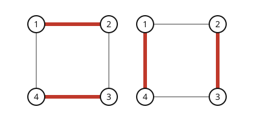

# Heilmann–Lieb 정리

# 개요

**Heilmann–Lieb 정리(Heilmann–Lieb theorem)** 는 그래프의 매칭을 크기별로 센 수로 만든 다항식의 근이 모두 실수라는 정리다. 네 꼭짓점의 순환 그래프에는 변 하나짜리 매칭이 $4$ 개, 변 둘짜리 매칭이 $2$ 개 있다. 이런 개수의 수열이 가운데서 가장 크고 양 끝으로 줄어드는지는 개수를 하나씩 세어서는 일반적으로 보이기 어렵다.

이 정리는 개수를 계수로 하는 다항식의 근이 실수라는 것을 보여, 수열이 로그 오목이고 단봉이라는 것을 근의 위치로 증명한다.

# 직관

순환 그래프 $C\_4$ 의 꼭짓점을 $1,2,3,4$ 로 두면 변이 $12,23,34,41$ 넷이다. 변 하나짜리 매칭은 변마다 하나씩 $4$ 개, 변 둘짜리 매칭은 $\lbrace 12,34\rbrace$ 와 $\lbrace 23,41\rbrace$ 의 $2$ 개다. 빈 매칭 $1$ 개까지 넣으면 개수가 $1,4,2$ 다. 아래 그림의 굵은 변이 변 둘짜리 매칭 두 개다.

이 개수를 계수로 쓴 $1+4t+2t^2$ 의 근은 $t=-1\pm\frac{\sqrt2}{2}$ 로 둘 다 음의 실수다. 그래서 [Pólya 빈도 수열](polya-frequency-sequences.md)의 판정에 따라 $1,4,2$ 는 Pólya 빈도 수열이고 로그 오목이다. 실제로 $4^2\ge 1\cdot 2$ 이다.

# 정의

## 매칭 다항식

$G$ 는 꼭짓점이 $n$ 개인 그래프이고 $m\_k$ 는 변이 $k$ 개인 [매칭](matchings.md)의 수다. $m\_0=1$ 이다. $G$ 의 **매칭 다항식(matching polynomial)** 은 다음과 같다.

$$
\mu(G,x)=\sum\_{k\ge 0}(-1)^km\_kx^{n-2k}
$$

$C\_4$ 에서는 $\mu(C\_4,x)=x^4-4x^2+2$ 이다. $x^2=2\pm\sqrt2$ 이므로 근 넷이 모두 실수다. $\mu(G,x)$ 의 근이 실수인 것과 $\sum\_km\_kt^k$ 의 근이 음의 실수인 것은 $t=-x^{-2}$ 의 치환으로 동치다.

# 성질

## Heilmann–Lieb 정리

**정리.** 모든 그래프 $G$ 에서 $\mu(G,x)$ 의 근은 모두 실수다. 최대 차수가 $\Delta\ge 2$ 이면 근의 절댓값은 모두 $2\sqrt{\Delta-1}$ 미만이다[^1].

$C\_4$ 는 $\Delta=2$ 이고, 근의 절댓값의 최댓값 $\sqrt{2+\sqrt2}\approx 1.85$ 가 $2$ 미만이다. 결과로 매칭 수열 $m\_0,m\_1,\dots$ 는 Pólya 빈도 수열이고 로그 오목이며 단봉이다.

## 점화식과 끼움

꼭짓점 $v$ 를 고르면, $v$ 를 덮지 않는 매칭과 변 $uv$ 로 $v$ 를 덮는 매칭으로 나누어 다음을 얻는다.

$$
\mu(G,x)=x\thinspace\mu(G-v,x)-\sum\_{u\sim v}\mu(G-u-v,x)
$$

이 점화식과 꼭짓점 수에 대한 귀납법으로, $\mu(G-v,x)$ 의 근이 $\mu(G,x)$ 의 근 사이에 하나씩 끼어 있다는 것을 함께 증명한다. 끼어 있는 근의 개수를 세면 $\mu(G,x)$ 가 실근을 $n$ 개 갖는다.

## 경로 나무

꼭짓점 $v$ 에서 출발해 같은 꼭짓점을 두 번 지나지 않는 경로들을 꼭짓점으로 하고, 한 변을 늘인 경로끼리 이은 나무를 $v$ 의 경로 나무 $T(G,v)$ 라 한다. Godsil 은 $\mu(G,x)$ 가 $\mu(T(G,v),x)$ 를 나눈다는 것을 보였다[^2]. 나무에서는 매칭 다항식이 인접 행렬의 특성다항식과 같으므로 근이 실수이고, 최대 차수가 $\Delta$ 인 나무의 인접 행렬의 고윳값은 절댓값이 $2\sqrt{\Delta-1}$ 미만이다. 이것으로 정리의 두 주장이 함께 나온다.

# 활용

- 단봉성. 매칭 수열, 그리고 단량체-이량체 모형의 분배함수 계수가 로그 오목이라는 것이 이 정리에서 나온다.
- 통계역학. Heilmann 과 Lieb 는 단량체-이량체 모형에서 상전이가 없다는 것을 보이려고 이 정리를 증명했다. 분배함수의 영점이 실축 위의 한 반직선에만 있어, 양의 활성도에서는 자유 에너지가 해석적이다[^1].
- [Ramanujan 그래프](ramanujan-graphs.md). Marcus, Spielman, Srivastava 는 정규 그래프의 2 겹 덮개들의 특성다항식 평균이 매칭 다항식이라는 것과 이 정리의 근 상계를 [끼움 족](interlacing-families.md)과 함께 써서, 모든 차수의 이분 Ramanujan 그래프가 있음을 증명했다.

[^1]: O. J. Heilmann, E. H. Lieb, "Theory of monomer-dimer systems", Communications in Mathematical Physics 25 (1972), 190–232.
[^2]: C. D. Godsil, "Matchings and walks in graphs", Journal of Graph Theory 5 (1981), 285–297.

# 연관 문서

## 선수지식

- [매칭](matchings.md)
- [Pólya 빈도 수열](polya-frequency-sequences.md)

## 더 알아보기

아직 연결한 문서가 없다.

#combinatorics #graph_theory #probability
