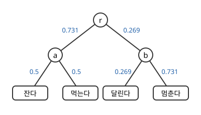

# 계층적 softmax

# 개요

**계층적 softmax(hierarchical softmax)** 는 어휘를 잎으로 하는 이진 나무를 두고, 뿌리에서 잎까지 갈림길마다 왼쪽과 오른쪽 가운데 하나를 고르는 확률을 곱해 낱말의 확률을 정하는 방법이다. 어휘가 수만 개인 언어 모형에서 softmax 로 다음 낱말의 확률을 구하면 점수 수만 개를 모두 더해야 한다. 계층적 softmax 에서는 낱말 하나의 확률을 그 낱말까지의 갈림길 수, 곧 어휘 크기의 로그 정도의 곱셈으로 계산하고, 확률의 합은 저절로 $1$ 이 된다.

# 직관

[단어 임베딩](word-embeddings.md) 문서의 신경망 언어 모형은 문맥 벡터 $\mathbf h$ 에서 다음 낱말의 확률을 softmax 로 정한다. 낱말 하나의 확률에도 분모의 합이 들어가므로, 어휘 $\lvert V\rvert$ 개의 점수를 모두 계산해야 한다.

어휘가 "잔다, 먹는다, 달린다, 멈춘다" 넷이라 하고, 아래 그림처럼 뿌리에서 두 번 갈라 네 낱말에 닿는 나무를 둔다.

갈림길 $r,a,b$ 마다 벡터 $\mathbf u_r,\mathbf u_a,\mathbf u_b$ 를 두고, 갈림길 $n$ 에서 왼쪽으로 갈 확률을 $\sigma(\mathbf h\cdot\mathbf u_n)$, 오른쪽으로 갈 확률을 $1-\sigma(\mathbf h\cdot\mathbf u_n)=\sigma(-\mathbf h\cdot\mathbf u_n)$ 로 정한다. $\sigma(t)=1/(1+e^{-t})$ 는 로지스틱 함수(logistic function)다. 어떤 문맥에서 $\mathbf h\cdot\mathbf u_r=1$, $\mathbf h\cdot\mathbf u_a=0$, $\mathbf h\cdot\mathbf u_b=-1$ 이면 $\sigma(1)\approx0.731$, $\sigma(0)=0.5$, $\sigma(-1)\approx0.269$ 다.

낱말의 확률은 뿌리에서 그 낱말까지 고른 방향의 확률을 곱한 것이다.

$$P(\text{달린다})=\sigma(-1)\cdot\sigma(-1)\approx0.269\times0.269\approx0.072$$

같은 방법으로 "잔다" 와 "먹는다" 는 $0.731\times0.5\approx0.366$, "멈춘다" 는 $0.269\times0.731\approx0.197$ 이고, 넷의 합은 $1$ 이다. 낱말 하나의 확률을 구하는 데 로지스틱 함수 두 번이면 되고, 나누는 합이 없다. 이렇게 나무의 갈림길 확률을 곱해 정한 분포를 계층적 softmax 라 한다.

# 정의

어휘 $V$ 를 잎으로 하는 이진 나무 $T$ 의 내부 정점 $n$ 마다 벡터 $\mathbf u_n\in\mathbb R^d$ 를 둔다. 낱말 $v$ 에 대해 뿌리에서 $v$ 까지의 경로가 지나는 내부 정점을 $n_1,\dots,n_{L(v)}$ 라 하고, $n_j$ 에서 왼쪽으로 가면 $\delta_j=1$, 오른쪽으로 가면 $\delta_j=-1$ 로 둔다. 문맥 벡터 $\mathbf h$ 에 대해 다음 분포를 **계층적 softmax** 라 한다[^1].

$$P(v\mid\mathbf h)=\prod_{j=1}^{L(v)}\sigma\bigl(\delta_j\thinspace\mathbf h\cdot\mathbf u_{n_j}\bigr)$$

직관 절에서 "달린다" 의 경로는 $r,b$ 이고 $\delta=(-1,1)$ 이므로, 위 식은 다음과 같다.

$$P(\text{달린다}\mid\mathbf h)=\sigma(-\mathbf h\cdot\mathbf u_r)\thinspace\sigma(\mathbf h\cdot\mathbf u_b)=\sigma(-1)\thinspace\sigma(-1)$$

# 성질

## 확률의 합

모든 $\mathbf h$ 에서 $\sum_{v\in V}P(v\mid\mathbf h)=1$ 이다.

증명의 요지. 내부 정점 $n$ 아래의 잎들의 확률 합을 $n$ 까지 오는 확률로 나눈 값이 $1$ 임을 잎 쪽부터 귀납으로 보인다. 두 자식 쪽 합이 각각 $1$ 이면 $n$ 아래의 합은 $\sigma(t)+\sigma(-t)=1$ 이다.

## 계산 비용과 Huffman 나무

낱말 $v$ 의 확률과 그 기울기는 경로 위의 벡터 $L(v)$ 개만으로 계산된다. 기울기는 다음과 같다.

$$\nabla_{\mathbf h}\log P(v\mid\mathbf h)=\sum_{j=1}^{L(v)}\delta_j\thinspace\sigma\bigl(-\delta_j\thinspace\mathbf h\cdot\mathbf u_{n_j}\bigr)\thinspace\mathbf u_{n_j}$$

균형 나무에서는 $L(v)=\lceil\log_2\lvert V\rvert\rceil$ 정도다. 말뭉치의 낱말 하나당 평균 비용은 낱말 빈도로 평균한 $L(v)$ 에 비례하고, 이것은 나무를 부호로 보았을 때의 평균 부호 길이다. 그래서 낱말 빈도로 만든 [Huffman 부호](huffman-coding.md)의 나무가 이 평균을 가장 작게 하고, 그 값은 빈도 분포의 엔트로피에 $1$ 을 더한 것보다 작다.

## 나무가 정하는 모형

나무가 다르면 표현할 수 있는 분포가 다르다. 한 갈림길의 확률은 그 아래 낱말 전체에 공통으로 곱해지므로, 쓰임이 비슷한 낱말이 한 가지 아래에 모이면 그 갈림길의 벡터가 그 낱말들의 공통점을 맡는다. Mnih 와 Hinton 은 낱말 벡터를 모아 나무를 만들면 무작위 나무보다 언어 모형의 성능이 좋음을 보고했다[^3].

## 전체 분포의 비용

낱말 하나의 확률은 싸지만, 어휘 전체의 분포를 구하거나 가장 확률이 큰 낱말을 찾으려면 여전히 모든 잎을 보아야 한다. 그래서 계층적 softmax 는 학습과 주어진 낱말의 확률 계산을 빠르게 하고, 생성할 때의 비용은 줄이지 않는다.

# 활용

- word2vec. 단어 임베딩 문서의 skip-gram 은 음수 표집 대신 Huffman 나무의 계층적 softmax 로도 학습된다[^2].
- 문장 분류. 분류할 범주가 수천 개 이상일 때 범주를 잎으로 하는 나무를 두어 학습을 빠르게 한다[^4].
- 신경망 언어 모형. Morin 과 Bengio 는 WordNet 의 낱말 분류로 만든 나무로 신경망 언어 모형의 학습을 수백 배 빠르게 했다[^1].

[^1]: F. Morin, Y. Bengio, "Hierarchical probabilistic neural network language model", *Proceedings of the Tenth International Workshop on Artificial Intelligence and Statistics* (2005), 246–252.
[^2]: T. Mikolov, I. Sutskever, K. Chen, G. Corrado, J. Dean, "Distributed representations of words and phrases and their compositionality", *Advances in Neural Information Processing Systems* **26** (2013).
[^3]: A. Mnih, G. Hinton, "A scalable hierarchical distributed language model", *Advances in Neural Information Processing Systems* **21** (2009).
[^4]: A. Joulin, E. Grave, P. Bojanowski, T. Mikolov, "Bag of tricks for efficient text classification", *Proceedings of the 15th Conference of the European Chapter of the Association for Computational Linguistics* (2017), 427–431.

# 연관 문서

## 선수지식

- [단어 임베딩](word-embeddings.md)
- [Huffman 부호](huffman-coding.md)

## 더 알아보기

아직 연결한 문서가 없다.

#machine_learning #information_theory
