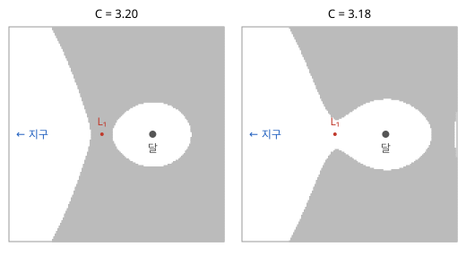

# Hill 영역

# 개요

**Hill 영역(Hill region)** 은 원 제한 삼체 문제(circular restricted three-body problem)에서 가벼운 물체가 자기의 Jacobi 상수(Jacobi constant)로 갈 수 있는 위치 전체다. 지구를 도는 우주선이 엔진을 끈 뒤 달 근처까지 갈 수 있는지는 우주선의 위치와 속도만으로 정해지는 수 하나에 달려 있다. 그 수를 [Lagrange 점](lagrange-points.md) $L\_1$ 에서의 값과 견주면, 지구 쪽과 달 쪽 영역이 이어져 있는지 끊겨 있는지가 정해진다.

# 직관

지구와 달은 $\mu\approx 0.01215$ 인 원 제한 삼체 문제로 근사된다. Lagrange 점 문서의 회전 좌표계에서 우주선의 위치를 $(x,y)$, 속도를 $(x',y')$ 이라 하면 다음 값 $C$ 는 시간에 따라 바뀌지 않는다.

$$
C=2\Omega(x,y)-(x'^2+y'^2)
$$

속력의 제곱 $2\Omega(x,y)-C$ 는 음수가 될 수 없으므로 우주선은 $2\Omega\ge C$ 인 점에만 간다. $C$ 가 크면 갈 수 있는 곳이 좁고, $C$ 가 작으면 넓다.

아래 그림은 달 근처를 확대해, 우주선이 갈 수 없는 점 $2\Omega\lt C$ 를 회색으로 칠한 것이다. 왼쪽 $C=3.20$ 에서는 지구 쪽 흰 영역과 달 둘레의 흰 영역이 회색 띠로 갈라져 있어, 지구 쪽에서 출발한 우주선은 달 둘레에 들어가지 못한다. 오른쪽 $C=3.18$ 에서는 $L\_1$ 자리에서 두 흰 영역이 이어진다.

두 영역은 $C$ 가 $L\_1$ 에서의 값 $2\Omega(L\_1)\approx 3.1883$ 아래로 내려갈 때 이어진다. 지구와 달을 잇는 선분 위에서 $2\Omega$ 가 가장 작은 점이 $L\_1$ 이므로, 회색 띠는 그 점에서 처음 끊긴다.

# 정의

질량비 $\mu$ 의 원 제한 삼체 문제에서 $\Omega$ 는 Lagrange 점 문서의 함수이고, $C$ 는 직관 절의 식으로 정한 Jacobi 상수다. $C$ 에 대한 **Hill 영역** 은 다음 집합이다.

$$
H(C)=\lbrace (x,y) : 2\Omega(x,y)\ge C\rbrace
$$

경계 $2\Omega(x,y)=C$ 위에서는 속력이 $0$ 이므로, 이 곡선을 **영속도 곡선(zero-velocity curve)** 이라 한다. 직관 절의 그림에서 흰 영역이 $H(C)$ 이고 흰색과 회색의 경계가 영속도 곡선이다.

Lagrange 점 $L\_i$ 에서의 값 $C\_i=2\Omega(L\_i)$ 를 **임계 Jacobi 상수(critical Jacobi constant)** 라 한다. 지구–달에서 $C\_1\approx 3.1883$ 이다.

# 성질

## 임계값의 순서

$0\lt\mu\lt 1/2$ 이면 다음이 성립한다[^1].

$$
C_1\gt C_2\gt C_3\gt C_4=C_5=3-\mu+\mu^2
$$

$L\_4$ 는 $r\_1=r\_2=1$ 인 점이고 원점까지 거리의 제곱이 다음과 같다.

$$
x^2+y^2=\left(\tfrac12-\mu\right)^2+\tfrac34=1-\mu+\mu^2
$$

이것을 $\Omega$ 에 넣으면 $C\_4$ 가 나온다.

$$
2\Omega(L_4)=(1-\mu+\mu^2)+2(1-\mu)+2\mu=3-\mu+\mu^2
$$

$\Omega$ 의 임계점은 Lagrange 점뿐이다. 그래서 $C$ 를 줄일 때 $H(C)$ 의 연결 성분이 바뀌는 것은 $C$ 가 $C\_i$ 를 지날 때뿐이다. 지구–달의 값과 단계는 다음과 같다.

| 범위                          | Hill 영역                                                   |
| ----------------------------- | ----------------------------------------------------------- |
| $C\gt C\_1\approx 3.1883$     | 지구 둘레, 달 둘레, 바깥의 세 성분이 서로 떨어져 있다       |
| $C\_2\lt C\lt C\_1$           | $L\_1$ 에서 지구 둘레와 달 둘레가 이어진다                  |
| $C\_3\lt C\lt C\_2\approx 3.1722$ | $L\_2$ 에서 달 둘레와 바깥이 이어진다                    |
| $C\_4\lt C\lt C\_3\approx 3.0121$ | $L\_3$ 에서도 이어지고, 금지 영역은 $L\_4$, $L\_5$ 둘레의 두 조각이다 |
| $C\lt C\_4\approx 2.9880$     | 평면 전체                                                   |

## Hill 안정성

$C\gt C\_1$ 이고 물체가 가벼운 천체 둘레의 성분에서 출발하면, 그 성분이 유계이므로 물체는 영원히 가벼운 천체 근처에 남는다. 이것을 **Hill 안정(Hill stable)** 이라 한다. 성분 안에서 어떻게 움직이는지는 정하지 않고, 가벼운 천체와 충돌하는 궤도도 Hill 안정이다.

$\mu$ 가 작으면 그 성분은 가벼운 천체를 중심으로 하는 반지름 $(\mu/3)^{1/3}$ 근처의 영역이다. 이 반지름을 **Hill 반지름(Hill radius)** 이라 한다. 지구–달에서는 $(0.01215/3)^{1/3}\approx 0.159$, 곧 약 6 만 1 천 km 이다.

## 목을 지나는 궤도

$C$ 가 $C\_1$ 보다 조금 작으면 $H(C)$ 는 $L\_1$ 근처에 좁은 목을 가진다. Conley 는 이 목 안에 [Lyapunov 궤도](lyapunov-orbits.md)라는 $L\_1$ 근처의 주기 궤도가 있고, 그 주기 궤도를 기준으로 목을 한쪽에서 다른 쪽으로 지나는 궤도와 되튀어 나오는 궤도가 나뉜다는 것을 보였다[^2]. Hill 영역은 지나갈 수 있는 곳의 필요조건이고, 실제로 지나가는지는 이 구분이 정한다.

# 활용

- 달 전이 궤도의 설계. 지구 쪽에서 달 둘레로 가려면 $C\lt C\_1$ 이어야 한다. $C\_1$ 바로 아래의 Jacobi 상수로 $L\_1$ 의 목을 지나는 궤도를 골라 연료를 적게 쓰는 저에너지 전이 궤도를 만든다.
- 위성 궤도의 범위. 행성의 위성은 태양–행성 계의 Hill 반지름 안에서 돈다. 태양–지구에서 Hill 반지름은 약 150 만 km 이고 달의 궤도 반지름 약 38 만 km 는 그 안에 있다.
- 쌍성의 Roche 로브(Roche lobe). 공전하는 두 별 각각의 둘레에서 $L\_1$ 을 지나는 영속도 곡면이 감싸는 영역이다. 한 별이 부풀어 자기 Roche 로브를 채우면 $L\_1$ 을 지나 다른 별로 물질이 옮겨 간다.

[^1]: V. Szebehely, *Theory of Orbits: The Restricted Problem of Three Bodies*, Academic Press, 1967, 4장.
[^2]: C. Conley, "Low energy transit orbits in the restricted three-body problem", *SIAM Journal on Applied Mathematics* **16** (1968), 732–746.

# 연관 문서

## 선수지식

- [Lagrange 점](lagrange-points.md)

## 더 알아보기

- [Lyapunov 궤도](lyapunov-orbits.md)

#analysis #differential_geometry
