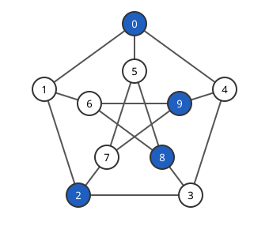

# Hoffman 비율 한계

# 개요

**Hoffman 비율 한계(Hoffman ratio bound)** 는 모든 정점의 이웃 수가 같은 그래프에서, 서로 이웃하지 않는 정점을 최대 몇 개 고를 수 있는지를 인접행렬의 가장 큰 고윳값과 가장 작은 고윳값으로 위에서 막는 부등식이다. 정점 $10$ 개, 정점마다 이웃 $3$ 개인 Petersen 그래프에서 서로 이웃하지 않는 정점 $4$ 개는 쉽게 찾지만, $5$ 개가 불가능하다는 것을 경우를 나눠 확인하려면 $\binom{10}5=252$ 가지를 보아야 한다.

이 한계는 고윳값 두 개만으로 상한 $4$ 를 계산해 그 확인을 대신한다.

# 직관

아래 그림은 Petersen 그래프이고, 파랗게 칠한 $0,2,8,9$ 는 어느 둘도 이웃하지 않는다.

고른 정점의 집합을 $S$ 라 하고, $S$ 에서 $1$, 밖에서 $0$ 인 벡터를 생각한다. $S$ 안에 간선이 없으면 이 벡터를 인접행렬에 넣은 이차형식은 $0$ 이다. 평균을 빼서 모든 성분이 $1$ 인 벡터와 직교하게 만들면, 그 이차형식은 음수가 되고 크기가 $\vert S\vert$ 에 따라 커진다.

반면 모든 성분이 $1$ 인 벡터와 직교하는 벡터에서 이차형식은 가장 작은 고윳값과 길이의 제곱의 곱보다 작아지지 못한다. 두 사실을 맞세우면 $\vert S\vert$ 가 너무 크면 안 된다는 부등식이 나온다.

# 정의

[그래프](graphs.md) $G$ 에서 어느 두 정점도 간선으로 이어지지 않은 정점 집합을 **독립집합(independent set)** 이라 하고, 독립집합의 최대 크기를 **독립수(independence number)** $\alpha(G)$ 라 한다. 직관 절의 $\lbrace 0,2,8,9\rbrace$ 는 Petersen 그래프의 독립집합이다.

모든 정점의 이웃 수가 $k$ 인 그래프를 $k$-정칙 그래프($k$-regular graph)라 한다. $k$-정칙 그래프의 인접행렬의 가장 큰 고윳값은 $k$ 이고, 고유벡터는 모든 성분이 $1$ 인 벡터 $\mathbf 1$ 이다. Petersen 그래프는 $3$-정칙이고 고윳값은 $3,1,-2$ 다.

# 성질

## 정리

정리. 정점이 $n$ 개인 $k$-정칙 그래프의 인접행렬의 가장 작은 고윳값이 $\lambda\_{\min}$ 이면 다음이 성립한다.

$$
\alpha(G)\le\frac{n(-\lambda_{\min})}{k-\lambda_{\min}}
$$

Petersen 그래프에서 우변은 $10\cdot2/(3+2)=4$ 이고, 직관 절의 독립집합이 등호를 달성한다.

증명의 요지. 독립집합 $S$ 의 크기를 $s$, 지시벡터를 $\mathbf 1\_S$ 로 두고 $x=\mathbf 1\_S-\tfrac sn\mathbf 1$ 이라 한다. $S$ 안에 간선이 없고 각 정점의 이웃이 $k$ 개이므로 다음이 나온다.

$$
x^{\top}Ax=0-2\cdot\frac sn\cdot ks+\frac{s^2}{n^2}\cdot kn=-\frac{ks^2}n,\qquad \Vert x\Vert^2=\frac{s(n-s)}n
$$

$x$ 는 $\mathbf 1$ 과 직교하므로 [Rayleigh 몫](rayleigh-quotient.md)에서 $x^{\top}Ax\ge\lambda\_{\min}\Vert x\Vert^2$ 이다. 두 식을 넣고 $s$ 에 대해 풀면 정리가 나온다.

## 등호의 꼴

등호가 성립하면 $x$ 가 $\lambda\_{\min}$ 의 고유벡터이고, $S$ 밖의 각 정점은 $S$ 안에 이웃이 정확히 $-\lambda\_{\min}$ 개다. Petersen 그래프에서 $S=\lbrace 0,2,8,9\rbrace$ 밖의 여섯 정점은 각각 $S$ 안에 이웃이 $2$ 개다.

# 활용

- [Kneser 그래프](kneser-graphs.md)와 [Erdős–Ko–Rado 정리](erdos-ko-rado.md). $K(n,k)$ 의 고윳값을 넣으면 독립수의 상한이 $\binom{n-1}{k-1}$ 이 되고, 서로 만나는 $k$ 원소 부분집합족의 크기 상한이 나온다.
- [Johnson 그래프](johnson-graphs.md). 같은 연관 체계의 다른 거리 관계에 이 한계를 적용해 집합족의 크기 상한을 얻는다.
- [강정칙 그래프](strongly-regular-graphs.md). 세 고윳값이 매개변수로 정해지므로 독립수의 상한이 매개변수의 식으로 나온다.
- [그래프 색칠](graph-coloring.md). 색 하나의 정점들이 독립집합이므로 채색수(chromatic number)는 $n/\alpha(G)\ge1-k/\lambda\_{\min}$ 이상이다.

# 연관 문서

## 선수지식

- [그래프](graphs.md)
- [Rayleigh 몫](rayleigh-quotient.md)

## 더 알아보기

아직 연결한 문서가 없다.

#graph_theory #linear_algebra #combinatorics
