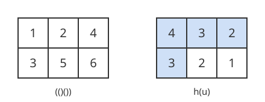

# 갈고리 길이 공식

# 개요

**갈고리 길이 공식(hook length formula)** 은 계단 모양으로 쌓은 칸에 $1$ 부터 $n$ 까지를 오른쪽과 아래쪽으로 갈수록 커지게 채우는 방법의 수를 곱 하나로 주는 공식이다. 괄호 세 쌍을 짝이 맞게 늘어놓는 방법을 세는 문제가 이 꼴이다. 여는 괄호의 자리 번호를 위 줄에, 닫는 괄호의 자리 번호를 아래 줄에 적으면 짝이 맞는 배열 하나가 두 줄 세 칸을 채우는 방법 하나에 대응한다.

공식은 칸마다 그 칸과 그 오른쪽 칸, 그 아래쪽 칸의 수를 세어 모두 곱하고, $n!$ 을 그 곱으로 나눈다. 채우는 방법을 하나씩 나열하지 않고 개수가 나온다.

# 직관

괄호 세 쌍을 짝이 맞게 늘어놓는 방법은 다음 다섯이다.

$$
((())),\quad (()()),\quad (())(),\quad ()(()),\quad ()()()
$$

$(()())$ 에서 여는 괄호는 $1, 2, 4$ 번째 자리에 있고 닫는 괄호는 $3, 5, 6$ 번째 자리에 있다. 앞의 셋을 위 줄에, 뒤의 셋을 아래 줄에 왼쪽부터 적는다. 두 줄은 자리 번호 순서로 적었으므로 왼쪽에서 오른쪽으로 커진다.

짝이 맞는다는 것은 앞에서부터 어디서 끊어도 닫는 괄호가 여는 괄호보다 많지 않다는 것이다. $k$ 번째 닫는 괄호가 나오기 전에 여는 괄호가 $k$ 개 이상 나와 있어야 하므로, 아래 줄의 $k$ 번째 수는 위 줄의 $k$ 번째 수보다 크다. 곧 각 열에서도 위에서 아래로 커진다. 거꾸로 행과 열이 모두 커지게 채운 두 줄 세 칸은 짝이 맞는 괄호 배열 하나를 준다.

아래 그림의 왼쪽이 $(()())$ 를 옮겨 적은 칸이다. 오른쪽은 각 칸에 그 칸 자신과 그 오른쪽 칸, 그 아래쪽 칸의 수를 적은 것이고, 색칠한 칸은 왼쪽 위 칸에서 센 네 칸이다.

오른쪽 그림의 여섯 수를 곱하면 $4\cdot3\cdot2\cdot3\cdot2\cdot1=144$ 이고, $6!=720$ 을 $144$ 로 나누면 $5$ 다. 나열해서 센 다섯과 같다. 괄호가 열 쌍이면 짝이 맞는 배열은 $16796$ 개라서 나열로는 셀 수 없지만, 두 줄 열 칸에 같은 계산을 하면 그 수가 나온다.

# 정의

## Young 도형과 표준 대각표

[분할수](partitions.md) 문서의 분할 $\lambda=(\lambda_1\ge\lambda_2\ge\cdots\ge\lambda_\ell\gt 0)$ 에 대해 $i$ 번째 행에 $\lambda_i$ 개의 칸을 왼쪽 정렬한 그림이 Young 도형(Young diagram)이고, 이 문서에서는 그 칸의 집합도 $\lambda$ 로 쓴다. $i$ 행 $j$ 열의 칸을 $(i,j)$ 로 쓴다. $\lambda$ 의 칸 수가 $n=\lambda_1+\cdots+\lambda_\ell$ 이면 $\lambda\vdash n$ 으로 쓴다.

**표준 Young 대각표(standard Young tableau)** 는 $\lambda\vdash n$ 의 칸에 $1,\dots,n$ 을 한 번씩 채워 각 행이 왼쪽에서 오른쪽으로, 각 열이 위에서 아래로 커지게 한 것이다. 그 개수를 $f^\lambda$ 로 쓴다. 직관 절의 두 줄 세 칸은 $\lambda=(3,3)$ 이고 $f^{(3,3)}=5$ 다. $\lambda=(2,1)$ 이면 첫 행이 $1,2$ 이고 둘째 행이 $3$ 인 것과, 첫 행이 $1,3$ 이고 둘째 행이 $2$ 인 것의 둘이므로 $f^{(2,1)}=2$ 다.

## 갈고리 길이

칸 $u=(i,j)\in\lambda$ 의 **갈고리(hook)** 는 $u$ 자신과 같은 행에서 $u$ 의 오른쪽에 있는 칸, 같은 열에서 $u$ 의 아래에 있는 칸을 모은 집합이다. 그 칸 수가 **갈고리 길이(hook length)** $h(u)$ 다. $\lambda'\_j$ 를 $j$ 번째 열의 칸 수라 하면 다음과 같다.

$$
h(i,j)=(\lambda_i-j)+(\lambda'\_j-i)+1
$$

$\lambda_i-j$ 는 오른쪽 칸 수, $\lambda'\_j-i$ 는 아래쪽 칸 수다. 직관 절 그림의 오른쪽이 $\lambda=(3,3)$ 의 갈고리 길이이고, 색칠한 네 칸이 $(1,1)$ 의 갈고리다. $\lambda=(3,2)$ 이면 첫 행의 갈고리 길이는 $4,3,1$ 이고 둘째 행은 $2,1$ 이다.

## 갈고리 길이 공식

$\lambda\vdash n$ 에 대해 다음이 성립한다[^1].

$$
f^\lambda=\frac{n!}{\prod_{u\in\lambda}h(u)}
$$

$\lambda=(3,2)$ 이면 $5!/(4\cdot3\cdot1\cdot2\cdot1)=120/24=5$ 다. 실제로 첫 행을 $123$, $124$, $125$, $134$, $135$ 로 두고 나머지 두 수를 둘째 행에 커지게 적은 다섯 개가 전부다.

# 성질

## 모서리 점화식

칸 $c\in\lambda$ 의 오른쪽과 아래쪽에 칸이 없으면 $c$ 를 $\lambda$ 의 모서리(corner)라 한다. 표준 대각표에서 가장 큰 수 $n$ 은 행의 끝이자 열의 끝인 칸, 곧 모서리에 있다. $n$ 을 지우면 $\lambda-c$ 의 표준 대각표가 남으므로 다음이 성립한다.

$$
f^\lambda=\sum_{c\ \text{모서리}}f^{\lambda-c},\qquad f^{\varnothing}=1
$$

$\lambda=(3,2)$ 의 모서리는 $(1,3)$ 과 $(2,2)$ 이다. $f^{(2,2)}=4!/(3\cdot2\cdot2\cdot1)=2$, $f^{(3,1)}=4!/(4\cdot2\cdot1\cdot1)=3$ 이고 합이 $5$ 다.

## 갈고리 걷기 증명

Greene–Nijenhuis–Wilf 의 증명(hook walk proof)은 $F(\lambda)=n!/\prod_{u\in\lambda}h(u)$ 가 모서리 점화식을 만족함을 보인다[^2]. 그러면 $n$ 에 대한 귀납법으로 $f^\lambda=F(\lambda)$ 다. 보일 식은 다음이다.

$$
\sum_{c\ \text{모서리}}\frac{F(\lambda-c)}{F(\lambda)}=1
$$

증명의 요지. 모서리 $c=(\alpha,\beta)$ 를 지우면 갈고리 길이가 바뀌는 칸은 $\alpha$ 행에서 $c$ 의 왼쪽 칸과 $\beta$ 열에서 $c$ 의 위쪽 칸뿐이고, 각각 $1$ 씩 줄어든다. 그래서 다음이 나온다.

$$
\frac{F(\lambda-c)}{F(\lambda)}=\frac1n\prod_{j\lt \beta}\frac{h(\alpha,j)}{h(\alpha,j)-1}\prod_{i\lt \alpha}\frac{h(i,\beta)}{h(i,\beta)-1}
$$

칸 하나를 균등하게 고르고, 지금 칸의 갈고리에서 자신을 뺀 칸 하나를 균등하게 골라 옮겨 가기를 모서리에 닿을 때까지 되풀이한다. 이 걷기가 모서리 $c$ 에서 멈출 확률을 지나간 행과 열의 집합으로 나누어 더하면 위 식의 우변과 같다. 확률의 합은 $1$ 이므로 보일 식이 성립한다. $\lambda=(3,2)$ 에서 우변은 $c=(1,3)$ 일 때 $\frac15\cdot\frac43\cdot\frac32=\frac25$, $c=(2,2)$ 일 때 $\frac15\cdot\frac21\cdot\frac32=\frac35$ 이고 합이 $1$ 이다.

## 제곱합

$\lambda$ 가 $n$ 의 분할 전체를 지날 때 다음이 성립한다.

$$
\sum_{\lambda\vdash n}\big(f^\lambda\big)^2=n!
$$

[Robinson–Schensted–Knuth 대응](robinson-schensted-knuth.md)(RSK)이 순열 하나를 같은 모양의 표준 대각표 쌍 하나로 보내는 전단사이므로 양변이 같다. $n=3$ 이면 $f^{(3)}=1$, $f^{(2,1)}=2$, $f^{(1,1,1)}=1$ 이고 $1+4+1=6$ 이다.

## 갈고리 내용 공식

칸 $u=(i,j)$ 의 내용(content)을 $c(u)=j-i$ 로 둔다. $\lambda$ 의 칸에 $1,\dots,m$ 을 각 행에서 약증가, 각 열에서 강증가하게 채운 반표준 Young 대각표(semistandard Young tableau)의 개수는 다음과 같다. 이것을 갈고리 내용 공식(hook-content formula)이라 한다[^3].

$$
s_\lambda(\underbrace{1,\dots,1}\_{m})=\prod_{u\in\lambda}\frac{m+c(u)}{h(u)}
$$

좌변은 [Schur 다항식](schur-polynomials.md)에 $1$ 을 $m$ 번 넣은 값이다. $\lambda=(2,1)$, $m=2$ 이면 내용은 $0,1,-1$ 이고 갈고리 길이는 $3,1,1$ 이므로 값은 $(2\cdot3\cdot1)/(3\cdot1\cdot1)=2$ 다. Schur 다항식 문서에서 센 대각표 두 개와 같다.

# 활용

- [대칭군](symmetric-groups.md)의 표현. $S_n$ 의 기약표현은 $n$ 의 분할과 일대일로 대응하고, $\lambda$ 에 대응하는 기약표현의 차원이 $f^\lambda$ 다. $S_3$ 의 기약표현 셋의 차원 $1,2,1$ 이 갈고리 길이 공식으로 나온다. 제곱합 항등식은 [군의 표현](group-representations.md)에서 기약표현 차원의 제곱합이 군의 위수와 같다는 정리의 $S_n$ 경우다.
- [Catalan 수](catalan-numbers.md). $\lambda=(n,n)$ 의 갈고리 길이는 첫 행이 $n+1,\dots,2$, 둘째 행이 $n,\dots,1$ 이므로 다음이 나온다. 직관 절의 괄호 배열 수가 이것이다.

  $$
  f^{(n,n)}=\frac{(2n)!}{(n+1)!\thinspace n!}=\frac1{n+1}\binom{2n}{n}
  $$

- [최장 증가 부분수열](longest-increasing-subsequence.md). 균등하게 고른 순열의 RSK 모양이 $\lambda$ 일 확률은 $(f^\lambda)^2/n!$ 이다. 이 분포를 Plancherel 측도(Plancherel measure)라 한다. Vershik–Kerov 와 Logan–Shepp 는 갈고리 길이 공식으로 이 확률을 갈고리 길이의 곱으로 적고, $n\to\infty$ 에서 도형의 극한 모양을 구해 최장 증가 부분수열의 길이가 $2\sqrt n$ 에 가깝다는 것을 증명했다.

[^1]: J. S. Frame, G. de B. Robinson, R. M. Thrall, The hook graphs of the symmetric group, *Canadian J. Math.* **6** (1954), 316–324.
[^2]: C. Greene, A. Nijenhuis, H. S. Wilf, A probabilistic proof of a formula for the number of Young tableaux of a given shape, *Advances in Math.* **31** (1979), 104–109.
[^3]: R. Stanley, *Enumerative Combinatorics II* (1999), 7.21 절.

# 연관 문서

## 선수지식

- [Schur 다항식](schur-polynomials.md)

## 더 알아보기

아직 연결한 문서가 없다.

#combinatorics #algebra #probability
