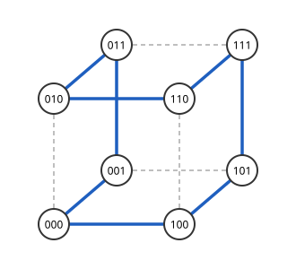

# 초입방체 그래프

# 개요

**초입방체 그래프(hypercube graph)** 는 길이 $n$ 인 이진 문자열을 정점으로 두고 한 비트만 다른 두 문자열을 이은 그래프다. 회전 위치를 세 비트로 읽는 장치에서 이웃한 위치의 비트가 둘 이상 다르면 바뀌는 순간에 엉뚱한 값을 읽으므로, 여덟 개의 세 비트 문자열을 이웃끼리 한 비트만 다르게 한 바퀴로 늘어놓아야 한다. 그런 배열은 이 그래프에서 모든 정점을 한 번씩 지나는 순환이고, 그래프를 두 복사본으로 나누는 구성으로 모든 $n$ 에서 얻는다.

# 직관

$n=2$ 에서 $00,01,11,10$ 은 이웃끼리, 그리고 끝과 처음이 한 비트만 다르다. $n=3$ 에서는 앞에 $0$ 을 붙인 $000,001,011,010$ 을 지나고, 같은 목록을 거꾸로 하여 앞에 $1$ 을 붙인 $110,111,101,100$ 을 지난다. 이음매의 $010$ 과 $110$, 그리고 끝의 $100$ 과 처음의 $000$ 은 첫 비트만 다르다. 아래 그림의 굵은 간선이 이 순환이다.

같은 방법을 되풀이하면 길이 $n-1$ 의 목록에서 길이 $n$ 의 목록이 나오므로 모든 $n\ge 2$ 에서 이런 순환이 있다. 이 목록을 반사 Gray 부호(reflected Gray code)라 한다.

# 정의

$\lbrace 0,1\rbrace^n$ 을 정점 집합으로 두고, 정확히 한 자리에서 다른 두 문자열을 이은 [그래프](graphs.md)를 $n$ 차원 **초입방체 그래프** 라 하고 $Q_n$ 으로 적는다[^1]. $Q_1$ 은 간선 하나, $Q_2$ 는 사각형, $Q_3$ 은 직관 절의 정육면체다. 두 정점의 거리는 다른 자리의 수, 곧 Hamming 거리(Hamming distance)다.

# 성질

## 기본 수

$Q_n$ 은 정점이 $2^n$ 개이고, 정점마다 이웃이 $n$ 개이므로 간선이 $n2^{n-1}$ 개다. $1$ 의 개수가 짝수인 정점과 홀수인 정점이 두 부분을 이루는 이분그래프이고, 지름은 $n$ 이다. $Q_n$ 은 $x_n=0$ 인 정점과 $x_n=1$ 인 정점이 이루는 두 $Q\_{n-1}$ 사이에 대응하는 정점을 이은 것이다. 직관 절의 구성이 이 분해를 쓴다.

## 거리 정칙성

$Q_n$ 은 교차 배열이 $\lbrace n,n-1,\dots,1;1,2,\dots,n\rbrace$ 인 [거리 정칙 그래프](distance-regular-graphs.md)다. 거리 $i$ 인 정점 $v$ 의 이웃 가운데 출발점에 가까워지는 것은 다른 자리 $i$ 개 가운데 하나를 고친 것이고, 멀어지는 것은 같은 자리 $n-i$ 개 가운데 하나를 바꾼 것이다.

## 고윳값

$u\in\lbrace 0,1\rbrace^n$ 에 대해 벡터 $\chi_u(x)=(-1)^{u\cdot x}$ 는 인접행렬의 고유벡터이고 고윳값은 $n-2\thinspace\mathrm{wt}(u)$ 다. 이웃 $x+e_j$ 에서 $\chi_u$ 의 값은 $u_j=1$ 이면 부호가 바뀌고 $u_j=0$ 이면 같으므로, 합이 $(n-\mathrm{wt}(u))-\mathrm{wt}(u)$ 배다. 따라서 [고윳값](eigenvalues.md)은 $n-2i$ 이고 중복도는 $\binom ni$ 다.

이 값은 [Krawtchouk 다항식](krawtchouk-polynomials.md) $K_1(i)$ 이다. $Q_3$ 은 $3,1,-1,-3$ 이 각각 $1,3,3,1$ 번이다.

## 간선 등주 부등식

정점 집합 $S$ 의 두 끝점이 모두 $S$ 에 있는 간선의 수는

$$
e(S)\le\tfrac12\lvert S\rvert\log_2\lvert S\rvert
$$

이하이고, $\lvert S\rvert=2^k$ 이면 $k$ 차원 부분 초입방체가 등호를 달성한다[^2]. $x_n$ 의 값으로 $S$ 를 둘로 나누어 $n$ 에 대한 귀납법으로 증명한다. $Q_3$ 에서 네 정점이 이루는 간선은 많아야 $4$ 개이고, 그림의 아랫면 $000,100,101,001$ 이 그 예다.

## 유도 부분그래프의 최대 차수

$Q_n$ 의 정점 $2^{n-1}+1$ 개로 유도된 부분그래프에는 이웃이 $\sqrt n$ 개 이상인 정점이 있다[^3]. 정점 $2^{n-1}$ 개는 이분그래프의 한쪽 부분으로 고를 수 있고 그때 간선이 없으므로, 하나를 더하는 순간 최대 차수가 $\sqrt n$ 까지 오른다. 이 정리에서 [민감도 정리](sensitivity-theorem.md)가 나온다.

# 활용

- Gray 부호. 회전 부호기와 Karnaugh 도표에서 이웃한 값이 한 비트만 다르게 늘어놓는 것은 직관 절의 Hamilton 순환이다. [Hamilton 순환](hamiltonian-cycles.md)이 있는 그래프의 표준 예다.
- 병렬 계산의 연결망. 처리기 $2^n$ 개를 $Q_n$ 으로 이으면 어느 두 처리기 사이의 거리가 $n$ 이하이고, 다른 비트를 하나씩 고치는 경로로 전달한다.
- [부울 함수의 Fourier 해석](boolean-fourier.md). [함수](functions.md) $f:\lbrace 0,1\rbrace^n\to\mathbb R$ 은 $Q_n$ 의 정점 위의 함수이고, Fourier 전개는 $Q_n$ 의 고유벡터 $\chi_u$ 로 전개한 것이다. 영향력은 $Q_n$ 의 간선을 따라 값이 바뀌는 정도다.

[^1]: F. Harary, J. P. Hayes, H.-J. Wu, "A survey of the theory of hypercube graphs", *Computers & Mathematics with Applications* 15 (1988), 277–289.
[^2]: L. H. Harper, "Optimal assignments of numbers to vertices", *Journal of the Society for Industrial and Applied Mathematics* 12 (1964), 131–135.
[^3]: H. Huang, "Induced subgraphs of hypercubes and a proof of the Sensitivity Conjecture", *Annals of Mathematics* 190 (2019), 949–955.

# 연관 문서

## 선수지식

- [그래프](graphs.md)
- [고윳값](eigenvalues.md)

## 더 알아보기

아직 연결한 문서가 없다.

#graph_theory #combinatorics #computation
