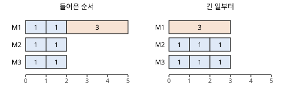

# 동일 병렬 기계 일정 문제

# 개요

**동일 병렬 기계 일정 문제(identical parallel machine scheduling)** 는 걸리는 시간이 정해진 일들을 똑같은 기계 여러 대에 나눠 맡겨 마지막 일이 끝나는 시각을 가장 이르게 하는 문제다. 인쇄기 세 대에 $1$ 분짜리 인쇄 여섯 건과 $3$ 분짜리 인쇄 한 건이 들어왔을 때 모든 인쇄를 몇 분 안에 끝낼 수 있는지가 이 꼴이다. 쉬는 기계에 다음 일을 맡기는 규칙을 긴 일부터 적용하면 끝나는 시각이 최솟값의 $4/3$ 배를 넘지 않는다.

# 직관

인쇄기 $M\_1,M\_2,M\_3$ 에 인쇄가 $1,1,1,1,1,1,3$ 분의 순서로 들어오고, 인쇄기가 비면 바로 다음 인쇄를 맡긴다. 아래 그림의 왼쪽처럼 $1$ 분짜리 여섯 건이 세 인쇄기에서 $2$ 분 만에 끝나고, 마지막 $3$ 분짜리가 $M\_1$ 에서 $2$ 분에 시작해 $5$ 분에 끝난다.

인쇄 시간을 모두 더하면 $9$ 분이고 인쇄기가 셋이므로 어떻게 나눠도 $9/3=3$ 분보다 빨리 끝날 수 없다. $3$ 분짜리 한 건만으로도 $3$ 분이 걸린다. 왼쪽 시간표는 긴 인쇄가 마지막에 와서 다른 두 인쇄기가 $2$ 분부터 놀았다.

그래서 인쇄를 긴 것부터 $3,1,1,1,1,1,1$ 로 늘어놓고 같은 규칙으로 맡긴다. 그림의 오른쪽처럼 $3$ 분짜리가 $M\_1$ 에, $1$ 분짜리가 $M\_2,M\_3$ 에 세 건씩 가서 모두 $3$ 분에 끝나고, 이것은 앞의 하한 $3$ 과 같다.

# 정의

## 일정과 완료 시각

기계 $m$ 대와 일 $n$ 개의 처리 시간 $p\_1,\dots,p\_n\gt 0$ 이 주어진다. 일마다 기계 하나를 정해 주는 함수 $\sigma:\lbrace 1,\dots,n\rbrace\to\lbrace 1,\dots,m\rbrace$ 를 **일정(schedule)** 이라 하고, 기계 $i$ 의 부하는 $L\_i=\sum\_{\sigma(j)=i}p\_j$ 다. 모든 일이 끝나는 시각 $\max\_iL\_i$ 를 **완료 시각(makespan)** 이라 한다.

**동일 병렬 기계 일정 문제** 는 완료 시각이 가장 작은 일정을 찾는 문제이고, 그 값을 $\mathrm{OPT}$ 로 쓴다. 직관 절에서 $m=3$, 처리 시간은 $1$ 여섯 개와 $3$ 하나이고 $\mathrm{OPT}=3$ 이다.

## 목록 일정과 LPT

일을 주어진 순서로 보면서 그때까지 부하가 가장 작은 기계에 맡기는 규칙을 **목록 일정(list scheduling)** 이라 한다. 일을 처리 시간이 줄어드는 순서로 정렬한 뒤 목록 일정을 쓰는 것을 **LPT 규칙(longest processing time first)** 이라 한다. 직관 절의 왼쪽 시간표가 목록 일정, 오른쪽이 LPT 규칙의 결과다.

# 성질

## 두 하한

어떤 일정의 완료 시각도 다음 둘 이상이다.

$$
\mathrm{OPT}\ge\max\left(\frac1m\sum_{j=1}^np_j,\ \max_jp_j\right)
$$

부하의 최댓값은 평균 이상이고, 가장 긴 일을 맡은 기계의 부하는 그 일의 시간 이상이다. 직관 절에서 두 값은 모두 $3$ 이다.

## 목록 일정의 보장

R. L. Graham 은 목록 일정의 완료 시각이 $(2-1/m)\mathrm{OPT}$ 이하임을 보였다[^1]. 마지막에 끝나는 일 $j$ 가 시각 $S$ 에 시작했다고 하자. 목록 일정은 부하가 가장 작은 기계에 맡기므로 $S$ 까지 모든 기계가 일하고 있었고, $j$ 를 뺀 일들의 시간 합이 $mS$ 이상이다.

$$
S+p_j\le\frac1m\sum_{k\ne j}p_k+p_j=\frac1m\sum_kp_k+\left(1-\frac1m\right)p_j\le\left(2-\frac1m\right)\mathrm{OPT}
$$

직관 절의 왼쪽 시간표는 $m=3$ 에서 $5=(2-1/3)\cdot 3$ 이므로 등호가 성립한다. 일반적으로 길이 $1$ 인 일 $m(m-1)$ 개 뒤에 길이 $m$ 인 일 하나가 오면 등호가 된다.

## LPT 규칙의 보장

Graham 은 LPT 규칙의 완료 시각이 다음 이하임을 보였다[^2].

$$
\left(\frac43-\frac1{3m}\right)\mathrm{OPT}
$$

증명의 요지. 마지막에 끝나는 일보다 뒤에 정렬된 일들을 지워도 LPT 의 완료 시각은 그대로이고 $\mathrm{OPT}$ 는 늘지 않으므로, 마지막에 끝나는 일 $j$ 가 가장 짧은 일이라 해도 된다. $p\_j\gt\mathrm{OPT}/3$ 이면 최적 일정에서 기계마다 일이 둘 이하이고 이때 LPT 는 최적이다. $p\_j\le\mathrm{OPT}/3$ 이면 목록 일정의 부등식에 넣어 위 값을 얻는다.

$m=2$ 에서 처리 시간 $3,3,2,2,2$ 는 LPT 가 $\lbrack 3,2,2\rbrack$, $\lbrack 3,2\rbrack$ 로 $7$ 을 내고 최적은 $\lbrack 3,3\rbrack$, $\lbrack 2,2,2\rbrack$ 의 $6$ 이므로 비가 $7/6=4/3-1/6$ 이다.

## 계산 복잡도

$m=2$ 에서 완료 시각이 $\sum\_jp\_j/2$ 인 일정이 있는지 판정하는 것은 처리 시간들을 합이 같은 두 무리로 나누는 분할 문제(partition problem)이고, 목표값이 전체 합의 절반인 [부분합 문제](subset-sum.md)이므로 NP(nondeterministic polynomial time)-완전이다. $m$ 이 고정되면 처리 시간 합에 대한 다항 시간의 동적 계획법과 완전 다항 시간 근사 기법(fully polynomial-time approximation scheme)이 있다[^3]. $m$ 이 입력의 일부이면 강한 NP-어려움(strong NP-hardness)이 성립하여, 처리 시간을 이진법이 아니라 일진법으로 적어도 NP-어렵다[^4].

## 상자 채우기와의 대응

완료 시각 $T$ 이하의 일정이 있는 것과, 크기 $p\_1,\dots,p\_n$ 의 물건을 용량 $T$ 인 상자 $m$ 개에 담을 수 있는 것은 동치다. D. S. Hochbaum 과 D. B. Shmoys 는 이 대응으로 [상자 채우기 문제](bin-packing.md)의 [근사 알고리즘](approximation-algorithms.md)을 $T$ 에 대한 이분 탐색과 묶어, 모든 $\varepsilon\gt 0$ 에 대해 완료 시각이 $(1+\varepsilon)\mathrm{OPT}$ 이하인 일정을 다항 시간에 찾는 근사 기법을 주었다[^5].

# 활용

- 병렬 계산의 부하 분산. 독립된 계산 작업을 같은 성능의 처리기들에 나눌 때 목록 일정과 LPT 규칙을 쓴다. 작업 시간을 미리 모르고 들어오는 대로 맡겨야 하면 목록 일정의 $2-1/m$ 보장이 그대로 적용된다.
- 생산 일정. 같은 기계가 여러 대인 공정에서 주문들을 나눠 마지막 주문의 완료 시각을 줄인다.
- 다른 일정 모형의 출발점. 기계마다 속도가 다른 균일 기계, 일마다 기계별 시간이 다른 비관련 기계, 일 사이의 선후 제약이 있는 경우가 이 문제를 넓힌 것이고, Graham 의 $2-1/m$ 보장은 선후 제약이 있어도 성립한다[^1].

[^1]: R. L. Graham, "Bounds for certain multiprocessing anomalies", Bell System Technical Journal 45 (1966), 1563–1581.
[^2]: R. L. Graham, "Bounds on multiprocessing timing anomalies", SIAM Journal on Applied Mathematics 17 (1969), 416–429.
[^3]: S. Sahni, "Algorithms for scheduling independent tasks", Journal of the ACM 23 (1976), 116–127.
[^4]: M. R. Garey, D. S. Johnson, "Strong NP-completeness results: motivation, examples, and implications", Journal of the ACM 25 (1978), 499–508.
[^5]: D. S. Hochbaum, D. B. Shmoys, "Using dual approximation algorithms for scheduling problems: theoretical and practical results", Journal of the ACM 34 (1987), 144–162.

# 연관 문서

## 선수지식

- [근사 알고리즘](approximation-algorithms.md)
- [상자 채우기 문제](bin-packing.md)

## 더 알아보기

아직 연결한 문서가 없다.

#algorithms #complexity #optimization #combinatorics
