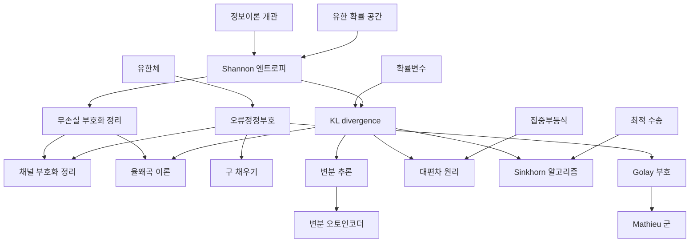

# 정보이론 개관

# 개요

정보이론(information theory)은 확률분포의 불확실성을 수 하나로 재고, 그 수를 압축과 통신의 한계로 삼는다. 압축률, 통신 속도, 추정의 정확도가 모두 같은 양에 대한 부등식이 된다.

[Shannon 엔트로피](entropy.md)에서 시작한다. 엔트로피로 두 분포의 차이를 재는 [KL divergence](kl-divergence.md)(Kullback–Leibler divergence)와 두 확률변수가 공유하는 정보를 재는 상호정보량을 정의한다. 이 세 양이 Shannon 의 부호화 정리의 양변을 이룬다. [무손실 부호화 정리](source-coding.md)에서 압축의 하한이 엔트로피이고, [채널 부호화 정리](channel-coding.md)에서 잡음 있는 통신로의 상한이 상호정보량의 최댓값이다. 왜곡을 허용하는 압축의 하한은 [율왜곡 이론](rate-distortion-theory.md)에서 상호정보량의 최솟값으로 나온다.

두 정리는 부호의 존재만 주장한다. 실제 부호는 [오류정정부호](error-correcting-codes.md)가 [유한체](finite-fields.md) 위의 선형대수로 구성하고, 그 조합 구조가 [Golay 부호](golay-codes.md)를 거쳐 [Mathieu 군](mathieu-groups.md)과 [구 채우기](sphere-packing.md)로 이어진다.

KL divergence 는 통신 밖에서도 쓰인다. [대편차 원리](large-deviations.md)의 속도함수, [지수족](exponential-families.md)의 쌍대 좌표, [Sinkhorn 알고리즘](sinkhorn.md)의 정규화항, [변분 오토인코더](variational-autoencoder.md)의 손실 항이 모두 KL divergence 다.

# 지도

# 갈래

처음 읽는 사람은 정보량, 부호의 구성, Shannon 의 부호화 정리의 순서로 읽는다. 확률과 통계, 최적화와 학습은 KL divergence 를 읽은 뒤 어느 순서로도 읽는다.

## 정보량

시작 문서: [확률변수](random-variables.md).

- [확률변수](random-variables.md) — 정보량은 확률변수의 함수를 평균한 값이다
- [Shannon 엔트로피](entropy.md) — 연속성, 단조성, 가법성을 요구하면 $-\sum p\log p$ 가 상수배를 빼고 유일하다
  - [유한형 이동](shifts-of-finite-type.md) — 금지 낱말 목록으로 정한 기호열의 이동. 위상 엔트로피가 전이 행렬의 Perron 고윳값의 로그이고 제한 채널의 용량이다
- [KL divergence](kl-divergence.md) — 두 분포의 차이와 두 변수가 공유하는 정보. 비음수성에서 정보이론의 부등식들이 나온다
  - [상호정보량 추정](mutual-information-estimation.md) — 표본만으로 상호정보량을 재려면 밀도 대신 밀도의 비를 맞춘다. 변분 표현이 하한을 준다
  - [Kolmogorov–Sinai 엔트로피](kolmogorov-sinai-entropy.md) — 측도보존변환이 걸음마다 만드는 정보량. 정상 정보원의 엔트로피율이 이 값이다

## 부호의 구성

먼저 읽을 갈래: 정보량. 시작 문서: [오류정정부호](error-correcting-codes.md).

- [오류정정부호](error-correcting-codes.md) — 유한체 위의 선형부호. 최소거리가 검출과 정정의 능력을 정한다
  - [Golay 부호](golay-codes.md) — Hamming 부호족 밖의 완전 부호. 확장판이 자기쌍대이고 Steiner 계 $S(5,8,24)$ 를 준다
  - [Mathieu 군](mathieu-groups.md) — Golay 부호의 자기동형군이 5 중 추이 산재 단순군이다
  - [구 채우기](sphere-packing.md) — 부호를 격자로 올리면 채우기 밀도 문제가 된다

## Shannon 의 부호화 정리

먼저 읽을 갈래: 부호의 구성. 시작 문서: [무손실 부호화 정리](source-coding.md).

- [무손실 부호화 정리](source-coding.md) — 평균 부호 길이의 하한이 엔트로피이고 그 하한에 임의로 가까이 갈 수 있다
  - [Huffman 부호](huffman-coding.md) — 확률이 가장 작은 두 기호를 합치기를 되풀이해 평균 길이가 최소인 접두부호를 만든다. 교환 논증에 의한 최적성과 정준 부호
  - [산술 부호화](arithmetic-coding.md) — 기호열을 확률만큼의 부분구간으로 보내고 그 안의 이진 소수를 부호어로 낸다. 손해는 기호열 전체에서 2 비트 미만이다
  - [Lempel–Ziv 압축](lempel-ziv.md) — 앞에 나온 조각을 가리키는 참조로 기호열을 줄이는 보편 부호, LZ78 의 부호 길이가 엔트로피율에 수렴한다
- [채널 부호화 정리](channel-coding.md) — 부호율이 채널 용량보다 작으면 오류 확률을 0 으로 보내는 부호가 있고, 크면 어떤 부호로도 보낼 수 없다
- [율왜곡 이론](rate-distortion-theory.md) — 평균 왜곡을 $D$ 이하로 두었을 때 부호율의 하한이 상호정보량의 제약 최소다
  - [양자화](quantization.md) — 유한 개의 대표값으로 값을 보낸다. 최적 배치의 두 조건이 Lloyd 반복을 준다

## 확률과 통계

먼저 읽을 갈래: 정보량. 시작 문서: [대편차 원리](large-deviations.md).

- [대편차 원리](large-deviations.md) — 표본평균이 기댓값에서 벗어날 확률의 지수 감소율이 KL divergence 다
- [지수족](exponential-families.md) — 로그분배함수의 Legendre 변환이 KL divergence 를 준다

## 최적화와 학습

먼저 읽을 갈래: Shannon 의 부호화 정리. 시작 문서: [Sinkhorn 알고리즘](sinkhorn.md).

- [Sinkhorn 알고리즘](sinkhorn.md) — 최적 수송 문제에 엔트로피 항을 더하면 행렬 스케일링 반복으로 풀린다
- [변분 오토인코더](variational-autoencoder.md) — 사후분포 근사의 손실에 KL divergence 항이 들어간다
- [정보 병목](information-bottleneck.md) — 입력의 압축 가운데 목표에 대한 정보를 가장 많이 남기는 것을 찾는다. 율왜곡 문제에서 왜곡이 예측 손실로 정해진 꼴이다
- [Lovász 세타 함수](lovasz-theta.md) — 그래프의 Shannon 용량을 반정부호 계획법으로 위에서 잡는다

# 연관 문서

## 선수지식

- [집합](sets.md)

## 더 알아보기

- [Shannon 엔트로피](entropy.md)

#information_theory #probability #computation #overview
