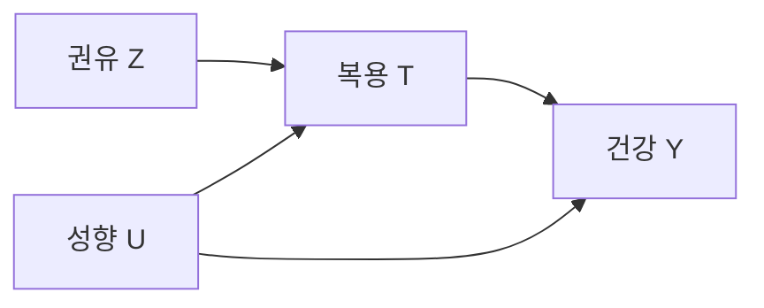

# 도구변수

# 개요

**도구변수(instrumental variable)** 는 치료에는 영향을 주지만 결과에는 치료를 거쳐서만 영향을 주고, 관찰하지 못한 교란 요인과는 무관한 변수다. 비타민을 먹으라는 권유 문자를 동전 던지기로 보낸 실험에서, 실제로 먹은 사람과 먹지 않은 사람의 건강을 견주면 원래 건강에 신경 쓰는 사람이 더 많이 먹었다는 차이가 함께 섞인다. 그 성향은 기록되지 않아서 [뒷문 기준](backdoor-criterion.md)대로 나누어 평균 낼 수 없다.

동전으로 정한 권유는 성향과 무관하다. 권유가 결과를 바꾼 양을 권유가 복용률을 바꾼 양으로 나누면 비타민의 효과가 나온다.

# 직관

사람의 절반은 건강에 신경 쓰고($U=1$) 절반은 그렇지 않다($U=0$). 권유 $Z$ 는 동전으로 정한다. 복용 $T$ 의 확률은 다음 표와 같다.

| 복용 확률 | 권유 받음 | 권유 못 받음 |
| --- | --- | --- |
| 신경 씀 | $1$ | $0.4$ |
| 신경 안 씀 | $0.2$ | $0$ |

건강 점수는 $Y=4+2T+2U$ 이다. 비타민의 효과는 $2$ 이고, 신경 쓰는 성향도 점수를 $2$ 올린다.

먹은 사람과 먹지 않은 사람을 견준다. 먹은 사람 가운데 신경 쓰는 사람의 비율은 $0.875$, 먹지 않은 사람 가운데서는 $0.25$ 다. 그래서 두 집단의 평균 점수 차는 $2+2(0.875-0.25)=3.25$ 이다. 성향의 몫 $1.25$ 가 효과에 섞였다.

권유를 받은 집단과 받지 못한 집단을 견주면 성향의 구성이 같다. 복용률은 $(1+0.2)/2=0.6$ 과 $(0.4+0)/2=0.2$ 로 $0.4$ 차이 나고, 평균 점수는 $6.2$ 와 $5.4$ 로 $0.8$ 차이 난다. 권유는 복용을 거쳐서만 점수를 바꾸므로, 점수 차 $0.8$ 은 복용률 차 $0.4$ 에 효과 $2$ 를 곱한 것이다. 나누면 $0.8/0.4=2$ 가 나온다.

# 정의

## 도구변수의 조건

치료 $T$, 결과 $Y$, 관찰하지 못한 교란 요인 $U$ 가 있을 때 변수 $Z$ 가 다음 셋을 만족하면 $Z$ 를 **도구변수** 라 한다.

1. 관련성(relevance). $Z$ 가 $T$ 와 상관이 있다.
2. 배제 제약(exclusion restriction). $Z$ 는 $T$ 를 거치지 않고는 $Y$ 에 영향을 주지 않는다.
3. 독립성(independence). $Z$ 는 $U$ 와 독립이다.

직관 절의 그림에서 $Z$ 에서 $Y$ 로 가는 화살표가 $T$ 를 거치는 것 하나뿐이고 $Z$ 와 $U$ 를 잇는 길이 없는 것이 조건 2 와 3 이다.

## Wald 추정량

$Z$ 가 $0$ 과 $1$ 의 두 값이면 다음을 **Wald 추정량(Wald estimator)** 이라 한다.

$$
\beta\_{\mathrm{Wald}}=\frac{E\lbrack Y\mid Z=1\rbrack-E\lbrack Y\mid Z=0\rbrack}{E\lbrack T\mid Z=1\rbrack-E\lbrack T\mid Z=0\rbrack}
$$

직관 절에서 분자는 $0.8$, 분모는 $0.4$ 이고 값은 $2$ 다. 자료에서는 기댓값을 집단 평균으로 바꾼다.

## 두 단계 최소제곱

치료와 도구변수가 여럿이면 [선형회귀](linear-regression.md)를 두 번 한다. 먼저 치료의 열 $X$ 를 도구변수의 열 $W$ 에 회귀시켜 적합값 $\hat X=W(W^\top W)^{-1}W^\top X$ 를 얻고, 다음으로 $Y$ 를 $\hat X$ 에 회귀시킨다. 이것을 **두 단계 최소제곱(two-stage least squares, 2SLS)** 이라 하고, 추정량은 다음과 같다.

$$
\hat\beta\_{\mathrm{2SLS}}=(\hat X^\top X)^{-1}\hat X^\top Y
$$

도구변수의 수와 치료의 수가 같으면 $\hat\beta=(W^\top X)^{-1}W^\top Y$ 이고, 치료와 도구변수가 하나씩이면 표본 공분산의 비 $\widehat{\mathrm{Cov}}(Z,Y)/\widehat{\mathrm{Cov}}(Z,T)$ 다.

# 성질

## 선형 모형에서의 일치성

$Y=\alpha+\beta T+\varepsilon$ 이고 $\varepsilon$ 이 $U$ 를 담아 $T$ 와는 상관이 있지만 $Z$ 와는 상관이 없다고 한다. 양변과 $Z$ 의 공분산을 취하면 $\mathrm{Cov}(Z,\varepsilon)=0$ 이므로 다음이 나온다.

$$
\beta=\frac{\mathrm{Cov}(Z,Y)}{\mathrm{Cov}(Z,T)}
$$

조건 1 이 분모가 $0$ 이 아님을 보장한다. 표본 공분산은 [큰 수의 법칙](law-of-large-numbers.md)으로 수렴하므로 추정량은 $\beta$ 로 수렴한다. 최소제곱 추정량은 $\mathrm{Cov}(T,Y)/\mathrm{Var}(T)$ 로 수렴하고, $\mathrm{Cov}(T,\varepsilon)\ne0$ 이면 $\beta$ 와 다르다.

## 약한 도구변수

$\mathrm{Cov}(Z,T)$ 가 $0$ 에 가까우면 분모의 표본 오차가 커져 추정량의 분산이 커지고, 유한 표본에서 최소제곱 추정량 쪽으로 치우친다. 첫 단계 회귀의 $F$ 통계량이 $10$ 보다 작으면 약한 도구변수로 보는 경험 규칙이 쓰인다(Staiger–Stock 1997).

## 국소 평균 처리 효과

효과가 사람마다 다르면 Wald 추정량은 전체의 평균 효과가 아니다. 권유가 복용을 줄이는 사람이 없다는 단조성(monotonicity)을 더하면, Wald 추정량은 권유에 따라 복용 여부가 바뀌는 사람들의 평균 효과와 같다. 이것을 **국소 평균 처리 효과(local average treatment effect, LATE)** 라 한다(Imbens–Angrist 1994)[^1].

# 활용

- 순응하지 않는 무작위 실험. 배정을 도구변수로, 실제 처치를 치료로 두면 배정 효과(intention-to-treat)를 실제 처치의 효과로 바꾼다.
- 계량경제학. 수요와 공급 곡선을 따로 추정하는 문제에서 공급만 움직이는 날씨를 도구변수로 쓴 것이 시작이다(Wright 1928). 교육의 임금 효과를 출생 분기로 추정한 Angrist–Krueger 연구가 있다.
- Mendel 무작위화(Mendelian randomization). 부모에게서 무작위로 물려받는 유전 변이를 도구변수로 삼아 혈중 지질 같은 노출이 질병에 주는 효과를 추정한다.
- [do 계산법](do-calculus.md)으로는 도구변수 그래프에서 $P(y\mid do(t))$ 가 식별되지 않는다. 선형성이나 단조성 같은 추가 가정이 있어야 효과가 정해진다.

[^1]: G. W. Imbens and J. D. Angrist, "Identification and estimation of local average treatment effects", *Econometrica* 62 (1994), 467–475.

# 연관 문서

## 선수지식

- [뒷문 기준](backdoor-criterion.md)
- [선형회귀](linear-regression.md)

## 더 알아보기

아직 연결한 문서가 없다.

#statistics #probability #machine_learning
