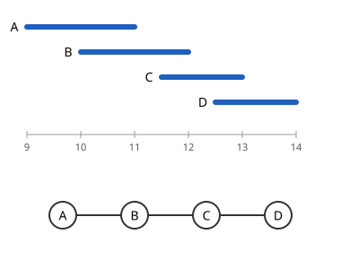

# 구간 그래프

# 개요

**구간 그래프(interval graph)** 는 수직선 위의 구간마다 정점을 하나씩 두고, 겹치는 두 구간의 정점을 간선으로 이은 그래프다. 회의 여러 개의 시작과 끝 시각이 주어졌을 때 시간이 겹치는 회의끼리는 같은 방을 쓸 수 없다. 이 충돌 관계가 구간 그래프이고, 필요한 방의 수는 구간 그래프의 색칠 수로, 그 값은 한 시각에 동시에 열리는 회의의 최대 수로 바로 계산된다.

# 직관

회의 넷의 시간이 A 9–11 시, B 10–12 시, C 11 시 30 분–13 시, D 12 시 30 분–14 시다. 아래 그림의 위쪽이 네 구간이고, 아래쪽이 겹치는 회의를 이은 그래프다. A 와 B, B 와 C, C 와 D 가 겹치므로 그래프는 길이 $3$ 의 경로다.

한 시각에 동시에 열리는 회의는 많아야 둘이다. 회의를 시작 시각 순서로 보며 비어 있는 방 가운데 아무것에나 넣으면 A 는 방 1, B 는 방 2, C 는 A 가 끝난 방 1, D 는 B 가 끝난 방 2 에 들어가 방 둘로 충분하다.

# 정의

실수 구간들의 모임 $\lbrace I\_v\rbrace\_{v\in V}$ 에 대해, $I\_u\cap I\_v\ne\varnothing$ 인 두 정점 $u\ne v$ 를 잇는 그래프를 이 구간 모임의 교차 그래프라 한다. 어떤 구간 모임의 교차 그래프와 동형인 그래프를 **구간 그래프** 라 하고, 그 구간 모임을 그래프의 **구간 표현(interval representation)** 이라 한다. 직관 절의 경로 A–B–C–D 는 구간 그래프이고 네 회의 시간이 그 구간 표현이다.

# 성질

## 현 그래프와 클릭

구간 그래프는 [현 그래프](chordal-graphs.md)다. 길이 $4$ 이상의 순환에 현이 없으면, 순환의 구간 가운데 오른쪽 끝이 가장 왼쪽인 구간의 두 이웃 구간이 그 끝점을 지나야 하므로 서로 겹치고, 이것이 현이 된다.

수직선 위의 구간들이 두 개씩 겹치면 전부가 한 점을 공통으로 가진다. 이것을 Helly 성질(Helly property)이라 하고, [Helly 정리](helly-theorem.md)의 1 차원 경우다. 그래서 가장 큰 클릭의 크기는 한 점을 지나는 구간의 최대 개수이고, 직관 절에서 $2$ 다.

## 색칠

구간을 왼쪽 끝 순서로 놓고 [그래프 색칠](graph-coloring.md)을 탐욕적으로 하면 가장 큰 클릭의 크기만큼의 색으로 칠해진다. 새 구간이 들어올 때 이미 칠한 이웃은 모두 그 구간의 왼쪽 끝을 지나므로 한 클릭을 이루고, 그 수보다 하나 많은 색이면 충분하다. 색칠 수와 클릭 크기가 같고, 계산은 정렬 뒤 $O(n)$ 시간이다.

## 특징

정리(Gilmore–Hoffman). 그래프 $G$ 가 구간 그래프인 것은 $G$ 가 현 그래프이고 $G$ 의 여그래프가 비교 가능성 그래프(comparability graph), 곧 간선에 방향을 주어 추이적인 순서로 만들 수 있는 그래프인 것과 동치다[^1].

정리(Fulkerson–Gross). 그래프가 구간 그래프인 것은 극대 클릭들을 일렬로 놓아 각 정점을 포함하는 극대 클릭들이 연속한 구간을 이루게 할 수 있는 것과 동치다[^2]. 직관 절의 극대 클릭은 $\lbrace A,B\rbrace,\lbrace B,C\rbrace,\lbrace C,D\rbrace$ 이고 이 순서에서 B 와 C 가 각각 연속한 두 자리를 차지한다.

## 선형 시간 인식

극대 클릭의 연속 배열을 PQ 나무(PQ-tree)라는 자료구조로 찾으면 구간 그래프인지를 $O(\lvert V\rvert+\lvert E\rvert)$ 시간에 판정하고 구간 표현을 만든다[^3].

# 활용

- 회의실과 레지스터 배정. 시간 구간의 충돌 그래프를 칠하는 색칠 수가 필요한 방이나 레지스터의 수다.
- 유전자의 선형 구조. Benzer 는 박테리오파지 유전자의 결실 돌연변이들이 겹치는지를 실험으로 정하고, 그 겹침 그래프가 구간 그래프라는 것으로 유전자 안의 자리가 일직선으로 늘어서 있음을 보였다[^4].
- 고고학의 연대 배열. 유물의 출토 층에서 함께 나온 유물들의 관계로 유물이 쓰인 시기를 구간으로 배열한다.
- 일정 계획. 구간 그래프의 최대 [독립집합](independent-set.md)은 겹치지 않는 회의를 가장 많이 고르는 문제이고, 끝 시각이 이른 구간부터 고르는 탐욕 알고리즘이 최적해를 준다.

[^1]: P. C. Gilmore, A. J. Hoffman, "A characterization of comparability graphs and of interval graphs", *Canadian Journal of Mathematics* **16** (1964), 539–548.
[^2]: D. R. Fulkerson, O. A. Gross, "Incidence matrices and interval graphs", *Pacific Journal of Mathematics* **15** (1965), 835–855.
[^3]: K. S. Booth, G. S. Lueker, "Testing for the consecutive ones property, interval graphs, and graph planarity using PQ-tree algorithms", *Journal of Computer and System Sciences* **13** (1976), 335–379.
[^4]: S. Benzer, "On the topology of the genetic fine structure", *Proceedings of the National Academy of Sciences* **45** (1959), 1607–1620.

# 연관 문서

## 선수지식

- [현 그래프](chordal-graphs.md)

## 더 알아보기

아직 연결한 문서가 없다.

#graph_theory #combinatorics #algorithms
