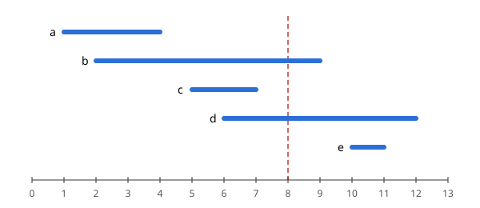

# 구간 트리

# 개요

**구간 트리(interval tree)** 는 수직선 위의 구간들을 저장하고, 주어진 점이나 구간과 겹치는 구간을 빠르게 찾는 자료구조다. 회의실 예약 목록에서 "오후 3시에 진행 중인 회의" 를 찾으려면 예약을 하나씩 확인해야 하고, 시작 시각으로 정렬해 두어도 3시 전에 시작한 회의가 3시에 끝났는지는 하나씩 보아야 한다. 구간 트리는 시작 시각으로 정렬한 탐색 트리의 마디마다 그 아래에서 가장 늦게 끝나는 시각을 적어 두어, 모두 일찍 끝나는 부분 트리를 통째로 건너뛴다.

# 직관

다섯 구간 $a=\lbrack 1,4\rbrack$, $b=\lbrack 2,9\rbrack$, $c=\lbrack 5,7\rbrack$, $d=\lbrack 6,12\rbrack$, $e=\lbrack 10,11\rbrack$ 가운데 점 $8$ 을 포함하는 것을 찾는다. 아래 그림의 파란 막대가 구간이고 빨간 점선이 점 $8$ 이다. 점선과 만나는 막대는 $b$ 와 $d$ 다.



시작점으로 정렬하면 $a,b,c,d,e$ 이고, 시작점이 $8$ 보다 큰 $e$ 는 확인하지 않아도 된다. 그러나 시작점이 $8$ 이하인 $a,b,c,d$ 는 끝점이 $8$ 이상인지 하나씩 보아야 한다. 구간이 많고 대부분 일찍 시작하면 이 확인이 구간 전체에 가깝다.

막힌 것은 일찍 시작한 구간들이 언제 끝나는지 모아 둔 정보가 없어서다. 그래서 시작점을 키로 한 [균형 이진 탐색 트리](balanced-binary-search-trees.md)를 만들고 마디마다 그 부분 트리에서 가장 큰 끝점을 적는다. 시작점 $5$ 인 $c$ 를 뿌리로 하면 왼쪽 부분 트리 $\lbrace a,b\rbrace$ 의 가장 큰 끝점은 $9$ 이고, $a$ 하나만 있는 부분 트리의 가장 큰 끝점은 $4$ 다. $4\lt 8$ 이므로 $a$ 는 확인하지 않는다.

# 정의

## 구간 트리

**구간 트리** 는 닫힌 구간 $\lbrack\ell,h\rbrack$ 을 마디마다 하나씩 담은 이진 탐색 트리이며, 왼쪽 끝점 $\ell$ 을 키로 쓰고, 각 마디 $v$ 에 $v$ 의 부분 트리에 담긴 구간들의 오른쪽 끝점 가운데 가장 큰 값 $\mathrm{max}(v)$ 를 함께 저장한 것이다. 이 정의는 Cormen, Leiserson, Rivest, Stein 의 교재를 따른다[^1].

$\mathrm{max}(v)$ 는 자식의 값으로 다음과 같이 정해진다. 빈 자식의 값은 $-\infty$ 로 둔다.

$$
\mathrm{max}(v)=\max\bigl(h(v),\thinspace\mathrm{max}(v.\mathrm{left}),\thinspace\mathrm{max}(v.\mathrm{right})\bigr)
$$

예. 직관 절의 구간으로 뿌리 $c$, 그 왼쪽 자식 $b$, $b$ 의 왼쪽 자식 $a$, 뿌리의 오른쪽 자식 $d$, $d$ 의 오른쪽 자식 $e$ 인 트리를 만든다. $\mathrm{max}$ 값은 $a$ 가 $4$, $b$ 가 $9$, $e$ 가 $11$, $d$ 가 $12$, $c$ 가 $12$ 다.

## 겹침 질의

두 닫힌 구간 $\lbrack\ell,h\rbrack$ 과 $\lbrack\ell',h'\rbrack$ 은 $\ell\le h'$ 이고 $\ell'\le h$ 일 때 **겹친다(overlap)**. 점 $x$ 는 구간 $\lbrack x,x\rbrack$ 로 본다. 질의 구간 $q$ 와 겹치는 구간을 모두 내놓는 질의는 다음과 같다.

```typescript
interface IntervalNode {
  lo: number;
  hi: number;
  max: number;
  left: IntervalNode | null;
  right: IntervalNode | null;
}

function overlapping(v: IntervalNode | null, qlo: number, qhi: number, out: IntervalNode[]): void {
  if (v === null || v.max < qlo) return; // 부분 트리의 구간이 모두 qlo 전에 끝난다
  overlapping(v.left, qlo, qhi, out);
  if (v.lo <= qhi && qlo <= v.hi) out.push(v);
  if (v.lo <= qhi) overlapping(v.right, qlo, qhi, out); // 오른쪽은 시작점이 v.lo 이상이다
}
```

예. 점 $8$ 로 질의하면 뿌리 $c$ 는 겹치지 않는다. 왼쪽 자식 $b$ 는 $\mathrm{max}=9\ge 8$ 이라 들어가서 $b$ 를 내놓고, $a$ 는 $\mathrm{max}=4\lt 8$ 이라 건너뛴다. 뿌리의 시작점 $5$ 가 $8$ 이하이므로 오른쪽 자식 $d$ 로 가서 $d$ 를 내놓고, $e$ 는 시작점 $10$ 이 $8$ 보다 커서 내놓지 않는다.

# 성질

## 갱신

삽입과 삭제는 이진 탐색 트리의 연산에 $\mathrm{max}$ 갱신을 더한 것이다. 한 마디의 $\mathrm{max}$ 는 그 마디와 두 자식에서 정해지므로, 회전 한 번 뒤에 자리가 바뀐 두 마디의 값만 다시 계산하면 된다. red-black 트리를 쓰면 삽입과 삭제가 $O(\log n)$ 이다[^1].

## 겹치는 구간 하나 찾기

겹치는 구간이 하나라도 있는지는 뿌리에서 잎까지 한 경로만 따라가 $O(\log n)$ 에 판정한다. 마디 $v$ 가 $q$ 와 겹치지 않을 때, 왼쪽 자식이 있고 그 $\mathrm{max}$ 가 $q$ 의 시작점 이상이면 왼쪽으로, 아니면 오른쪽으로 간다.

*증명의 요지.* 오른쪽으로 가는 경우는 왼쪽 부분 트리의 모든 구간이 $q$ 의 시작점 전에 끝나므로 왼쪽에 답이 없다. 왼쪽으로 가는 경우, 왼쪽 부분 트리에서 끝점이 $\mathrm{max}$ 인 구간 $i$ 를 잡는다. $i$ 는 $q$ 의 시작점 뒤에 끝나므로, $q$ 와 겹치지 않으면 $i$ 가 $q$ 의 끝점 뒤에 시작한다. 오른쪽 부분 트리의 구간은 모두 $i$ 이상인 시작점을 가지므로 $q$ 와 겹치지 않고, 오른쪽에도 답이 없다.

## 모든 겹치는 구간 찾기

겹치는 구간이 $k$ 개이면 겹치는 구간 하나 찾기를 되풀이해 모두 찾는 데 $O(\min(n,\thinspace k\log n))$ 시간이 든다[^1].

질의와 겹치는 구간을 $O(\log n+k)$ 시간에 내놓는 구조도 있다. 구간들의 끝점의 중앙값에 걸치는 구간을 뿌리에 모아 끝점 순으로 두 번 정렬해 두고, 중앙값 왼쪽과 오른쪽에 완전히 놓인 구간으로 양쪽 부분 트리를 만든다. 이 구조는 공간 $O(n)$ 이다[^2].

# 활용

- 일정과 자원 예약. 새 예약과 겹치는 기존 예약이 있는지를 판정한다.
- 유전체 주석. 염색체 위의 유전자 구간 가운데 주어진 위치나 구간과 겹치는 것을 찾는다.
- 계산기하의 창 질의. 축에 평행한 선분들 가운데 직사각형 창과 만나는 것을 찾을 때, 구간 트리의 마디마다 그 마디에 모인 선분의 끝점을 담는 범위 질의 구조를 두어 쓴다[^3].

[^1]: T. H. Cormen, C. E. Leiserson, R. L. Rivest, C. Stein, *Introduction to Algorithms*, 3rd ed., MIT Press, 2009, Section 14.3.
[^2]: H. Edelsbrunner, "Dynamic data structures for orthogonal intersection queries", Technical Report F59, Institute for Information Processing, Technical University of Graz, 1980.
[^3]: M. de Berg, O. Cheong, M. van Kreveld, M. Overmars, *Computational Geometry: Algorithms and Applications*, 3rd ed., Springer, 2008, Section 10.1.

# 연관 문서

## 선수지식

- [균형 이진 탐색 트리](balanced-binary-search-trees.md)

## 더 알아보기

아직 연결한 문서가 없다.

#data_structures #algorithms #computation
