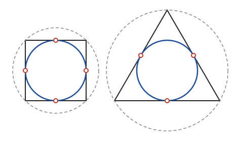

# John 타원체

# 개요

**John 타원체(John ellipsoid)** 는 볼록한 도형 안에 들어가는 타원체 가운데 부피가 가장 큰 것이다. 꼭짓점이 많은 다각형이나 다면체는 부등식이 많아 다루기 어렵지만, 타원체는 행렬 하나와 중심 하나로 적힌다. 정사각형 안에 넣을 수 있는 가장 큰 타원은 내접원이고, 그 원을 $\sqrt2$ 배로 키우면 정사각형 전체를 덮는다.

John 정리는 $n$ 차원의 모든 볼록체가 John 타원체와 그것을 $n$ 배로 키운 타원체 사이에 끼인다고 보장한다. 그래서 볼록체에 대한 계산과 부등식을 타원체, 곧 선형변환으로 옮긴 공으로 바꾸어 다룬다.

# 직관

정사각형 $\lbrack -1,1\rbrack^2$ 안에 축이 좌표축과 나란한 타원 $x^2/a^2+y^2/b^2\le 1$ 을 넣는다. 타원이 정사각형 안에 있으려면 $a\le 1$, $b\le 1$ 이고, 넓이 $\pi ab$ 는 $a=b=1$ 에서 가장 크다. 가장 큰 타원은 단위원이고, 단위원은 네 변의 중점 $(\pm1,0)$, $(0,\pm1)$ 에서 정사각형에 닿는다.

정사각형의 꼭짓점 $(1,1)$ 은 원점에서 $\sqrt2$ 떨어져 있다. 그래서 단위원을 $\sqrt2$ 배로 키우면 정사각형을 덮고, 그보다 덜 키우면 꼭짓점이 밖에 남는다.

정삼각형에서는 가장 큰 타원이 내접원이고, 외접원의 반지름이 내접원의 $2$ 배다. 내접원은 세 변의 중점에서 삼각형에 닿는다.

그림의 빈 점이 내접원이 도형에 닿는 점이다. 정사각형은 원점에 대해 대칭이라 $\sqrt2$ 배로 덮이고, 정삼각형은 대칭이 아니라 $2$ 배가 필요하다. 평면에서 $\sqrt2=\sqrt n$, $2=n$ 이다.

# 정의

## 볼록체와 타원체

$\mathbb R^n$ 의 [볼록](convexity.md)이고 콤팩트이며 내부가 비어 있지 않은 집합을 **볼록체(convex body)** 라 한다. 원점에 대해 $K=-K$ 이면 대칭이라 한다. 단위공을 $B$ 라 할 때, 가역 행렬 $A$ 와 점 $c$ 로 적히는 다음 집합을 **타원체(ellipsoid)** 라 한다.

$$
E=c+AB=\lbrace c+Au:\ \lvert u\rvert\le 1\rbrace
$$

$E$ 의 부피는 $\lvert\det A\rvert\thinspace\mathrm{vol}(B)$ 다. [행렬식](determinants.md)은 선형변환이 부피를 몇 배로 바꾸는지를 준다. 직관 절의 타원 $x^2/a^2+y^2/b^2\le 1$ 은 $c=0$, $A=\mathrm{diag}(a,b)$ 이고 넓이가 $\pi ab$ 다.

## John 타원체와 Löwner 타원체

볼록체 $K$ 에 포함되는 타원체 가운데 부피가 가장 큰 것을 $K$ 의 **John 타원체(John ellipsoid)** 라 한다. $K$ 를 포함하는 타원체 가운데 부피가 가장 작은 것을 **Löwner 타원체(Löwner ellipsoid)** 라 한다. 정사각형 $\lbrack -1,1\rbrack^2$ 의 John 타원체는 단위원이고 Löwner 타원체는 반지름 $\sqrt2$ 인 원이다.

# 성질

## 존재와 유일성

볼록체마다 John 타원체가 존재하고 하나뿐이다.

증명의 요지. $K$ 에 포함되는 타원체의 $(A,c)$ 는 콤팩트 집합을 이루므로 부피의 최댓값이 존재한다. $A$ 를 양의 정부호 대칭행렬로 고를 수 있다. 부피가 같은 두 최대 타원체 $c\_1+A\_1B$, $c\_2+A\_2B$ 가 있으면 볼록성으로 다음 타원체도 $K$ 에 포함된다.

$$
\frac{c_1+c_2}{2}+\frac{A_1+A_2}{2}B
$$

양의 정부호 행렬에서 $\log\det$ 는 순오목하므로 $A\_1\ne A\_2$ 이면 이 타원체의 부피가 더 크다. $A\_1=A\_2$ 이고 $c\_1\ne c\_2$ 이면 두 타원체의 볼록 껍질 안에 $c\_1-c\_2$ 방향으로 늘린 더 큰 타원체가 있다. 두 경우 모두 최대성과 모순이다.

## John 정리

정리(John). 볼록체 $K$ 의 John 타원체가 단위공 $B$ 이면 $K\subseteq nB$ 다. $K$ 가 대칭이면 $K\subseteq\sqrt n\thinspace B$ 다.[^1]

$B$ 가 $K$ 의 John 타원체인 것은 $B\subseteq K$ 이고 다음을 만족하는 접점 $u\_1,\dots,u\_m\in\partial B\cap\partial K$ 와 양수 $c\_1,\dots,c\_m$ 이 존재하는 것과 동치다.[^1][^2]

$$
\sum_{i=1}^mc_iu_iu_i^{\mathsf T}=I,\qquad\sum_{i=1}^mc_iu_i=0
$$

정사각형에서는 네 접점 $(\pm1,0)$, $(0,\pm1)$ 에 $c\_i=1/2$ 을 주면 두 식이 성립한다. 정삼각형에서는 서로 $120^\circ$ 를 이루는 세 접점에 $c\_i=2/3$ 을 주면 성립한다. 첫 식의 대각합을 취하면 $\sum c\_i=n$ 이다.

증명의 요지($K\subseteq nB$). $u\_i$ 에서 $B$ 의 접평면은 $K$ 의 받침 평면이므로 모든 $x\in K$ 에서 $\langle x,u\_i\rangle\le 1$ 이다. 또 $\langle x,u\_i\rangle\ge-\lvert x\rvert$ 이므로 다음 합의 각 항이 음이 아니다.

$$
\sum_ic_i\bigl(1-\langle x,u_i\rangle\bigr)\bigl(\lvert x\rvert+\langle x,u_i\rangle\bigr)\ge 0
$$

전개하면 두 식으로 $\sum c\_i=n$, $\sum c\_i\langle x,u\_i\rangle=0$, $\sum c\_i\langle x,u\_i\rangle^2=\lvert x\rvert^2$ 이므로 $n\lvert x\rvert-\lvert x\rvert^2\ge 0$, 곧 $\lvert x\rvert\le n$ 이다. $K$ 가 대칭이면 $\lvert\langle x,u\_i\rangle\rvert\le 1$ 이어서 $\lvert x\rvert^2=\sum c\_i\langle x,u\_i\rangle^2\le n$ 이다.

직관 절의 두 도형에서 두 상수 $\sqrt n$ 과 $n$ 이 그대로 나타나므로 두 상수는 더 줄일 수 없다. $n$ 차원에서는 정육면체와 정단체가 같은 역할을 한다.

## Löwner 타원체와의 쌍대

$K$ 가 대칭이면 $K$ 의 Löwner 타원체는 $K$ 의 극집합(polar set) $K^\circ=\lbrace y:\langle x,y\rangle\le 1\ \forall x\in K\rbrace$ 의 John 타원체의 극집합이다. 그래서 대칭인 볼록체에서는 $\frac{1}{\sqrt n}E\subseteq K\subseteq E$ 인 Löwner 타원체 $E$ 가 있다.

## 계산

$K$ 가 부등식 $\langle a\_j,x\rangle\le b\_j$ 들로 주어지면 John 타원체는 다음 볼록 최적화 문제의 해다.

$$
\max_{A\succ 0,\thinspace c}\ \log\det A\quad\text{subject to}\quad\lvert Aa_j\rvert+\langle a_j,c\rangle\le b_j
$$

목적함수가 오목하고 제약이 볼록이므로 [내점법](interior-point-method.md)으로 다항시간에 근사해를 구한다. $K$ 가 점들의 볼록 껍질로 주어지면 Löwner 타원체를 같은 방식으로 구하고, 평면에서는 최소 넓이 외접 타원이 조합 차원 $5$ 의 [LP 형 문제](lp-type-problems.md)(linear programming)여서 기대 선형 시간에 구해진다.

# 활용

- [Banach–Mazur 거리](banach-mazur-distance.md). 대칭 John 정리로 $n$ 차원 노름 공간은 모두 Euclid 공간과 Banach–Mazur 거리 $\sqrt n$ 이하다.
- [Dvoretzky 정리](dvoretzky-theorem.md). 증명은 볼록체를 John 타원체가 단위공이 되는 자리로 옮긴 뒤 무작위 부분공간을 고르는 데서 시작한다.
- [타원체법](ellipsoid-method.md). 각 단계에서 반쪽 타원체를 포함하는 Löwner 타원체로 다음 타원체를 잡고, 부피가 일정 비율로 준다.
- 볼록체의 부피 계산과 표본 추출. 무작위 걷기로 부피를 근사하기 전에 볼록체를 선형변환으로 옮겨, 단위공을 포함하고 반지름 $n$ 의 공에 포함되게 한다.

[^1]: F. John, "Extremum problems with inequalities as subsidiary conditions", *Studies and Essays Presented to R. Courant on his 60th Birthday*, Interscience (1948), 187–204.
[^2]: K. Ball, "An elementary introduction to modern convex geometry", in *Flavors of Geometry*, MSRI Publications **31**, Cambridge University Press (1997), 1–58. 3 장.

# 연관 문서

## 선수지식

- [볼록성](convexity.md)
- [행렬식](determinants.md)

## 더 알아보기

- [Banach–Mazur 거리](banach-mazur-distance.md)

#optimization #analysis #functional_analysis
