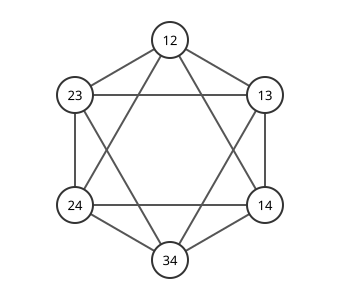

# Johnson 그래프

# 개요

**Johnson 그래프(Johnson graph)** 는 $n$ 개 원소에서 고른 $k$ 원소 부분집합을 정점으로 두고, 원소 하나만 바꾸면 서로 옮겨 가는 두 부분집합을 이은 그래프다. 네 사람 $1,2,3,4$ 가운데 두 사람을 대표로 뽑는다고 할 때, 대표 $\lbrace 1,2\rbrace$ 에서 $\lbrace 3,4\rbrace$ 로 가려면 한 번에 한 사람씩 두 번 바꿔야 하고, $\lbrace 1,3\rbrace$ 으로는 한 번에 간다.

이 그래프에서 두 부분집합 사이의 거리는 공통 원소의 수로 정해지고, 인접행렬의 고윳값은 $n,k$ 의 식으로 모두 계산된다.

# 직관

대표 두 사람을 고르는 방법은 $\binom42=6$ 가지다. 한 사람만 바꿔 옮겨 갈 수 있는 두 구성을 이으면 아래 그림이 된다. 마주 보는 두 정점, 곧 $12$ 와 $34$, $13$ 과 $24$, $14$ 와 $23$ 은 공통인 사람이 없어 이어지지 않는다.

각 정점은 넷과 이어져 있다. $12$ 에서 $34$ 까지는 거리 $2$ 이고, $12$ 와 $34$ 를 잇는 길은 $13,14,23,24$ 어느 것을 거쳐도 된다. 거리는 두 구성에서 다른 사람의 수다.

# 정의

$\lbrack n\rbrack=\lbrace 1,\dots,n\rbrace$ 의 $k$ 원소 부분집합 전체를 정점으로 두고, $\vert A\cap B\vert=k-1$ 인 두 부분집합 $A,B$ 를 이은 [그래프](graphs.md)를 Johnson 그래프 $J(n,k)$ 라 한다[^1]. 직관 절의 그림은 $J(4,2)$ 이고, 정육면체의 면 중심을 이은 정팔면체의 꼭짓점과 모서리와 같다.

$J(n,k)$ 와 $J(n,n-k)$ 는 여집합을 대응시켜 같은 그래프다. 그래서 $n\ge2k$ 인 경우만 보면 된다.

# 성질

## 거리와 교차 배열

두 정점의 거리는 $k-\vert A\cap B\vert$ 이고, 지름은 $k$ 다. $J(n,k)$ 는 [거리 정칙 그래프](distance-regular-graphs.md)이고 교차 배열은 다음과 같다.

$$
b_i=(k-i)(n-k-i),\qquad c_i=i^2
$$

$A$ 에서 거리 $i$ 인 $B$ 의 이웃은 $B$ 의 원소 하나를 빼고 다른 원소 하나를 넣은 것이다. $A$ 에서 멀어지려면 $A$ 에 있는 $k-i$ 개 가운데 하나를 빼고 $A$ 에 없는 $n-k-i$ 개 가운데 하나를 넣어야 하므로 $b_i$ 가 나온다. 가까워지려면 $B$ 에만 있는 $i$ 개 가운데 하나를 빼고 $A$ 에만 있는 $i$ 개 가운데 하나를 넣어야 하므로 $c_i$ 가 나온다. $J(4,2)$ 는 $\lbrace 4,1;1,4\rbrace$ 이다.

## 고윳값

$J(n,k)$ ($n\ge2k$) 인접행렬의 고윳값은 $j=0,1,\dots,k$ 에 대해 다음과 같다[^1].

$$
\theta_j=(k-j)(n-k-j)-j
$$

중복도는 $\binom nj-\binom n{j-1}$ 이다. $J(4,2)$ 에서 $\theta_0=4$, $\theta_1=0$, $\theta_2=-2$ 이고 중복도는 $1,3,2$ 다. 합 $4+0\cdot3-2\cdot2=0$ 이 인접행렬의 대각합 $0$ 과 맞는다.

고윳값은 거리 정칙 그래프의 교차 배열로 만든 $(k+1)\times(k+1)$ 삼중대각 행렬의 고윳값으로도 계산된다.

## Kneser 그래프와의 관계

$J(n,k)$ 에서 거리가 $k$ 인 두 정점, 곧 서로 만나지 않는 두 부분집합을 이은 그래프가 [Kneser 그래프](kneser-graphs.md) $K(n,k)$ 다. 직관 절에서는 마주 보는 세 쌍이 $K(4,2)$ 의 간선이다. 두 그래프는 같은 연관 체계의 두 관계이므로 인접행렬이 같은 고유공간을 갖는다.

# 활용

- [연관 체계](association-schemes.md). $J(n,k)$ 의 거리별 관계가 Johnson 체계를 이루고, 설계와 부호의 선형계획 한계를 이 체계 위에서 계산한다.
- [Erdős–Ko–Rado 정리](erdos-ko-rado.md). 서로 만나는 $k$ 원소 부분집합족은 Kneser 그래프의 독립집합이다. Kneser 그래프의 고윳값을 Johnson 체계의 고유공간에서 구해 [Hoffman 비율 한계](hoffman-ratio-bound.md)에 넣으면 $\binom{n-1}{k-1}$ 이 나온다.
- [양자 걸음](quantum-walks.md). 목록에 같은 값이 두 번 나오는지 묻는 원소 구별 문제를 $J(N,r)$ 위의 걸음으로 푸는 알고리즘이 있다.

[^1]: A. E. Brouwer, A. M. Cohen, A. Neumaier, *Distance-Regular Graphs*, Springer, 1989, §9.1.

# 연관 문서

## 선수지식

- [거리 정칙 그래프](distance-regular-graphs.md)

## 더 알아보기

아직 연결한 문서가 없다.

#graph_theory #combinatorics #linear_algebra
