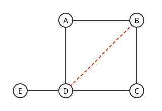
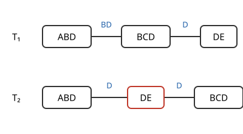

# 접합 나무

# 개요

**접합 나무(junction tree)** 는 서로 얽힌 변수들을 몇 개씩 묶고, 그 묶음들을 같은 변수가 끊기지 않게 나무 모양으로 이은 것이다. 다섯 변수의 결합분포가 네 변수의 순환을 이루는 인수들로 적혀 있으면, 나무에서만 정확한 믿음 전파로는 각 변수의 주변분포를 구할 수 없다. 변수를 묶어 나무를 만들면 메시지를 한 번씩 왕복시켜 모든 주변분포를 정확히 얻는다.

# 직관

변수 $A,B,C,D,E$ 가 각각 $0$ 과 $1$ 을 갖고 결합분포가 다섯 퍼텐셜의 곱이다.

$$p(a,b,c,d,e)=\frac1Z\psi_{AB}(a,b)\thinspace\psi_{BC}(b,c)\thinspace\psi_{CD}(c,d)\thinspace\psi_{DA}(d,a)\thinspace\psi_{DE}(d,e)$$

[확률 그래프 모형](graphical-models.md)으로 그리면 아래 그림의 검은 실선이고, $A,B,C,D$ 가 순환을 이룬다.

순환이 있으므로 믿음 전파가 주변분포를 준다는 보장이 없다. 대신 변수를 하나씩 합해 없앤다. $A$ 가 든 인수는 $\psi_{AB}$ 와 $\psi_{DA}$ 둘이므로 $A$ 에 대한 합을 이 둘에만 적용한다.

$$m_1(b,d)=\sum_a\psi_{AB}(a,b)\thinspace\psi_{DA}(d,a)$$

새 인수 $m_1$ 이 $B$ 와 $D$ 를 함께 담으므로 그림의 빨간 점선 $B$–$D$ 가 생긴다. 점선을 더한 그래프는 [현 그래프](chordal-graphs.md)다.

이어서 $B$ 와 $C$ 를 합한다.

$$m_2(c,d)=\sum_b\psi_{BC}(b,c)\thinspace m_1(b,d),\qquad m_3(d)=\sum_c\psi_{CD}(c,d)\thinspace m_2(c,d)$$

$E$ 의 주변분포는 $\sum_d m_3(d)\psi_{DE}(d,e)$ 에 비례한다. 각 단계에서 함께 다룬 변수는 $\lbrace A,B,D\rbrace$, $\lbrace B,C,D\rbrace$, $\lbrace C,D\rbrace$, $\lbrace D,E\rbrace$ 이고 많아야 셋이다.

이 계산은 $E$ 의 주변분포 하나만 준다. $A$ 의 주변분포를 구하려면 다른 쪽부터 다시 합해야 하고, 다섯 변수 전부를 구하면 같은 계산을 다섯 번 한다. 믿음 전파는 나무에서 메시지를 잎에서 뿌리로, 뿌리에서 잎으로 한 번씩 보내 모든 주변분포를 얻었다. 위의 계산은 $E$ 를 향해 한 방향으로만 흘렀다.

그래서 함께 다룬 변수 묶음을 정점으로 하는 나무를 만들고 그 위에서 메시지를 양방향으로 보낸다. 묶음은 $\lbrace A,B,D\rbrace$, $\lbrace B,C,D\rbrace$, $\lbrace D,E\rbrace$ 이고, $\lbrace C,D\rbrace$ 는 $\lbrace B,C,D\rbrace$ 안에 든다. 아래 그림의 $T_1$ 이 그 나무이고, 파란 글자는 이웃한 두 묶음의 공통 변수다.

$\lbrace A,B,D\rbrace$ 에서 $\lbrace B,C,D\rbrace$ 로 가는 메시지는 공통 변수 $B,D$ 의 함수이고, 위의 $m_1$ 이 그것이다.

묶음을 아무 나무로나 이으면 되지 않는다. 그림의 $T_2$ 처럼 $\lbrace D,E\rbrace$ 를 가운데 두면 $\lbrace A,B,D\rbrace$ 가 보내는 메시지가 $\lbrace D,E\rbrace$ 를 지나면서 $D$ 만의 함수가 되고, $B$ 의 값에 대한 정보가 사라진다. 양 끝의 두 묶음은 $B$ 를 함께 담고 가운데 묶음은 $B$ 를 담지 않는다. 같은 변수를 담은 묶음들이 나무에서 끊기지 않게 이은 것을 접합 나무라 한다.

# 정의

## 접합 나무

그래프 $G$ 에서 서로 모두 이어진 정점 집합을 클릭(clique)이라 하고, 더 큰 클릭에 들지 않는 클릭을 극대 클릭이라 한다. $G$ 의 극대 클릭 $C_1,\dots,C_m$ 을 정점으로 하는 나무 $T$ 가 다음 조건을 만족하면 $T$ 를 $G$ 의 **접합 나무(junction tree, 연접 나무, 클릭 나무 clique tree)** 라 한다. 조건은 임의의 두 클릭 $C_i,C_j$ 와 $T$ 에서 둘을 잇는 경로 위의 모든 클릭 $C_k$ 에 대해 $C_i\cap C_j\subseteq C_k$ 라는 것이다.

이 조건을 **running intersection 성질(running intersection property)** 이라 한다. $T$ 의 간선 $C_iC_j$ 에 대해 $S_{ij}=C_i\cap C_j$ 를 그 간선의 **분리자(separator)** 라 한다.

직관 절의 그래프에 점선 $B$–$D$ 를 더한 그래프의 극대 클릭은 $\lbrace A,B,D\rbrace$, $\lbrace B,C,D\rbrace$, $\lbrace D,E\rbrace$ 다. $T_1$ 은 접합 나무이고 분리자는 $\lbrace B,D\rbrace$ 와 $\lbrace D\rbrace$ 다. $T_2$ 에서는 $\lbrace A,B,D\rbrace$ 와 $\lbrace B,C,D\rbrace$ 를 잇는 경로 위의 $\lbrace D,E\rbrace$ 가 교집합 $\lbrace B,D\rbrace$ 를 포함하지 않으므로 접합 나무가 아니다.

## 접합 나무 알고리즘

분포가 인수의 곱 $p(x)=\frac1Z\prod_F\psi_F(x_F)$ 이고 각 인수의 변수 집합 $F$ 가 어떤 극대 클릭에 든다고 하자. 인수마다 $F$ 를 포함하는 클릭 하나를 골라 배정하고, $C_i$ 에 배정된 인수들의 곱을 $\phi_i$ 라 한다. 접합 나무의 이웃한 두 클릭 사이의 메시지는 다음과 같다.

$$\mu_{i\to j}(x_{S_{ij}})=\sum_{x_{C_i\setminus S_{ij}}}\phi_i(x_{C_i})\prod_{k\in N(i)\setminus\lbrace j\rbrace}\mu_{k\to i}(x_{S_{ki}})$$

$N(i)$ 는 $T$ 에서 $C_i$ 와 이웃한 클릭의 번호들이다. 이웃 하나를 뺀 나머지 모두에게서 메시지를 받은 클릭이 그 이웃에게 메시지를 보낸다. 잎에서 시작하면 모든 간선의 두 방향 메시지가 정해지고, 그 뒤 각 클릭의 믿음을 다음과 같이 둔다.

$$\beta_i(x_{C_i})=\phi_i(x_{C_i})\prod_{k\in N(i)}\mu_{k\to i}(x_{S_{ki}})$$

이 절차를 **접합 나무 알고리즘(junction tree algorithm)** 이라 한다.

직관 절의 분포에서 $\psi_{AB},\psi_{DA}$ 를 $C_1=\lbrace A,B,D\rbrace$ 에, $\psi_{BC},\psi_{CD}$ 를 $C_2=\lbrace B,C,D\rbrace$ 에, $\psi_{DE}$ 를 $C_3=\lbrace D,E\rbrace$ 에 배정한다. $\mu_{1\to2}$ 는 $m_1$ 이고, $\mu_{2\to3}(d)=\sum_{b,c}\psi_{BC}\psi_{CD}\mu_{1\to2}$ 는 $m_3$ 이다. 반대 방향으로는 $\mu_{3\to2}(d)=\sum_e\psi_{DE}(d,e)$ 와 $\mu_{2\to1}(b,d)=\sum_c\psi_{BC}\psi_{CD}\mu_{3\to2}$ 를 보낸다. 메시지 네 개로 세 클릭의 믿음이 모두 정해진다.

# 성질

## 정점별 부분나무

$T$ 가 $G$ 의 접합 나무인 것은 $G$ 의 각 정점 $v$ 에 대해 $v$ 를 담는 클릭들이 $T$ 에서 연결된 부분나무를 이루는 것과 동치다.

증명의 요지. $v$ 를 담는 두 클릭 사이의 경로 위 클릭은 running intersection 성질로 $v$ 를 담는다. 거꾸로 $v\in C_i\cap C_j$ 이면 $v$ 의 부분나무가 연결이므로 $C_i$ 와 $C_j$ 를 잇는 유일한 경로를 포함하고, 그 경로 위의 클릭이 모두 $v$ 를 담는다.

## 존재 정리

정리(Buneman, Gavril). 그래프 $G$ 의 극대 클릭들의 접합 나무가 있는 것은 $G$ 가 현 그래프인 것과 동치다[^1][^2].

증명의 요지. 접합 나무가 있으면 정점마다 앞 성질의 부분나무가 생긴다. 두 정점이 이웃인 것은 한 클릭에 함께 드는 것, 곧 두 부분나무가 공통 정점을 갖는 것과 같다. 그래서 $G$ 는 나무의 부분나무들의 교차 그래프이고, 현 그래프 문서의 부분나무 표현에 따라 현 그래프다.

거꾸로 $G$ 가 현 그래프이면 단체 정점 $v$ 를 하나 떼고 $G-v$ 의 접합 나무를 귀납으로 만든다. $v$ 의 이웃 $N(v)$ 는 클릭이므로 $G-v$ 의 어떤 극대 클릭 $C$ 에 든다. $N(v)=C$ 이면 $C$ 를 $C\cup\lbrace v\rbrace$ 로 바꾸고, 아니면 새 클릭 $N(v)\cup\lbrace v\rbrace$ 를 $C$ 에 잇는다. 어느 경우든 각 정점의 부분나무가 연결로 남는다.

## 최대 가중 생성 나무

$G$ 의 극대 클릭들을 정점으로 하고 두 클릭 사이에 가중치 $\lvert C_i\cap C_j\rvert$ 를 준 완전그래프를 생각한다. $G$ 가 현 그래프이면 이 그래프의 최대 가중 생성 나무가 정확히 $G$ 의 접합 나무다[^3].

증명의 요지. $v$ 를 담는 클릭의 개수를 $n_v$ 라 하자. 생성 나무 $T$ 에서 분리자가 $v$ 를 담는 간선들은 $v$ 를 담는 클릭 $n_v$ 개 위의 숲이므로 많아야 $n_v-1$ 개다. 이것을 정점마다 더하면 다음 부등식이 나온다.

$$\sum_{C_iC_j\in T}\lvert C_i\cap C_j\rvert\le\sum_{v}(n_v-1)$$

등호는 모든 $v$ 에 대해 그 숲이 나무일 때, 곧 $T$ 가 접합 나무일 때 성립한다. 존재 정리로 등호를 이루는 나무가 있으므로 최댓값은 우변이다.

직관 절의 예에서 가중치는 $\lbrace A,B,D\rbrace$–$\lbrace B,C,D\rbrace$ 가 $2$, 나머지 두 쌍이 $1$ 이다. $n_A,n_B,n_C,n_D,n_E$ 는 $1,2,1,3,1$ 이어서 우변은 $3$ 이다. $T_1$ 의 가중치 합은 $3$ 이고 $T_2$ 는 $2$ 다. 최대 가중 생성 나무는 [최소 신장트리](minimum-spanning-tree.md)의 Kruskal 알고리즘에서 가중치의 부호를 바꾸어 구한다.

## 정확성

정리. $T$ 가 접합 나무이면 접합 나무 알고리즘이 끝난 뒤 모든 $i$ 에서 $\beta_i(x_{C_i})=Z\thinspace p(x_{C_i})$ 다[^4].

증명의 요지. 간선 $C_iC_j$ 를 지우면 $T$ 가 두 조각으로 갈린다. $i$ 쪽 조각의 클릭에 나오는 변수 가운데 $j$ 쪽 조각에도 나오는 것은 running intersection 성질로 $C_i$ 와 $C_j$ 에 모두 들어 있으므로 $S_{ij}$ 에 있다. 그래서 귀납으로 $\mu_{i\to j}$ 는 $i$ 쪽 조각에만 나오는 변수를 한 번씩 전부 합한 값이고, $\beta_i$ 는 $C_i$ 밖의 변수를 한 번씩 전부 합한 값이다. $T_2$ 에서는 $B$ 가 두 조각에 모두 나오면서 분리자 $\lbrace D\rbrace$ 에 없어, $B$ 가 양쪽에서 따로 합해진다.

이웃한 두 클릭의 믿음을 분리자의 변수만 남기고 합하면 둘 다 $Z\thinspace p(x_{S_{ij}})$ 가 된다.

## 계산 비용

변수가 각각 $q$ 개의 값을 갖고 가장 큰 클릭의 크기가 $w$ 이면 메시지 하나를 계산하는 데 $q^w$ 에 비례하는 곱셈이 들고, 메시지는 $2(m-1)$ 개다. 그래프가 현 그래프가 아니면 간선을 더해 현 그래프로 만든 뒤 접합 나무를 만든다. 가장 큰 클릭을 가장 작게 하는 그런 그래프에서 $w-1$ 은 원래 그래프의 [나무폭](treewidth.md)이다. 나무폭이 주어진 $k$ 이하인지 판정하는 문제는 NP-완전(NP-complete, NP 는 nondeterministic polynomial time)이다[^5].

# 활용

- Bayes 망의 정확 추론. 유향 그래프 모형을 모랄 그래프로 바꾸고, 간선을 더해 현 그래프로 만들고, 그 접합 나무 위에서 이 알고리즘을 돌려 관측을 고정한 사후 주변분포를 구한다. Lauritzen 과 Spiegelhalter 가 의료 진단 전문가 시스템에 이 절차를 썼다[^4]. [Bayes 추론](bayesian-inference.md)의 사후분포 계산이 이 꼴이다.
- 가장 그럴듯한 배정. 메시지의 합을 최댓값으로 바꾸면 같은 나무에서 결합확률이 가장 큰 배정이 나온다.
- 비순환 데이터베이스 질의. 관계 여러 개를 결합하는 질의에서 관계들의 속성 집합을 클릭처럼 보고 접합 나무를 만들면, 나무를 따라 반조인(semijoin)을 양방향으로 보내 중간 결과가 최종 결과보다 커지지 않게 계산한다[^6].
- [제약 만족 문제](constraint-satisfaction-problems.md). 메시지의 합과 곱을 "해가 있는가" 의 논리합과 논리곱으로 바꾸면, 제약 그래프의 나무폭이 $k$ 일 때 변수 개수에 선형이고 $q^{k+1}$ 에 비례하는 시간에 해의 존재를 판정한다.
- 희소 Cholesky 분해. 소거로 생긴 현 그래프의 접합 나무가 다전선(multifrontal) 방법에서 밀집 부분행렬들을 처리하는 순서를 정한다.

[^1]: P. Buneman, "A characterisation of rigid circuit graphs", *Discrete Mathematics* **9** (1974), 205–212.
[^2]: F. Gavril, "The intersection graphs of subtrees in trees are exactly the chordal graphs", *Journal of Combinatorial Theory, Series B* **16** (1974), 47–56.
[^3]: F. V. Jensen, F. Jensen, "Optimal junction trees", *Proceedings of the Tenth Conference on Uncertainty in Artificial Intelligence* (1994), 360–366.
[^4]: S. L. Lauritzen, D. J. Spiegelhalter, "Local computations with probabilities on graphical structures and their application to expert systems", *Journal of the Royal Statistical Society, Series B* **50** (1988), 157–224.
[^5]: S. Arnborg, D. G. Corneil, A. Proskurowski, "Complexity of finding embeddings in a k-tree", *SIAM Journal on Algebraic and Discrete Methods* **8** (1987), 277–284.
[^6]: M. Yannakakis, "Algorithms for acyclic database schemes", *Proceedings of the 7th International Conference on Very Large Data Bases* (1981), 82–94.

# 연관 문서

## 선수지식

- [현 그래프](chordal-graphs.md)
- [확률 그래프 모형](graphical-models.md)

## 더 알아보기

아직 연결한 문서가 없다.

#graph_theory #probability #machine_learning #algorithms
