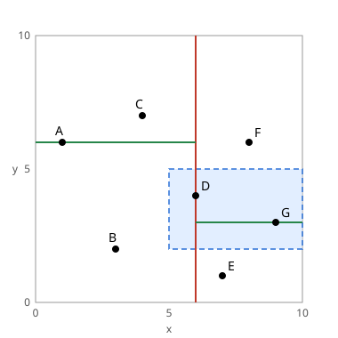

# k-d 트리

# 개요

**k-d 트리(k-d tree)** 는 $k$ 차원 공간의 점들을 좌표 하나씩 번갈아 기준으로 삼아 반으로 가르며 저장하는 이진 트리다. 지도 위의 식당 가운데 직사각형 범위 안에 든 것을 찾으려면, 식당을 가로 좌표로 정렬해 두어도 세로 좌표는 뒤섞여 있어 가로 범위에 든 식당을 하나씩 확인해야 한다. k-d 트리는 가로로 한 번, 세로로 한 번 번갈아 평면을 나누므로, 범위와 겹치지 않는 조각에 든 점들을 한꺼번에 건너뛴다.

# 직관

평면의 점 일곱 개 $A(1,6)$, $B(3,2)$, $C(4,7)$, $D(6,4)$, $E(7,1)$, $F(8,6)$, $G(9,3)$ 가운데 직사각형 $\lbrack 5,10\rbrack\times\lbrack 2,5\rbrack$ 안에 든 것을 찾는다. 1차원이면 점을 정렬하고 [이진 탐색](binary-search.md)으로 범위의 양 끝을 찾으면 된다. 2차원에서 $x$ 좌표로 정렬하면 $x\ge 5$ 인 $D,E,F,G$ 를 찾은 뒤 그 넷의 $y$ 좌표를 하나씩 확인해야 하고, 범위가 넓으면 이 확인이 점 전체에 가깝다.

$x$ 로 정렬했을 때 막힌 것은 $y$ 가 정리되어 있지 않아서다. 그래서 $x$ 좌표의 중앙값인 $D$ 의 세로줄 $x=6$ 으로 평면을 가른 뒤, 왼쪽 조각은 그 안의 $y$ 좌표 중앙값인 $A$ 의 가로줄 $y=6$ 으로, 오른쪽 조각은 $G$ 의 가로줄 $y=3$ 으로 다시 가른다. 조각 안에 남은 점은 하나씩이다.

아래 그림은 이렇게 나눈 평면이다. 빨간 세로줄이 첫 번째 가르기, 초록 가로줄 둘이 두 번째 가르기이고, 파란 점선 직사각형이 찾는 범위다.



범위는 $y=6$ 위쪽의 왼쪽 조각과 겹치지 않으므로 그 조각에 든 $C$ 는 확인하지 않는다. 나머지 여섯 점을 확인하면 범위 안의 점은 $D$ 와 $G$ 다.

# 정의

## k-d 트리

**k-d 트리** 는 각 마디가 $\mathbb R^k$ 의 점 하나를 갖는 이진 트리이며, 깊이 $d$ 인 마디의 점을 $p$ 라 할 때 왼쪽 부분 트리의 점은 모두 $(d\bmod k)$ 번째 좌표가 $p$ 의 그 좌표보다 작고 오른쪽 부분 트리의 점은 모두 그 이상이라는 조건을 만족하는 트리다. 이 좌표를 그 마디의 **가르는 좌표(splitting coordinate)** 라 한다. Bentley 가 1975 년에 제안했다[^1]. $k=1$ 이면 [균형 이진 탐색 트리](balanced-binary-search-trees.md)의 이진 탐색 트리 조건과 같다.

예. 직관 절의 평면에서 뿌리는 $D$ 이고 가르는 좌표는 $x$ 다. 왼쪽 자식 $A$ 와 오른쪽 자식 $G$ 의 가르는 좌표는 $y$ 이고, $A$ 의 왼쪽 자식은 $y\lt 6$ 인 $B$, 오른쪽 자식은 $C$ 다. $G$ 의 왼쪽 자식은 $E$, 오른쪽 자식은 $F$ 다.

마디 $v$ 에는 $\mathbb R^k$ 의 직사각형 상자 하나가 대응한다. 뿌리의 상자는 공간 전체이고, 자식의 상자는 부모의 상자를 부모의 점을 지나는 가르는 좌표의 초평면으로 자른 두 조각이다. 이 상자를 마디의 **영역(region)** 이라 한다.

예. $A$ 의 영역은 $x\lt 6$ 인 반평면이고, $C$ 의 영역은 $x\lt 6$, $y\ge 6$ 인 조각이다.

## 만들기

점 집합을 가르는 좌표의 중앙값에서 둘로 나누고, 중앙값의 점을 뿌리로 삼아 양쪽에 다음 좌표로 되풀이한다.

```typescript
type Point = number[];

interface KdNode {
  point: Point;
  axis: number;
  left: KdNode | null;
  right: KdNode | null;
}

function build(points: Point[], depth: number, k: number): KdNode | null {
  if (points.length === 0) return null;
  const axis = depth % k;
  const sorted = [...points].sort((p, q) => p[axis] - q[axis]);
  const m = Math.floor(sorted.length / 2);
  return {
    point: sorted[m],
    axis,
    left: build(sorted.slice(0, m), depth + 1, k),
    right: build(sorted.slice(m + 1), depth + 1, k),
  };
}
```

## 범위 질의

**직교 범위 질의(orthogonal range query)** 는 좌표축에 평행한 직사각형 상자 $R$ 안의 점을 모두 내놓는 질의다. 마디의 점이 $R$ 안에 있으면 내놓고, $R$ 이 가르는 초평면의 한쪽에만 있으면 그쪽 자식으로만, 양쪽에 걸치면 두 자식으로 내려간다.

```typescript
// lo[i] <= x[i] <= hi[i] 인 점을 모두 out 에 넣는다.
function rangeQuery(v: KdNode | null, lo: Point, hi: Point, out: Point[]): void {
  if (v === null) return;
  const p = v.point;
  if (p.every((x, i) => lo[i] <= x && x <= hi[i])) out.push(p);
  if (lo[v.axis] < p[v.axis]) rangeQuery(v.left, lo, hi, out);
  if (hi[v.axis] >= p[v.axis]) rangeQuery(v.right, lo, hi, out);
}
```

예. 직관 절의 범위 $\lbrack 5,10\rbrack\times\lbrack 2,5\rbrack$ 에서 뿌리 $D$ 는 범위 안에 있다. $x$ 범위가 $6$ 의 양쪽에 걸치므로 $A$ 와 $G$ 로 내려간다. $A$ 에서는 $y$ 범위의 위끝 $5$ 가 $6$ 보다 작으므로 $B$ 로만 가고 $C$ 를 건너뛴다. $G$ 에서는 $y$ 범위가 $3$ 의 양쪽에 걸쳐 $E$ 와 $F$ 를 모두 확인한다.

## 최근접 이웃 질의

**최근접 이웃 질의(nearest neighbor query)** 는 점 $q$ 에서 Euclid 거리가 가장 가까운 점을 찾는 질의다. $q$ 가 속한 쪽의 자식부터 내려가 지금까지 찾은 가장 가까운 거리 $r$ 를 유지하고, 되돌아오는 길에 $q$ 에서 가르는 초평면까지의 거리가 $r$ 보다 작을 때만 반대쪽 자식을 확인한다.

예. $q=(5,5)$ 이면 $D$, $A$ 를 거쳐 $B$ 에서 거리 $\sqrt{13}$ 을 얻는다. $q$ 에서 $A$ 의 줄 $y=6$ 까지의 거리 $1$ 이 $\sqrt{13}$ 보다 작아 $C$ 를 확인해 $\sqrt5$ 로 줄이고, $D$ 에서 $\sqrt2$ 로 줄인다. 줄 $x=6$ 까지의 거리 $1$ 이 $\sqrt2$ 보다 작아 $G$ 와 $F$ 를 확인하지만, $G$ 의 줄 $y=3$ 까지의 거리 $2$ 는 $\sqrt2$ 보다 커서 $E$ 를 건너뛴다. 답은 $D$ 다.

# 성질

## 높이와 만들기 시간

중앙값으로 가르면 부분 트리의 크기가 깊이마다 절반 이하로 줄어 높이가 $\lfloor\log\_2 n\rfloor$ 다. 각 좌표로 미리 정렬해 두거나 선형 시간 중앙값 선택을 쓰면 만들기가 $O(n\log n)$ 시간이다[^2].

## 범위 질의 시간

$k$ 차원에서 점 $n$ 개를 담은 k-d 트리의 직교 범위 질의는 다음 시간에 끝난다. 여기서 $m$ 은 내놓는 점의 수다[^3].

$$
O\bigl(n^{1-1/k}+m\bigr)
$$

*증명의 요지.* $k=2$ 를 본다. 범위 안에 영역 전체가 들어가는 마디는 그 부분 트리를 내놓는 비용 $O(m)$ 으로 센다. 나머지 방문하는 마디는 영역이 범위의 네 변 가운데 하나와 만나는 마디다. 세로줄 하나와 만나는 영역의 수를 $Q(n)$ 이라 하면, 두 단계 내려가는 동안 손자 넷 가운데 많아야 둘의 영역만 그 줄과 만나므로 다음이 성립한다.

$$
Q(n)=2+2Q(n/4)
$$

이 점화식의 해는 $Q(n)=O(\sqrt n)$ 이다. 변이 넷이므로 방문하는 마디는 $O(\sqrt n+m)$ 개다.

이 상한은 최악의 경우에도 성립하고 차수는 개선되지 않는다. 범위가 아주 얇은 띠이면 $\sqrt n$ 개 정도의 영역과 만난다.

## 최근접 이웃 질의 시간

차원 $k$ 가 고정되고 점이 고르게 퍼져 있으면 최근접 이웃 질의의 기대 시간은 $O(\log n)$ 이다[^4]. 반대쪽 자식을 확인하는 조건이 차원이 커질수록 자주 성립해, 점의 수가 $2^k$ 보다 충분히 크지 않으면 대부분의 마디를 방문한다.

## 삽입과 삭제

삽입은 가르는 좌표를 따라 내려가 잎에 매단다. 좌표마다 번갈아 가르는 조건 때문에 회전으로 균형을 고칠 수 없으므로, 삽입을 거듭해 높이가 커지면 부분 트리를 다시 만든다.

# 활용

- 점 데이터베이스. 위도와 경도의 직사각형 안에 든 지점, 나이와 소득의 범위에 든 기록처럼 여러 속성의 범위 질의에 쓴다.
- 최근접 이웃 분류와 군집. 차원이 낮은 특징 벡터에서 가장 가까운 학습 표본을 찾는 데 쓴다. 차원이 높으면 [Johnson–Lindenstrauss 보조정리](johnson-lindenstrauss-lemma.md)로 차원을 줄이거나 근사 최근접 이웃 방법을 쓴다.
- 컴퓨터 그래픽스. 광선 추적에서 장면의 물체를 공간 분할 트리에 담아 광선과 만나는 물체 후보를 줄이고, 점 구름의 표면 복원에서 이웃 점을 찾는다.

[^1]: J. L. Bentley, "Multidimensional binary search trees used for associative searching", Communications of the ACM 18 (1975), 509–517.
[^2]: M. de Berg, O. Cheong, M. van Kreveld, M. Overmars, *Computational Geometry: Algorithms and Applications*, 3rd ed., Springer, 2008, Section 5.2.
[^3]: D. T. Lee, C. K. Wong, "Worst-case analysis for region and partial region searches in multidimensional binary search trees and balanced quad trees", Acta Informatica 9 (1977), 23–29.
[^4]: J. H. Friedman, J. L. Bentley, R. A. Finkel, "An algorithm for finding best matches in logarithmic expected time", ACM Transactions on Mathematical Software 3 (1977), 209–226.

# 연관 문서

## 선수지식

- [균형 이진 탐색 트리](balanced-binary-search-trees.md)

## 더 알아보기

아직 연결한 문서가 없다.

#data_structures #algorithms #computation
