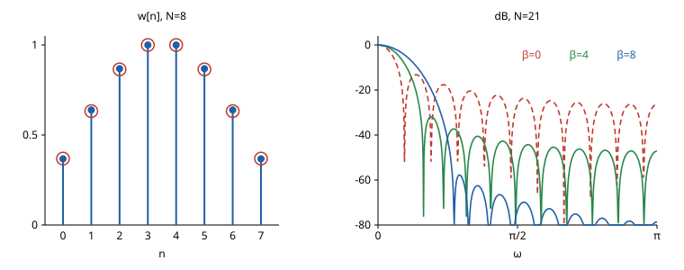

# Kaiser 창

# 개요

**Kaiser 창(Kaiser window)** 은 매개변수 하나로 모양을 바꾸는, 닫힌 식으로 적힌 [창함수](window-functions.md)다. 길이 8 인 창 가운데 주파수 $\lvert\omega\rvert\le\pi/4$ 안에 스펙트럼의 세기가 가장 많이 모이는 것을 구하려면 $8\times 8$ 행렬의 고유벡터를 계산해야 하고, 길이나 범위를 바꿀 때마다 다시 계산해야 한다. Kaiser 창은 계수를 0 차 변형 [Bessel 함수](bessel-functions.md) $I_0$ 의 값으로 바로 적고, 매개변수 $\beta$ 하나로 그 고유벡터에 가깝게 맞춘다.

# 직관

[Slepian 수열](slepian-sequences.md) 문서에서 길이 $8$ 인 창 가운데 $\lvert\omega\rvert\le\pi/4$ 에 세기가 가장 많이 모이는 것은 가장 큰 값을 $1$ 로 맞추어

$$
0.369,\quad 0.633,\quad 0.864,\quad 1,\quad 1,\quad 0.864,\quad 0.633,\quad 0.369
$$

이고, 범위 안에 모이는 비율은 $0.98305$ 다. 이 수열은 집중 행렬의 가장 큰 [고윳값](eigenvalues.md)에 속하는 고유벡터로만 얻는다.

창의 가운데를 $t=0$, 양 끝을 $t=\pm1$ 로 놓고, 위치 $t$ 의 계수를 $I_0\bigl(\beta\sqrt{1-t^2}\bigr)$ 로 정한다. $I_0$ 는 $I_0(0)=1$ 이고 $0$ 이상에서 증가하므로 이 값은 양 끝에서 $1$, 가운데에서 $I_0(\beta)$ 다. 길이 $8$ 이면 표본 위치가 $t=-1,-\frac57,-\frac37,-\frac17,\frac17,\dots,1$ 이다. $\beta=2.27$ 로 두고 가장 큰 값을 $1$ 로 맞추면

$$
0.368,\quad 0.639,\quad 0.868,\quad 1,\quad 1,\quad 0.868,\quad 0.639,\quad 0.368
$$

이고, 범위 안에 모이는 비율은 $0.98304$ 다. 고유벡터를 계산하지 않고 비율이 넷째 자리까지 같다.

$\beta=0$ 이면 모든 계수가 $1$ 이라 직사각형 창이다. $\beta$ 를 키우면 양 끝의 계수가 가운데보다 빠르게 작아지고, 먼 주파수로 새는 세기가 줄고 주엽이 넓어진다.

아래 그림의 왼쪽은 위 두 수열이다. 막대 끝의 점이 $\beta=2.27$ 인 계수이고 빈 원이 Slepian 수열이다.

오른쪽은 길이 $21$ 에서 $\beta=0,4,8$ 인 창의 스펙트럼을 데시벨로 그린 것이다. $\beta$ 가 커질수록 곁엽이 내려가고 첫 영점이 오른쪽으로 간다.

# 정의

## Kaiser 창

$N=M+1$ 을 창의 길이, $\beta\ge 0$ 을 모양 매개변수(shape parameter)라 한다. 계수가

$$
w\lbrack n\rbrack=\frac{I_0\Bigl(\beta\sqrt{1-(2n/M-1)^2}\Bigr)}{I_0(\beta)},\qquad n=0,\dots,M
$$

인 대칭 창을 **Kaiser 창** 이라 한다. $2n/M-1$ 은 $n=0$ 에서 $-1$, $n=M$ 에서 $1$ 이고, 분모 $I_0(\beta)$ 는 가운데 위치의 값을 $1$ 로 맞춘다.

직관 절은 $N=8$, $\beta=2.27$ 이다. $I_0(2.27)\approx 2.77$ 이고 정의대로 계산한 계수는 $0.361,\ 0.628,\ 0.854,\ 0.983$ 과 그 대칭이다. 직관 절의 수열은 이것을 $0.983$ 으로 나눈 것이다.

## 연속 Kaiser 함수

구간 $\lbrack -1,1\rbrack$ 위의 함수

$$
k_\beta(t)=I_0\bigl(\beta\sqrt{1-t^2}\bigr)
$$

를 연속 Kaiser 함수라 한다. Kaiser 창은 $k\_\beta$ 를 $t=2n/M-1$ 에서 읽고 $I_0(\beta)$ 로 나눈 것이다.

# 성질

## 연속 판본의 스펙트럼

연속 Kaiser 함수의 [Fourier 변환](fourier-transform.md)은 닫힌 꼴이다.

$$
\int_{-1}^{1}I_0\bigl(\beta\sqrt{1-t^2}\bigr)\thinspace e^{-i\omega t}\thinspace dt=\frac{2\sinh\sqrt{\beta^2-\omega^2}}{\sqrt{\beta^2-\omega^2}}
$$

$\lvert\omega\rvert\gt\beta$ 이면 $\sqrt{\beta^2-\omega^2}=i\sqrt{\omega^2-\beta^2}$ 이므로 우변은 $2\sin\sqrt{\omega^2-\beta^2}/\sqrt{\omega^2-\beta^2}$ 다. 이 식 때문에 Kaiser 창을 $I_0$–$\sinh$ 창이라고도 한다.

증명의 요지. $J_0$ 의 적분표현에서 $x$ 를 $ix$ 로 바꾸면 $I_0(x)=\frac1{2\pi}\int_0^{2\pi}e^{x\cos\varphi}d\varphi$ 다. 단위구면의 점을 $(\sqrt{1-t^2}\cos\varphi,\sqrt{1-t^2}\sin\varphi,t)$ 로 매개하면 넓이 요소가 $dt\thinspace d\varphi$ 이므로, 좌변은 $a=(\beta,0,-i\omega)$ 에 대한 $\frac1{2\pi}\int_{S^2}e^{a\cdot x}d\sigma$ 다. 실벡터 $a$ 에서는 $a$ 방향을 축으로 잡으면 높이 $u$ 의 띠 넓이가 $2\pi\thinspace du$ 이므로 다음이 나온다.

$$
\int_{S^2}e^{a\cdot x}d\sigma=2\pi\int_{-1}^1e^{\lvert a\rvert u}du=\frac{4\pi\sinh\lvert a\rvert}{\lvert a\rvert}
$$

양변이 $a\cdot a$ 의 전해석 함수(entire function)이므로 같은 식이 [복소수](complex-numbers.md) $a$ 에서도 성립하고, $a\cdot a=\beta^2-\omega^2$ 이다.

## 주엽의 폭과 곁엽의 높이

위 식에서 $\lvert\omega\rvert\le\beta$ 구간에는 영점이 없고, 첫 영점은 $\sqrt{\omega^2-\beta^2}=\pi$, 곧 $\omega=\sqrt{\beta^2+\pi^2}$ 이다.

가장 높은 곁엽은 $\sin x/x$ 의 첫 극값 $x\approx 4.49$ 에서의 값 $-0.217$ 이므로 봉우리와의 비가 약 $0.217\beta/\sinh\beta$ 다.

구간 $\lbrack -1,1\rbrack$ 을 길이 $M$ 의 표본 구간으로 옮기면 주파수가 $2/M$ 배가 되어, Kaiser 창의 주엽 반폭은 약 $2\sqrt{\beta^2+\pi^2}/M$ 이다. $N=21$ 에서 정의대로 계산한 값은 다음과 같다. 주엽의 반폭은 $2\pi/N$ 을 단위로 적었다.

| $\beta$ | 주엽의 반폭 | 가장 높은 곁엽 |
| --- | --- | --- |
| $0$ | $1.00$ | $-13.2$ dB |
| $4$ | $1.71$ | $-31.9$ dB |
| $8$ | $2.87$ | $-57.8$ dB |

$\beta=0$ 은 창함수 문서의 직사각형 창과 같은 값이다. 곁엽의 높이는 $\beta$ 에 대해 지수적으로 줄고 주엽의 폭은 $\beta$ 에 대해 일차로 는다.

## 곁엽이 줄어드는 빠르기

Kaiser 창의 양 끝 계수는 $1/I_0(\beta)\gt 0$ 이라 $0$ 이 아니다. 창함수 문서의 끝점 매끄러움과 곁엽의 관계에서 값이 끊기는 창이므로 곁엽은 $\lvert\omega\rvert^{-1}$ 꼴로 줄어든다. 연속 판본의 $2\sin\sqrt{\omega^2-\beta^2}/\sqrt{\omega^2-\beta^2}$ 도 같은 빠르기다. $\beta$ 를 키우면 끝 계수가 지수적으로 작아져 끊김의 크기가 줄고, 그래서 첫 곁엽부터 낮아진다.

## Slepian 수열의 근사

연속 시간에서 구간 $\lbrack -1,1\rbrack$ 밖이 $0$ 인 함수 가운데 주파수 $\lvert\omega\rvert\le c$ 에 세기가 가장 많이 모이는 것은 0 차 장구 회전타원체 파동함수(prolate spheroidal wave function)다. Kaiser 창은 이 함수를 $k\_\beta$ 로 근사한 것이다[^1]. 이산 판본에서도 직관 절처럼 $\beta$ 를 맞추면 Kaiser 창의 집중 비율이 Slepian 수열의 최댓값에 매우 가깝다. Slepian 수열은 고유벡터 계산이 필요하고 Kaiser 창은 $I_0$ 의 급수 몇 항으로 계산된다.

## FIR 필터 설계 공식

[FIR 필터](fir-filters.md)(finite impulse response filter)를 창 방법으로 설계할 때, 저지대역의 감쇠를 $A=-20\log_{10}\delta$ dB, 전이대역의 폭을 $\Delta\omega$ 라 하면 다음 경험식으로 $\beta$ 와 $M$ 을 정한다[^2].

$$
\beta=\begin{cases}0.1102(A-8.7), & A\gt 50\cr 0.5842(A-21)^{0.4}+0.07886(A-21), & 21\le A\le 50\cr 0, & A\lt 21\end{cases}\qquad M=\frac{A-8}{2.285\thinspace\Delta\omega}
$$

$A=60$, $\Delta\omega=0.1\pi$ 이면 $\beta=0.1102\cdot 51.3\approx 5.65$ 이고 $M=52/(2.285\cdot 0.1\pi)\approx 72.4$ 이므로 $M=73$ 으로 올린다.

# 활용

- FIR 필터의 창 방법. 이상적인 저역통과 응답을 Kaiser 창으로 자르고, 위 경험식으로 감쇠와 전이대역 폭에서 길이와 $\beta$ 를 한 번에 정한다.
- [스펙트럼 추정](spectral-estimation.md). 강한 성분 옆의 약한 성분을 볼 때 $\beta$ 를 키워 곁엽을 약한 성분보다 낮추고, 두 성분이 주엽의 반폭보다 떨어져 있도록 길이를 정한다.
- [수정 이산 코사인 변환](modified-discrete-cosine-transform.md)의 Kaiser–Bessel 유도 창(Kaiser–Bessel-derived window, KBD). 길이 $N+1$ 인 Kaiser 창 $v$ 의 누적합으로 $w\lbrack n\rbrack=\sqrt{\sum_{j\le n}v\lbrack j\rbrack/\sum_{j\le N}v\lbrack j\rbrack}$, $0\le n\lt N$ 을 정하고 좌우 대칭으로 늘린다. $v$ 가 대칭이므로 $w\lbrack n\rbrack^2+w\lbrack N-1-n\rbrack^2=1$ 이 되어 Princen–Bradley 조건을 만족한다. AAC(Advanced Audio Coding) 부호화기가 이 창을 쓴다.

[^1]: J. F. Kaiser, R. W. Schafer, "On the use of the I0-sinh window for spectrum analysis", *IEEE Transactions on Acoustics, Speech, and Signal Processing* 28 (1980), 105–107.
[^2]: A. V. Oppenheim, R. W. Schafer, *Discrete-Time Signal Processing*, 3rd ed., Prentice Hall, 2010. 7.6 절.

# 연관 문서

## 선수지식

- [창함수](window-functions.md)
- [Slepian 수열](slepian-sequences.md)
- [Bessel 함수](bessel-functions.md)

## 더 알아보기

아직 연결한 문서가 없다.

#signal_processing #analysis #statistics
