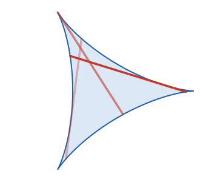

# Kakeya 바늘 문제

# 개요

**Kakeya 바늘 문제(Kakeya needle problem)** 는 길이 $1$ 인 바늘을 평면에서 움직여 방향을 반 바퀴 돌릴 때, 바늘이 지나가는 영역의 넓이를 얼마나 작게 할 수 있는지 묻는 문제다. 바늘을 중심에 대고 돌리면 지름 $1$ 인 원판을 쓰고 넓이가 $\pi/4\approx 0.785$ 다. 바늘을 미끄러뜨리며 돌리면 넓이가 줄고, A. S. Besicovitch 는 넓이를 원하는 만큼 작게 할 수 있다는 것을 보였다.

# 직관

원판 대신 세 꼭짓점이 뾰족한 곡선 삼각형 모양의 영역을 쓰면 넓이가 줄어든다. 아래 그림의 영역은 반지름 $1/4$ 인 원이 반지름 $3/4$ 인 원의 안쪽을 따라 구를 때 원 위의 한 점이 그리는 곡선으로 둘러싸여 있고, 이 곡선을 삼첨점 곡선(deltoid)이라 한다.

그림의 바늘은 모두 곡선에 접하고 두 끝이 곡선 위에 있으며, 길이가 모두 $1$ 이다. 접점을 곡선을 따라 옮기면 바늘이 영역 안에서 방향을 바꾸며 미끄러지고, 접점이 한 바퀴 돌면 바늘은 반 바퀴 돈다. 이 영역의 넓이는 $\pi/8\approx 0.393$ 으로 원판의 절반이다.

볼록한 영역만 쓰면 높이 $1$ 인 정삼각형이 가장 작고 넓이는 $1/\sqrt3\approx 0.577$ 이다. 볼록하지 않은 영역에서는 넓이가 $\pi/8$ 보다도 작아질 수 있다.

# 정의

## 바늘 영역

평면의 집합 $E$ 가 다음 조건을 만족하면 **Kakeya 바늘 집합(Kakeya needle set)** 이라 한다. 길이 $1$ 인 선분을 $E$ 안에서 연속적으로 움직여, 처음 위치와 같은 직선 위에 있으면서 방향이 반대인 위치로 옮길 수 있다. 지름 $1$ 인 원판과 직관 절의 삼첨점 영역이 그 예다. 1917 년 S. Kakeya 가 이런 집합의 넓이의 하한을 물었다.[^1]

## Besicovitch 집합

$\mathbb R^n$ 의 집합이 모든 방향의 길이 $1$ 인 선분을 하나 이상 포함하면 **Besicovitch 집합(Besicovitch set)** 또는 Kakeya 집합이라 한다. Kakeya 바늘 집합은 바늘을 돌리는 동안 모든 방향을 지나므로 Besicovitch 집합이다. 반대로 Besicovitch 집합은 선분이 방향마다 흩어져 있어도 되므로 바늘을 돌리지 못할 수 있다.

# 성질

## 넓이가 0 인 Besicovitch 집합

정리(Besicovitch). 평면에 Lebesgue 측도가 $0$ 인 Besicovitch 집합이 있다.[^2]

증명의 요지. 밑변이 수평인 삼각형을 밑변에서 $2^k$ 개의 가는 삼각형으로 자른다. 이웃한 삼각형끼리 수평으로 밀어 겹치게 하면 모든 조각의 꼭짓점 쪽이 겹쳐 전체 넓이가 줄지만, 조각들이 포함하는 선분의 방향은 그대로다. 이 이동을 되풀이해 만든 모양을 Perron 나무(Perron tree)라 하고, $k$ 를 키우면 넓이가 $0$ 으로 간다. 극한을 잡으면 측도 $0$ 의 집합이 나온다.

## 넓이가 작은 바늘 집합

정리(Besicovitch). 임의의 $\varepsilon\gt 0$ 에 대해 넓이가 $\varepsilon$ 보다 작은 Kakeya 바늘 집합이 있다.[^2]

증명의 요지. 바늘을 자기 방향으로 미는 것은 넓이를 쓰지 않는다. 같은 방향의 두 평행 위치 사이는, 바늘을 먼 곳까지 밀고 조금 돌려 다른 직선에 올린 뒤 되돌아오는 길로 잇는다. 이 길의 넓이는 원하는 만큼 작게 만들 수 있고, J. Pál 의 이 연결(Pál join)로 Perron 나무의 조각들을 이으면 넓이가 작은 바늘 집합이 된다.

## Hausdorff 차원

정리(Davies). 평면의 Besicovitch 집합은 모두 [Hausdorff 차원](hausdorff-dimension.md)이 $2$ 다.[^3]

넓이는 $0$ 이 될 수 있지만 차원은 줄지 않는다. 모든 $n$ 에서 $\mathbb R^n$ 의 Besicovitch 집합의 Hausdorff 차원이 $n$ 이라는 진술을 Kakeya 추측(Kakeya conjecture)이라 한다. $n=3$ 인 경우는 H. Wang 과 J. Zahl 이 2025 년에 증명했다.[^4]

# 활용

- 원판 곱셈자. [Bochner–Riesz 평균](bochner-riesz-means.md)의 $\delta=0$ 경우다. C. Fefferman 은 Besicovitch 집합을 써서, [Fourier 변환](fourier-transform.md)에 단위 공의 지시함수를 곱하는 작용소가 $n\ge 2$ 이고 $p\ne 2$ 일 때 $L^p(\mathbb R^n)$ 에서 유계가 아님을 보였다.[^5] 다차원 [Fourier 급수](fourier-series.md)를 공 모양의 부분합으로 더할 때 $L^p$ 수렴이 실패하는 것이 이 결과에서 나온다.
- [유한체 Kakeya 집합](finite-field-kakeya-sets.md). 유한체 위의 공간에서 모든 방향의 직선을 포함하는 집합의 크기를 묻는 같은 꼴의 문제이고, Z. Dvir 가 다항식 방법으로 크기의 하한을 증명했다.
- 조화해석의 극대함수. 방향마다 가는 관을 평균 내는 [Kakeya 극대함수](kakeya-maximal-function.md)의 유계성은 Kakeya 추측을 함의한다. [Fourier 변환의 제한 추측](fourier-restriction-conjecture.md)(restriction conjecture)과 Bochner–Riesz 추측(Bochner–Riesz conjecture)은 각각 이 유계성을 함의한다.

[^1]: S. Kakeya, "Some problems on maxima and minima regarding ovals", *Science Reports of the Tôhoku Imperial University* **6** (1917), 71–88. 볼록 영역의 최솟값 $1/\sqrt3$ 은 J. Pál, "Ueber ein elementares Variationsproblem", *Danske Videnskabernes Selskab, Mat.-Fys. Meddelelser* **3** (1920), 2.
[^2]: A. S. Besicovitch, "On Kakeya's problem and a similar one", *Mathematische Zeitschrift* **27** (1928), 312–320. Perron 나무는 O. Perron, *Mathematische Zeitschrift* **28** (1928), 383–386 의 단순화다. 서술은 K. J. Falconer, *The Geometry of Fractal Sets*, Cambridge University Press (1985), 7 장.
[^3]: R. O. Davies, "Some remarks on the Kakeya problem", *Mathematical Proceedings of the Cambridge Philosophical Society* **69** (1971), 417–421.
[^4]: H. Wang, J. Zahl, "Volume estimates for unions of convex sets, and the Kakeya set conjecture in three dimensions", arXiv:2502.17655 (2025).
[^5]: C. Fefferman, "The multiplier problem for the ball", *Annals of Mathematics* **94** (1971), 330–336.

# 연관 문서

## 선수지식

- [Hausdorff 차원](hausdorff-dimension.md)

## 더 알아보기

- [Kakeya 극대함수](kakeya-maximal-function.md)

#measure_theory #analysis #combinatorics
