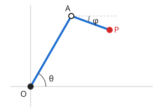

# Kempe 보편성 정리

# 개요

**Kempe 보편성 정리(Kempe's universality theorem)** 는 평면의 대수곡선에서 유계인 조각을 하나 잘라 내면, 막대와 관절만으로 된 장치 가운데 한 관절이 그 조각을 정확히 그리는 것이 있다는 정리다. [Peaucellier–Lipkin 연결 장치](peaucellier-lipkin-linkage.md)는 직선을 그리는데, 같은 방법으로 두 직선 $x^2=y^2$ 이나 타원 같은 곡선도 그릴 수 있는지가 물음이다. 곡선의 식을 관절의 각도에 대한 코사인의 합으로 바꾸고, 각을 더하고 곱하는 장치를 이어 그 합을 한 점의 좌표로 만든 뒤, 그 점을 직선 위에 묶으면 곡선이 그려진다.

# 직관

길이 $1$ 인 막대 둘을 고정점 $O$ 에서 이어 팔을 만든다. 첫 막대가 가로축과 이루는 각을 $\theta$, 둘째 막대의 각을 $\varphi$ 라 하면 팔 끝 $P$ 의 좌표는 다음과 같다.

$$
x=\cos\theta+\cos\varphi,\qquad y=\sin\theta+\sin\varphi
$$

그림의 $P$ 는 $O$ 에서 거리 $2$ 안의 모든 점에 갈 수 있다. 이 팔로 두 직선 $x^2-y^2=0$ 의 조각을 그리려면 $P$ 가 그 곡선을 벗어나지 못하게 묶어야 한다.

$x$ 와 $y$ 를 넣고 곱을 합으로 바꾸면 다음이 나온다.

$$
x^2-y^2=\cos 2\theta+\cos 2\varphi+2\cos(\theta+\varphi)
$$

$\theta=\pi/4$, $\varphi=-\pi/4$ 이면 $P=(\sqrt2,0)$ 이고 왼쪽은 $2$, 오른쪽은 $0+0+2$ 다.

오른쪽은 막대 셋의 가로 성분을 더한 것이다. 길이 $1$ 이고 각 $2\theta$ 인 막대, 길이 $1$ 이고 각 $2\varphi$ 인 막대, 길이 $2$ 이고 각 $\theta+\varphi$ 인 막대를 $O$ 에서 이어 놓으면 끝점 $Q$ 의 가로 좌표가 $x^2-y^2$ 이다. 각 $2\theta$ 와 $\theta+\varphi$ 를 만드는 장치를 팔에 붙이고 $Q$ 를 Peaucellier–Lipkin 연결 장치로 세로축 위에 묶으면, $P$ 는 $x^2=y^2$ 위만 움직인다.

# 정의

## 연결 장치

평면의 **연결 장치(linkage)** 는 관절과, 두 관절 사이의 거리를 고정하는 막대와, 위치가 고정된 관절로 이루어진다. 관절의 위치를 막대 길이를 지키도록 정한 것을 장치의 배치(configuration)라 한다. 직관 절의 팔은 고정 관절 $O$, 관절 $A$ 와 $P$, 막대 $OA$ 와 $AP$ 로 된 연결 장치다.

## 곡선을 그리는 장치

관절 $P$ 가 장치의 모든 배치에서 차지하는 위치의 집합이 곡선 조각 $K$ 와 같으면 장치가 $K$ 를 **그린다(draws)** 고 한다. Peaucellier–Lipkin 연결 장치는 직선의 선분을 그린다.

## Kempe 의 세 장치

각 $\theta$, $\varphi$ 를 막대의 방향으로 가진 장치에서 새 막대의 방향을 정하는 장치 세 가지를 쓴다.

- 각 더하기 장치(additor). 방향이 $\theta+\varphi$ 인 막대를 만든다.
- 각 곱하기 장치(multiplicator). 정수 $r$ 에 대해 방향이 $r\theta$ 인 막대를 만든다.
- 평행이동 장치(translator). 막대 하나를 같은 방향으로 다른 관절에 옮겨 붙인다. 평행사변형 하나로 된다.

더하기 장치와 곱하기 장치는 마주 보는 변의 길이가 같고 두 변이 엇갈린 사각형, 곧 엇평행사변형(contraparallelogram)을 이어서 만든다.

# 성질

## Kempe 보편성 정리

$f(x,y)$ 가 실수 계수 다항식이고 $D$ 가 닫힌 원판이면, $\lbrace f=0\rbrace\cap D$ 를 그리는 연결 장치가 있다.

증명의 요지. $D$ 의 모든 점에 닿도록 두 팔의 길이를 잡고, 두 팔의 각 $\theta$, $\varphi$ 로 $D$ 의 점을 적고 $x$, $y$ 를 $f$ 에 넣는다. 코사인과 사인의 곱을 합으로 바꾸면 $f$ 는 다음 꼴이 된다.

$$
f=c+\sum_j a_j\cos(r_j\theta+s_j\varphi+\alpha_j)
$$

여기서 $r_j$, $s_j$ 는 정수다. 항마다 곱하기 장치와 더하기 장치로 방향이 $r_j\theta+s_j\varphi+\alpha_j$ 이고 길이가 $a_j$ 인 막대를 만들고, 평행이동 장치로 막대들을 끝과 끝으로 잇는다. 끝점의 가로 좌표가 $f-c$ 이므로, 끝점을 Peaucellier–Lipkin 연결 장치로 직선 $x=-c$ 위에 묶으면 $P$ 는 $f=0$ 위만 움직인다.

## 증명의 결함과 고침

Kempe 의 1876 년 증명[^1]에서 평행사변형과 엇평행사변형은 네 꼭짓점이 한 직선 위에 놓이는 배치를 지나면 다른 쪽으로 접힐 수 있다. 평행사변형이 엇평행사변형으로 바뀌면 각 더하기와 곱하기가 성립하지 않으므로, 장치의 $P$ 가 곡선 밖의 점까지 그린다. 각 사각형에 막대를 덧대어 접히지 않게 하면 이 문제가 없어지고, Kapovich 와 Millson 이 2002 년에 이 방법으로 정리를 증명했다[^2].

## 배치 공간의 보편성

Kapovich 와 Millson 은 더 강한 정리도 증명했다[^2]. 실수 계수 다항식들의 공통 영점으로 된 콤팩트 집합은 모두 어느 평면 연결 장치의 배치 공간의 연결 성분들과 미분동형이다.

# 활용

- 대수곡선의 기계적 작도. 직관 절처럼 곡선의 식을 코사인의 합으로 바꾸어 막대의 방향과 길이를 정한다. 막대의 수는 다항식의 차수가 높을수록 빠르게 늘어난다.
- 로봇 팔의 배치 공간. 배치 공간의 보편성 정리는 관절로 이은 팔이 움직일 수 있는 자세들의 집합이 위상적으로 어떤 모양이든 될 수 있다는 것을 보인다.

[^1]: A. B. Kempe, "On a general method of describing plane curves of the nth degree by linkwork", Proceedings of the London Mathematical Society 7 (1876), 213–216.
[^2]: M. Kapovich, J. J. Millson, "Universality theorems for configuration spaces of planar linkages", Topology 41 (2002), 1051–1107.

# 연관 문서

## 선수지식

- [Peaucellier–Lipkin 연결 장치](peaucellier-lipkin-linkage.md)

## 더 알아보기

아직 연결한 문서가 없다.

#algebra #complex_analysis #differential_geometry
