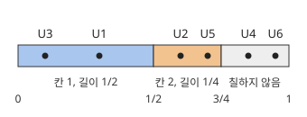

# Kingman 표현정리

# 개요

**Kingman 표현정리(Kingman's representation theorem)** 는 번호를 바꾸어 붙여도 확률이 그대로인 무작위 분할이 모두 한 가지 방법으로 만들어진다는 정리다. 손님이 차례로 들어와 이미 앉은 사람 수에 비례하는 확률로 식탁을 고르면, 앉는 규칙은 도착 순서에 따르는데도 손님 셋이 둘과 하나로 나뉘는 세 가지 방식의 확률이 모두 같다. Kingman 표현정리에 따르면 이런 분할은 먼저 식탁마다의 비율을 무작위로 정하고, 손님마다 그 비율에 따라 서로 독립으로 식탁을 고르게 해서 얻는 것과 같다.

# 직관

[Ewens 표본 공식](ewens-sampling-formula.md)의 순차 규칙에서 $\theta=1$ 로 둔다. $n$ 명이 앉아 있으면 $n+1$ 번째 손님은 $k$ 명이 앉은 식탁에 확률 $k/(n+1)$ 로, 새 식탁에 확률 $1/(n+1)$ 로 앉는다. 손님 $1,2,3$ 이 한 식탁에 앉을 확률은 $\frac12\cdot\frac23=\frac13$ 이고, $\lbrace 1,2\rbrace\lbrace 3\rbrace$, $\lbrace 1,3\rbrace\lbrace 2\rbrace$, $\lbrace 2,3\rbrace\lbrace 1\rbrace$ 은 각각 $\frac16$ 이며, 모두 따로 앉을 확률도 $\frac16$ 이다. 둘과 하나로 나뉘는 세 분할의 확률이 같으므로 번호를 바꾸어도 분포가 바뀌지 않는다.

[de Finetti 정리](de-finetti-theorem.md)는 번호를 바꾸어도 분포가 같은 수열을, 분포를 먼저 무작위로 뽑은 뒤 그 분포에서 독립으로 값을 뽑는 것으로 적는다. 분할에는 값이 없고 식탁에 이름도 없으므로 이 정리를 그대로 쓸 수 없다. 대신 손님 수가 늘 때 각 식탁에 앉은 손님의 비율을 본다. $\theta=1$ 에서 손님 $1$ 의 식탁에 앉은 비율은 $[0,1]$ 의 균등분포를 따르는 수로 수렴한다.

비율 $s_1,s_2,\dots$ 가 정해지면 손님은 서로 독립으로 확률 $s_i$ 로 $i$ 번째 식탁을 고르는 것과 같다. 아래 그림처럼 $[0,1]$ 을 길이 $s_i$ 인 칸으로 칠하고 손님마다 균등난수 $U$ 를 뽑아 같은 칸에 떨어진 손님끼리 묶으면 된다. 그림은 $s=(1/2,1/4)$ 에서 여섯 손님이 $\lbrace 1,3\rbrace$, $\lbrace 2,5\rbrace$, $\lbrace 4\rbrace$, $\lbrace 6\rbrace$ 으로 나뉜 것이다. 칠하지 않은 부분에 떨어진 손님 $4$ 와 $6$ 은 혼자 앉는다.

# 정의

## 교환가능한 무작위 분할

자연수 집합 $\mathbb N=\lbrace 1,2,\dots\rbrace$ 의 무작위 분할 $\Pi$ 를 $\lbrace 1,\dots,n\rbrace$ 에 제한한 것을 $\Pi_n$ 이라 하자. 모든 $n$ 과 $\lbrace 1,\dots,n\rbrace$ 의 모든 순열 $\sigma$ 에서 $\sigma(\Pi_n)$ 과 $\Pi_n$ 의 분포가 같으면 $\Pi$ 를 **교환가능한 무작위 분할(exchangeable random partition)** 이라 한다. 직관 절의 식탁 배치는 교환가능한 무작위 분할이다.

교환가능하면 $\Pi_n$ 이 블록 $A_1,\dots,A_k$ 로 나뉠 확률은 블록 크기만의 대칭함수 $p(\vert A_1\vert,\dots,\vert A_k\vert)$ 다. 이 $p$ 를 **교환가능 분할 확률 함수(exchangeable partition probability function, EPPF)** 라 한다. 직관 절의 배치에서 EPPF 는 Ewens 표본 공식의 다음 식이다.

$$
p(n_1,\dots,n_k)=\frac{\theta^k}{\theta^{(n)}}\prod_{i=1}^k(n_i-1)!
$$

$\theta=1$, $n=3$ 이면 $p(2,1)=1/6$, $p(3)=2/6$, $p(1,1,1)=1/6$ 이다.

## 물감 상자 분할

**Kingman 단체(Kingman simplex)** $\nabla$ 는 $s_1\ge s_2\ge\cdots\ge 0$ 이고 $\sum_is_i\le 1$ 인 수열 $s$ 전체다. $s\in\nabla$ 에 대해 $[0,1]$ 의 서로소인 구간 $I_1,I_2,\dots$ 를 길이가 $s_1,s_2,\dots$ 이 되게 잡고, 균등분포를 따르는 독립인 $U_1,U_2,\dots$ 를 뽑는다. $i\ne j$ 를 $U_i$ 와 $U_j$ 가 같은 $I_k$ 에 들 때만 같은 블록에 넣은 분할을 $s$ 의 **물감 상자 분할(paintbox partition)** 이라 한다. 어느 $I_k$ 에도 들지 않은 $U_i$ 의 번호 $i$ 는 혼자 블록을 이룬다.

직관 절의 그림은 $s=(1/2,1/4)$ 의 물감 상자 분할이다. 손님 $1$ 과 $2$ 가 같은 블록에 들 확률은 $s_1^2+s_2^2=5/16$ 이다.

## 점근 빈도

블록 $B\subseteq\mathbb N$ 의 **점근 빈도(asymptotic frequency)** 는 극한 $\lim_n\vert B\cap\lbrace 1,\dots,n\rbrace\vert/n$ 이다. 물감 상자 분할에서는 [대수의 법칙](law-of-large-numbers.md)에 따라 $I_k$ 에 떨어진 번호들의 블록이 점근 빈도 $s_k$ 를 갖고, 혼자인 블록의 빈도는 $0$ 이다. 그림의 분할에서 손님을 계속 더하면 파란 칸 블록의 빈도는 $1/2$ 로 간다.

# 성질

## Kingman 표현정리

**정리.** $\Pi$ 가 교환가능한 무작위 분할이면 거의 확실하게 모든 블록이 점근 빈도를 갖는다. 그 빈도를 큰 순서로 늘어놓은 것을 $S\in\nabla$ 라 하면, $S$ 가 주어졌을 때 $\Pi$ 의 조건부 분포는 $S$ 의 물감 상자 분할이다[^1].

곧 $\Pi$ 의 분포는 $\nabla$ 위의 확률측도 $\mu$ 하나로 다음과 같이 쓰이고, $\mu$ 는 $S$ 의 분포로 유일하게 정해진다.

$$
P(\Pi\in\cdot)=\int_\nabla P\_s(\cdot)\thinspace\mu(ds)
$$

여기서 $P_s$ 는 $s$ 의 물감 상자 분할의 분포다. 직관 절의 배치에서 $\mu$ 는 매개변수 $1$ 인 Poisson–Dirichlet 분포(Poisson–Dirichlet distribution)다.

## 증명의 요지

Aldous 의 증명은 de Finetti 정리를 쓴다[^2]. $\Pi$ 와 독립인 균등난수 $V_1,V_2,\dots$ 를 뽑고, 번호 $i$ 에 $X_i=V\_{m(i)}$ 를 붙인다. $m(i)$ 는 $i$ 가 든 블록의 가장 작은 번호다. $\Pi$ 가 교환가능하므로 수열 $X_1,X_2,\dots$ 도 교환가능하다.

de Finetti 정리에 따라 $X_i$ 들은 무작위 분포 $\nu$ 가 주어졌을 때 $\nu$ 에서 독립으로 뽑은 것이다. $\nu$ 의 원자 하나가 빈도가 양수인 블록 하나이고 원자의 무게가 그 빈도이며, $\nu$ 의 연속인 부분이 혼자인 블록들이다. $i$ 와 $j$ 가 같은 블록인 것은 거의 확실하게 $X_i=X_j$ 인 것과 같으므로, $\nu$ 에서 독립으로 뽑는 것이 물감 상자 분할이다.

## 두 번호가 같은 블록에 들 확률

정리의 적분에서 $1$ 과 $2$ 가 같은 블록에 들 확률은 다음이다.

$$
P(1\sim 2)=E\Bigl\lbrack\sum_iS_i^2\Bigr\rbrack
$$

직관 절의 배치에서 좌변은 $1/2$ 이므로 매개변수 $1$ 인 Poisson–Dirichlet 분포에서 $E\lbrack\sum S_i^2\rbrack=1/2$ 이다. 일반적인 $\theta$ 에서는 두 값이 모두 $1/(1+\theta)$ 다.

## 극단인 분포

물감 상자 분할의 분포 $P_s$ 는 교환가능한 무작위 분할의 분포들이 이루는 볼록 집합의 극단점이고, 극단점은 이것뿐이다. 그래서 정리는 이 볼록 집합이 극단점에 대한 적분 표현이 유일한 단체라는 것을 말한다. $\nabla$ 는 무한 대칭군의 극단 지표를 분류하는 [Thoma 정리](thoma-theorem.md)의 매개변수 공간에서 $\beta=0$ 인 부분과 같다.

# 활용

- Dirichlet 과정. [Dirichlet 과정](dirichlet-process.md)에서 뽑은 값들이 같은지로 만든 분할은 직관 절의 배치와 같고, 정리의 $\mu$ 가 Poisson–Dirichlet 분포다. [Pitman–Yor 과정](pitman-yor-process.md)은 두 매개변수로 이 분포를 넓힌 것이다.
- 합류 과정. [Kingman 합류](kingman-coalescent.md)의 각 시각의 분할은 교환가능하고, 양의 시각에서는 블록이 유한 개라 빈도의 합이 $1$ 이다. Pitman 과 Schweinsberg 는 블록 여럿이 한꺼번에 합쳐지는 교환가능한 합류 과정을, 한 번에 합쳐지는 블록들을 물감 상자 분할로 고르는 것으로 분류했다[^3].
- 분열 과정. 블록이 시간에 따라 쪼개지는 교환가능한 분열 과정도 쪼개는 방식이 물감 상자 분할로 적히고, Bertoin 은 이것으로 분열 과정을 분류했다[^3].
- 비모수 Bayes 통계. 군집의 수를 미리 정하지 않는 혼합 모형에서 군집 배정의 사전분포를 EPPF 로 주면, 정리에 따라 그 사전분포는 군집 비율의 사전분포 $\mu$ 와 같은 정보다.

[^1]: J. F. C. Kingman, "The representation of partition structures", Journal of the London Mathematical Society (2) 18 (1978), 374–380.
[^2]: D. J. Aldous, "Exchangeability and related topics", École d'Été de Probabilités de Saint-Flour XIII, Lecture Notes in Mathematics 1117, Springer, 1985, 11 절.
[^3]: J. Pitman, *Combinatorial Stochastic Processes*, Lecture Notes in Mathematics 1875, Springer, 2006, 2 장과 4 장.

# 연관 문서

## 선수지식

- [de Finetti 정리](de-finetti-theorem.md)
- [Ewens 표본 공식](ewens-sampling-formula.md)

## 더 알아보기

아직 연결한 문서가 없다.

#probability #combinatorics #statistics
