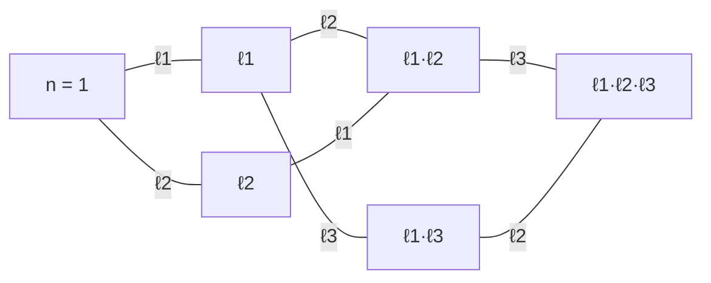

# Kolyvagin 계

# 개요

**Kolyvagin 계(Kolyvagin system)** 는 제곱인수 없는 정수로 번호를 붙인 [Galois 코호몰로지](galois-cohomology.md) 류들이 소수마다 유한 특이 사상으로 이어지는 모임이고, [Selmer 군](selmer-tate-shafarevich.md)의 크기를 상계와 하계 양쪽에서 정한다. [Euler 계](euler-systems.md)는 Selmer 군이 어떤 크기 이하라는 상계만 주므로, 타원곡선의 Selmer 군이 정확히 몇 개의 원소를 갖는지는 Euler 계만으로 나오지 않는다. Kolyvagin 계는 Euler 계에서 만든 류들이 만족하는 성질만 정의로 삼고, 국소 자료로 계산되는 정수 하나가 $1$ 이면 그런 족의 생성원 하나가 Selmer 군의 크기를 정확히 준다.

# 직관

Euler 계의 논법은 유도류 $\kappa_n$ 들로 Selmer 군의 크기에 상계를 준다. 상계가 등식이 되려면 $\kappa_n$ 들이 Selmer 군을 남김없이 덮어야 한다. 그러려면 $\kappa_n$ 들이 이루는 모임이 얼마나 큰지를 알아야 한다.

증명에 쓰이는 것은 $\kappa_n$ 의 두 성질뿐이다. 첫째, $\kappa_n$ 은 $n$ 의 소인수 $\ell$ 에서 원래 국소 조건 대신 정해진 다른 국소 조건을 만족하고, 나머지 자리에서는 원래 조건을 만족한다. 둘째, $\ell$ 에서 $\kappa_n$ 의 성분과 $\kappa_{n\ell}$ 의 성분이 고정된 동형으로 대응한다. Mazur 와 Rubin 은 이 두 성질을 만족하는 족을 Kolyvagin 계라 부르고, 이런 족 전체가 이루는 가군을 연구했다.

그 가군의 크기는 정수 하나로 정해진다. 국소 조건을 정한 Selmer 군의 차원에서 그 쌍대 Selmer 군의 차원을 뺀 값이다. 이 값은 [Poitou–Tate 완전열](poitou-tate.md)의 Greenberg–Wiles 공식으로 자리마다 국소 차원을 세어 더하면 나온다. 유리수 위 타원곡선 $E$ 와 $p\ge5$ 에서 $E\lbrack p\rbrack$ 의 Kummer 조건을 쓰면, 실수 자리가 $-1$, $p$ 가 $+1$, 나머지 자리가 $0$ 을 내어 합이 $0$ 이다.

합이 $0$ 이면 두 Selmer 군의 차원이 같아 정합 조건을 모두 만족하는 족은 $0$ 뿐이다. $p$ 에서 조건을 없애면 $p$ 의 기여가 $+2$ 가 되어 합이 $1$ 이 된다. 합이 $1$ 이면 족 전체가 원소 하나의 배수들이고, 그 원소 하나가 쌍대 Selmer 군의 크기를 정확히 준다. 이 정수가 핵심계수(core rank)다.

# 정의

이하 $K$ 는 수체, $R$ 은 $\mathbb Z/p^k$ 또는 $\mathbb Z_p$ 이고 $T$ 는 $R$ 위 유한 생성 자유가군이며 $G_K$ 가 연속으로 작용한다. $T^\ast=\mathrm{Hom}(T,\mu_{p^k})$ 는 Cartier 쌍대다.

## Selmer 구조

**Selmer 구조(Selmer structure)** $\mathcal F$ 는 다음 자료다.

- $p$, $\infty$, $T$ 가 분기하는 자리를 모두 포함하는 유한집합 $\Sigma$
- 각 $v\in\Sigma$ 마다 부분가군 $H^1_{\mathcal F}(K_v,T)\subseteq H^1(K_v,T)$

$v\notin\Sigma$ 에서는 비분기 조건 $H^1_{\mathrm{ur}}(K_v,T)=H^1(K_v^{\mathrm{ur}}/K_v,T^{I_v})$ 를 쓴다. Selmer 군은

$$
H^1_{\mathcal F}(K,T)=\ker\Bigl(H^1(K_\Sigma/K,T)\longrightarrow\bigoplus_{v\in\Sigma}\frac{H^1(K_v,T)}{H^1_{\mathcal F}(K_v,T)}\Bigr)
$$

이다. **쌍대 구조(dual Selmer structure)** $\mathcal F^\ast$ 는 각 자리에서 국소 Tate 짝에 대한 소멸자 $H^1_{\mathcal F^\ast}(K_v,T^\ast)=H^1_{\mathcal F}(K_v,T)^{\perp}$ 이다. $T\cong T^\ast$ 이고 $\mathcal F=\mathcal F^\ast$ 이면 $\mathcal F$ 를 **자기쌍대(self-dual)** 라 한다. 타원곡선 $E$ 의 $T=E\lbrack p\rbrack$ 에서 $H^1_{\mathcal F}(K_v,T)$ 를 Kummer 사상 $E(K_v)/pE(K_v)\to H^1(K_v,E\lbrack p\rbrack)$ 의 상으로 고르면 $H^1_{\mathcal F}(K,T)$ 가 $p$ Selmer 군이고, Weil 짝으로 이 구조는 자기쌍대다.

## 세 가지 변형

한 자리 $\ell$ 에서 조건을 바꾸는 방식은 셋이다.

| 이름 | ℓ 에서의 조건 | 기호 |
| --- | --- | --- |
| 완화(relaxed) | $H^1(K_\ell,T)$ 전체 | $\mathcal F^{\ell}$ |
| 엄격(strict) | $0$ | $\mathcal F_{\ell}$ |
| 가로지름(transverse) | 아래 $H^1_{\mathrm{tr}}(K_\ell,T)$ | $\mathcal F(\ell)$ |

완화 구조의 쌍대는 엄격 구조이고, 엄격 구조의 쌍대는 완화 구조다. 위 $E\lbrack p\rbrack$ 의 예에서 $\mathcal F^p$ 는 $p$ 에서 아무 조건도 두지 않은 Selmer 군이고 $(\mathcal F^p)^\ast=\mathcal F_p$ 는 $p$ 에서 국소 성분이 $0$ 인 것만 남긴 Selmer 군이다.

## Kolyvagin 소수

**Kolyvagin 소수(Kolyvagin prime)** 는 $\ell\notin\Sigma$ 이면서 $\ell\equiv1\pmod{p^k}$ 이고 $T/(\mathrm{Fr}\_\ell-1)T$ 가 순위 $1$ 인 자유 $R$ 가군인 소수다. $\mathrm{Fr}\_\ell$ 은 $\ell$ 의 Frobenius 원소다. $K=\mathbb Q$, $T=E\lbrack p\rbrack$ 이면 $\mathrm{Fr}\_\ell$ 의 행렬식이 $\ell\equiv1$ 이므로, 조건은 $a_\ell\equiv2\pmod p$ 이고 $\mathrm{Fr}\_\ell$ 이 $E\lbrack p\rbrack$ 위에서 항등이 아닌 것이다. 그러면 $\mathrm{Fr}\_\ell$ 은 $\begin{pmatrix}1&1\cr 0&1\end{pmatrix}$ 과 켤레다.

Kolyvagin 소수에서 국소 코호몰로지가 두 조각으로 갈린다.

$$
H^1(K_\ell,T)=H^1_{\mathrm{ur}}(K_\ell,T)\oplus H^1_{\mathrm{tr}}(K_\ell,T),\qquad H^1_{\mathrm{ur}}(K_\ell,T)\cong T/(\mathrm{Fr}\_\ell-1)T\cong R
$$

$H^1_{\mathrm{tr}}(K_\ell,T)$ 는 $K_\ell$ 의 차수 $p^k$ 인 완전 분기 순분기 확대 $K_\ell(\ell^{1/p^k})$ 로 제한하면 $0$ 이 되는 류들이고, 이것도 $R$ 과 동형이다. **가로지름 조건(transverse condition)** 은 $\ell$ 에서 $H^1_{\mathrm{ur}}$ 대신 $H^1_{\mathrm{tr}}$ 를 쓰는 것이다.

$\mathcal N$ 을 Kolyvagin 소수들의 제곱인수 없는 곱의 집합이라 하고, $n\in\mathcal N$ 에 대해 $\mathcal F(n)$ 은 $n$ 의 모든 소인수에서 가로지름 조건으로 바꾼 구조다. $\mathcal N$ 은 $n$ 과 $n\ell$ 을 잇는 간선으로 [그래프](graphs.md)가 된다. 다음은 소수 $\ell_1,\ell_2,\ell_3$ 에서 나오는 정점 일부다.

## 유한-특이 사상

Kolyvagin 소수 $\ell$ 에서 $\ell\equiv1\pmod{p^k}$ 와 $T/(\mathrm{Fr}\_\ell-1)T\cong R$ 을 쓰면 동형

$$
\phi_\ell^{\mathrm{fs}}\colon H^1_{\mathrm{ur}}(K_\ell,T)\thickspace\xrightarrow{\sim}\thickspace H^1_{\mathrm{tr}}(K_\ell,T)
$$

이 정해진다. 이것이 **유한-특이 사상(finite-singular map)** 이다. 비분기 류는 $T/(\mathrm{Fr}\_\ell-1)T$ 의 원소로, 가로지름 류는 순분기 관성군에서 $T$ 로 가는 준동형으로 적히고, $\phi_\ell^{\mathrm{fs}}$ 는 둘 사이의 동형이다.

## Kolyvagin 계

**Kolyvagin 계** 는 다음 조건을 만족하는 족 $\kappa=(\kappa_n)\_{n\in\mathcal N}$ 이다.

$$
\kappa_n\in H^1_{\mathcal F(n)}(K,T),\qquad
\phi_\ell^{\mathrm{fs}}\bigl(\mathrm{loc}\_\ell(\kappa_n)\bigr)=\mathrm{loc}\_\ell(\kappa_{n\ell})\quad(n\ell\in\mathcal N)
$$

$\ell\nmid n$ 이므로 $\mathrm{loc}\_\ell(\kappa_n)$ 은 비분기 류이고, $\kappa_{n\ell}$ 은 $\ell$ 에서 가로지름 조건을 만족하므로 양변이 같은 군에 있다. 이런 족 전체는 $R$ 가군이고 $\mathbf{KS}(T,\mathcal F,\mathcal P)$ 로 적는다. $\mathcal P$ 는 쓰는 Kolyvagin 소수의 집합이다. 위 그래프에서 Kolyvagin 계는 정점마다 류 하나를 두고, 간선 $\ell$ 의 두 끝에 둔 류의 $\ell$ 성분이 $\phi_\ell^{\mathrm{fs}}$ 로 대응하게 한 것이다.

## 핵심계수

$\bar T=T/\mathfrak mT$ 라 하자. **핵심계수(core rank)** 는

$$
\chi(\mathcal F)=\dim_{\mathbb F_p}H^1_{\mathcal F}(K,\bar T)-\dim_{\mathbb F_p}H^1_{\mathcal F^\ast}(K,\bar T^\ast)
$$

이다. 직관 절의 $E\lbrack p\rbrack$ 예에서 Kummer 조건의 $\chi$ 는 $0$ 이고 $p$ 에서 완화한 $\chi(\mathcal F^p)$ 는 $1$ 이다(성질 절에서 계산한다).

# 성질

## 국소 자료로 쓴 핵심계수

Greenberg–Wiles 공식을 $\bar T$ 에 쓰면

$$
\chi(\mathcal F)=\sum_v\Bigl(\dim H^1_{\mathcal F}(K_v,\bar T)-\dim H^0(K_v,\bar T)\Bigr)+\dim H^0(K,\bar T)-\dim H^0(K,\bar T^\ast)
$$

이고 오른쪽은 전부 국소 계산이다. $v\notin\Sigma$ 의 항은 $0$ 이라 유한합이다.

## 시소 보조정리

$\mathcal F\subseteq\mathcal F'$ 가 자리 $\ell$ 하나에서만 다르면, Greenberg–Wiles 공식을 두 구조에 써서 나누어

$$
\frac{\char35{}H^1_{\mathcal F'}(K,\bar T)}{\char35{}H^1_{\mathcal F}(K,\bar T)}\cdot\frac{\char35{}H^1_{\mathcal F^\ast}(K,\bar T^\ast)}{\char35{}H^1_{\mathcal F'^\ast}(K,\bar T^\ast)}=\frac{\char35{}H^1_{\mathcal F'}(K_\ell,\bar T)}{\char35{}H^1_{\mathcal F}(K_\ell,\bar T)}
$$

을 얻는다. 조건을 넓히면 Selmer 군은 커지거나 그대로이고 쌍대 Selmer 군은 작아지거나 그대로이며, 두 변화의 곱이 국소 크기의 비다.

- Kolyvagin 소수 $\ell$ 에서 비분기 조건을 완화하면 오른쪽이 $p$ 이므로 $\chi$ 가 $1$ 커진다.
- 비분기 조건을 가로지름 조건으로 바꾸면 두 조건의 크기가 같아 $\chi$ 가 그대로다. 그래서 모든 $n\in\mathcal N$ 에서 $\chi(\mathcal F(n))=\chi(\mathcal F)$ 다.

## 타원곡선의 핵심계수

$K=\mathbb Q$, $T=E\lbrack p\rbrack$, $p\ge5$ 이고 $E\lbrack p\rbrack$ 이 기약이며 $E$ 가 $p$ 에서 좋은 환원을 갖는다고 하자. Kummer 조건의 자리별 기여는 다음과 같다. 기약이므로 $H^0(\mathbb Q,T)=H^0(\mathbb Q,T^\ast)=0$ 이다.

| 자리 v | 국소 조건의 차원 | H⁰(K_v, T) 의 차원 | 기여 |
| --- | --- | --- | --- |
| $\infty$ | $0$ | $1$ | $-1$ |
| $p$ | $\dim H^0(\mathbb Q_p,T)+1$ | $\dim H^0(\mathbb Q_p,T)$ | $+1$ |
| 그 밖의 $\ell$ | $\dim H^0(\mathbb Q_\ell,T)$ | 같음 | $0$ |

$p$ 가 홀수라 $H^1(\mathbb R,T)=0$ 이고, 복소켤레의 행렬식이 $-1$ 이라 고유공간이 $1$ 차원씩 갈려 $\dim H^0(\mathbb R,T)=1$ 이다. 합이 $0$ 이므로 $\chi=0$ 이고, 자기쌍대 구조에서는 두 Selmer 군이 같아 $\chi=0$ 이 정의에서도 나온다.

$p$ 에서 조건을 $H^1(\mathbb Q_p,T)$ 전체로 바꾸면 그 차원은 국소 Euler 표수 공식으로 $2+2\dim H^0(\mathbb Q_p,T)$ 이고 기여가 $2+\dim H^0(\mathbb Q_p,T)$ 가 된다. $E(\mathbb Q_p)\lbrack p\rbrack=0$ 이면 $\chi(\mathcal F^p)=-1+2=1$ 이다. 이 구조의 쌍대는 $p$ 에서 엄격한 구조이므로, Kolyvagin 계가 크기를 주는 대상은 엄격 Selmer 군이다.

## Mazur–Rubin 구조 정리

잔여 표현 $\bar T$ 가 기약이고 상이 충분히 크다는 가설 아래 다음이 성립한다[^1].

- $\chi(\mathcal F)=0$ 이면 $\mathbf{KS}(T,\mathcal F,\mathcal P)=0$ 이다.
- $\chi(\mathcal F)=1$ 이면 $\mathbf{KS}(T,\mathcal F,\mathcal P)$ 는 순위 $1$ 인 자유 $R$ 가군이다.

$\chi=1$ 이면 서로 다른 Euler 계에서 나온 Kolyvagin 계가 한 생성원의 배수이므로, Euler 계마다 남는 정보는 그 계가 생성원의 몇 배인지뿐이다.

## Selmer 군의 계산

$R=\mathbb Z_p$, $\chi=1$ 이라 하자. $\kappa\in\mathbf{KS}$ 의 성분 $\kappa_n$ 이 $p$ 의 몇 제곱으로 나누어지는지를 $\partial(\kappa_n)$ 이라 하고, $i\ge0$ 에 대해

$$
\partial^{(i)}(\kappa)=\min\lbrace\thinspace\partial(\kappa_n) \thinspace:\thinspace n\in\mathcal N,\thinspace \nu(n)=i\thinspace\rbrace
$$

로 두면($\nu(n)$ 은 $n$ 의 소인수 개수), $\partial^{(i)}$ 는 $i$ 에 대해 감소하는 열이고 극한 $\partial^{(\infty)}(\kappa)$ 가 있다. Mazur–Rubin 의 정리는

$$
\mathrm{length}\_{\mathbb Z_p}\thinspace H^1_{\mathcal F^\ast}(K,T^\ast)=\partial^{(0)}(\kappa)-\partial^{(\infty)}(\kappa)
$$

이고, 차이 $\partial^{(i)}-\partial^{(i+1)}$ 들이 쌍대 Selmer 군의 초등인자다. $\kappa$ 가 생성원이면 $\partial^{(\infty)}(\kappa)=0$ 이다. Euler 계에서 온 $\kappa$ 에 대해서는 이 식이 상계 $\mathrm{length}\le\partial^{(0)}(\kappa)$ 를 주고, $\kappa$ 가 생성원이면 등식이다.

$\kappa_1$ 이 $p$ 로 나누어지지 않으면 $\partial^{(0)}(\kappa)=0$ 이므로 $H^1_{\mathcal F^\ast}(K,T^\ast)=0$ 이다. 이것이 Kolyvagin 의 고전적 결론의 이 형식에서의 꼴이다.

## 핵심 정점

$n\in\mathcal N$ 이 $H^1_{\mathcal F(n)^\ast}(K,\bar T^\ast)=0$ 을 만족하면 **핵심 정점(core vertex)** 이라 한다. 핵심 정점에서는 $\dim H^1_{\mathcal F(n)}(K,\bar T)=\chi$ 이다. 임의의 $n$ 에 Kolyvagin 소수를 몇 개 곱해 핵심 정점에 닿을 수 있다는 것이 [Chebotarev 밀도 정리](chebotarev.md)로 증명되고, 구조 정리의 증명은 이 사실을 쓴다.

# 활용

## Euler 계에서 Kolyvagin 계로

Euler 계에 Kolyvagin 유도 연산자를 쓰면 유도류 $\kappa_n$ 이 나오고, Euler 계의 자취 관계에서 유한-특이 사상의 정합 조건이 나온다. 이렇게 $R$ 선형 사상 $\lbrace\text{Euler 계}\rbrace\to\mathbf{KS}(T,\mathcal F,\mathcal P)$ 가 정의된다(원전 3 장). $\chi=1$ 이면 그 상은 순위 $1$ 인 자유가군 안에 있으므로, 남는 계산은 상이 생성원의 몇 배인지다.

## 원분체의 류군

짝수 Dirichlet 지표로 꼰 $T=\mathbb Z_p(1)$ 과 원분 단수(cyclotomic units)의 Euler 계가 원형이다. 실수 자리의 기여로 핵심계수가 $1$ 이고, Kolyvagin 계는 [원분체](cyclotomic-fields.md)의 이데알류군의 지표 성분마다 크기의 상계를 준다. 해석적 류수 공식이 지표 성분 크기의 곱을 주므로 상계가 모두 등식이 된다. 이 논법의 Iwasawa 판이 Rubin 이 얻은 원분 [Iwasawa 주추측](iwasawa-main-conjecture.md)의 증명이고, 주추측은 Mazur–Wiles 가 먼저 다른 방법으로 증명했다.

## 타원곡선의 Selmer 군

$T=T_p(E)$ 에서 $p$ 를 완화한 구조의 핵심계수가 $1$ 이고, Kato 의 zeta 원소(Kato's zeta elements)의 Euler 계가 그 구조의 Kolyvagin 계를 준다. 결론은 타원곡선의 원분 Iwasawa 주추측의 한쪽 나눔이고, 반대쪽 나눔은 Skinner–Urban 이 Eisenstein 합동으로 증명했다. [Heegner 점](heegner-points.md)의 Euler 계에서 나오는 Kolyvagin 계와 Gross–Zagier 공식을 합치면, 해석적 순위가 $1$ 이하일 때 $E(\mathbb Q)$ 의 순위가 해석적 순위와 같고 $\text{Ш}(E/\mathbb Q)$ 가 유한하다는 Kolyvagin 의 정리이 나온다. 이것이 [Birch–Swinnerton-Dyer 추측](birch-swinnerton-dyer.md)(Birch and Swinnerton-Dyer conjecture, BSD)의 순위 $1$ 이하 경우다.

## 이분 Euler 계

허수이차체 위의 반순환(anticyclotomic) 상황에서는 $n$ 의 소인수 개수의 홀짝에 따라 함수방정식의 부호가 바뀌어, 핵심계수가 $1$ 인 정점과 $0$ 인 정점이 번갈아 나온다. Howard 는 홀수 쪽 정점에 Heegner 점에서 온 류를, 짝수 쪽 정점에 [모듈러 형식](modular-forms.md)의 특수값을 두는 족을 정의하고 이분 Euler 계(bipartite Euler system)라 불렀다.

## 변형환

[Galois 표현의 변형환](deformation-rings.md)의 접공간은 국소 조건을 단 Selmer 군이고, Taylor–Wiles 소수에서 조건을 완화할 때 접공간과 쌍대 Selmer 군이 변하는 양은 시소 보조정리와 같은 계산으로 정해진다.

[^1]: B. Mazur, K. Rubin, *Kolyvagin Systems*, Memoirs AMS **168** (2004) 가 핵심계수와 구조 정리의 원전이다. Greenberg–Wiles 공식은 A. Wiles, *Modular elliptic curves and Fermat's Last Theorem*, Ann. of Math. **141** (1995) 의 부록과 R. Greenberg 의 계산에서 왔고, 교과서 서술은 K. Rubin, *Euler Systems* (Annals of Math. Studies 147, 2000) 의 1 장에 있다. 이분 Euler 계는 B. Howard, *Bipartite Euler systems*, J. reine angew. Math. **597** (2006).

# 연관 문서

## 선수지식

- [Euler 계](euler-systems.md)

## 더 알아보기

아직 연결한 문서가 없다.

#number_theory #theorem #algebra
