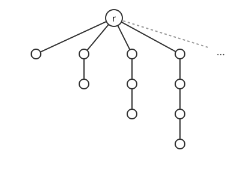

# König 보조정리

# 개요

**König 보조정리(Kőnig's lemma)** 는 마디마다 자식이 유한 개인 무한 나무에는 뿌리에서 끝없이 내려가는 길이 있다는 정리다. 정점이 $v_1,v_2,v_3,\dots$ 로 끝없이 이어지는 그래프에서, 처음 $n$ 개 정점만 남긴 그래프는 어느 $n$ 에서나 세 가지 색으로 칠할 수 있다고 하자. 그러면 그래프 전체를 세 가지 색으로 칠할 수 있는지 묻는다.

처음 $n$ 개 정점을 칠하는 방법들을 마디로 하는 나무를 만들면, 전체를 칠하는 방법은 그 나무의 끝없는 길이다. König 보조정리가 그 길의 존재를 보장한다.

# 직관

정점 $v_1,v_2,\dots$ 의 [그래프](graphs.md) $G$ 에서 처음 $n$ 개 정점이 만드는 부분그래프를 $G_n$ 이라 한다. 모든 $G_n$ 이 세 가지 색으로 칠해진다고 한다.

$G_n$ 의 칠하기에서 $v_n$ 의 색을 지우면 $G_{n-1}$ 의 칠하기가 된다. 그래서 $G_n$ 의 칠하기를 $n$ 층의 마디로, 그 칠하기에서 $v_n$ 을 지운 것을 부모로 두면 나무가 생긴다. 뿌리는 아무것도 칠하지 않은 상태다.

마디마다 자식은 $v_n$ 에 줄 색의 가짓수인 $3$ 개 이하다. 모든 층에 마디가 있으므로 나무는 무한하다. 뿌리에서 끝없이 내려가는 길은 $v_1$ 부터 차례로 색을 정하되 앞의 색을 바꾸지 않는 것이므로, 그런 길이 하나 있으면 $G$ 전체의 칠하기가 나온다.

길을 찾는다. 뿌리의 자식은 셋 이하이고 그 아래 마디를 모두 합하면 무한히 많으므로, 어느 한 자식 아래에는 마디가 무한히 많다. 그 자식으로 내려가 같은 일을 되풀이한다.

자식이 유한 개라는 조건은 필요하다. 뿌리에서 길이 $1,2,3,\dots$ 인 길을 하나씩 따로 늘어뜨린 나무는 마디가 무한히 많지만, 뿌리의 자식이 무한히 많고 끝없이 내려가는 길은 없다.

아래 그림은 그 나무의 처음 네 가지와 다섯째 가지가 시작하는 자리다. 뿌리 $r$ 의 자식마다 아래로 이어진 길의 길이가 $1,2,3,4$ 로 늘어나고, 어느 길에도 끝이 있다.

# 정의

## 유한 분기 나무

뿌리 있는 나무 $T$ 에서 모든 마디의 자식이 유한 개이면 $T$ 를 **유한 분기(finitely branching)** 나무라 한다. 직관 절의 칠하기 나무는 자식이 셋 이하인 유한 분기 나무다.

## 끝없는 길

뿌리 $r$ 에서 시작해 $r=t_0,t_1,t_2,\dots$ 의 각 $t_{k+1}$ 이 $t_k$ 의 자식인 무한열을 $T$ 의 **무한 가지(infinite branch)** 라 한다. 직관 절에서 무한 가지는 $G$ 전체의 칠하기와 일대일로 대응한다.

# 성질

## König 보조정리

정리. 유한 분기 나무에 마디가 무한히 많으면 무한 가지가 존재한다. D. Kőnig 가 1927 년에 증명했다[^1].

증명의 요지. 마디 $t$ 아래의 마디가 무한히 많을 때 $t$ 를 무한 마디라 한다. 뿌리는 무한 마디다. 무한 마디의 자식은 유한 개이고 그 아래를 합하면 무한하므로 무한 마디인 자식이 있다. 자식을 차례로 고르면 무한 가지가 된다.

## 그래프 꼴

정리. 연결된 무한 그래프의 모든 정점의 차수가 유한하면, 같은 정점을 두 번 지나지 않는 한쪽으로 무한한 길이 있다.

증명의 요지. 한 정점에서 [그래프 탐색](graph-search.md)의 너비 우선 탐색 나무를 만든다. 그래프가 연결되어 있으므로 나무가 모든 정점을 포함해 무한하고, 차수가 유한하므로 유한 분기다. 나무의 무한 가지가 그래프의 무한한 길이다.

## 콤팩트성과의 관계

자식이 $k$ 개 이하인 나무의 무한 가지는 $\lbrace 1,\dots,k\rbrace^{\mathbb N}$ 의 원소로 적힌다. 각 층에서 가지가 지나는 마디가 있다는 조건은 닫힌 집합이고, 이 닫힌 집합들이 유한 교집합 성질을 가지므로 [Tychonoff 정리](tychonoff-theorem.md)로 공통점이 있다. König 보조정리는 이 곱공간의 [콤팩트성](compactness.md)을 나무로 적은 것이다.

## 증명 강도

$0$ 과 $1$ 로 된 수열의 나무에 대한 특수한 경우가 [약한 König 보조정리](weak-konig-lemma.md)다. [역수학](reverse-mathematics.md)의 기본 체계 RCA₀(recursive comprehension axiom) 에 약한 König 보조정리를 더한 체계가 WKL₀(weak König's lemma) 다. 자식 수에 제한을 두지 않은 König 보조정리는 RCA₀ 위에서 체계 ACA₀(arithmetical comprehension axiom) 과 동치다[^2].

차이는 자식의 수를 아는지에 있다. 계산 가능한 유한 분기 나무라도 마디마다 자식이 몇 개인지를 계산할 수 없으면, 무한 가지가 모두 정지 문제의 답을 계산하는 나무를 만들 수 있다.

# 활용

- 무한 그래프의 색칠. [de Bruijn–Erdős 정리](de-bruijn-erdos-theorem.md)의 셀 수 있는 경우는 직관 절의 논법이다. 유한 부분그래프가 모두 $k$ 색으로 칠해지면 그래프 전체가 $k$ 색으로 칠해진다.
- 평면 채우기. [Wang 타일](wang-tiles.md)로 모든 크기의 정사각형을 채울 수 있으면 평면 전체를 채울 수 있다. 크기 $n$ 의 정사각형 채우기를 $n$ 층 마디로 두는 나무에 이 보조정리를 쓴다.
- 무한 정리에서 유한 정리 얻기. 무한 [Ramsey 이론](ramsey-theory.md)의 정리, [Kruskal 나무 정리](kruskal-tree-theorem.md), [Paris–Harrington 정리](paris-harrington.md)의 유한판은 반례가 모든 길이로 있다고 가정하고 그 반례들을 마디로 하는 나무에 이 보조정리를 써서 무한 반례를 만드는 논법으로 증명된다.
- 명제 논리의 콤팩트성. 변수가 $p_1,p_2,\dots$ 인 논리식 모임의 유한 부분마다 참으로 만드는 값 매김이 있으면, 처음 $n$ 개 변수의 값 매김을 마디로 하는 이진 나무의 무한 가지가 전체를 참으로 만드는 값 매김이다.

[^1]: D. Kőnig, "Über eine Schlussweise aus dem Endlichen ins Unendliche", Acta Scientiarum Mathematicarum (Szeged) 3 (1927), 121–130.
[^2]: S. G. Simpson, *Subsystems of Second Order Arithmetic*, 2nd ed., Cambridge University Press, 2009, Theorem III.7.2. König 보조정리와 ACA₀ 의 동치.

# 연관 문서

## 선수지식

- [그래프](graphs.md)

## 더 알아보기

- [약한 König 보조정리](weak-konig-lemma.md)

#graph_theory #logic #combinatorics
