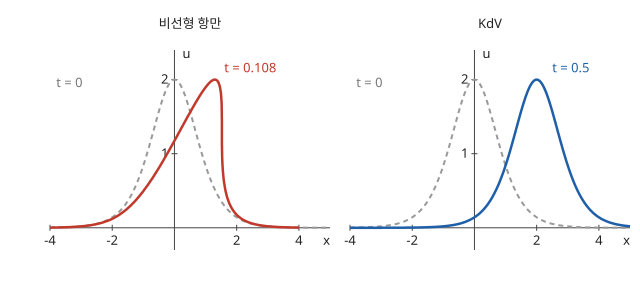

# Korteweg–de Vries 방정식

# 개요

**Korteweg–de Vries 방정식(Korteweg–de Vries equation, KdV)** 은 얕은 수로를 한 방향으로 나아가는 긴 물결의 높이가 시간에 따라 어떻게 바뀌는지 적는 편미분방정식이다. 수로에 물 혹 하나를 만들면 높은 곳이 낮은 곳보다 빨리 가려 하고, 파장마다 속도가 달라 혹이 흩어지려고도 한다. 이 방정식은 두 효과를 항 하나씩으로 적고, 두 항이 맞아떨어지는 혹은 모양을 바꾸지 않고 나아간다는 것을 계산으로 보인다.

# 직관

수로의 물 높이를 $u(x,t)$ 로 적고, 처음 모양을 혹 하나 $u(x,0)=2\thinspace\mathrm{sech}^2x$ 로 둔다. 꼭대기는 $x=0$ 에서 높이 $2$ 이고 양옆으로 $0$ 에 가까워진다.

높은 물이 빨리 가는 효과만 적으면 $u_t+6uu_x=0$ 이다. [Burgers 방정식](burgers-equation.md)과 같은 꼴이어서 높이 $u$ 는 속도 $6u$ 로 실려 가고, 처음 $x_0$ 에 있던 높이는 시각 $t$ 에 $x_0+12\thinspace\mathrm{sech}^2x_0\cdot t$ 에 있다.

앞면에서는 뒤쪽 점이 앞쪽 점을 따라잡는다. $x_0$ 근처 두 점의 간격은 시각 $t$ 에 처음 간격의 $1-24\thinspace\mathrm{sech}^2x_0\tanh x_0\cdot t$ 배이고, 이 값이 처음 $0$ 이 되는 시각에 앞면이 세로로 선다. $\mathrm{sech}^2x_0\tanh x_0$ 의 최댓값은 $\tanh x_0=1/\sqrt3$ 에서 $2/(3\sqrt3)$ 이므로 그 시각은 $t=\sqrt3/16\approx 0.108$ 이다.

파장마다 속도가 다른 효과만 적으면 $u_t+u_{xxx}=0$ 이다. $e^{i(kx-\omega t)}$ 를 넣으면 $\omega=-k^3$ 이 나와 파수 $k$ 인 성분은 속도 $-k^2$ 로 움직인다. 혹은 여러 파수의 성분을 겹친 것이므로 성분들이 서로 다른 속도로 흩어지고, 꼭대기가 낮아지며 왼쪽에 잔물결이 남는다.

둘을 함께 둔 $u_t+6uu_x+u_{xxx}=0$ 에는 $u=2\thinspace\mathrm{sech}^2(x-4t)$ 가 해다. 아래 그림의 왼쪽은 비선형 항만 있을 때 $t=0.108$ 의 모양이고, 오른쪽은 두 항이 다 있을 때 $t=0.5$ 의 모양이다. 점선은 처음 혹이다.

왼쪽에서는 앞면이 서서 혹이 깨지고, 오른쪽에서는 혹이 모양 그대로 속도 $4$ 로 나아간다. 가파르게 만드는 항과 퍼뜨리는 항이 서로 상쇄된 것이다.

# 정의

함수 $u(x,t)$, $x\in\mathbb R$, $t\ge 0$ 에 대한 다음 방정식을 **Korteweg–de Vries 방정식** 이라 한다.

$$
u_t+6uu_x+u_{xxx}=0
$$

$6uu_x$ 를 비선형 항, $u_{xxx}$ 를 분산 항(dispersive term)이라 한다. 직관 절의 혹 $2\thinspace\mathrm{sech}^2(x-4t)$ 가 이 방정식의 해다.

계수는 척도로 바꿀 수 있다. $\alpha,\beta\ne 0$ 일 때 $u_t+\alpha uu_x+\beta u_{xxx}=0$ 의 해 $u$ 에서 $x$, $t$, $u$ 의 단위를 바꾸면 위 방정식의 해가 된다. $u$ 를 $-u$ 로 바꾼 꼴 $u_t=6uu_x-u_{xxx}$ 도 흔히 쓰고, [솔리톤](solitons.md)과 [역산란 변환](inverse-scattering-transform.md) 문서는 이 꼴을 쓴다. 그 꼴에서는 혹이 아래로 파인 우물 $-2\thinspace\mathrm{sech}^2(x-4t)$ 가 된다.

깊이 $h$ 인 수로에서 수면의 높이를 $\eta$, 중력가속도를 $g$, $c_0=\sqrt{gh}$ 라 하면, 파장이 $h$ 보다 훨씬 길고 높이가 $h$ 보다 훨씬 작은 물결은 근사적으로 다음을 따른다[^1][^2].

$$
\eta_t+c_0\eta_x+\frac{3c_0}{2h}\eta\eta_x+\frac{c_0h^2}{6}\eta_{xxx}=0
$$

속도 $c_0$ 로 움직이는 좌표 $x-c_0t$ 로 옮기면 $c_0\eta_x$ 항이 사라지고, 척도를 바꾸면 위 방정식이 된다.

# 성질

## 고립파

모양을 바꾸지 않고 속도 $c\gt 0$ 로 나아가는 해 $u=\phi(x-ct)$ 를 찾는다. 방정식에 넣으면 $-c\phi'+6\phi\phi'+\phi'''=0$ 이고, 먼 곳에서 $\phi$ 와 도함수가 $0$ 이라는 조건으로 두 번 적분하면 $(\phi')^2=c\phi^2-2\phi^3$ 이다. 이 [상미분방정식](ordinary-differential-equations.md)의 해는 다음과 같다.

$$
u(x,t)=\frac c2\thinspace\mathrm{sech}^2\Bigl(\frac{\sqrt c}{2}(x-ct-x_0)\Bigr)
$$

높이 $c/2$ 와 속도 $c$ 가 비례하므로 높은 혹이 빠르고, 폭은 $1/\sqrt c$ 에 비례하므로 높은 혹이 좁다. $c=4$ 가 직관 절의 혹이다. 이 고립파들은 서로 부딪친 뒤에도 모양과 속도를 유지하며 위치만 옮겨지고, 이런 고립파를 솔리톤이라 한다.

## 보존량

방정식은 $u_t=-(3u^2+u_{xx})\_x$ 로 쓸 수 있다. $u$ 와 도함수가 $\vert x\vert\to\infty$ 에서 빨리 $0$ 으로 가면 다음 세 적분이 시간에 따라 변하지 않는다.

$$
I_1=\int u\thinspace dx,\qquad I_2=\int u^2\thinspace dx,\qquad I_3=\int\Bigl(u^3-\frac12u_x^2\Bigr)dx
$$

$I_1$ 은 $u_t$ 가 $x$ 에 대한 도함수이므로 보존된다. $I_2$ 와 $I_3$ 은 부분적분으로 다음이 나온다.

$$
\begin{aligned}
\frac{d}{dt}\int\frac12u^2\thinspace dx&=-\int u(3u^2+u_{xx})\_x\thinspace dx=\int\Bigl(u^3+\frac12u_x^2\Bigr)\_x\thinspace dx=0\cr
\frac{d}{dt}I_3&=\int(3u^2+u_{xx})u_t\thinspace dx=-\int(3u^2+u_{xx})(3u^2+u_{xx})\_x\thinspace dx=0
\end{aligned}
$$

직관 절의 혹에서는 $I_1=4$, $I_2=16/3$ 이다.

$I_3$ 을 $H$ 로 두면 방정식은 $u_t=-\partial_x(\delta H/\delta u)$ 꼴이고, $H$ 가 [Hamilton 역학](hamiltonian-mechanics.md)의 에너지 구실을 한다. KdV 에는 이런 다항식 보존량이 무한히 많고, 차수가 하나씩 올라가는 열을 이룬다[^3].

## Miura 변환

$v$ 가 수정 KdV 방정식(modified KdV equation, mKdV) $v_t-6v^2v_x+v_{xxx}=0$ 을 만족하면 $u=-(v^2+v_x)$ 가 KdV 를 만족한다. 이것을 **Miura 변환(Miura transformation)** 이라 하고, 다음 항등식에서 나온다[^4].

$$
w_t-6ww_x+w_{xxx}=(2v+\partial_x)(v_t-6v^2v_x+v_{xxx}),\qquad w=v^2+v_x
$$

$v=\psi_x/\psi$ 로 두면 $v^2+v_x=\psi_{xx}/\psi$ 이므로 Miura 변환은 $-\psi_{xx}-u\psi=0$ 이 된다. 퍼텐셜이 $-u$ 이고 에너지가 $0$ 인, 시간에 무관한 [Schrödinger 방정식](schrodinger-equation.md)이다. Gardner, Greene, Kruskal, Miura 는 연산자 $-\partial_x^2-u$ 의 고윳값이 KdV 흐름에서 변하지 않음을 보였고, 이 사실로 역산란 변환을 만들었다[^5]. Lax 는 같은 사실을 [Lax 쌍](lax-pairs.md)으로 적었다.

## 솔리톤으로 갈라짐

빨리 줄어드는 초기값 $u(x,0)$ 의 해는 $t\to\infty$ 에서 몇 개의 고립파와 왼쪽으로 퍼지며 낮아지는 잔물결로 갈라진다. 고립파의 개수는 $-\psi_{xx}-u(x,0)\psi=E\psi$ 의 음의 고윳값 $E=-\kappa_n^2$ 의 개수이고, $n$ 번째 고립파의 속도는 $4\kappa_n^2$ 이다[^6].

$u(x,0)=N(N+1)\thinspace\mathrm{sech}^2x$ 이면 고윳값이 $-1,-4,\dots,-N^2$ 이고 잔물결이 생기지 않는다. $N=2$ 인 $6\thinspace\mathrm{sech}^2x$ 는 높이 $2$, 속도 $4$ 인 혹과 높이 $8$, 속도 $16$ 인 혹으로 갈라지고, 빠른 혹이 앞서 나간다.

## 초기값 문제

KdV 의 초기값 문제는 거친 초기값에서도 잘 놓여 있다(well-posed). 해가 존재하고 유일하며 초기값에 연속으로 의존한다는 뜻이다. Bourgain 은 초기값이 [Lᵖ 공간](lp-spaces.md) $L^2$ 에 있으면 모든 시각에서 잘 놓여 있음을 보였다[^7]. Killip 과 Vişan 은 같은 결론을 [Sobolev 공간](sobolev-spaces.md) $H^{-1}$ 의 초기값으로 넓혔다[^8].

# 활용

- 얕은 물의 긴 물결. Russell 이 운하에서 본 고립된 물결을 Korteweg 와 de Vries 가 이 방정식의 고립파로 설명했다[^1]. 해안으로 오는 긴 물결과 바다 속 밀도층 사이의 내부파도 같은 근사를 쓴다.
- 수치 실험과 솔리톤의 이름. Zabusky 와 Kruskal 은 주기 경계에서 코사인 초기값을 수치로 풀어 앞면이 가팔라진 뒤 고립파 여럿으로 갈라지고, 이들이 부딪친 뒤 모양을 되찾는 것을 관찰하고 '솔리톤' 이라는 이름을 붙였다[^9].
- 적분가능계의 표준 예. 역산란 변환, Lax 쌍, 무한히 많은 보존량이 처음 발견된 방정식이고, [적분가능계](integrable-systems.md)의 무한차원 예다. 주기 진행파는 [Jacobi 타원함수](jacobi-elliptic-functions.md) $\mathrm{cn}^2$ 꼴이다.
- 다른 분야의 방정식. 플라스마의 이온 음파, 결정 격자의 긴 파동에서 같은 꼴의 방정식이 나온다. 보존량의 열에서 나오는 흐름을 모은 KdV 위계(KdV hierarchy)는 [곡선의 모듈라이 공간](moduli-of-curves.md)의 교차수 생성함수가 만족하는 방정식이다.

[^1]: D. J. Korteweg, G. de Vries, "On the change of form of long waves advancing in a rectangular canal, and on a new type of long stationary waves", *Philosophical Magazine* 39 (1895), 422–443.
[^2]: G. B. Whitham, *Linear and Nonlinear Waves*, Wiley, 1974.
[^3]: R. M. Miura, C. S. Gardner, M. D. Kruskal, "Korteweg-de Vries equation and generalizations. II. Existence of conservation laws and constants of motion", *Journal of Mathematical Physics* 9 (1968), 1204–1209.
[^4]: R. M. Miura, "Korteweg-de Vries equation and generalizations. I. A remarkable explicit nonlinear transformation", *Journal of Mathematical Physics* 9 (1968), 1202–1204.
[^5]: C. S. Gardner, J. M. Greene, M. D. Kruskal, R. M. Miura, "Method for solving the Korteweg-de Vries equation", *Physical Review Letters* 19 (1967), 1095–1097.
[^6]: P. G. Drazin, R. S. Johnson, *Solitons: An Introduction*, Cambridge University Press, 1989, 3 장과 4 장.
[^7]: J. Bourgain, "Fourier transform restriction phenomena for certain lattice subsets and applications to nonlinear evolution equations. II. The KdV-equation", *Geometric and Functional Analysis* 3 (1993), 209–262.
[^8]: R. Killip, M. Vişan, "KdV is well-posed in H⁻¹", *Annals of Mathematics* 190 (2019), 249–305.
[^9]: N. J. Zabusky, M. D. Kruskal, "Interaction of 'solitons' in a collisionless plasma and the recurrence of initial states", *Physical Review Letters* 15 (1965), 240–243.

# 연관 문서

## 선수지식

- [Burgers 방정식](burgers-equation.md)
- [솔리톤](solitons.md)

## 더 알아보기

아직 연결한 문서가 없다.

#analysis #functional_analysis
