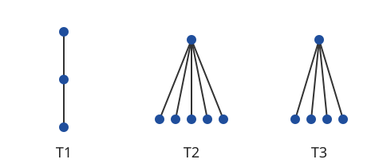

# Kruskal 나무 정리

# 개요

**Kruskal 나무 정리(Kruskal's tree theorem)** 는 뿌리 있는 유한 나무를 아무렇게나 무한히 늘어놓으면 반드시 앞의 나무 하나가 뒤의 나무 하나 안에 들어간다는 정리다. 나무를 하나씩 그려 가면서, 앞에 그린 어느 나무도 새 나무 안에 들어가지 않게 하는 놀이를 생각한다. 첫 나무로 마디 셋이 한 줄로 이어진 나무를 그리면, 그 뒤의 나무는 높이가 $1$ 이하여야 하고 놀이는 곧 끝난다.

Kruskal 나무 정리는 첫 나무를 어떻게 고르든 이 놀이가 유한 번에 끝남을 보인다. 끝나기까지의 길이는 선택에 따라 얼마든지 길어질 수 있고, 그 길이를 셈으로 바꾼 진술은 [역수학](reverse-mathematics.md)의 체계 ATR₀(arithmetical transfinite recursion) 에서 증명되지 않는다.

# 직관

마디 셋이 한 줄로 이어진 나무를 $T_1$ 로 그린다. 그 뒤의 나무 $T$ 에 $T_1$ 이 들어가지 않으려면 $T$ 에는 뿌리에서 두 단계 내려간 마디가 없어야 한다. 그러므로 $T_2,T_3,\dots$ 는 뿌리와 그 자식들로만 된 별 모양 나무다.

잎이 $a$ 개인 별은 잎이 $b\ge a$ 개인 별에 들어간다. 그래서 그림처럼 $T_2$ 를 잎 다섯 개의 별로 그리면 $T_3$ 은 잎이 넷 이하인 별이어야 하고, 잎의 수가 줄어들기만 하므로 놀이는 많아야 여섯 수 더 이어진다.

$T_2$ 를 잎 $1000$ 개의 별로 그렸다면 놀이는 천 수 넘게 이어진다. 놀이의 길이에는 미리 정한 상한이 없지만, 어느 경우든 유한 번에 끝난다. 높이가 $1$ 인 나무에서는 이것이 잎의 수가 자연수라는 것이고, 높이에 제한이 없는 나무에서 같은 결론을 내는 것이 이 정리다.

# 정의

## 나무의 매장

뿌리 있는 유한 나무 $T$ 의 두 마디 $u,v$ 에 대해, 뿌리에서 $u$ 로 가는 길과 $v$ 로 가는 길이 함께 지나는 가장 아래 마디를 $u\wedge v$ 로 쓴다. 뿌리 있는 유한 나무 $T$ 에서 $T'$ 로의 **매장(embedding)** 은 마디 사이의 단사 사상 $f$ 로서 모든 $u,v$ 에 대해 다음을 만족하는 것이다.

$$
f(u\wedge v)=f(u)\wedge f(v)
$$

매장이 존재하면 $T\le T'$ 로 쓴다. 직관 절에서 한 줄 나무 $T_1$ 의 세 마디는 $f$ 로 보내면 조상 관계가 지켜져야 하므로 깊이가 $2$ 이상인 마디가 있는 나무에만 들어간다.

## 이름 붙은 나무

[정렬 준순서](well-quasi-orders.md) $(Q,\le)$ 를 둔다. 마디마다 $Q$ 의 원소를 이름으로 붙인 나무 사이의 매장은 위의 조건에 더해 마디 $u$ 의 이름이 $f(u)$ 의 이름 이하인 것이다. $Q$ 가 원소 하나뿐이면 이름 없는 나무의 매장이다.

# 성질

## Kruskal 정리

정리. $Q$ 가 정렬 준순서이면 $Q$ 로 이름 붙인 뿌리 있는 유한 나무 전체는 매장 관계 $\le$ 에 대해 정렬 준순서다. J. B. Kruskal 이 1960 년에 증명했다[^1].

증명의 요지. C. St. J. A. Nash-Williams 의 최소 나쁜 수열 논증을 쓴다[^2]. 나쁜 수열이 있다고 하고, $T_1$ 은 나쁜 수열의 첫 항이 될 수 있는 마디 수가 가장 작은 나무, $T_2$ 는 $T_1,T_2$ 로 시작하는 나쁜 수열이 있는 가장 작은 나무로 차례로 고른다.

$T_i$ 의 뿌리의 자식마다 그 자식을 뿌리로 하는 부분나무가 있다. 이 부분나무 전체의 집합 $B$ 가 정렬 준순서임을 보인다. $B$ 에 나쁜 수열 $S_1,S_2,\dots$ 가 있으면, $S_1$ 이 $T_k$ 의 부분나무일 때 $T_1,\dots,T_{k-1},S_1,S_2,\dots$ 가 나쁜 수열이 되고 $S_1$ 이 $T_k$ 보다 작아 $T_k$ 의 선택과 모순이다.

$T_i$ 는 뿌리의 이름과 자식 부분나무들의 열로 정해진다. Higman 보조정리(Higman's lemma)로 $B$ 위의 유한 열은 부분열 관계로 정렬 준순서이므로, $i\lt j$ 이면서 $T_i$ 의 뿌리 이름이 $T_j$ 의 것 이하이고 $T_i$ 의 자식 부분나무 열이 $T_j$ 의 것의 부분열에 하나씩 매장되는 쌍이 있다. 뿌리를 뿌리로 보내고 서로 다른 자식 부분나무를 서로 다른 자식 부분나무로 보내면 $\wedge$ 가 지켜지므로 $T_i\le T_j$ 이고, 수열이 나쁘다는 것과 모순이다.

## 유한판

정리. 모든 $n$ 에 대해 $N$ 이 존재해, $T_i$ 의 마디가 $n+i$ 개 이하인 이름 없는 나무의 열 $T_1,\dots,T_N$ 에는 반드시 $i\lt j$ 이고 $T_i\le T_j$ 인 쌍이 있다.

증명의 요지. 그런 $N$ 이 없으면 길이마다 나쁜 유한 열이 있다. 마디 수의 상한 때문에 각 자리에 올 수 있는 나무가 유한 개이므로, König 보조정리(Kőnig's lemma)로 무한 나쁜 수열이 나와 Kruskal 정리와 모순이다.

H. Friedman 은 이 유한판이 ATR₀ 에서 증명되지 않음을 보였고, S. G. Simpson 이 그 증명을 출판했다[^3]. 유한판은 자연수에 대한 진술이어서, 무한 집합을 말하지 않는 참인 진술이 ATR₀ 에서 증명되지 않는 예가 된다.

## 증명 강도

ATR₀ 이 정렬성을 증명하는 순서수의 상한은 Feferman–Schütte 순서수(Feferman–Schütte ordinal) $\Gamma_0$ 다. Friedman 은 $\Gamma_0$ 보다 작은 [서수](ordinals.md)의 표기를 나무로 적어, 표기의 크기 비교가 매장과 맞도록 했다. 그러면 Kruskal 정리로부터 $\Gamma_0$ 의 정렬성이 증명되므로 Kruskal 정리는 ATR₀ 에서 증명되지 않는다.

## TREE 함수

마디에 $k$ 가지 이름을 붙인 나무의 열 $T_1,\dots,T_m$ 에서 $T_i$ 의 마디가 $i$ 개 이하이고 $i\lt j$ 이면 $T_i\not\le T_j$ 일 때, 가능한 가장 긴 $m$ 을 $\mathrm{TREE}(k)$ 라 한다. 이름 붙은 나무의 Kruskal 정리와 König 보조정리로 이 값은 유한하다.

$\mathrm{TREE}(1)=1$ 이다. 첫 나무가 마디 하나뿐이고 그 마디는 어느 나무에나 들어가기 때문이다. $\mathrm{TREE}(2)=3$ 이고, $\mathrm{TREE}(3)$ 도 유한하다.

# 활용

- 항 다시 쓰기의 종료. 항을 나무로 보면 단순화 순서(simplification ordering)는 매장을 늘리는 순서다. Kruskal 정리로 단순화 순서에는 무한 감소열이 없으므로, 규칙마다 왼쪽 항이 오른쪽 항보다 큰 단순화 순서가 있으면 다시 쓰기가 끝난다. 재귀 경로 순서(recursive path ordering)의 종료 증명이 이렇게 된다.
- [그래프 마이너](graph-minors.md). Robertson–Seymour 정리는 유한 그래프가 마이너 관계로 정렬 준순서라는 정리이고, 그 증명은 나무 너비가 작은 그래프에서 Kruskal 정리의 논증을 쓴다.
- 역수학. 유한판은 [Paris–Harrington 정리](paris-harrington.md)와 함께 산술의 약한 체계에서 증명되지 않는 조합론 진술의 대표 예다.

[^1]: J. B. Kruskal, "Well-quasi-ordering, the tree theorem, and Vazsonyi's conjecture", Transactions of the American Mathematical Society 95 (1960), 210–225.
[^2]: C. St. J. A. Nash-Williams, "On well-quasi-ordering finite trees", Proceedings of the Cambridge Philosophical Society 59 (1963), 833–835.
[^3]: S. G. Simpson, "Nonprovability of certain combinatorial properties of finite trees", in Harvey Friedman's Research on the Foundations of Mathematics, North-Holland (1985), 87–117.

# 연관 문서

## 선수지식

- [정렬 준순서](well-quasi-orders.md)

## 더 알아보기

아직 연결한 문서가 없다.

#order_theory #combinatorics #logic
