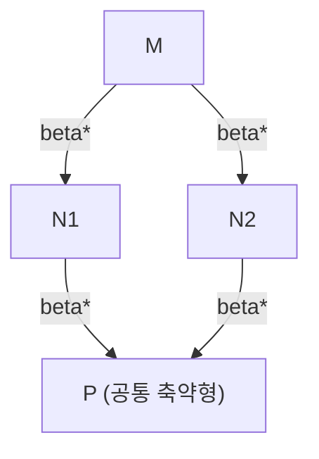

# Lambda calculus

# 개요

**Lambda calculus** 는 Alonzo Church 가 1930년대에 도입한 계산 모형(model of computation)이다. 기본 대상은 [함수](functions.md)뿐이고, 연산은 함수를 만드는 추상(abstraction)과 함수를 인자에 적용하는 적용(application) 둘뿐이다. 숫자, 진리값, 자료구조, 재귀는 모두 함수로 부호화된다.

lambda calculus 로 정의할 수 있는 함수는 Turing 기계(Turing machine)가 계산하는 함수와 같고, Kleene 의 일반 재귀함수(general recursive function)와도 같다. 세 정의가 같은 함수족을 내놓는다는 것이 Church–Turing 논제(Church–Turing thesis)의 근거다. 따라서 [계산 가능성](computability.md)의 결정 불가능성 결과가 lambda calculus 에서도 성립한다.

lambda calculus 는 프로그래밍 언어의 의미론과 증명론에서도 쓰인다. 함수형 언어의 클로저, 고차함수, 지연 평가는 lambda calculus 에 자료형을 더한 체계로 정의된다. 항에 단순 타입을 붙이면 항이 증명에, 타입이 명제에 대응하는 [Curry–Howard 대응](curry-howard.md)이 나타난다. 이때 모든 계산이 유한 단계에서 끝나고 계산할 수 있는 함수는 줄어든다.

# 직관

Turing 기계는 테이프와 상태표로 계산을 적으므로, $x$ 에 $1$ 을 더하는 함수 하나도 칸을 옮기고 기호를 고치는 규칙 여러 줄이 된다. 수학에서는 같은 함수를 $f(x) = x + 1$ 로 적고, $f(3)$ 은 $x$ 자리에 $3$ 을 넣어 $3 + 1$ 로 계산한다. 이름 $f$ 를 빼고 이 함수를 $\lambda x.\thinspace x + 1$ 로, $3$ 에 적용한 것을 $(\lambda x.\thinspace x + 1)\thinspace 3$ 으로 쓴다. lambda calculus 는 계산을 이 "자리에 넣기" 규칙 하나로만 적는다.

$+$ 와 $1$ 도 함수로 적어야 규칙 하나로 끝난다. 자연수 $n$ 을 주어진 함수를 $n$ 번 거듭 적용하는 함수로 정하면, $1$ 을 더하는 것은 한 번 더 적용하는 것이고 $m + n$ 은 $n$ 번 적용한 결과에 $m$ 번 더 적용하는 것이다. 이름이 없는 함수는 자기를 부를 수 없으므로 반복은 함수를 자기 자신에게 적용해서 만든다. $(\lambda x.\thinspace x\thinspace x)(\lambda x.\thinspace x\thinspace x)$ 는 $x$ 자리에 넣으면 같은 항으로 돌아와 계산이 끝나지 않고, 이 장치를 다듬으면 재귀가 나온다.

# 정의

## 항의 정의

가산 무한개의 변수 집합에서 $\lambda$ 항을 귀납적으로 정의한다.

$$
M, N \thickspace::=\thickspace x \thickspace\mid\thickspace \lambda x.\thinspace M \thickspace\mid\thickspace M\thinspace N
$$

$x$ 는 변수, $\lambda x.\thinspace M$ 은 추상, $M\thinspace N$ 은 적용이다. 관례적으로 적용은 왼쪽 결합이어서 $M\thinspace N\thinspace P$ 는 $(M\thinspace N)\thinspace P$ 이고, 추상의 본체는 최대한 오른쪽으로 뻗어서 $\lambda x.\thinspace M\thinspace N$ 은 $\lambda x.\thinspace (M\thinspace N)$ 이다.

자유변수 집합은 $\mathrm{FV}(x) = \lbrace x\rbrace$ 와 $\mathrm{FV}(\lambda x.\thinspace M) = \mathrm{FV}(M) \setminus \lbrace x\rbrace$ 와 $\mathrm{FV}(M\thinspace N) = \mathrm{FV}(M) \cup \mathrm{FV}(N)$ 로 정의한다. 자유변수가 없는 항을 **닫힌 항(closed term)** 또는 **combinator** 라 한다.

## 세 가지 변환

**$\alpha$ -변환.** $y$ 가 $M$ 에서 자유롭지 않을 때 $\lambda x.\thinspace M$ 과 $\lambda y.\thinspace M[x := y]$ 를 같은 항으로 본다. 속박변수의 이름만 다른 두 항을 구별하지 않으며, 이후 모든 항은 $\alpha$ -동치류로 다룬다.

**$\beta$ -축약.** 계산 규칙이다.

$$
(\lambda x.\thinspace M)\thinspace N \thickspace\to_\beta\thickspace M[x := N]
$$

여기서 치환은 포획 회피(capture-avoiding) 치환이다. $N$ 의 자유변수가 $M$ 안의 추상에 붙잡히지 않도록 필요하면 $\alpha$ -변환을 먼저 한다. $(\lambda x.\thinspace M)\thinspace N$ 꼴의 부분항을 **redex**(reducible expression)라 하고, redex 가 없는 항을 **정규형(normal form)** 이라 한다.

**$\eta$ -변환.** $x$ 가 $M$ 에서 자유롭지 않을 때

$$
\lambda x.\thinspace M\thinspace x \thickspace\to_\eta\thickspace M .
$$

$\lambda x.\thinspace M\thinspace x$ 와 $M$ 은 어느 인자 $N$ 에 적용해도 $M\thinspace N$ 을 준다. $\eta$ -축약은 이 외연성(extensionality)을 구문 규칙으로 적은 것이다.

$\to^\ast$ 로 여러 단계 축약을, $=\_\beta$ 로 $\beta$ -축약으로 생성되는 [동치관계](equivalence-relations.md)를 쓴다.

## Church 수와 산술

자연수 $n$ 을 "함수를 $n$ 번 적용하는 연산자"로 정의한다. 이것을 **Church 수(Church numeral)** 라 한다.

$$
\underline{n} \thickspace=\thickspace \lambda f.\thinspace\lambda x.\thinspace \underbrace{f\thinspace(f\thinspace(\cdots(f}\_{n}\thinspace x)\cdots))
$$

$\underline 0 = \lambda f.\lambda x.\thinspace x$ 와 $\underline 1 = \lambda f.\lambda x.\thinspace f\thinspace x$ 와 $\underline 2 = \lambda f.\lambda x.\thinspace f\thinspace(f\thinspace x)$ 다. 산술 연산은 다음과 같다.

- 후자: $\mathrm{succ} = \lambda n.\lambda f.\lambda x.\thinspace f\thinspace(n\thinspace f\thinspace x)$
- 덧셈: $\mathrm{plus} = \lambda m.\lambda n.\lambda f.\lambda x.\thinspace m\thinspace f\thinspace(n\thinspace f\thinspace x)$
- 곱셈: $\mathrm{mult} = \lambda m.\lambda n.\lambda f.\thinspace m\thinspace(n\thinspace f)$
- 거듭제곱: $\mathrm{exp} = \lambda m.\lambda n.\thinspace n\thinspace m$

진리값과 조건은 선택자로 정의한다. $\mathrm{true} = \lambda x.\lambda y.\thinspace x$ 와 $\mathrm{false} = \lambda x.\lambda y.\thinspace y$ 와 $\mathrm{ifelse} = \lambda b.\lambda t.\lambda e.\thinspace b\thinspace t\thinspace e$ 다. 그러면 $\mathrm{iszero} = \lambda n.\thinspace n\thinspace(\lambda z.\thinspace \mathrm{false})\thinspace\mathrm{true}$ 다. 순서쌍은 $\mathrm{pair} = \lambda a.\lambda b.\lambda s.\thinspace s\thinspace a\thinspace b$ 와 $\mathrm{fst} = \lambda p.\thinspace p\thinspace\mathrm{true}$ 와 $\mathrm{snd} = \lambda p.\thinspace p\thinspace\mathrm{false}$ 다. 전자(predecessor) $\mathrm{pred}$ 는 쌍 $(n, n-1)$ 을 $(n+1, n)$ 으로 갱신하는 함수를 $n$ 번 적용해 얻는다. 이 구성은 Kleene 의 것이다.

## 고정점 combinator

**고정점 combinator(fixed-point combinator)** $Y$ 는 다음 항이다.

$$
Y = \lambda f.\thinspace (\lambda x.\thinspace f\thinspace(x\thinspace x))\thinspace(\lambda x.\thinspace f\thinspace(x\thinspace x))
$$

임의의 $g$ 에 대해

$$
Y\thinspace g \thickspace\to_\beta\thickspace (\lambda x.\thinspace g\thinspace(x\thinspace x))\thinspace(\lambda x.\thinspace g\thinspace(x\thinspace x)) \thickspace\to_\beta\thickspace g\thinspace\big((\lambda x.\thinspace g\thinspace(x\thinspace x))\thinspace(\lambda x.\thinspace g\thinspace(x\thinspace x))\big)
$$

이고 마지막 항의 인자는 첫 축약의 결과와 같은 항이다. 따라서 $Y\thinspace g =\_\beta g\thinspace(Y\thinspace g)$ 이고, $Y\thinspace g$ 는 $g$ 의 고정점이다.

재귀 함수는 자기 자신을 인자 $r$ 로 받는 함수의 고정점으로 얻는다. 계승은

$$
F = \lambda r.\thinspace\lambda n.\thinspace \mathrm{ifelse}\thinspace (\mathrm{iszero}\thinspace n)\thinspace \underline{1}\thinspace (\mathrm{mult}\thinspace n\thinspace (r\thinspace (\mathrm{pred}\thinspace n)))
$$

에 대해 $\mathrm{fact} = Y\thinspace F$ 다. 값 호출(call-by-value) 언어에서는 $Y\thinspace F$ 의 축약이 끝나지 않으므로 한 단계 지연을 넣은 $Z = \lambda f.\thinspace (\lambda x.\thinspace f\thinspace(\lambda v.\thinspace x\thinspace x\thinspace v))\thinspace(\lambda x.\thinspace f\thinspace(\lambda v.\thinspace x\thinspace x\thinspace v))$ 를 쓴다.

## 축약 전략

한 항에 redex 가 여럿 있을 때 어느 것을 먼저 줄일지 정한 규칙을 **축약 전략(reduction strategy)** 이라 한다.

- **정규 순서(normal order).** 가장 왼쪽 바깥쪽 redex 부터 줄인다. 지연 평가가 이 순서를 쓴다.
- **적용 순서(applicative order).** 인자를 먼저 정규형으로 만든 뒤 적용한다. 값 호출 언어가 이 순서를 쓴다.

두 전략이 모두 정규형에 도달하면 그 정규형은 같지만, 한쪽만 도달할 수 있다. $\Omega = (\lambda x.\thinspace x\thinspace x)(\lambda x.\thinspace x\thinspace x)$ 로 둔 $(\lambda x.\thinspace \lambda y.\thinspace y)\thinspace\Omega$ 는 정규 순서에서는 $\lambda y.\thinspace y$ 로 끝나지만 적용 순서에서는 $\Omega$ 를 먼저 줄이므로 끝나지 않는다.

# 성질

## Church–Rosser 정리

**정리 (합류성, confluence).** $M \to^\ast N_1$ 이고 $M \to^\ast N_2$ 이면, 어떤 $P$ 가 존재하여 $N_1 \to^\ast P$ 이고 $N_2 \to^\ast P$ 다. $\beta\eta$ 축약에 대해서도 성립한다.

표준 증명은 Tait–Martin-Löf 방식이다. 한 단계 축약을 여러 redex 를 동시에 줄이는 평행 축약(parallel reduction)으로 바꾸고, 평행 축약이 다이아몬드 성질(diamond property)을 만족함을 항에 대한 귀납으로 보인다.

따름정리 둘.

1. **정규형의 유일성.** 항이 정규형을 가지면 그것은 $\alpha$ -동치를 제외하고 유일하다. 두 정규형은 공통 축약형을 갖는데, 정규형은 더 줄지 않으므로 서로 같다.
2. **무모순성.** $\mathrm{true}$ 와 $\mathrm{false}$ 는 서로 다른 정규형이므로 $\mathrm{true} \neq\_\beta \mathrm{false}$ 다. 따라서 $=\_\beta$ 는 모든 항을 동일시하지 않는다.

**정리 (정규화, normalization).** 항이 정규형을 가지면 정규 순서 축약이 그 정규형에 도달한다. 이것은 표준화 정리(standardization theorem)의 따름정리다.

## 계산 능력과 결정 불가능성

**정리 (Church, Kleene, Turing).** 함수 $f : \mathbb N^k \to \mathbb N$ 가 $\lambda$ 정의가능한 것과 Turing 계산가능한 것은 동치다. Church 수로 입출력을 부호화할 때 $F\thinspace\underline n =\_\beta \underline{f(n)}$ 인 항 $F$ 가 존재하는 것과 $f$ 를 계산하는 Turing 기계가 있는 것이 같다[^1].

증명의 한쪽은 원시 재귀 도식(primitive recursion)과 최소화 연산자(minimization operator)를 $\lambda$ 항으로 구성하는 것이다. 최소화에는 고정점 combinator 를 쓴다. 다른 쪽은 $\lambda$ 항의 축약 과정을 Turing 기계로 시뮬레이션하는 것이다. Church–Turing 논제는 비형식적 개념인 "계산할 수 있다" 를 다루므로 수학적 정리가 아니고, 이 동치가 그 근거다.

계산 능력이 같으므로 결정 불가능성 결과도 그대로 성립한다.

- 주어진 항이 정규형을 갖는지는 결정 불가능하다. 정지 문제에 대응한다.
- 두 항이 $=\_\beta$ 인지도 결정 불가능하다(Church 의 정리). Scott–Curry 정리(Scott–Curry theorem)에 따르면 $=\_\beta$ 로 닫혀 있고 비어 있지 않으며 전체도 아닌 항 집합은 결정 불가능하다. 이것은 [Rice 정리](rice-theorem.md)의 lambda calculus 판본이다.
- [유한 오토마타](finite-automata.md)처럼 계산 능력이 제한된 모형에서는 같은 질문들이 결정 가능하다.

## 단순 타입과 정규화

**단순 타입 lambda calculus(simply typed lambda calculus, STLC)** 는 타입을 기본 타입과 함수 타입 $A \to B$ 로 정의하고 항에 타입 판정 규칙을 준 체계다. 변수는 문맥에서 타입을 받고, $\lambda x : A.\thinspace M$ 은 $M : B$ 일 때 $A \to B$ 를 가지며, 적용 $M\thinspace N$ 은 $M : A \to B$ 이고 $N : A$ 일 때 $B$ 를 갖는다.

**정리 (강한 정규화, strong normalization).** STLC 의 모든 타입 있는 항은 어떤 축약 순서로도 유한 단계 안에 정규형에 도달한다.

표준 증명은 Tait 의 계산가능성 술어(reducibility) 논법이다. 타입 구조에 대한 귀납으로 "계산가능한 항" 을 정의하고, 모든 타입 있는 항이 계산가능함을 보인다. $\beta$ -축약은 항을 키울 수 있어서 항의 크기에 대한 귀납으로는 증명되지 않는다.

강한 정규화가 성립하는 대신 표현할 수 있는 함수가 줄어든다. $\lambda x.\thinspace x\thinspace x$ 는 타입을 붙일 수 없고(자기 적용은 $A = A \to B$ 를 요구한다), 따라서 $Y$ 도 타입을 갖지 못한다. STLC 에서 Church 수로 표현되는 수치 함수는 확장 다항식(extended polynomial)뿐이므로 STLC 는 Turing 완전(Turing complete)하지 않다. 실제 언어는 재귀를 원시 연산 `fix` 로 추가하거나 다형성, 의존 타입 같은 더 강한 체계를 쓴다.

**Curry–Howard 대응.** 타입을 명제에, 항을 증명에 대응시키면 STLC 는 [직관주의 논리](intuitionism.md)의 함의 단편과 정확히 대응한다. 함수 타입은 함의, 곱 타입은 논리곱, 합 타입은 논리합에 대응하고, $\beta$ -축약은 증명의 정규화(cut 제거)에 대응한다. 증명 보조 도구 Coq, Agda, Lean 이 이 대응 위에 설계되었다[^2].

# 활용

## 언어와 시스템에서의 쓰임

- **함수형 언어.** Haskell, OCaml, Scheme 의 의미론은 lambda calculus 에 상수, 자료형, 평가 전략을 더한 체계로 정의된다. 컴파일러의 중간 표현도 타입 있는 lambda calculus 이며, GHC(Glasgow Haskell Compiler)의 Core 가 그 예다.
- **클로저와 고차함수.** 클로저(closure)는 함수 본체와 그 자유변수의 값을 담은 환경의 쌍이고, $\lambda$ 추상을 값으로 구현한 것이다. 명령형 언어의 람다 표현식도 같은 구현을 쓴다.
- **평가 전략.** 지연 평가는 정규 순서를 그래프 축약과 thunk 로 구현한 것이고, 엄격 평가는 적용 순서를 구현한 것이다.
- **증명 보조 도구.** 구성 계산(Calculus of Constructions) 같은 의존 타입 체계는 STLC 를 확장한 것이며, 정리를 증명하는 것은 그 타입을 갖는 항을 구성하는 것이다. 강한 정규화로부터 빈 타입을 갖는 닫힌 항이 없다는 것, 곧 체계의 무모순성이 유도된다.
- **범주론적 해석.** 타입 있는 lambda calculus 는 데카르트 닫힌 [범주](category.md)(cartesian closed category)의 내부 언어(internal language)로 해석된다. 타입은 대상, 항은 사상, 함수 타입은 지수 대상에 대응한다.

## 관련 체계

- **combinator 논리(combinatory logic).** 변수 속박을 없애고 $S = \lambda x.\lambda y.\lambda z.\thinspace x\thinspace z\thinspace(y\thinspace z)$ 와 $K = \lambda x.\lambda y.\thinspace x$ 두 combinator 만으로 같은 계산 능력을 얻는다. 변수 이름 처리를 피하려는 구현에서 쓴다.
- **계산 복잡도.** $\beta$ -축약 한 단계가 인자를 여러 번 복사할 수 있어서 축약 단계 수를 그대로 계산 시간으로 쓸 수 없다. 이 문서의 결과는 계산 가능성에 관한 것이고, [NP-완전성](np-completeness.md)(nondeterministic polynomial time) 같은 복잡도 결과는 Turing 기계로 정의한다.
- **기초론.** Church 는 lambda calculus 에 논리 연산자를 더한 체계를 수학의 기초로 제안했으나 Kleene–Rosser 역설(Kleene–Rosser paradox)로 모순이 드러났다. 계산 부분만 남긴 것이 지금의 체계이고, Church 는 1940년에 모순을 피하려고 단순 타입을 도입했다. 고정점 combinator 의 자기 적용은 [Gödel 불완전성 정리](godel-incompleteness.md)의 대각선 보조정리와 같은 꼴이다.

[^1]: A. M. Turing, Computability and λ-Definability, Journal of Symbolic Logic 2(4), 1937, https://www.jstor.org/stable/2268280
[^2]: H. Barendregt, The Lambda Calculus: Its Syntax and Semantics, North-Holland, 1984, https://archive.org/details/lambdacalculusit0000bare

# 연관 문서

## 선수지식

- [계산 가능성](computability.md)
- [함수](functions.md)

## 더 알아보기

- [Curry–Howard 대응](curry-howard.md)

#computation #logic
