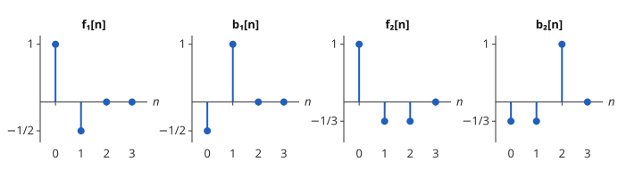

# 격자 필터

# 개요

**격자 필터(lattice filter)** 는 [Levinson–Durbin 알고리즘](levinson-durbin-algorithm.md)의 반사계수만으로 예측오차를 한 단씩 계산하는 필터 구조다. 지난 값 2 개로 다음 값을 맞히는 예측기를 지난 값 3 개로 바꾸면, 가중치를 그대로 쓰는 필터는 가중치를 모두 새로 받아야 한다. 격자 필터는 단 하나를 뒤에 덧붙이고 앞의 단은 그대로 둔다.

# 직관

Levinson–Durbin 알고리즘 문서의 직관 절에서 자기상관이 $r=(1,\frac12,\frac12)$ 이면 반사계수는 $k\_1=\frac12$, $k\_2=\frac13$ 이고, 차수 1 의 예측오차는 $x\lbrack n\rbrack-\frac12x\lbrack n-1\rbrack$, 차수 2 의 예측오차는 $x\lbrack n\rbrack-\frac13x\lbrack n-1\rbrack-\frac13x\lbrack n-2\rbrack$ 다. 차수를 올리면 $x\lbrack n-1\rbrack$ 의 가중치가 $\frac12$ 에서 $\frac13$ 으로 바뀐다.

가중치의 갱신 $a^{(2)}\_1=a^{(1)}\_1-k\_2a^{(1)}\_1$ 에서 $k\_2$ 에 곱해지는 것은 차수 1 의 가중치를 거꾸로 놓은 것이다. 그래서 차수 1 의 오차와 함께, 같은 가중치를 거꾸로 써서 $x\lbrack n-1\rbrack$ 을 $x\lbrack n\rbrack$ 으로 맞힌 오차 $x\lbrack n-1\rbrack-\frac12x\lbrack n\rbrack$ 를 계산해 둔다. 이 둘째 오차를 한 칸 늦춘 것에 $k\_2$ 를 곱해 첫째 오차에서 빼면 차수 2 의 오차가 된다.

$x$ 가 $n=0$ 에서만 $1$ 인 수열이면 첫째 오차는 $(1,-\frac12)$, 둘째 오차는 $(-\frac12,1)$ 이다. 둘째를 한 칸 늦추면 $(0,-\frac12,1)$ 이고, 다음 결과가 차수 2 의 가중치와 맞는다.

$$
\bigl(1,-\tfrac12,0\bigr)-\tfrac13\bigl(0,-\tfrac12,1\bigr)=\bigl(1,-\tfrac13,-\tfrac13\bigr)
$$

아래 그림이 이 네 수열이다.



# 정의

## 전방 오차와 후방 오차

$a^{(m)}$ 을 차수 $m$ 의 예측 가중치라 한다. 다음 두 수열을 각각 차수 $m$ 의 **전방 예측오차(forward prediction error)** 와 **후방 예측오차(backward prediction error)** 라 한다.

$$
f\_m\lbrack n\rbrack=x\lbrack n\rbrack-\sum_{j=1}^{m}a^{(m)}\_jx\lbrack n-j\rbrack,\qquad b\_m\lbrack n\rbrack=x\lbrack n-m\rbrack-\sum_{j=1}^{m}a^{(m)}\_jx\lbrack n-m+j\rbrack
$$

전방 오차는 지난 $m$ 개로 $x\lbrack n\rbrack$ 을 맞힌 오차이고, 후방 오차는 그 뒤의 $m$ 개 $x\lbrack n-m+1\rbrack,\dots,x\lbrack n\rbrack$ 으로 $x\lbrack n-m\rbrack$ 을 맞힌 오차다. 직관 절의 그림에서 $f\_1,b\_1,f\_2,b\_2$ 가 이것이다.

## 격자 필터

$f\_0\lbrack n\rbrack=b\_0\lbrack n\rbrack=x\lbrack n\rbrack$ 에서 시작해 $m=1,\dots,p$ 에 대해 다음을 계산하는 구조를 차수 $p$ 의 **격자 필터** 라 한다[^1].

$$
f\_m\lbrack n\rbrack=f\_{m-1}\lbrack n\rbrack-k\_m\thinspace b\_{m-1}\lbrack n-1\rbrack,\qquad b\_m\lbrack n\rbrack=b\_{m-1}\lbrack n-1\rbrack-k\_m\thinspace f\_{m-1}\lbrack n\rbrack
$$

$k\_m$ 이 Levinson–Durbin 알고리즘의 반사계수이면 $f\_m$, $b\_m$ 은 위의 예측오차와 같다. 각 $m$ 의 계산을 한 **단(stage)** 이라 한다.

```javascript
// k: 반사계수 k[1..p], x: 입력 수열. 반환: 마지막 단의 전방 오차 f_p
function latticeAnalysis(k, x) {
  const p = k.length - 1;
  const bPrev = new Array(p + 1).fill(0);  // b_m[n-1], m = 0..p
  const out = [];
  for (const v of x) {
    let f = v;                // f_0[n]
    const bNew = [v];         // b_0[n]
    for (let m = 1; m <= p; m++) {
      const fm = f - k[m] * bPrev[m - 1];
      const bm = bPrev[m - 1] - k[m] * f;
      f = fm;
      bNew.push(bm);
    }
    for (let m = 0; m <= p; m++) bPrev[m] = bNew[m];
    out.push(f);
  }
  return out;
}
```

# 성질

## 예측오차와의 일치

$f\_{m-1}\lbrack n\rbrack-k\_mb\_{m-1}\lbrack n-1\rbrack$ 을 전개한다. 후방 오차는 다음과 같다.

$$
b\_{m-1}\lbrack n-1\rbrack=x\lbrack n-m\rbrack-\sum_{j=1}^{m-1}a^{(m-1)}\_{m-j}\thinspace x\lbrack n-j\rbrack
$$

그러므로 $x\lbrack n-j\rbrack$ $(1\le j\le m-1)$ 의 가중치는 $a^{(m-1)}\_j-k\_ma^{(m-1)}\_{m-j}$, $x\lbrack n-m\rbrack$ 의 가중치는 $k\_m$ 이다. 이것이 Levinson–Durbin 알고리즘의 갱신식 $a^{(m)}$ 이므로 결과는 $f\_m\lbrack n\rbrack$ 이다. 후방 오차도 같은 계산이다.

## 후방 오차의 직교성

$x$ 가 광의 정상 과정이면 같은 시각의 후방 오차 $b\_0\lbrack n\rbrack,\dots,b\_p\lbrack n\rbrack$ 은 서로 무상관이다[^1]. $b\_m\lbrack n\rbrack$ 은 $x\lbrack n-m\rbrack$ 에서 $x\lbrack n-m+1\rbrack,\dots,x\lbrack n\rbrack$ 의 선형결합으로 맞힐 수 있는 부분을 뺀 나머지이므로, $l\lt m$ 인 $b\_l\lbrack n\rbrack$ (그 $m$ 개 값의 선형결합)과 무상관이다. 그래서 $x\lbrack n\rbrack,\dots,x\lbrack n-p\rbrack$ 을 $b\_0\lbrack n\rbrack,\dots,b\_p\lbrack n\rbrack$ 로 바꾸는 것은 [내적 공간](inner-product-spaces.md)의 Gram–Schmidt 과정(Gram–Schmidt process)을 시간 순서대로 한 것이다.

## 반사계수와 편상관

두 오차의 제곱 평균은 같다.

$$
\mathbb E\lbrack f\_{m-1}\lbrack n\rbrack^2\rbrack=\mathbb E\lbrack b\_{m-1}\lbrack n-1\rbrack^2\rbrack=E\_{m-1}
$$

그리고 다음이 성립한다[^1].

$$
k\_m=\frac{\mathbb E\lbrack f\_{m-1}\lbrack n\rbrack\thinspace b\_{m-1}\lbrack n-1\rbrack\rbrack}{E\_{m-1}}
$$

$k\_m$ 은 $x\lbrack n-1\rbrack,\dots,x\lbrack n-m+1\rbrack$ 의 영향을 뺀 뒤의 $x\lbrack n\rbrack$ 과 $x\lbrack n-m\rbrack$ 의 상관계수이므로 **편상관계수(partial correlation coefficient, PARCOR coefficient)** 라고도 한다. [Cauchy–Schwarz 부등식](cauchy-schwarz.md)에서 $\lvert k\_m\rvert\le 1$ 이다.

## 단의 독립성

차수를 $p$ 에서 $p+1$ 로 올리면 단 하나를 덧붙이고, 앞의 단 $p$ 개의 $k\_1,\dots,k\_p$ 는 바뀌지 않는다. 가중치 $a^{(p)}$ 를 쓰는 [FIR 필터](fir-filters.md)(finite impulse response)는 같은 일에 가중치 $p$ 개를 모두 새로 계산한다. 한 단은 표본 하나에 곱셈 두 번이다.

## 전극점 격자와 안정성

두 식을 $f\_{m-1}$ 에 대해 풀면 $f\_{m-1}\lbrack n\rbrack=f\_m\lbrack n\rbrack+k\_mb\_{m-1}\lbrack n-1\rbrack$ 이다. $f\_p$ 를 입력으로 넣어 $m=p,\dots,1$ 의 순서로 내려오면 $f\_0=x$ 가 나오고, 이 구조의 전달함수는 $1/A(z)$, $A(z)=1-\sum_ja^{(p)}\_jz^{-j}$ 다. 이 [IIR 필터](iir-filters.md)(infinite impulse response)는 모든 $m$ 에서 $\lvert k\_m\rvert\lt 1$ 일 때만 안정이다[^1]. 반사계수를 보면 안정성을 다항식의 근을 구하지 않고 판정한다.

# 활용

- 음성 합성. 선형 예측 부호화(linear predictive coding, LPC)의 받는 쪽은 받은 반사계수로 전극점 격자를 돌려 예측오차에서 음성을 다시 만든다. 반사계수가 $(-1,1)$ 안에 있도록 양자화하면 합성 필터가 안정이다.
- Burg 방법(Burg's method). 자기상관을 추정하지 않고, 단마다 전방 오차와 후방 오차의 제곱합을 가장 작게 하는 $k\_m$ 을 자료에서 바로 구한다. 결과는 늘 $\lvert k\_m\rvert\le 1$ 을 만족한다.
- 적응 격자 필터. [LMS 알고리즘](lms-algorithm.md)(least mean squares)처럼 표본마다 계수를 고치되 가중치 대신 반사계수를 단마다 따로 고친다. 후방 오차가 서로 무상관이므로 단끼리 갱신이 간섭하지 않는다.

[^1]: S. Haykin, *Adaptive Filter Theory*, 5th ed., Pearson (2014), 3장.

# 연관 문서

## 선수지식

- [Levinson–Durbin 알고리즘](levinson-durbin-algorithm.md)

## 더 알아보기

아직 연결한 문서가 없다.

#signal_processing #linear_algebra #statistics
