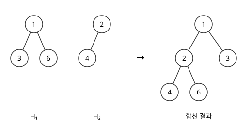

# 왼쪽 치우침 힙

# 개요

**왼쪽 치우침 힙(leftist heap)** 은 힙 조건을 만족하는 이진 트리를 왼쪽이 더 깊게 기울도록 유지해, 두 힙을 오른쪽 끝 경로만 따라 합치는 자료구조다. [이진 힙](binary-heaps.md) 두 개를 합치려면 배열을 이어 붙이고 힙을 다시 만들어야 해서 원소 수에 비례하는 시간이 든다. 왼쪽 치우침 힙은 오른쪽 끝 경로의 길이가 원소 수의 로그 이하가 되게 하므로, 그 경로 둘을 정렬된 목록처럼 맞물려 합치는 데 로그 시간이면 된다.

# 직관

두 힙 $H_1$ 과 $H_2$ 를 합친다. $H_1$ 은 뿌리 $1$ 에 왼쪽 자식 $3$, 오른쪽 자식 $6$ 이 있고, $H_2$ 는 뿌리 $2$ 에 왼쪽 자식 $4$ 만 있다. 합친 힙의 뿌리는 두 뿌리 가운데 작은 $1$ 이다. $1$ 의 왼쪽 부분 트리는 그대로 두고, 오른쪽 부분 트리 $\lbrace 6\rbrace$ 과 $H_2$ 를 같은 방법으로 합쳐 $1$ 의 새 오른쪽 부분 트리로 삼는다.

$\lbrace 6\rbrace$ 과 $H_2$ 를 합치면 뿌리는 $2$ 이고, $2$ 의 오른쪽은 비어 있으므로 $6$ 이 그 자리에 들어간다. 이 과정은 두 힙의 오른쪽 끝 경로 $1,6$ 과 $2$ 만 따라 내려간다. 두 경로를 정렬된 목록 둘을 합치듯 맞물렸으므로, 걸음 수는 두 경로의 길이의 합이다.

경로가 짧으려면 오른쪽 끝 경로가 짧아야 한다. 합친 뒤 $1$ 의 오른쪽 부분 트리 $\lbrace 2,4,6\rbrace$ 이 왼쪽 부분 트리 $\lbrace 3\rbrace$ 보다 크므로, 두 자식을 바꾸어 짧은 쪽을 오른쪽에 둔다. 아래 그림의 왼쪽 둘이 $H_1$ 과 $H_2$, 오른쪽이 자식을 바꾼 뒤의 결과다.



# 정의

## 영 경로 길이

이진 트리의 마디 $v$ 의 **영 경로 길이(null path length)** $s(v)$ 는 $v$ 에서 자식이 둘 다 있지 않은 마디까지 내려가는 가장 짧은 경로의 마디 수다. 빈 트리의 값은 $s=0$ 으로 두므로 다음이 성립한다.

$$
s(v)=1+\min\bigl(s(v.\mathrm{left}),\thinspace s(v.\mathrm{right})\bigr)
$$

예. 직관 절의 $H_1$ 에서 잎 $3$ 과 $6$ 의 값은 $1$ 이고 뿌리 $1$ 의 값은 $2$ 다. $H_2$ 의 뿌리 $2$ 는 오른쪽 자식이 없으므로 값이 $1$ 이다.

## 왼쪽 치우침 힙

**왼쪽 치우침 힙** 은 모든 마디에서 부모의 키가 자식의 키 이하라는 힙 조건과, 모든 마디 $v$ 에서 $s(v.\mathrm{left})\ge s(v.\mathrm{right})$ 라는 **왼쪽 치우침 조건(leftist property)** 을 만족하는 이진 트리다. Crane 이 1972 년에 제안했다[^1]. 이 조건에서 $s(v)$ 는 $v$ 에서 오른쪽 자식만 따라 내려간 경로의 마디 수와 같다.

예. 직관 절의 결과는 뿌리 $1$ 에서 왼쪽 자식 $2$ 의 값이 $2$, 오른쪽 자식 $3$ 의 값이 $1$ 이라 조건을 만족한다. 자식을 바꾸기 전에는 왼쪽 $3$ 의 값이 $1$, 오른쪽 $2$ 의 값이 $2$ 라 조건이 깨져 있었다.

## 합치기

```typescript
interface LeftistNode {
  key: number;
  s: number;
  left: LeftistNode | null;
  right: LeftistNode | null;
}

const rank = (v: LeftistNode | null): number => (v === null ? 0 : v.s);

function merge(a: LeftistNode | null, b: LeftistNode | null): LeftistNode | null {
  if (a === null) return b;
  if (b === null) return a;
  if (b.key < a.key) [a, b] = [b, a];
  a.right = merge(a.right, b);
  if (rank(a.left) < rank(a.right)) [a.left, a.right] = [a.right, a.left];
  a.s = rank(a.right) + 1;
  return a;
}
```

삽입은 원소 하나로 된 힙과 합치고, 최솟값 삭제는 뿌리를 떼고 두 부분 트리를 합친다.

# 성질

## 오른쪽 끝 경로의 길이

마디가 $n$ 개인 왼쪽 치우침 힙의 뿌리 $r$ 에서 다음이 성립한다.

$$
s(r)\le\log\_2(n+1)
$$

*증명의 요지.* $s(r)=t$ 라 하자. 깊이 $t-1$ 까지의 자리 가운데 하나라도 비어 있으면 거기까지의 경로가 $t$ 보다 짧아 $s(r)=t$ 에 어긋나므로, 그 모든 자리에 마디가 있다. 그러므로 $n\ge 2^t-1$ 이다.

합치기는 두 힙의 오른쪽 끝 경로를 따라 내려가므로 $O(\log n)$ 이고, 삽입과 최솟값 삭제도 $O(\log n)$ 이다. 트리 자체의 높이는 $n$ 에 가까울 수 있다. 원소를 큰 것부터 차례로 삽입하면 왼쪽으로만 이어진 한 줄이 된다.

## 기울어진 힙

**기울어진 힙(skew heap)** 은 $s$ 값을 저장하지 않고, 합치기에서 오른쪽으로 내려간 마디마다 두 자식을 무조건 바꾸는 힙이다. 한 번의 합치기는 $\Theta(n)$ 이 걸릴 수 있지만, 합치기, 삽입, 최솟값 삭제의 분할상환 비용은 $O(\log n)$ 이다[^2]. 퍼텐셜은 오른쪽 자식이 왼쪽보다 큰 마디의 수로 둔다.

# 활용

- 합칠 수 있는 우선순위 큐. 배열 대신 포인터로 된 트리라 합치기가 잦을 때 [이항 힙](binomial-heaps.md)과 같은 $O(\log n)$ 을 더 짧은 코드로 얻는다.
- 함수형 언어의 우선순위 큐. 합치기가 오른쪽 끝 경로만 새로 만들고 나머지를 공유하므로, 갱신 전의 힙을 남기는 [영속 자료구조](persistent-data-structures.md)로 쓰기 쉽다.
- 일정 관리와 그래프 알고리즘. 여러 후보 집합을 거듭 합치는 최소 신장 트리 알고리즘에서 각 부분 트리의 간선 후보를 합칠 수 있는 힙에 둔다.

[^1]: C. A. Crane, *Linear lists and priority queues as balanced binary trees*, PhD thesis, Stanford University, 1972.
[^2]: D. D. Sleator, R. E. Tarjan, "Self-adjusting heaps", SIAM Journal on Computing 15 (1986), 52–69.

# 연관 문서

## 선수지식

- [이진 힙](binary-heaps.md)

## 더 알아보기

아직 연결한 문서가 없다.

#data_structures #algorithms #computation
